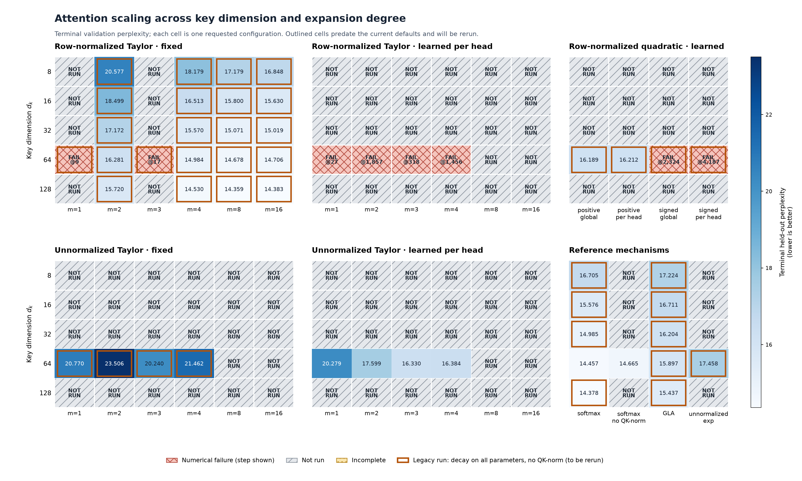

# Attention mechanisms across key width and Taylor degree

This figure puts the completed 200M-reference attention experiments on one
terminal held-out perplexity scale. Rows are per-head query/key widths
`d_K = 8, 16, 32, 64, 128`. Columns are grouped by attention mechanism,
normalization, coefficient policy, and Taylor degree. The comparison is a
derived analysis of existing runs; it trains no new models.

Each colored cell is a model evaluated after **19,074 optimizer updates** and
**10,000,269,312 prediction tokens**. All plotted runs use seed 0 and the same
packed FineWeb-Edu order and held-out evaluation set. Terminal validation loss
and perplexity come from each source run's committed `metrics.jsonl` and
`completion.json`. The [figure configuration](configs/heatmap.json) pins seven
source manifests by SHA256 and names every plotted run. The
[comparison provenance](provenance/manifest.json) records the source commits,
run-file hashes, and generated artifact hashes.

**Home cluster:** Kennel. **Artifact root:**
`/data/cl/u/rafah/home/projects/functional-memory`. This analysis has no new
checkpoint or Slurm log. The source experiments retain their own training
provenance and artifacts.

## Reading the figure

The panels use one common linear perplexity color scale; lower perplexity is
better. They distinguish five families:

| Panel | Columns | Meaning |
| --- | --- | --- |
| Row-normalized Taylor, fixed | `m = 1, 2, 3, 4, 8, 16` | Fixed coefficients `1/r!`; causal row normalization |
| Row-normalized quadratic, learned | Positive/global, positive/per-head, unrestricted/global, unrestricted/per-head | Four degree-2 coefficient variants, initialized at the Taylor quadratic |
| References | Softmax, GLA, unnormalized exponential | Different attention mechanisms; GLA has no Taylor degree |
| Unnormalized Taylor, fixed | `m = 1, 2, 3, 4, 8, 16` | Fixed coefficients with no attention row division |
| Unnormalized Taylor, learned | `m = 1, 2, 3, 4, 8, 16` | Learned per-head coefficients with no attention row division |

**FAIL** means a recorded scientific numerical failure at the annotated update;
it has no terminal perplexity. **NOT RUN** means no run was trained at that coordinate. The
figure never fills a gap with a partial validation or an estimated perplexity.
Other execution states are labeled **INCOMPLETE** if encountered when regenerating.

<!-- BEGIN GENERATED RESULTS -->
125 displayed coordinates: 41 complete, 4 numerical failures, 80 not run, and 0 incomplete. Only completed runs at the common 19,074-update endpoint receive a color and a terminal PPL. A failed run is labeled with its failure update; an untrained coordinate is marked NOT RUN.



[PDF](figures/combined_terminal_ppl.pdf) · [Cell-level data and source checksums](summary.csv) · [Provenance](provenance/manifest.json)
<!-- END GENERATED RESULTS -->

## Snapshot under the original weight-decay policy

Every run in this figure trained under the scaffold's original optimizer policy,
in which AdamW's decay applied to all parameters, including the token embedding
and RMSNorm scales. Commit `cb31558` made the policy that excludes embeddings,
normalization scales, and biases canonical for new runs. As the source records are
retrained under it, the figure and `summary.csv` above will change with them.
[`figures/combined_terminal_ppl-original-decay.png`](figures/combined_terminal_ppl-original-decay.png)
([PDF](figures/combined_terminal_ppl-original-decay.pdf)) and
[`summary-original-decay.csv`](summary-original-decay.csv) are frozen copies of the
2026-09-25 state under the original policy; regeneration does not rewrite them.

## Findings

The dense fixed normalized grid shows that increasing degree narrows the
softmax gap. At `d_K=8`, fixed `m=2` has PPL 20.5775, versus 16.8479 at
`m=16` and 16.7053 for softmax. At `d_K=128`, fixed `m=8` reaches 14.3586,
close to softmax's 14.3776. The difference of 0.0190 is a single-seed
observation, not evidence of a reliable improvement.

GLA has no degree axis. Its PPL decreases from 17.2239 at `d_K=8` to 15.4366
at `d_K=128`; it beats fixed normalized `m=2` at each width but trails softmax
at each width. GLA adds gates and head normalization, and parameter counts
change with `d_K`, so the chart compares the observed models rather than
isolating a single architectural effect.

The experiments that vary normalization or learn coefficients were run only at
`d_K=64`. The fixed normalized `m=1` and `m=3` runs failed numerically at
updates 9 and 17 when signed row sums became unstable. Their unnormalized
counterparts finished, with PPL 20.7701 and 20.2397. Learned unnormalized
Taylor coefficients improved all four fixed unnormalized endpoints; their best
result is `m=3` at 18.5316, compared with 20.2397 for fixed `m=3`.

For normalized `m=2`, the learned positive global and per-head runs finished
at 16.1890 and 16.2125, compared with 16.2810 for fixed Taylor. Both
unrestricted learned variants failed, at updates 2,324 and 4,187. Their last
partial validations are excluded from the heatmap. The unnormalized
exponential reference at `d_K=64` finishes at 17.4583; it does not divide by
an attention row sum and is a different baseline from softmax.

The source record also includes a fixed normalized `m=0` run at `d_K=64`
(PPL 47.0653) and softmax runs at `d_K=2, 4, 256`. They remain in the
[source record](../key_dimension_taylor/README.md) but lie outside this
comparison's declared width and degree range. Showing them as extra rows or a
single extreme degree-zero cell would obscure the requested joint grid.

## Limits and reproduction

This is one seed per trained coordinate. Width changes model parameter count;
GLA also changes the attention architecture. The source runs used different GPU
types and execution revisions, as their manifests record. Small PPL differences
should not be read as statistically established rankings. Sparse panels show
which runs were actually performed, not evidence that untested coordinates
would fail or match the plotted values.

From a checkout with the committed source records, sync its own locked
environment and regenerate the summary, figures, and provenance:

```bash
uv sync --project scaffolds/transformer --locked --extra cuda --link-mode hardlink
PYTHONPATH=. scaffolds/transformer/.venv/bin/python -m \
  experiments.attention_scaling_comparison.adapter.analysis.plot
```

The renderer checks each pinned source manifest and the underlying run record,
then writes the figure and [cell-level summary](summary.csv). No GPU, dataset,
or source checkpoint is required.
