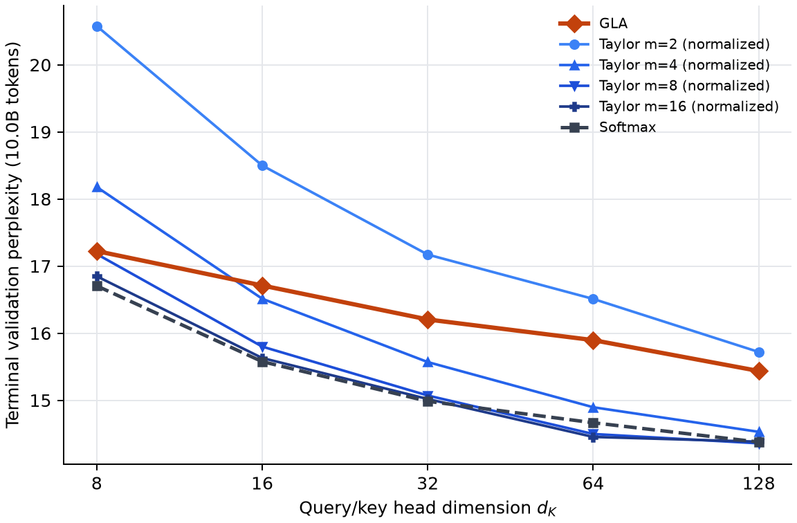

# Gated linear attention across key width

How does a gated linear attention (GLA) state-space baseline scale with key width,
compared with softmax and truncated-Taylor attention on the same 200M backbone?
This sweep trains GLA at **d_K ∈ {8, 16, 32, 64, 128}**, matching the rows of the
[dK × Taylor-degree record](../key_dimension_taylor/README.md), and measures
terminal held-out perplexity after 10.0B training tokens.

**Status:** complete. All five runs trained for 10.0B tokens on Kennel B300s and H100s.

## Scientific comparison

Each layer maintains one `dK × 64` matrix per head. For head-local vectors,
`S_t = diag(alpha_t) S_(t-1) + k_t v_t^T` and `o_t = q_t^T S_t`.
The decay is `alpha_t = exp(log_sigmoid(W2 W1 x_t + b) / 16)`, with gate
rank 16. As in OFM, Q/K use RoPE; per-head RMSNorm is applied to the readout,
which is multiplied by a learned SiLU output gate before output projection.
State starts at zero for every packed record; training does not carry it between
records. There is no softmax row normalization or additional `1/sqrt(dK)` scaling.

The GLA module and its fused kernels are adapted into this repository from OFM;
the runtime does not import the external OFM checkout. Implementation ancestry
and retained upstream notices are recorded with the shared GLA backend. The
reference recurrence and fused implementation use the same mathematics.
Chunk size 64 and inner chunk size 16 preserve the upstream implementation.
The local changes pad narrow kernel tiles to at least 16 and update the bridge's
manual-sharding detection for JAX 0.10. Original source commits, hashes, and
adaptations are retained in the shared backend's `gla_sources.json`.
OFM's mixed-precision details are also retained: RoPE promotes Q/K to FP32,
and the fused read enters head normalization in FP32; the blocked reference
casts its read to the configured computation dtype first. Production therefore
pins the fused path and does not assume bitwise BF16 parity between backends.

All runs retain the heatmap backbone: 10 layers, hidden width 1024, 16 heads,
value width 64, SwiGLU intermediate width 3008, vocabulary 32,000, untied
embeddings, RMSNorm epsilon `1e-6`, RoPE base 10,000, no dropout, and OFM/Flax
initialization. BF16 computation uses FP32 trainable parameters and optimizer
state. The shared model, data pipeline, optimizer, trainer, evaluation, and
checkpoint code live under `scaffolds/transformer/`.

This is a **200M-reference backbone comparison**, not a parameter-matched one.
Increasing dK increases both the recurrent state and trainable projections. GLA
also adds decay gates, an output gate, and head normalization compared with
softmax/Taylor attention; the comparison cannot isolate state size alone.

| dK | Trainable parameters | Recurrent state elements per layer |
| ---: | ---: | ---: |
| 8 | 192,237,824 | 8,192 |
| 16 | 194,881,024 | 16,384 |
| 32 | 200,167,424 | 32,768 |
| 64 | 210,740,224 | 65,536 |
| 128 | 231,885,824 | 131,072 |

## Data, optimization, and endpoint

Recipes in [configs/](configs/) preserve the heatmap's FineWeb-Edu `sample-100BT`
packed corpus and Llama-2 tokenizer. Each 2,049-token record supplies 2,048
next-token predictions. Seed and shuffle seed are both zero. The exact train/eval
manifest hashes are in [provenance/manifest.json](provenance/manifest.json).
The same seed fixes data order; different module shapes and added gates do not
imply identical parameter draws to the softmax and Taylor Transformer runs.

Each run uses global batch 256, global microbatch 64, four accumulation steps,
and 19,074 optimizer updates: **10,000,269,312 prediction tokens**. AdamW has
peak/minimum learning rates `3e-4`/`3e-5`, 2,000 warmup steps, cosine decay,
betas `(0.9,0.95)`, weight decay `0.1`, and global gradient clipping at `1.0`
after accumulation/device averaging. No learning-rate or gate sweep is included.

Evaluation every 1,000 updates and at completion uses the first seven fixed
held-out global batches: 1,792 records and 3,670,016 prediction tokens. The
primary endpoint is exponential mean token NLL at the common terminal training
budget. Validation-best metrics remain separate. Width-matched softmax and
row-normalized Taylor (m=2, 4, 8, 16) endpoints from the
[dK × Taylor record](../key_dimension_taylor/README.md) are pinned by checksum in
the manifest; the dK=64 softmax reference is `200m-softmax-seed0` (PPL 14.665), the
repository's softmax baseline, trained under the selective weight-decay policy.
One seed cannot establish statistical significance.

## Home cluster and artifacts

- **Home cluster:** Kennel. **Artifact root:** `/data/cl/u/rafah/home/projects/functional-memory`.
- **Data:** packed FineWeb-Edu at `/data/cl/u/rafah/home/datasets/fineweb_12b`; the train
  and eval manifests match the dK × Taylor corpus checksums exactly.
- **Hardware:** four B300s (`akita`) or four H100s (`dogo`, `mastiff`) per run, whichever
  are free in the low-priority `sweep` partition; acceptance is keyed to the allocated type.
- **Record:** recipes in [`configs/`](configs/), metrics and completion in `runs/<run>/`,
  and the authoritative [provenance manifest](provenance/manifest.json).
- **Artifacts (ignored by Git, in the artifact root):** the validation-best checkpoint per run
  under `checkpoints/<run>/<step>/` and one successful log per run under
  `logs/<run>/slurm-<job_id>.out`, both inside this experiment directory.

## Implementation and runtime

The model is the shared Transformer with `model.attention_mechanism: gla`
(`scaffolds/transformer/attention/gla.py`). Every recipe pins
`attention_backend: fused`, the chunked Triton kernels in
`attention/backends/chunked_gla_triton.py`, called through the vendored ejkernel
custom-call bridge; the blocked associative reference serves CPU tests and
diagnostics. The kernels convert Q, K, V, and the output cotangent to FP32 before
launch; they compute in FP32 regardless, and with BF16 operands upcast inside the
kernel Triton 3.6 on B300 ran the FP32 matrix products at TF32-level precision
(4e-4 relative output error in the production mixed-dtype case, against 1e-7 on
H100). With FP32 operands both GPU types match an FP64 recurrence to about 1e-7.
Two runtime settings come from the Kennel launcher and the adapter's acceptance
spec (`adapter/execution/acceptance.py`) and are recorded with acceptance, not in the
recipes:

- `CUDA_HOME` names the environment's locked CUDA 12.9 toolkit. jaxlib assembles
  the bridge's Triton PTX with the first `ptxas` among its CUDA roots, which is
  otherwise a node's `/usr/local/cuda`; `dogo`'s CUDA 12.6 cannot assemble
  Triton 3.6's PTX 8.7.
- `--xla_gpu_enable_command_buffer=` keeps the custom call outside XLA command buffers.

Acceptance runs inside each production allocation and is keyed to the source,
recipe, dependency lock, data manifests, GPU type and count, and runtime settings:
GLA CPU tests (recurrence oracle, all gradients, bridge tracing, configuration, and
recipe controls); fused-kernel GPU tests against the sequential recurrence for
every production width, extreme decays, and mixed FP32/BF16 operands; an
initialization hash; a 20-update full-recipe pilot with validation and valid
diagnostics on the fused backend; and an exact fresh-process resume at update 21
(state, next batch, and RNG hashes). Matching passed stages are reused on requeue;
training then resumes its latest checkpoint.

## Reproduction

The exact executed code is at the source commit recorded for each run
(`git show <commit>:<path>`).

A rerun with the current scaffold is a new experiment with its own worktree, branch,
and record (see [AGENTS.md](../../AGENTS.md)); never relaunch into this record's `runs/`.
Copy the recipes from `configs/` with outputs under `experiments/<new>/` and
`train.source_commit: auto`, give the new adapter an acceptance spec like
[this one's](adapter/execution/acceptance.py), then submit each run from the worktree root:

```bash
uv sync --project scaffolds/transformer --locked --extra cuda --link-mode hardlink
mkdir -p "experiments/<new>/logs/$RUN"
sbatch --job-name="$RUN" --output="experiments/<new>/logs/$RUN/slurm-%j.out" \
  scaffolds/transformer/launchers/kennel.sbatch experiments.<new>.adapter.execution.acceptance \
  "experiments/<new>/configs/$RUN.yaml" "$(git rev-parse HEAD)" 4 B300,H100
```

Regenerate `summary.csv` and the figure from `runs/`, and run the CPU checks:

```bash
PYTHONPATH=. scaffolds/transformer/.venv/bin/python -m experiments.gla_key_dimension.adapter.analysis.plot
JAX_PLATFORMS=cpu PYTHONPATH=. scaffolds/transformer/.venv/bin/python -m pytest \
  -c scaffolds/transformer/pyproject.toml --import-mode=importlib -m 'not gpu' \
  scaffolds/transformer/tests/test_gla.py scaffolds/transformer/tests/test_gla_bridge.py \
  scaffolds/transformer/tests/test_gla_integration.py experiments/gla_key_dimension/adapter/tests
```

## Findings

All five runs completed the full 19,074 updates (10.0B prediction tokens) without
numerical failures; attention diagnostics stayed valid, and every run's
validation-best checkpoint is its terminal one. Terminal held-out perplexity,
with the width-matched softmax and row-normalized Taylor runs from the
[dK × Taylor record](../key_dimension_taylor/README.md):

| d_K | Parameters | GLA | Softmax | GLA − softmax | Taylor m=2 | m=4 | m=8 | m=16 |
| ---: | ---: | ---: | ---: | ---: | ---: | ---: | ---: | ---: |
| 8 | 192.2M | **17.22** | 16.71 | +0.52 | 20.58 | 18.18 | 17.18 | 16.85 |
| 16 | 194.9M | **16.71** | 15.58 | +1.13 | 18.50 | 16.51 | 15.80 | 15.63 |
| 32 | 200.2M | **16.20** | 14.99 | +1.22 | 17.17 | 15.57 | 15.07 | 15.02 |
| 64 | 210.7M | **15.90** | 14.67 | +1.23 | 16.51 | 14.90 | 14.50 | 14.45 |
| 128 | 231.9M | **15.44** | 14.38 | +1.06 | 15.72 | 14.53 | 14.36 | 14.38 |



[PDF](figures/perplexity_vs_key_dimension.pdf) · [summary.csv](summary.csv)

The d_K=64 Taylor runs were retrained under the scaffold's current defaults (QK-norm
cosine scores and selective weight decay), which the GLA runs, the d_K=64 softmax
(selective decay, no QK-norm), and the other widths predate; comparisons with them
at d_K=64 include those changes.

- **GLA improves steadily with key width**, from 17.22 at d_K=8 to 15.44 at d_K=128
  (−1.79 overall; 0.3–0.5 per doubling). Softmax improves more over the same range
  (16.71 → 14.38, −2.33), so wider keys help the recurrent state less than they help
  exact attention.
- **GLA trails softmax at every width.** The gap is 0.52 at d_K=8 and 1.06–1.23 from
  d_K=16 to 128, even though GLA has more trainable parameters at each width (gates,
  output gate, and head normalization).
- **Against truncated Taylor attention**, GLA beats degree 2 at every width. At
  d_K=8 it beats degree 4 and matches degree 8 (17.22 vs 17.18); from d_K=16 on,
  degree 4 is better, and GLA sits between degrees 2 and 4.
- At the narrowest width the ranking compresses: GLA is within 0.52 of softmax and
  ahead of low-degree Taylor, whose approximation error is largest there.

One seed per width cannot establish statistical significance; differences of a few
hundredths (for example GLA versus Taylor m=8 at d_K=8) are within plausible seed
variation.

## Execution

Source `4af147e`; partition `sweep`; acceptance passed in every
allocation (49 CPU and 21 GPU kernel tests, initialization hash, pilot, and exact
resume). Initialization hashes agree across GPU types for the run that used both.

| Run | Slurm job | Hardware | Elapsed |
| --- | ---: | --- | ---: |
| `200m-dk008-gla-seed0` | 201792 | 4×B300 `akita` | 01:49:11 |
| `200m-dk016-gla-seed0` | 201793 | 4×H100 `dogo` (preempted) → 4×B300 `akita` | 01:14:27 + 01:15:24 |
| `200m-dk032-gla-seed0` | 201794 | 4×H100 `dogo` | 03:26:18 |
| `200m-dk064-gla-seed0` | 201795 | 4×B300 `akita` | 03:06:17 |
| `200m-dk128-gla-seed0` | 201796 | 4×B300 `akita` | 04:46:04 |

`200m-dk016-gla-seed0` was preempted on H100 at update 6,732 and resumed on B300 from
its update-6,500 checkpoint after B300 acceptance; the fused kernel agrees across the
two types to about 1e-7. Slurm truncated that job's log on requeue, so its retained log
covers the B300 attempt. The kernel is compute-inefficient (IEEE FP32 products on CUDA
cores; see [shared scaffold validation](../../scaffolds/transformer/validation/README.md)),
which affects wall time only. Per-run acceptance, attempts, checkpoints (validation-best
step 19,074, 2.1–2.6 GB each) and log checksums are in the
[provenance manifest](provenance/manifest.json).
