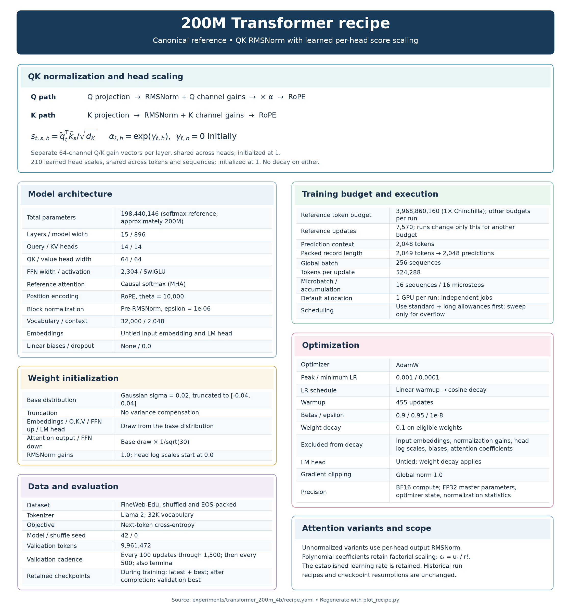

# 200M Transformer / 4B-token setup

How do attention variants perform under the 200M-parameter, approximately 4B-token
recipe? This self-contained study owns its [recipe](recipe.yaml), [run index](runs.csv),
[membership](sweep.yaml), and [results](results/README.md), including exploratory
diagnostics. Reusable model, attention, data, optimizer, and runtime code live in
the [Transformer scaffold](../../scaffolds/transformer/README.md).

## Reference recipe



The pretraining reference has 15 layers, width 896, 14 query/KV heads of width 64,
SwiGLU width 2304, context 2048, vocabulary 32,000, untied embeddings, and RoPE
theta 10,000, with no biases or dropout. Normalized softmax has 198,439,936 parameters.
Q and K use independent per-layer, 64-channel RMSNorm gains shared across heads,
before RoPE; scores retain division by sqrt(64). Normalization statistics, master
parameters, and optimizer state use FP32; computation uses BF16.

Linear and embedding weights use a Gaussian with underlying standard deviation
0.02, truncated to [-0.04, 0.04] without variance compensation. Attention output
and FFN down projections additionally scale by 1/sqrt(30). AdamW uses betas
(0.9, 0.95), epsilon 1e-8, global gradient clipping at 1, and weight decay 0.1,
excluding embeddings, normalization gains, biases, and attention coefficients.
The untied output head decays.

The reference uses shuffled, EOS-packed FineWeb-Edu data tokenized with the
Llama-2 tokenizer, seed 42, global batch 256, and 7,570 updates
(3,968,860,160 prediction tokens). Peak LR is 0.001, with 455 warmup updates and
cosine decay to 0.0001. Validation uses 9,961,472 tokens every 100 updates through
1,500, then every 500 and at the final update. Individual diagnostic recipes
specify their own fitting objective, trainable parameters, and stopping rule.

## Exploratory diagnostics

The [coefficient fitting topic](results/exploratory/coefficient_oracle/README.md)
compares the fitting capacity of free query coefficients and the trained tanh
query generator on one sequence, and coefficients shared across a full batch,
each with its pretrained backbone frozen.
Run `r3c0f21ab7dce` is the completed free-coefficient fit from the static checkpoint;
`rd7bf9bc37cb6` is the completed fit of the original query generator from the query-only checkpoint.
`r0963b3e6610b` fits one position-dependent coefficient table shared across the
parent recipe's entire 256-sequence batch. Static fits `r22854de31b96` (one
sequence) and `r5b28697413fa` (full batch) additionally share coefficients across
query positions. Their fitting metrics enter no canonical pretraining comparison.

Allocate the query-generator fit in its own worktree (once), commit the frozen
inputs, then submit one B300 or H100 job:

```bash
JAX_PLATFORMS=cpu scaffolds/transformer/.venv/bin/python -m experiments.transformer_200m_4b.launch_coefficient_fit prepare \
  --parent /data/cl/u/rafah/home/projects/functional-memory/worktrees/transformer-200m-4b/experiments/transformer_200m_4b/runs/r98d5895c02d0
# Commit the allocated recipe and implementation before submitting.
scaffolds/transformer/.venv/bin/python -m experiments.transformer_200m_4b.launch_coefficient_fit submit \
  rd7bf9bc37cb6 --partition debug,standard,long --time-limit 02:00:00
```

Allocate the shared-coefficient batch fit with the same parent in its own worktree:

```bash
JAX_PLATFORMS=cpu scaffolds/transformer/.venv/bin/python -m experiments.transformer_200m_4b.launch_coefficient_fit prepare \
  --parent /data/cl/u/rafah/home/projects/functional-memory/worktrees/transformer-200m-4b/experiments/transformer_200m_4b/runs/r98d5895c02d0 \
  --parameterization shared_batch_query_coefficients
# Commit frozen inputs before submitting; resumptions retain this run ID.
scaffolds/transformer/.venv/bin/python -m experiments.transformer_200m_4b.launch_coefficient_fit submit \
  r0963b3e6610b --partition debug,standard,long --time-limit 02:00:00
```

Allocate the independent per-sequence batch fit in its own worktree. Run
`r7505c6d49711` uses the same query-only parent and 256 fitting sequences, with
separate coefficient tables for every sequence. Its completed fit automatically
produces the CPU coefficient-shape analysis in the existing exploratory topic.

```bash
JAX_PLATFORMS=cpu scaffolds/transformer/.venv/bin/python -m experiments.transformer_200m_4b.launch_coefficient_fit prepare \
  --parent /data/cl/u/rafah/home/projects/functional-memory/worktrees/transformer-200m-4b/experiments/transformer_200m_4b/runs/r98d5895c02d0 \
  --parameterization free_per_example_query_coefficients --sequence-count 256
# Commit frozen inputs before submitting; resumptions retain this run ID.
scaffolds/transformer/.venv/bin/python -m experiments.transformer_200m_4b.launch_coefficient_fit submit \
  r7505c6d49711 --partition long --gpu-type B300 --time-limit 06:00:00
```

Allocate both static fits in one isolated worktree before committing or launching:

```bash
JAX_PLATFORMS=cpu scaffolds/transformer/.venv/bin/python -m experiments.transformer_200m_4b.launch_coefficient_fit prepare \
  --parent /data/cl/u/rafah/home/projects/functional-memory/worktrees/transformer-200m-4b/experiments/transformer_200m_4b/runs/r98d5895c02d0 \
  --parameterization static_coefficients --sequence-count 1
JAX_PLATFORMS=cpu scaffolds/transformer/.venv/bin/python -m experiments.transformer_200m_4b.launch_coefficient_fit prepare \
  --parent /data/cl/u/rafah/home/projects/functional-memory/worktrees/transformer-200m-4b/experiments/transformer_200m_4b/runs/r98d5895c02d0 \
  --parameterization static_coefficients --sequence-count 256
# Commit both recipes and implementation before either independent submission.
scaffolds/transformer/.venv/bin/python -m experiments.transformer_200m_4b.launch_coefficient_fit submit \
  r22854de31b96 --partition debug,standard,long --time-limit 02:00:00
scaffolds/transformer/.venv/bin/python -m experiments.transformer_200m_4b.launch_coefficient_fit submit \
  r5b28697413fa --partition debug,long --time-limit 02:00:00
```

The shared fitting runtime qualifies the frozen-backbone update and checkpoint
resume before production. The launcher checks frozen inputs at each start and
requeue and selects the locked CUDA environment for its GPU.

Degree-four query-generator fit `r1f2f749ff099` repeats the same single-sequence
diagnostic from its trained degree-four parent. It trains only the coefficient
generator, keeping the backbone frozen. Its settings and findings belong to the
same [coefficient fitting topic](results/exploratory/coefficient_oracle/README.md).
In its isolated worktree:

```bash
JAX_PLATFORMS=cpu scaffolds/transformer/.venv/bin/python -m experiments.transformer_200m_4b.launch_coefficient_fit prepare \
  --parent /data/cl/u/rafah/home/projects/functional-memory/worktrees/transformer_200m_4b_m4/experiments/transformer_200m_4b/runs/r49b7943aee1b
# Already allocated; use this ID for resumptions and commit frozen inputs before launch.
scaffolds/transformer/.venv/bin/python -m experiments.transformer_200m_4b.launch_coefficient_fit submit \
  r1f2f749ff099 --partition standard --time-limit 02:00:00
```

## Matched Taylor continuations

The [delayed coefficient-learning topic](results/exploratory/taylor_static_continuation/README.md)
compares 500 updates with fixed Taylor against learning static coefficients from
the same pretrained Taylor checkpoint. It preserves the backbone optimizer and
next training-data position, with a fresh Adam clock for newly introduced
coefficients. Both continuations use the shared trainer and acceptance procedure.

Allocate the pair once in its isolated worktree, then commit all frozen inputs
before either independent submission:

```bash
JAX_PLATFORMS=cpu scaffolds/transformer/.venv/bin/python -m experiments.transformer_200m_4b.launch_continuation prepare \
  --parent /data/cl/u/rafah/home/projects/functional-memory/worktrees/transformer-200m-4b/experiments/transformer_200m_4b/runs/r019ca96d6533
# The allocated IDs below identify this pair; do not allocate it again for a requeue.
scaffolds/transformer/.venv/bin/python -m experiments.transformer_200m_4b.launch_continuation submit \
  r28fb40a1d0e9 --partition standard,long --time-limit 06:00:00
scaffolds/transformer/.venv/bin/python -m experiments.transformer_200m_4b.launch_continuation submit \
  r0332cff0b0c0 --partition standard,long --time-limit 06:00:00
```

The two recorded continuations are complete; findings and the open research
decision are in the topic. Fresh reproductions receive new run IDs. The launcher
defaults to six hours, including the shared acceptance procedure's two-hour reserve.
Each job requests one B300 or H100 GPU. The launcher's frozen-source check and
shared runtime qualification run on every allocation; the scientific global batch
stays fixed through gradient accumulation. See the topic for comparison settings,
findings, and regeneration.

The [query continuation topic](results/exploratory/taylor_query_continuation/README.md)
compares degree-four query-dependent coefficients with a matched fixed-Taylor
continuation. Both train all backbone parameters for the same 500 additional
updates. The query generator starts with the study's zero-amplitude/random-projection
initialization, reproducing Taylor exactly. Prepare in its own worktree, then
commit frozen inputs before independent submission:

```bash
JAX_PLATFORMS=cpu scaffolds/transformer/.venv/bin/python -m experiments.transformer_200m_4b.launch_continuation prepare \
  --conditioning query \
  --parent /data/cl/u/rafah/home/projects/functional-memory/worktrees/transformer_200m_4b_m4/experiments/transformer_200m_4b/runs/r79da929de109
# Already allocated below; reuse these IDs for resumptions.
scaffolds/transformer/.venv/bin/python -m experiments.transformer_200m_4b.launch_continuation submit \
  rf311afb9339e --conditioning query --partition standard --time-limit 06:00:00
scaffolds/transformer/.venv/bin/python -m experiments.transformer_200m_4b.launch_continuation submit \
  r6186c797b4db --conditioning query --partition standard --time-limit 06:00:00
```

## Execution and records

Home cluster: **Kennel**. Data manifests live under
`/data/cl/u/rafah/home/datasets/fineweb_12b/`; common hashes are in `sweep.yaml`.
Retained checkpoints and logs live under this study in the primary Kennel checkout,
at the locations recorded in each run. The frozen recipe and execution record
identify the source commit, dependency lock, source checkpoint, and submitted
command. Reproducing a completed execution uses that recorded source; a fresh
execution receives a new ID and its own frozen recipe.

Develop and execute new runs in an isolated worktree with its own locked
environments. Consult [CLUSTERS.md](../../CLUSTERS.md) for allocation, storage,
and CUDA environments, and [AGENTS.md](../../AGENTS.md) for lifecycle rules.

From the repository/worktree root:

```bash
scaffolds/transformer/.venv/bin/python -m scaffolds.records index experiments/transformer_200m_4b
scaffolds/transformer/.venv/bin/python -m scaffolds.records validate experiments/transformer_200m_4b r3c0f21ab7dce
scaffolds/transformer/.venv/bin/python -m scaffolds.records refresh experiments/transformer_200m_4b/results/exploratory/coefficient_oracle
```

Refresh selection pins only after an intentional update to their scientific inputs.
