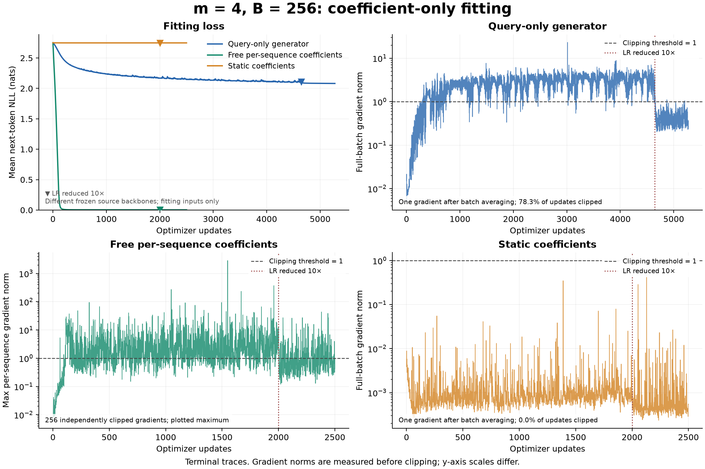
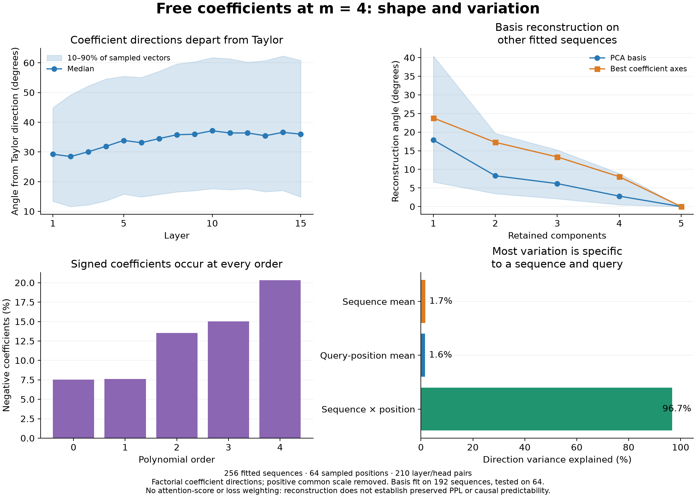
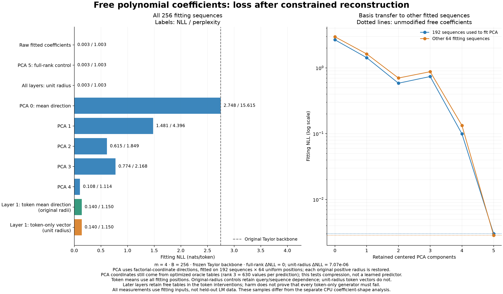
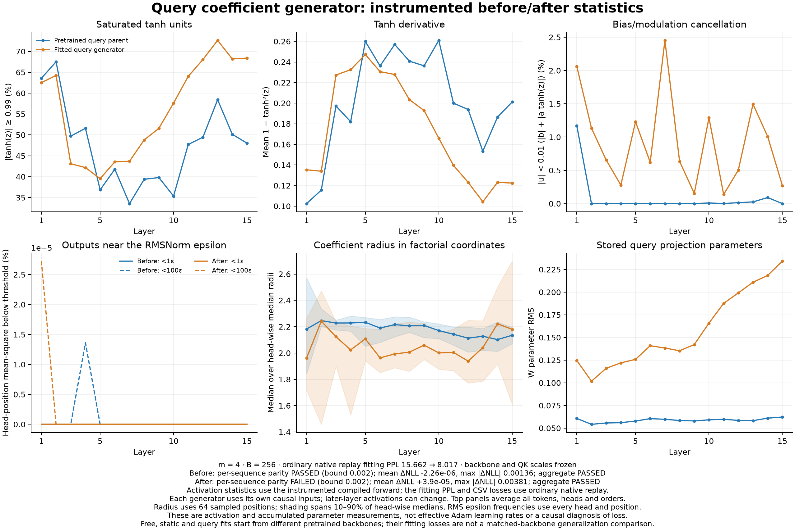

# Coefficient fitting with frozen 4B backbones

Opened: **2026-10-23**. Home cluster: **Kennel**.

How much can polynomial coefficients fit one sequence or a full batch, and how
does sharing coefficients across sequences constrain that capacity? These exploratory
fits start at the first packed evaluation sequence and keep each source checkpoint's
backbone frozen. They live in the
[200M / 4B study](../../../README.md) and enter no canonical comparison.

| Run | Trained parameters | Source checkpoint | Status |
| --- | --- | --- | --- |
| `r3c0f21ab7dce` | Free coefficients per layer, head, query, and order | Static `r9b8acfcbeb89`, step 7,500 | Complete |
| `rd7bf9bc37cb6` | Original tanh query coefficient generator | Query-only `r98d5895c02d0`, step 7,500 | Complete |
| `r1f2f749ff099` | Original degree-four tanh query coefficient generator | Query-only `r49b7943aee1b`, step 7,500 | Complete |
| `r0963b3e6610b` | One coefficient table shared across 256 sequences | Query-only `r98d5895c02d0`, step 7,500 | Running |
| `r22854de31b96` | Static coefficients on one sequence | Query-only `r98d5895c02d0`, step 7,500 | Complete |
| `r5b28697413fa` | Static coefficients on 256 sequences | Query-only `r98d5895c02d0`, step 7,500 | Complete |
| `r7505c6d49711` | Independent coefficients per sequence, layer, query, head, and order on 256 sequences | Query-only `r98d5895c02d0`, step 7,500 | Complete |
| `rc95f2055e96d` | Original degree-four query generator on 256 sequences, with per-head QK scaling | Query-only `r2b22f2ff6461`, step 7,500 | Complete |
| `rda6029c3286f` | Free degree-four coefficients per sequence and query on 256 sequences, with per-head QK scaling | Fixed Taylor `r816ab0fbe119`, step 7,500 | Complete |
| `rceea84f19f6b` | Static degree-four coefficients on 256 sequences, with per-head QK scaling | Static `r4339a245820e`, step 7,500 | Complete |

The source backbones differ. These are fitting-capacity diagnostics, not a
matched-backbone comparison of coefficient parameterizations. All reported
perplexities measure the fitting inputs, not held-out generalization.

## Degree-four batch fits with per-head QK scaling

Opened **2026-10-26**. These three fits use the new QK RMSNorm setup with learned
per-head scalar scaling. Each starts from its family's validation-best checkpoint
at step **7,500**, after 4B-token pretraining. They share the first **256** packed
evaluation sequences, each containing **2,048** next-token prediction positions;
their recipes pin the same batch and dataset-manifest SHA256. The input becomes
fitting data, with no independent generalization evaluation.

| Run | Trainable parameters | Count | Initialization |
| --- | --- | ---: | --- |
| `rc95f2055e96d` | Original query generator's stored kernel, bias, and amplitude | 942,900 | Restore query checkpoint `r2b22f2ff6461` |
| `rda6029c3286f` | Free coefficients `[sequence, layer, query, head, order]` | 550,502,400 | Fixed Taylor checkpoint `r816ab0fbe119`, exactly `1/r!` |
| `rceea84f19f6b` | Static coefficients `[layer, head, order]` | 1,050 | Restore exact effective coefficients from static checkpoint `r4339a245820e` |

The free table has shape `[256, 15, 2048, 14, 5]`; each polynomial is shared
across its query's causal keys. The static table has shape `[15, 14, 5]` and is
shared across every sequence and query position. Its initialization uses no
averaging or projection. Query fitting recomputes coefficients from the inputs
using the original trained generator. All other parameters stay frozen,
including QK channel gains, per-head QK scalars, and output RMSNorm gains.

Query fitting uses Adam on its native stored parameters at LR **0.001**; static
and free fitting use LR **0.01** in factorial coordinates `r! c_r`. All use
betas **0.9/0.95**, epsilon **1e-8**, no weight decay, and gradient clipping at
**1**. Query and static fitting average all 32 microbatches of eight before a
single clipping/Adam update. Free fitting clips and updates each sequence
independently. The shared stopping rule requires at least 2,000 updates,
reduces LR tenfold when improvement is below 0.001 nats over 200 updates, and
stops after 500 confirmation updates on a plateau, with a 10,000-update safety
budget. GPU qualification checks parent replay, finite updates with strict NLL
improvement within ten disposable Adam updates, frozen parameter hashes, and
exact checkpoint resume before training. Qualification does not advance the
production coefficients or optimizer; a transient first-step increase is allowed.

These fits compare capacity from different source backbones, rather than
isolating coefficient parameterization on a single backbone. The free-table
result provides a flexible fitting reference; it does not demonstrate that an
input-dependent generator can predict those coefficients on unseen inputs.
The open question is whether the original query generator closes the fitting
gap at degree four, and how much a static polynomial can fit from its own
trained checkpoint under the canonical QK normalization.

The frozen recipes and execution records contain the exact parent paths and
launch provenance. Allocate with
`python -m experiments.transformer_200m_4b.launch_coefficient_fit prepare`, using
`--sequence-count 256`, the chosen `--parent`, and respectively
`--parameterization query_coefficient_generator`,
`--parameterization free_per_example_query_coefficients`, or
`--parameterization static_coefficients`.

From the committed experiment worktree, launch independently with one GPU each:

```bash
python -m experiments.transformer_200m_4b.launch_coefficient_fit submit rc95f2055e96d --partition standard --time-limit 24:00:00
python -m experiments.transformer_200m_4b.launch_coefficient_fit submit rda6029c3286f --partition debug --time-limit 02:00:00
python -m experiments.transformer_200m_4b.launch_coefficient_fit submit rceea84f19f6b --partition debug --time-limit 02:00:00
```

The debug allocations checkpoint and requeue before the time limit. Runtime
environment selection follows the allocated GPU and the worktree's locked
CUDA environment.

### Fitting outcomes and optimization audit

Free and static fitting completed at update **2,500**, after reducing LR at
2,000 and completing the 500-update plateau confirmation. Query fitting completed
at **5,276**, after reducing LR at **4,648** and confirming the plateau. Every
backbone retains its original parameter checksum.

| Fit | Initial PPL | Best retained PPL | Best update | Terminal PPL |
| --- | ---: | ---: | ---: | ---: |
| Query | 15.662907 | 8.016347 | 5,273 | 8.016902 |
| Free | 15.600039 | 1.002979 | 2,453 | 1.002985 |
| Static | 15.648623 | 15.617530 | 2,394 | 15.618483 |

The implementation audit found no concrete bug in factorial-coordinate updates,
full-batch gradient averaging, clipping order, parameter freezing, or resumption.
Stored static/free coordinates are `u_r = r! c_r`; their gradients and effective
coefficient updates each divide by `r!` in the appropriate direction. The native
query generator already applies its factorial scaling inside the model. Fitting
metrics are contiguous, batch NLL equals the mean sequence NLL, and perplexity is
`exp(mean NLL)`. GPU qualification and final replay check the frozen parent and
retained coefficient checkpoint independently. These checks do not prove that
optimization finds the best solution in a parameterization.

The source pretraining runs do not show chronic clipping. Weighted compact
training windows cover all 7,570 updates exactly once:

| Parent | Updates clipped, all training | Updates clipped after 1,500 | Terminal validation PPL |
| --- | ---: | ---: | ---: |
| Query `r2b22f2ff6461` | 3.408% | 0.247% | 14.7792 |
| Static `r4339a245820e` | 3.633% | 0.198% | 14.7727 |
| Taylor `r816ab0fbe119` | 3.395% | 0.0165% | 14.7242 |

These are terminal validation values, not the fitting PPL or the validation-best
checkpoint values. Every recorded parent attention diagnostic is finite, with no
reported issues. Clipping during coefficient-only fitting must therefore be
examined separately from the original pretraining gap. A clipping multiplier is
not an effective Adam learning rate, and gradient-energy shares are not parameter
update shares.

The query fit improves every sequence in the fitting batch. During the last 200
measurements at LR 0.001, 99% of full-batch gradient norms exceed the clipping
threshold, with median norm **3.48**. During the last 200 at LR 0.0001, only **1%**
exceed it, with median **0.397**; the final 500-measurement clipping fraction is
**0.8%**. Best fitting PPL improves from **8.1713** before the reduction to **8.0163**.
The original LR produces much noisier optimization, but persistent clipping at the
final plateau does not explain the remaining large gap to the free table. Static
fitting has no clipping and improves only 0.00199 nats at its retained best.



### What the free coefficients encode

The retained free checkpoint has moderate factorial-coordinate magnitudes, with
99th percentiles around 2.0–2.4 across the five orders. The median direction differs
from Taylor by **33.93 degrees**, while each layer/head's mean direction is much
closer: median **4.93 degrees** from Taylor. This is substantial variation around
a largely Taylor-like average, rather than a single uniformly improved static
polynomial. Mixed coefficient signs occur in 41.14% of sampled vectors; coefficient
signs alone do not determine whether the polynomial is negative on observed scores.

Centered PCA of unit vectors `r!c / ||r!c||` captures a median **92.88%** of
coefficient-direction variance with three components and **97.58%** with four.
The first layer's original generator only sees its current token embedding after
normalization. Repeated occurrences of one token therefore share coefficients in
that layer, although the free oracle can distinguish them. An optimistic token
lookup leaves 80.46% of observed directional variation within repeated token IDs;
this does not establish that such variation is necessary for low loss.



### Functional reconstruction of the free coefficients

The GPU probe replays every prediction position in all 256 fitting sequences.
Raw replay reproduces the retained best NLL within **0.000000662 nats**, and the
full-rank coefficient round trip produces identical losses. These controls pass
before interpreting the reconstruction ablations. The selected measurement is
`rda6029c3286f/batch_functional_probe.json`; compact source measurements stay in
the run and are pinned by the selection.

| Reconstruction, without refitting | Fitting NLL | Fitting PPL | Fitted NLL improvement lost |
| --- | ---: | ---: | ---: |
| Original free table | 0.002974 | 1.002978 | 0% |
| Unit factorial-coordinate radius, every layer | 0.002981 | 1.002985 | 0.00026% |
| PCA: mean direction only | 2.748248 | 15.615257 | 100.04% |
| PCA: one component | 1.480650 | 4.395803 | 53.85% |
| PCA: two components | 0.614885 | 1.849444 | 22.30% |
| PCA: three components | 0.773630 | 2.167620 | 28.08% |
| PCA: four components | 0.108155 | 1.114220 | 3.83% |
| PCA: five components, round-trip control | 0.002974 | 1.002978 | 0% |
| First layer: token mean direction, original radii | 0.140181 | 1.150482 | 5.00% |
| First layer: token-only vector, unit radius | 0.139925 | 1.150187 | 4.99% |

The fraction lost is `(NLL_reconstructed - NLL_free) / (NLL_parent - NLL_free)`.
Magnitude can be removed with negligible effect on this fitted solution. A fixed
coefficient direction removes almost all its benefit. Four PCA components retain
most of the fitting gain, but three are worse than two despite explaining more
coefficient variance. Coefficient reconstruction error is therefore not a reliable
proxy for attention or loss error. Degree-four coefficients already have only four
directional degrees of freedom; PCA4 is not evidence of a large intrinsic reduction.

The first-layer token-only substitution preserves about 95% of the total NLL gain
while leaving later oracle layers unchanged. Thus first-layer occurrence-dependent
coefficients are not the dominant source of this hybrid's fitting improvement.
The remaining loss increase does not prove that an optimized token-only generator
cannot fit: the token average minimizes a coefficient-direction surrogate, and
later layers are not refitted after the substitution.

PCA bases use the first 192 fitting sequences and 64 endpoint-inclusive positions;
they are then evaluated at every position in all 256 sequences. The other 64
sequences test basis transfer, not LM generalization. PCA latents still come from
their target-fitted oracle tables: even rank three retains 630 free latent values
per prediction position across all layers and heads. Token means use all fitting
positions. The separate CPU shape analysis uses mid-bin positions and excludes
positions below 64 for its repeated-token summaries; the two samplings are not
identical. Numeric PCA bases learned from evaluation targets must not initialize
a purported clean pretraining comparison.



### Query generator and numerical sensitivity

The generator changes substantially during fitting: median coefficient-direction
change is **29.45 degrees**, with a 90th percentile of **67.66 degrees**. It is not
stuck at its source checkpoint. The following activation statistics come from an
instrumented forward; the qualification below records its numerical limits.

| Measurement | Pretrained query parent | Fitted query generator |
| --- | ---: | ---: |
| Tanh activations with absolute value at least 0.99 | 47.52% | 55.88% |
| Tanh derivatives below 0.01 | 41.50% | 51.05% |
| Mean tanh derivative | 0.20155 | 0.17397 |
| Projection-weight RMS | 0.05871 | 0.16270 |
| Stored amplitude RMS | 0.24930 | 0.68050 |
| Median factorial-coordinate radius | 2.18788 | 2.06308 |
| First-percentile factorial-coordinate radius | 1.83996 | 0.69552 |
| Severe bias/modulation cancellation | 0.0876% | 0.9283% |

Here severe cancellation means `|b + a tanh(z)| < 0.01 (|b| + |a tanh(z)|)`.
Increased saturation can suppress some projection-feature derivatives, but it
does not demonstrate globally vanishing generator gradients: amplitude growth and
small coefficient radii increase the measured projection-to-direction Jacobian
mean square from **0.717 to 9.784**. The current parameterization therefore has
uneven sensitivities, rather than simply failing to learn.

No observed head/query output has mean-square below the RMS epsilon. Only **one**
observation before fitting and **two** afterward fall below 100 times epsilon,
out of **110,100,480** observations per snapshot. The epsilon floor is not a
widespread explanation for this fitting gap.



Ordinary native replay reproduces the retained fitting-best checkpoint. The
instrumented BF16 forward's batch-average NLL differs by only **0.0000390 nats**
after fitting, but **22/256 sequences** exceed the established **0.002-nat**
per-sequence cross-compilation bound; the maximum is **0.00380683**. Before
fitting none exceed it. This bound remains recorded as **failed**, not widened.
The explicit `--record-parity-discrepancies` analysis option retains the
measurement while requiring native checkpoint replay and aggregate agreement.

On the worst microbatch (sequences 200–207), each separately compiled program
repeats exactly. The native coefficient-return API matches ordinary native NLL
and logits exactly. The instrumented statistics program differs deterministically;
its independent logits have relative RMS difference **2.23%**. Within a joint
compilation the native and hooked forwards agree exactly. These controls establish
graph-dependent numerical sensitivity, not stochastic execution corruption.

A separate sequence-zero gradient probe compares the original checkpoint with the
retained fitted checkpoint using its full causal keys. It measures the actual
Mosaic coefficient derivative against an independent FP64 formula, keeping the
recorded raw-output cotangent fixed. Median relative errors are about **2.6e-7**
in both snapshots. Excluding query position zero, pooled relative L2 error is
**2.56e-7 before** and **3.66e-7 after**. The full RMS-composed gradient error
against the smooth FP64 reference is **0.199% before** and **0.133% after**. There
is no clear coefficient-backward implementation bug in this sample. Relative errors near a mathematically vanishing gradient, especially
at the first causal position, require their absolute errors and pooled norms;
they must not be interpreted as large task-gradient errors from ratios alone.
The median nonradial condition number is about **39.7 before** and **36.7 after**
when excluding position zero: anisotropy exists, but did not broadly worsen in
this sample. Full samples, rank counts, and pooled versus per-row summaries are
retained in `precision_summary.json` and `precision_vjp_summary.csv`.

The zero-probe instrumented fitted BF16 graph differs from its native sequence
NLL by **0.00201344**, while the same checkpoint arrays under FP32 blocked
attention differ by **0.0000002384** between native and instrumented execution.
The logit relative RMS discrepancy falls from **0.01875** to **0.00000330**.
Because both arithmetic and backend change, this control supports numerical
sensitivity without attributing it to one precise compiler or kernel cause.
Derivative measurements from the discrepant BF16 capture are explicitly labeled
as belonging to that instrumented compiled execution. The canonical fitting PPL
always comes from ordinary native evaluation, not from these diagnostic variants.

### Parameterization decision

The evidence motivates improving the coefficient generator, but does not identify
a single cause of the gap or establish that a causal generator can reproduce
label-fitted free tables. A useful next controlled diagnostic would preserve all
five polynomial orders, use several nonlinear features mixed across orders, and
control their preactivation scale. The current diagonal generator gives each
order only one tanh feature; a dense readout removes that restriction, while an
inner bias removes its odd-function restriction. Dense mixing already exists in
the scaffold and is not itself a newly established optimization fix. A comparison
should use the same frozen backbone, fitting inputs, and initialization for all
variants; the present three fits have different source backbones.

A separate coordinate change suggested by the successful unit-radius control is
to predict the **four true directional degrees of freedom** of a degree-four
polynomial. Simply normalizing an unconstrained five-output vector does not remove
that vector's radial redundancy: ignoring epsilon, downstream head RMS already
makes `F(v / ||v||) = F(v)`, including its derivative with respect to `v`.

One concrete candidate uses a fixed Taylor-centered sphere chart. Let
`u0 = (1,1,1,1,1)/sqrt(5)` and choose a fixed orthonormal basis `E` perpendicular
to `u0`, independently of data. A causal generator outputs four coordinates `z`:

```text
u(z) = ((1 - ||z||^2) u0 + 2 E z) / (1 + ||z||^2)
c_r(z) = sqrt(5) u_r(z) / r!
```

At `z=0` this is exactly Taylor. It retains every coefficient direction except
the antipode, and removes the continuous coefficient-radius degree. Its tangent
Jacobian has equal singular values `2 / (1 + ||z||^2)`, but large coordinates
near the excluded antipode can themselves cause weak gradients. It does not
prevent cancellation in attention outputs or eliminate neural-network parameter
symmetries. Four directional outputs do not imply only four hidden features.
This is an open candidate, not an implemented or demonstrated improvement; the
lower-rank PCA ablations do not justify discarding another directional degree.

Regenerate compact-data analyses from the repository root:

```bash
PYTHONPATH=. scaffolds/transformer/.venv/bin/python experiments/transformer_200m_4b/results/exploratory/coefficient_oracle/audit_optimization.py
PYTHONPATH=. scaffolds/transformer/.venv/bin/python experiments/transformer_200m_4b/results/exploratory/coefficient_oracle/plot_optimization.py
PYTHONPATH=. scaffolds/transformer/.venv/bin/python experiments/transformer_200m_4b/results/exploratory/coefficient_oracle/free_coefficient_shape.py plot
PYTHONPATH=. scaffolds/transformer/.venv/bin/python experiments/transformer_200m_4b/results/exploratory/coefficient_oracle/plot_batch_functional.py
PYTHONPATH=. scaffolds/transformer/.venv/bin/python experiments/transformer_200m_4b/results/exploratory/coefficient_oracle/summarize_precision.py
```

The analyses use completed, pinned measurements. The
read-only checkpoint probe uses `inspect_batch_fit.sbatch <checkout> <source-commit>
<run-id>... --record-parity-discrepancies` on one qualified H100 or B300; its source, batch identity, and selected
checkpoint are checked before evaluation. The bounded gradient/FP32 control uses
`inspect_coefficient_vjp.sbatch <checkout> <source-commit> rc95f2055e96d
--record-parity-discrepancies` on one B300. Both commands record any failed
instrumentation bound explicitly, and native checkpoint replay remains required.
Raw regeneration requires retained home-cluster checkpoints and data, while
figures and summaries require only committed compact measurements.

## Free coefficients from the static checkpoint

The source is degree-eight learned-static run `r9b8acfcbeb89` from the 200M / 4B
setup, using its retained validation-best checkpoint at step **7,500**. The
backbone has 15 layers, width 896, 14 heads, QK RMSNorm, unnormalized polynomial
attention, and per-head RMSNorm on its output. Every pretrained parameter is
frozen. Free effective monomial coefficients have axes
`[sequence, layer, query, head, order]` and shape `[1, 15, 2048, 14, 9]`:
**3,870,720 trainable scalars**, initialized by broadcasting the checkpoint's
learned static coefficients across query positions. Each query uses the same
polynomial across its causal keys.

The input is the first packed evaluation sequence, with 2,048 next-token prediction
positions, also used in the earlier single-sequence oracle. It becomes training
data for this diagnostic; all NLL and perplexity are fitting metrics, with no
generalization claim. The frozen recipe and run record pin the parent recipe,
checkpoint, and dataset checksums. The parent checkpoint is read in place.

The existing coefficient-only runner uses Adam in factorial-scaled coordinates,
LR 0.01, betas 0.9/0.95, epsilon 1e-8, no decay, and gradient norm clipped to 1.
After at least 2,000 updates, improvement below 0.001 nats over 200 updates reduces
the LR tenfold. Fitting stops after 500 confirmation updates if the loss remains
on a plateau; the 10,000-update safety limit pauses an unconverged run. Only the
best fitting coefficients are retained after completion. GPU acceptance must
verify coefficient replay, finite improving updates, and exact checkpoint resume
before fitting starts.

### Findings

The run completed 2,500 updates on one B300 (Slurm job `224586`), with total
allocation time 2 minutes 25 seconds including GPU qualification. The learning
rate decreased at update 2,000 and 500 confirmation updates established a plateau.
All pretrained parameters retained their original checksum.

| Measurement | Update | Fitting NLL | Fitting PPL |
| --- | ---: | ---: | ---: |
| Initial | 0 | 2.591015100 | 13.34330953 |
| Best retained | 1,710 | 0.004305246 | 1.00431453 |
| Terminal | 2,500 | 0.004370327 | 1.00437989 |

Free query coefficients nearly memorize this sequence from the learned-static
checkpoint. The open decision is whether this capacity motivates a more expressive
shared coefficient generator for the 4B setup. This gain does not establish that a shared causal
coefficient generator can realize it, or explain the small held-out gap between
learned-static and fixed Taylor pretraining.

GPU qualification reproduced the original standalone forward exactly when the
captured coefficients were replayed. The separately compiled fitting forward
starts 0.00089169 nats/token lower because of BF16 compilation rounding, within
the recorded 0.002 tolerance. Both sides of the fitting improvement above use the
same compiled training forward; this offset is not counted as improvement.

## Original query coefficient generator

Run `rd7bf9bc37cb6` restores the trained degree-eight query-only checkpoint without
resetting its generator. Only `query_polynomial_bias`, `query_polynomial_amplitude`,
and `query_polynomial_kernel` are optimized: **1,697,220 parameters**. Q/K/V,
normalization gains, output projections, embeddings, MLPs, and the output head
remain fixed. Every forward recomputes intermediate activations normally; no
activation or coefficient table is substituted for the shared generator.

The model retains `c_r(x) = [b_r + a_r tanh(W_r x)] / r!`. Adam updates its native
stored parameters, with LR 0.001, betas 0.9/0.95, epsilon 1e-8, clipping at 1,
and no weight decay. The factorial is already applied by the model and is not
applied again to gradients or updates. The minimum 2,000 updates, 200-update
plateau window, 0.001-nat tolerance, tenfold LR reduction, and 500-update
confirmation match the free-coefficient diagnostic; a 10,000-update safety limit
pauses an unconverged run. The same 2,048 prediction targets are pinned by their
sequence checksum. GPU qualification checks original-forward replay, gradients
for all three generator parameter groups, a loss-reducing update, exact resume,
and an unchanged frozen backbone.

### Findings

Slurm job `224691` completed on one B300 in the `debug` partition in **3 minutes
27 seconds**, including GPU qualification. Fitting stopped at update **2,684**,
500 updates after the plateau controller reduced the learning rate at **2,184**.
The retained best generator is from update **2,656**. All backbone parameters
retained their original checksum; all three generator parameter groups had
finite, nonzero gradients in qualification.

| Measurement | Update | Fitting NLL | Fitting PPL |
| --- | ---: | ---: | ---: |
| Initial | 0 | 2.603273392 | 13.50788234 |
| Best retained | 2,656 | 0.005425740 | 1.00544049 |
| Terminal | 2,684 | 0.005504376 | 1.00551955 |

**The original trained query generator can nearly memorize this sequence with
its backbone frozen.** Its parametrization therefore has sufficient capacity
for this diagnostic. The result does not establish an advantage on unseen
sequences or explain why joint pretraining ties fixed Taylor. The earlier free
coefficients also nearly memorized the sequence, but from a different backbone;
their small difference in fitting PPL is not a controlled comparison.

The original and restored standalone forward logits matched exactly. The
separately compiled training forward differs from the capture forward by
0.00172043 nats, within the recorded BF16 tolerance of 0.002. Both the initial
and fitted losses in the table use the same training graph. Checkpoint roundtrip
and the next resumed update were exact.

## Degree-four query coefficient generator

Opened: **2026-10-24**. Run `r1f2f749ff099` repeats the single-sequence
query-generator fit at degree four, starting from the trained query-only
checkpoint `r49b7943aee1b` at step **7,500**. The question is whether this
degree-four model can memorize the same sequence that the degree-eight generator
fit above memorized. The pretrained backbones differ, so this is a comparison of
achieved fitting capacity, not an isolated degree ablation on one backbone.

Only the original query bias, amplitude, and projection parameters are trained:
**942,900 parameters**, with `c_r(x) = [b_r + a_r tanh(W_r x)] / r!`, for orders
zero through four. The trained generator is restored without resetting it.
Q/K/V projections, normalization gains, embeddings, MLPs, and the output head
remain frozen; activations are recomputed normally on every forward. This is
coefficient-only fitting, unlike the all-parameter Taylor continuation.

The first packed evaluation sequence is reused as fitting data: **2,048 prediction
targets**, with the same token checksum as `rd7bf9bc37cb6`. Adam uses LR **0.001**,
betas **0.9/0.95**, epsilon **1e-8**, clipping at **1**, and no weight decay.
The minimum **2,000** updates, **200**-update plateau window, **0.001**-nat
improvement threshold, tenfold LR reduction, and **500** confirmation updates
match the degree-eight fit. An unconverged run pauses at the **10,000**-update
safety limit. The retained checkpoint minimizes fitting NLL, with terminal
metrics reported separately.

### Findings

Slurm job **224960** completed on one B300 on `akita` in `standard` in **2 minutes
29 seconds**, including GPU qualification. The learning rate decreased at update
**2,194**, and fitting stopped at **2,694** after 500 confirmation updates on the
plateau. The retained best generator is from update **2,685**. All backbone
parameters retained their original checksum. All 2,695 loss and gradient-norm
measurements were finite; 201 measured gradient norms exceeded the clipping
threshold of 1.

| Measurement | Update | Fitting NLL | Fitting PPL |
| --- | ---: | ---: | ---: |
| Initial | 0 | 2.616209507 | 13.68375697 |
| Best retained | 2,685 | 0.006344396 | 1.00636456 |
| Terminal | 2,694 | 0.006474757 | 1.00649576 |

**The degree-four query generator can nearly memorize this sequence with its
backbone frozen.** Degree four therefore has sufficient capacity for this
single-sequence diagnostic. The degree-eight generator reached best PPL 1.00544
on the same sequence; their small difference is not a controlled degree ablation
because their pretrained backbones differ. This result does not establish
held-out generalization or explain the small gains in joint pretraining or
Taylor continuation.

GPU qualification passed source replay, finite nonzero gradients for all three
generator groups, an improving update, exact checkpoint resume, and unchanged
backbone parameters. Original and replayed standalone logits matched exactly.
The separately compiled training forward differed by 0.00069380 nats/token,
within the recorded BF16 tolerance of 0.002. Initial and fitted metrics above
use the same training graph, so this offset is not counted as fitting improvement.

### Departure from Taylor and input dependence at degree four

The retained generator at update 2,685 was inspected on its fitting sequence in
Slurm job `224965` (one B300, 58 seconds). Measurements and checkpoint identities
are in the run's [generator_dependence.json](../../../runs/r1f2f749ff099/generator_dependence.json),
pinned in this collection's selection. No parameters were updated.

Effective coefficients were captured at all 15 layers, 14 heads, and 2,048 query
positions. In coordinates `r! * c_r`, Taylor has value one at every order.

| Measurement | Pretrained query generator | Fitted generator |
| --- | ---: | ---: |
| RMS coefficient deviation from Taylor | 0.42045 | 0.72748 |
| RMS coefficient variation across query positions | 0.09728 | 0.46609 |
| RMS input-dependent amplitude | 0.22500 | 0.60315 |
| Median coefficient-direction cosine with Taylor | 0.96553 | 0.81727 |

Query variation is measured about each layer/head/order's sequence mean.
Coefficient distances depend on the chosen coordinates; positive common scales
are largely removed by head RMSNorm. The direction statistic also changes,
showing that the departure includes polynomial shape changes.

The following ablations substitute coefficients in every layer and recompute all
activations with the same frozen backbone. Each uses the same compiled forward;
replaying the captured fitted coefficients exactly matches the native fitted
forward's NLL. The difference from the saved fitting-graph NLL is 0.00000408 nats.

| Coefficients used | Sequence fitting NLL | Sequence fitting PPL |
| --- | ---: | ---: |
| Fitted query-dependent coefficients | 0.006348467 | 1.00637 |
| Fitted coefficients averaged over queries, per layer/head/order | 3.184901237 | 24.16490 |
| Fixed Taylor coefficients `1/r!` | 4.548325062 | 94.47404 |

The fitted solution makes substantial use of query variation and departs
functionally from fixed Taylor. These interventions do not retrain the static
coefficients or backbone, and the Taylor intervention does not use a separately
trained fixed-Taylor backbone. They establish dependence in this fitted solution,
not a lower bound for optimized static models or generalization to unseen inputs.

The inspection implementation is `inspect_generator.py`. To reproduce the raw
measurement on one GPU, from a checkout with the retained parent and fitted
checkpoints available, run:

```bash
PYTHONPATH=. python experiments/transformer_200m_4b/results/exploratory/coefficient_oracle/inspect_generator.py --run experiments/transformer_200m_4b/runs/r1f2f749ff099
```

Use the cluster-selected locked environment. The command refuses to overwrite an
existing measurement; a reproduction checkout should omit that output first.

## Coefficients shared across a full batch

Run `r0963b3e6610b` restores the original query-only checkpoint `r98d5895c02d0`
at step 7,500. It fits a single effective coefficient table with axes
`[layer, query_position, head, order]`, shape `[15, 2048, 14, 9]`, and
**3,870,720 trainable scalars**. This same table is broadcast across every sequence
in the batch, and each query polynomial is shared across its causal keys. It is
position dependent but does not depend on input content. All pretrained parameters
are frozen, and the original query generator is bypassed by the table.

The fitting input is the first **256 packed evaluation sequences**, with **524,288
prediction targets**, including the first sequence used above. Initial coefficients
are the arithmetic mean of the parent model's effective coefficients over these
256 sequences at each layer, query position, head, and order. That projection
changes the model's function, so original-parent NLL, projected-initial NLL, and
fitting-graph initial NLL are recorded separately. Fitting gains compare the initial
and fitted states using the same training graph.

Adam operates in factorial-scaled coordinates with LR 0.01, betas 0.9/0.95,
epsilon 1e-8, clipping at 1, and no decay. Microbatches of eight accumulate the
mean gradient over the entire batch before **one** clipping and Adam update;
there are no separate per-sequence parameters or optimizer states. Every forward
recomputes the backbone normally. The minimum 2,000 updates, 200-update plateau
window, 0.001-nat tolerance, tenfold LR reduction, 500 confirmation updates, and
10,000-update safety limit match the other free-coefficient fit.

Slurm job `224910` is running on one H100 on `dogo` in the `debug` partition.
GPU qualification passed original coefficient replay, shared-table repeatability,
an improving full-batch update, unchanged pretrained parameters, and exact checkpoint
resume. Fitting is underway; no terminal result is available yet.

This tests whether one coefficient table can reduce loss across many fitting
sequences simultaneously. It places a stronger sharing constraint than independent
per-sequence coefficients, but the batch is training data for this diagnostic;
transfer to unseen sequences is not measured.

## Static coefficients on one sequence and a full batch

Two further fits remove both query-position and input-content dependence. Each
trains one effective monomial coefficient tensor `[layer, head, order]`, shape
`[15, 14, 9]`: **1,890 trainable scalars**. Every query position and every sequence
uses the same polynomial within a layer and head. This is the static coefficient
parametrization, evaluated as a fitting diagnostic with the backbone frozen.

Both start from query-only parent `r98d5895c02d0`, checkpoint 7,500. Run
`r22854de31b96` fits the same first packed sequence; `r5b28697413fa` fits the
same first 256 packed sequences as the position-dependent batch diagnostic. For each fit, initialization is the mean
of that parent's effective coefficients across all sequences and query positions
in its fitting set. This projection changes the original forward, so original,
projected-initial, and fitting-graph initial losses are recorded separately.
All original model parameters remain frozen; the original generator is bypassed
by the static tensor, and activations are recomputed normally.

Both use Adam in factorial coordinates with LR 0.01, betas 0.9/0.95, epsilon
1e-8, clipping at 1, and no decay. Gradients average over all fitting tokens before
one clipping and optimizer update. The batch fit accumulates microbatches of eight;
the sequence fit uses one. The minimum 2,000 updates, 200-update plateau window,
0.001-nat tolerance, tenfold LR reduction, and 500 confirmation updates match the
position-dependent fit. The 10,000-update safety limit pauses an unconverged run.

The single-sequence fit completed on one H100 in `debug`, Slurm job `224916`,
in 2 minutes 50 seconds including qualification. The independent full-batch fit
completed on one H100 in `debug`, Slurm job `224917`, in 1 hour 14 minutes
18 seconds including qualification.
Both jobs passed GPU qualification, including exact checkpoint resume, before fitting.

### Single-sequence findings

The plateau controller reduced LR from 0.01 to 0.001 at update 3,430 and stopped
at update 4,112. The best retained static tensor is from update 4,041. All pretrained
parameters remained unchanged. All measurements were finite, but optimization
was uneven: 212 of 4,113 gradient evaluations exceeded the clipping threshold,
including 24 after the LR reduction.

| Measurement | Update | Fitting NLL | Fitting PPL |
| --- | ---: | ---: | ---: |
| Initial training graph | 0 | 2.611659288 | 13.62163433 |
| Best retained | 4,041 | 2.170698166 | 8.76440091 |
| Terminal | 4,112 | 2.172165871 | 8.77727391 |

Static coefficients improve fitting, but this run does not approach memorization.
The original query generator (`rd7bf9bc37cb6`) reached PPL 1.00544 from the same
parent checkpoint and sequence. The fit optimizers operate on different parameters
with different learning rates, so this comparison demonstrates the fitting achieved
by these runs; it does not prove a global optimum for static coefficients.

Qualification replayed the original coefficients exactly. The static projected
forward is repeatable, and its training graph differed by only 0.00015569 nats
from the separately compiled evaluation graph. Initialization and final fitting
metrics above use the same training graph. Checkpoint resume was exact.

### Full-batch findings

The plateau controller reduced LR from 0.01 to 0.001 at update 2,000 and stopped
at update 2,500 after 500 confirmation updates. The best retained static tensor
is from update 2,333. All 2,501 measurements and gradient norms were finite,
no gradient was clipped, and all pretrained parameters remained unchanged.

| Measurement | Update | Fitting NLL | Fitting PPL |
| --- | ---: | ---: | ---: |
| Initial training graph | 0 | 2.728801250 | 15.31451774 |
| Best retained | 2,333 | 2.720215797 | 15.18359847 |
| Terminal | 2,500 | 2.720302105 | 15.18490899 |

The static batch fit improves only slightly from its projected initialization
and plateaus far from memorization. Its final loss is close to the original
query-only checkpoint's batch NLL, 2.719785738: fitting mostly recovers the loss
introduced by averaging away the input and position dependence. The residual
difference is smaller than the recorded BF16 cross-compilation tolerance, so it
is not evidence that either original or fitted static coefficients are better.
This result describes the achieved fit under this optimizer and stopping rule,
not a proven global optimum or a held-out generalization measurement.

The batch static tensor is a restriction of the position-dependent tensor, on the
same source backbone and fitting batch. Comparing these fitting results tests the
benefit of query-position freedom. Neither fit evaluates unseen-sequence transfer,
and neither retrains the backbone as in the original static pretraining runs.

## Independent coefficients across a full batch

Opened: **2026-10-24**. Run `r7505c6d49711` fits independent degree-eight
coefficient tables on the first **256 packed evaluation sequences**, restoring
the query-only parent `r98d5895c02d0` at its retained step **7,500**. It tests
whether successful fits across sequences share a compact family of polynomial
shapes. This is the 4B counterpart of the older 10B batch oracle; both its parent
and its retained artifacts have **Kennel** as their home cluster.

All pretrained parameters stay frozen. Effective monomial coefficients have shape
`[256, 15, 2048, 14, 9]`: **990,904,320 independent fitted scalars**, shared only
across a query's causal keys. Each sequence starts with the coefficients captured
from its own original forward pass. The batch and parent checkpoint are pinned
by SHA256. These are free coefficient tables, so a shared causal generator's
ability to predict them remains a separate question.

The same batch is used by the shared-position and static batch diagnostics.
Microbatches of eight fit the independent tables with Adam in factorial
coordinates `r! c_r`, LR **0.01**, betas **0.9/0.95**, epsilon **1e-8**, no weight
decay, and gradient clipping at **1 independently for each sequence**. Each
reported update advances every sequence once. After at least 2,000 updates,
improvement below 0.001 nats over 200 updates reduces LR tenfold. Fitting stops
after 500 confirmation updates on a plateau; 10,000 is the safety budget.
Qualification checks original coefficient replay, finite improving updates,
unchanged pretrained parameters, and exact checkpoint resume on the allocated GPU.

### Findings

Slurm job **225066** completed on one **B300** on `akita` in `long` in **1 hour
5 minutes 8 seconds**, including qualification and coefficient analysis, using
the locked CUDA 13 environment. The learning rate decreased at update **2,000**;
fitting stopped at **2,500** after 500 confirmation updates on the plateau. The
retained best coefficients are from update **2,496**. All pretrained parameters
retained their original checksum. GPU qualification passed exact original-forward
replay, finite improving gradients, and exact checkpoint resume.

| Measurement | Update | Fitting NLL | Fitting PPL |
| --- | ---: | ---: | ---: |
| Initial | 0 | 2.719759941 | 15.17667851 |
| Best retained | 2,496 | 0.003100998 | 1.00310581 |
| Terminal | 2,500 | 0.003108311 | 1.00311315 |

**Independent query coefficients nearly memorize the full fitting batch with the
backbone frozen.** Each sequence has its own fitted table, so this establishes
capacity under that freedom, not transfer to unseen sequences or the ability of
a shared causal generator to predict the tables.

### Coefficient geometry

`analyze_batch_coefficients.py` analyzed the retained checkpoint on CPU after
fitting. It samples 64 uniformly spaced query positions from all 256 sequences,
multiplies coefficients by `r!`, and divides each nine-dimensional coefficient
vector by its positive L2 norm, preserving sign. This removes positive common
scale, which is largely redundant under head RMSNorm. PCA is centered separately
for each of the **210 layer/head pairs**. Compact measurements live in the run's
[batch_coefficient_geometry.json](../../../runs/r7505c6d49711/batch_coefficient_geometry.json),
with checkpoint identity, sampling settings, and analysis source provenance.

| Components | Median coefficient variance captured | Median error reduction on other fitted sequences |
| ---: | ---: | ---: |
| 1 | 44.4% | 44.0% |
| 2 | 69.1% | 69.2% |
| 3 | 82.9% | 82.9% |
| 4 | 89.8% | 89.7% |
| 5 | 94.4% | 94.4% |
| 6 | 96.9% | 96.8% |

The first column of measurements uses all fitting sequences. The last fits the
PCA basis on the first **192 sequences** and measures reconstruction on the
remaining **64**, relative to using the training-sequence mean alone. The median
layer/head requires **five components for 90%** of variance and **six for 95%**.
The similar reconstruction on the other fitted sequences indicates that the
coefficient directions share structure across these independently fitted tables.
It motivates testing a few shared polynomial basis functions with query-dependent
mixing weights, but does not establish that such a parametrization improves
training.

These are coordinate-dependent coefficient-space statistics, without weighting
by the attention scores actually encountered. They do not show that compressed
coefficients preserve attention outputs or fitting PPL. Every table was fitted
using its own sequence's targets, including the 64 sequences used to test the
basis, so the split is not a language-model generalization measurement. Whether
a causal generator can predict the fitted coefficients also remains untested.
The open decision is whether to reconstruct coefficients with fewer components
and check fitting PPL before changing the shared generator.

To recompute the CPU summary without changing the saved measurements or provenance:

```bash
JAX_PLATFORMS=cpu PYTHONPATH=. scaffolds/transformer/.venv/bin/python \
  experiments/transformer_200m_4b/results/exploratory/coefficient_oracle/analyze_batch_coefficients.py \
  --run experiments/transformer_200m_4b/runs/r7505c6d49711 --dry-run --overwrite
```

## Open decision and regeneration

Decide whether these fitting results motivate changes to the shared coefficient
generator or its training. [selection.yaml](selection.yaml) names the exact runs
and their source parents. Measurements and retained fitted parameters live only
under each run. Launch commands are in the [study README](../../../README.md).

```bash
scaffolds/transformer/.venv/bin/python -m scaffolds.records refresh experiments/transformer_200m_4b/results/exploratory/coefficient_oracle
```
