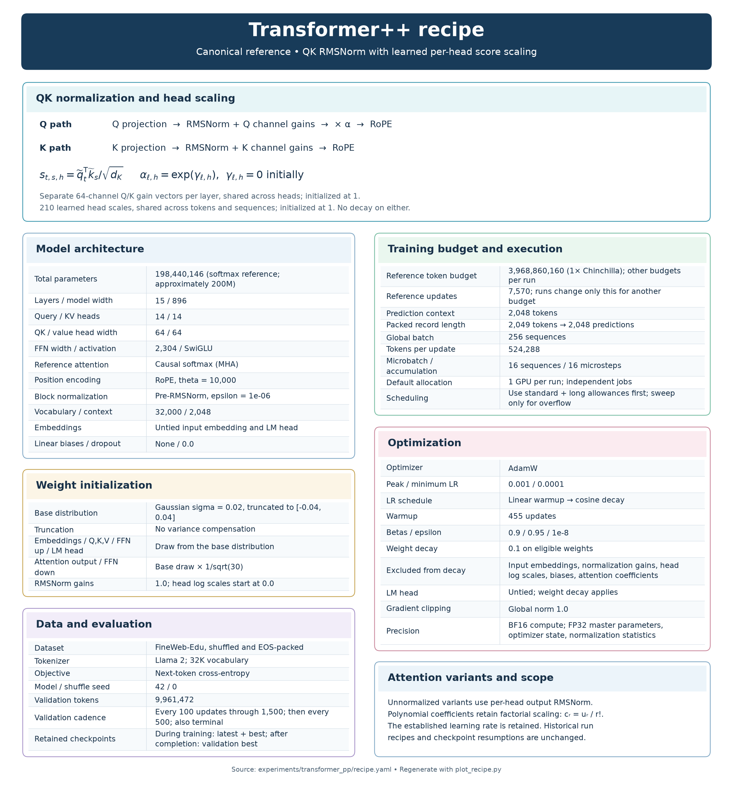

# Transformer++

How do attention variants perform under the Transformer++ recipe, and how do their
comparisons change with the training-token budget and the model shape? Both are per-run
settings: the reference is the 15-layer width-896 model at 1× Chinchilla (about 4B tokens),
and [the recipe rules](#model-shapes-and-token-budgets) derive every other run's batch and
schedule.
This self-contained study owns its [recipe](recipe.yaml), [run index](runs.csv),
[membership](sweep.yaml), and [results](results/README.md), including exploratory
diagnostics. Reusable model, attention, data, optimizer, and runtime code live in
the [Transformer scaffold](../../scaffolds/transformer/README.md).

## Reference recipe



The pretraining reference has 15 layers, width 896, 14 query/KV heads of width 64,
SwiGLU width 2304, context 2048, vocabulary 32,000, untied embeddings, and RoPE
theta 10,000, with no biases or dropout. Normalized softmax has 198,440,146 parameters.
The canonical QK setup is RMSNorm with a learned positive score scale for every
layer and head (`model.qk_norm_head_scale: true`). Q and K retain independent
per-layer, 64-channel RMSNorm gain vectors shared across heads. After normalization
and these gains, Q is multiplied by `alpha = exp(gamma)` before RoPE; K receives
no additional scalar. Scores retain division by sqrt(64), so each head's scale
multiplies the score once. The 210 head log scales start at zero, making every
initial multiplier one; the channel gains also start at one. Both are shared
across sequences and query positions and excluded from weight decay.
Normalization statistics, master parameters, and optimizer state use FP32;
computation uses BF16.

New pretraining runs use this setup. Historical run configurations and checkpoint
resumptions retain their recorded normalization; changing the canonical recipe
does not change those experiments. The architecture and optimizer below otherwise
retain the established recipe, including its previously selected learning rate.

Linear and embedding weights use a Gaussian with underlying standard deviation
0.02, truncated to [-0.04, 0.04] without variance compensation. Attention output
and FFN down projections additionally scale by 1/sqrt(2 × layers), 1/sqrt(30) at the
reference's 15 layers. AdamW uses betas
(0.9, 0.95), epsilon 1e-8, global gradient clipping at 1, and weight decay 0.1,
excluding embeddings, normalization gains, biases, and attention coefficients.
The untied output head decays.

The reference uses shuffled, EOS-packed FineWeb-Edu data tokenized with the
Llama-2 tokenizer, seed 42, and global batch 256. Its token budget is 1× Chinchilla:
7,570 updates (3,968,860,160 prediction tokens). Peak LR is 0.001, with 455 warmup
updates and cosine decay to 0.0001 over the run. Validation uses 9,961,472 tokens every 100 updates through
1,500, then every 500 and at the final update. Individual diagnostic recipes
specify their own fitting objective, trainable parameters, and stopping rule.

### Model shapes and token budgets

The study fixes the recipe's rules, not their values. Model shape and token budget are
per-run settings; [`derive_recipe.py`](derive_recipe.py) derives a run's recipe from a
partner run by these rules and changes nothing else:

| Setting | Rule |
| --- | --- |
| Heads | width / value head width (64); key/value heads equal query heads |
| SwiGLU width | 18/7 × width, rounded to a multiple of 64 |
| 1× Chinchilla | 20 prediction tokens per parameter of the normalized-softmax model (64-wide heads) at that depth and width, held for every variant at the shape |
| Batch | a shape change scales the tokens per update (524,288 at the reference) by 2^k, with k the nearest integer to log2(the shape's 1× parameters / 198,440,146), which holds the update count to within that rounding; a budget change keeps the partner's batch |
| Updates | budget × 1× tokens / tokens per update, rounded; the budget defaults to the partner's |
| Warmup | 455/7,570 of the updates (about 6.01%), rounded half up |
| Coefficient release | a partner's `optim.coefficient_release_step` and `coefficient_release_end_step` keep their fraction of the updates, rounded half up: 455 and 1,500 of 7,570 become 454 and 1,496 at the 12-layer shape, 1,138 and 3,750 at 2.5× |
| Validation | the reference's 9,961,472 validation tokens (4,864 sequences of 2,049), in whole training batches; cadence × budget |
| Learning rate | the partner's peak (0.001 unless a run sets another), floor 0.1 × peak; weight decay, betas and clipping unchanged |
| Initialization | the reference rules; a nonzero query-coefficient projection std keeps its multiple of 1/sqrt(width) |

| Shape | Layers × width | Heads | SwiGLU | 1× parameters | Batch | 1× updates | Warmup | `eval_batches` |
| --- | --- | ---: | ---: | ---: | ---: | ---: | ---: | ---: |
| Reference | 15 × 896 | 14 | 2,304 | 198,440,146 | 256 | 7,570 | 455 | 19 |
| 12-layer width 640 | 12 × 640 | 10 | 1,664 | 98,977,016 | 128 | 7,551 | 454 | 38 |

At the 12-layer shape the input and output embeddings are 41% of the parameters (29% at
the reference), so that step is 0.50× in total parameters but 0.41× without embeddings; with
half the tokens it is about 0.25× in training compute. Because validation runs in whole training batches, the rules reach shapes up to
batch 256 at context 2,048 (about 1.4× the reference's parameters); a larger shape needs
the validation batch decoupled from the training batch first. Derive and allocate a recipe
from the worktree root:

```bash
scaffolds/transformer/.venv/bin/python -m experiments.transformer_pp.derive_recipe \
  --partner <run_id> --layers 12 --width 640 --output /tmp/<label>.yaml  # add --budget 2.5 for 2.5×
scaffolds/transformer/.venv/bin/python -m scaffolds.records create \
  --study experiments/transformer_pp --config /tmp/<label>.yaml --label <label>
```

A run at another budget is the data-scaled run at its shape: it keeps the partner's batch
and recomputes `optim.total_steps` (and so the cosine horizon) from its tokens, 18,925 at
2.5× for the reference and 18,878 for the 12-layer shape; `optim.warmup_steps` and the
validation cadence (`train.eval_early_every`, `train.eval_early_until`, `train.eval_every`)
scale with it. Peak and floor learning rate, weight decay, batch, data order, seed, and
checkpoint interval stay the same.
Every pretraining run reads the same sequence stream (data order 0) from its start, so a run
that reads fewer sequences sees a prefix of a longer run's tokens; a continuation resumes the
stream at its parent's position. The 12.0B-token training set covers up to about 22,900 updates at
batch 256 (45,800 at 128) without repeating data. `runs.csv` records each run's shape,
batch, peak learning rate, and `training_steps`; compare runs at the same shape and
budget, or the same variant across shapes or budgets.

| Budget | Updates | Warmup | Validation | Prediction tokens |
| --- | ---: | ---: | --- | ---: |
| 1× Chinchilla (reference) | 7,570 | 455 | every 100 through 1,500, then every 500 | 3,968,860,160 |
| 2.5× Chinchilla | 18,925 | 1,138 | every 250 through 3,750, then every 1,250 | 9,922,150,400 |

The 2.5× runs repeat five 1× runs that use the canonical QK setup at the 2.5× budget.
All five are complete; the [token_budget topic](results/exploratory/token_budget/README.md)
compares them with their 1x partners. Each ran on one GPU:

| 2.5× run | Label | 1× partner |
| --- | --- | --- |
| `r8ccda981be2b` | `softmax-2.5x` | none with the canonical QK setup |
| `rfe12e5c36e94` | `exp-2.5x` | `r6a76e7fbde45` (`exp-head-scale`) |
| `r4f1682c1b54d` | `fixed-m4-2.5x` | `r816ab0fbe119` (`fixed-m4-head-scale`) |
| `raa81f92b6aaf` | `static-m4-2.5x` | `r4339a245820e` (`static-m4-head-scale`) |
| `reb9b5be4ff1b` | `query-m4-2.5x` | `r2b22f2ff6461` (`query-m4-head-scale`) |

They exclude the H100 PCIe node `mastiff`, whose throughput projects past 24 hours,
and the B200 node `shiba`. Each requests 24 hours on `standard,long`, except exp,
which requests 48 hours on `long` (its pilot projects about 23 hours):

```bash
sbatch --parsable --partition=standard,long --gres=gpu:1 --cpus-per-task=16 --mem=128G \
  --time=24:00:00 --exclude=mastiff,collie,samoyed,doodle,terrier,shiba --job-name=<run_id> \
  --output=experiments/transformer_pp/runs/<run_id>/training.log \
  --error=experiments/transformer_pp/runs/<run_id>/training.log \
  scaffolds/transformer/launchers/kennel.sbatch experiments.transformer_pp.acceptance \
  experiments/transformer_pp/runs/<run_id>/config.yaml "$(git rev-parse HEAD)" 1 B300,H100
```

Each record's `submission` holds its exact command and partition.

Five further 2.5× runs extend the comparison to key–query attention and to degree 8.
Home cluster: **ORCD**, with ORCD's byte-identical FineWeb manifests
(`/home/rafah/projects/ofm/datasets/fineweb_12b/`). They ran from launch commit
`8ef54e8`, one H100 each; retained checkpoints and logs are under ORCD's artifact root at
the paths recorded in each run. Degree-8 fixed Taylor, static,
and query use the Mosaic kernels; key–query uses the fused query–key kernel with the
same 32-by-32 backward tiles at degrees 4 and 8 as its 1× partners, and its GPU
acceptance runs the head-scale query–key backend tests.

| 2.5× run | Label | Source recipe | 1× partner |
| --- | --- | --- | --- |
| `r751984d1ca00` | `query_key-m4-2.5x` | `r501f5cca0d4c` (`query_key-m4-head-scale`) at the 2.5× schedule | `r501f5cca0d4c` |
| `r0ea4c732c5ac` | `fixed-m8-2.5x` | `r4f1682c1b54d` with `attention_degree: 8` | none with the canonical QK setup |
| `r6c9bcd661078` | `static-m8-2.5x` | `raa81f92b6aaf` with `attention_degree: 8` | none with the canonical QK setup |
| `r77bca86ef253` | `query-m8-2.5x` | `reb9b5be4ff1b` with `attention_degree: 8` | none with the canonical QK setup |
| `rb7e83a4b653f` | `query_key-m8-2.5x` | `r536dee0929d5` (`query_key-m8-head-scale`) at the 2.5× schedule | `r536dee0929d5` |

From the worktree root on ORCD, after committing the frozen inputs:

```bash
for run in r751984d1ca00 r0ea4c732c5ac r6c9bcd661078 r77bca86ef253 rb7e83a4b653f; do
  sbatch --parsable --job-name="$run" --output="experiments/transformer_pp/runs/$run/training.log" \
    --gres=gpu:h100:1 --exclude=node3009,node3209,node1708,node1709,node4508,node2801,node3409 \
    scaffolds/transformer/launchers/orcd.sbatch experiments.transformer_pp.acceptance \
    "experiments/transformer_pp/runs/$run/config.yaml" "$(git rev-parse HEAD)" 1 H100
done
```

Regenerate the reference image from the current recipe with:

```bash
scaffolds/transformer/.venv/bin/python experiments/transformer_pp/plot_recipe.py
```

## Model scale

The [model scale collection](results/model_scale/README.md) repeats eight attention
variants at the 12-layer width-640 shape. Each recipe is its reference-shape partner's,
derived by `derive_recipe.py --layers 12 --width 640` and allocated with
`scaffolds.records create`:

| Run | Label | Partner | Backend |
| --- | --- | --- | --- |
| `rf81c96f76a1d` | softmax-l12-d640 | `r9040f12f3d80` | cuDNN |
| `r3e2fa2532c23` | exp-l12-d640 | `r6a76e7fbde45` | fused |
| `r2c432bd3a2a4` | fixed-m4-l12-d640 | `r816ab0fbe119` | Mosaic |
| `r94e0f2b8cff9` | static-m4-l12-d640 | `r4339a245820e` | Mosaic |
| `r4cce9a985a70` | query-m4-w-decay-l12-d640 | `rca97cc9db8f2` | Mosaic |
| `r3d14b598d88f` | query-m4-forget-gate-no-rope-w-decay-l12-d640 | `r4a80e28ce0a7` | blocked |
| `ra5dfd978d3bd` | exp-forget-gate-no-rope-l12-d640 | `r183f08346ddc` | blocked |
| `r95a5691d293f` | query-m8-w-decay-l12-d640 | `r25fffc16c2f3` | Mosaic |

Home cluster: **Kennel**. All eight are complete; each record holds its launch commit.
After committing the inputs, submit each on one B300 or H100, choosing the partition
(`standard` or `long`) from the live allowance:

```bash
for run in rf81c96f76a1d r3e2fa2532c23 r2c432bd3a2a4 r94e0f2b8cff9 r4cce9a985a70 r3d14b598d88f ra5dfd978d3bd r95a5691d293f; do
  sbatch --parsable --partition=<standard|long> --gres=gpu:1 --cpus-per-task=16 --mem=128G \
    --time=24:00:00 --exclude=collie,samoyed,doodle,terrier,shiba --job-name="$run" \
    --output="experiments/transformer_pp/runs/$run/training.log" \
    --error="experiments/transformer_pp/runs/$run/training.log" \
    scaffolds/transformer/launchers/kennel.sbatch experiments.transformer_pp.acceptance \
    "experiments/transformer_pp/runs/$run/config.yaml" "$(git rev-parse HEAD)" 1 B300,H100
done
```

Each record's `submission` holds its exact submission, and its `attempts` the partition and
node of every allocation.

## Degree scaling

The [degree scaling collection](results/degree_scaling/README.md) plots 1× terminal validation
perplexity against polynomial degree `m = 1, 2, 3, 4, 5, 6, 7, 8` for four coefficient families of
unnormalized polynomial attention with per-head output RMSNorm and the canonical QK
setup: fixed Taylor (`c_r = 1/r!`), fixed Hermite (`exp(1/2) sum_r He_r(s)/r!` in
monomial form, the attention_scaling study's coefficients), learned static coefficients,
and tanh query coefficients with weight decay 0.1 on the projection W. Each new recipe
copies its family's `m = 4` run (Hermite copies fixed Taylor) and changes only the
degree and, for Hermite, the fixed coefficients. Four cells reuse completed runs. The
`m = 5` recipes copy their family's `m = 3` recipe in the same way, and the `m = 6` recipes
their family's `m = 5` recipe.

| Family | m = 1 | m = 2 | m = 3 | m = 4 | m = 5 | m = 6 | m = 7 |
| --- | --- | --- | --- | --- | --- | --- | --- |
| Fixed Taylor | `ra7f2fda1c792` | `rdb1c706a5b85` | `r81fad1755b11` | `r816ab0fbe119` (existing) | `r8a526282ac43` | `r167091e2aeac` | `re12e78d1ded3` |
| Fixed Hermite | `rddf0b0173f42` | `rdf6363a4b83c` | `rf378c0e67607` | `rbd0cd771c676` | `rf1993c745e17` | `r3a332ae60437` | `r751e8aaecb78` |
| Learned static | `r5c691128699f` | `r99c3ab7d8a77` | `r1f880c4ee659` | `r4339a245820e` (existing) | `r3feaf71ff7af` | `r5e6f23bd0533` | `r99ba8f9d26fc` |
| Query, W decay | `rf9099d70ab3a` | `rd6b4d16d81bb` (existing) | `r00f1f91a7803` | `rca97cc9db8f2` (existing) | `r5de86f9f02da` | `r688344e6dcc6` | `rdb67453630c8` |

Hermite at `m = 1` is `exp(1/2)` times Taylor at `m = 1`. The per-head output RMSNorm
removes that factor, so the two runs train the same function up to the norm's epsilon
and floating point.

Home clusters: the four new `m = 1` runs are Kennel's, from branch
`claude/degree-scaling-1x-kennel`; the other eight are ORCD's, from branch
`claude/degree-scaling-1x-orcd`. Both branches launch from the same commit. The four
`m = 5` runs are ORCD's, from branch `claude/degree-scaling-m5-orcd`, and the four `m = 6`
runs from `claude/degree-scaling-m6-orcd`, branched from `ba8494e7` so that they run the
same scaffold code as the other ORCD cells. The four `m = 7` runs, which copy their family's
`m = 6` recipe, come from `claude/degree-scaling-m7-orcd`, branched from `c3e963a6` for the
same reason. All of them launch the same way with their own run IDs. On ORCD, one H100 each, from the worktree root:

```bash
for run in rdb1c706a5b85 r81fad1755b11 rdf6363a4b83c rf378c0e67607 rbd0cd771c676 r99c3ab7d8a77 r1f880c4ee659 r00f1f91a7803; do
  sbatch --parsable --job-name="$run" --output="experiments/transformer_pp/runs/$run/training.log" \
    --gres=gpu:h100:1 --exclude=node3009,node3209,node2900,node1708,node1709,node4508,node2801,node3409 \
    scaffolds/transformer/launchers/orcd.sbatch experiments.transformer_pp.acceptance \
    "experiments/transformer_pp/runs/$run/config.yaml" "$(git rev-parse HEAD)" 1 H100
done
```

On Kennel, one GPU each on `standard,long`. Taylor and Hermite at `m = 1` request the
same GPU type (`GPU=b300` or `GPU=h100`, with `GPU_TYPE` B300 or H100):

```bash
for RUN in ra7f2fda1c792 rddf0b0173f42 r5c691128699f rf9099d70ab3a; do
  sbatch --parsable --partition=standard,long --gres=gpu:$GPU:1 --cpus-per-task=16 --mem=128G \
    --time=24:00:00 --exclude=mastiff --job-name=$RUN \
    --output=experiments/transformer_pp/runs/$RUN/training.log \
    --error=experiments/transformer_pp/runs/$RUN/training.log \
    scaffolds/transformer/launchers/kennel.sbatch experiments.transformer_pp.acceptance \
    experiments/transformer_pp/runs/$RUN/config.yaml "$(git rev-parse HEAD)" 1 $GPU_TYPE
done
```

At `m = 8`, fixed Taylor `ra7ee8a4b2544` and fixed Hermite `ra040de24096c` copy their
family's `m = 6` recipe with degree 8 (and, for Hermite, the degree-8 coefficients). They
are Kennel's, from branch `claude/degree-scaling-m8`. Two cells reuse runs with the
`m = 6` recipe at degree 8: query is the key-width run `r25fffc16c2f3`
(`query-m8-dk64-w-decay`), and static is `r9c69dd7cfc8d` (`static-m8-head-scale`, branch
`codex/static-m8-1x`). On Kennel, one H100 each, excluding `akita`:

```bash
for RUN in ra7ee8a4b2544 ra040de24096c; do
  sbatch --parsable --partition=standard,long --gres=gpu:h100:1 --cpus-per-task=16 --mem=128G \
    --time=24:00:00 --exclude=akita,collie,samoyed,doodle,terrier,shiba --job-name=$RUN \
    --output=experiments/transformer_pp/runs/$RUN/training.log \
    --error=experiments/transformer_pp/runs/$RUN/training.log \
    scaffolds/transformer/launchers/kennel.sbatch experiments.transformer_pp.acceptance \
    experiments/transformer_pp/runs/$RUN/config.yaml "$(git rev-parse HEAD)" 1 H100
done
```

## Query coefficients across key width and degree

The [query_width_degree topic](results/exploratory/query_width_degree/README.md) trains
`query-m4-w-decay`'s recipe at `d_K = 8, 16, 32, 64` and `m = 2, 4, 8`, reusing
`rca97cc9db8f2` for `d_K = 64`, `m = 4`; the `m = 12` column (`r1b1123bf96e0`, `rcdfee1e67fd4`, `r4f3aa6be7108`, `r0fceea0627c8`) uses
the same command. Each new run takes one B300 or H100 on `standard,long`:

```bash
for RUN in r7bede0f75198 r1c80ab3a466b r16b23893884d rc90fb11d4772 rb5fe0aef572a rd10c2ebe1181 r18d67098c780 rcb1f56f31981 rf5b51bd384bc rd6b4d16d81bb r25fffc16c2f3; do
  sbatch --parsable --partition=standard,long --gres=gpu:1 --cpus-per-task=16 --mem=128G \
    --time=24:00:00 --exclude=mastiff,collie,samoyed,doodle,terrier,shiba --job-name=$RUN \
    --output=experiments/transformer_pp/runs/$RUN/training.log \
    --error=experiments/transformer_pp/runs/$RUN/training.log \
    scaffolds/transformer/launchers/kennel.sbatch experiments.transformer_pp.acceptance \
    experiments/transformer_pp/runs/$RUN/config.yaml "$(git rev-parse HEAD)" 1 B300,H100
done
```

## Extrapolation ablation

The [extrapolation_ablation diagnostic](results/diagnostics/extrapolation_ablation/README.md)
rescored the query + W decay checkpoint at 16,384 tokens with a 2,048-key window and with RoPE
distances clamped at 2,047 (`rb786bd19c6b1`). One GPU, no training:

```bash
sbatch --parsable --partition=standard,long --gres=gpu:1 --cpus-per-task=8 --mem=96G --time=04:00:00 \
  --exclude=collie,samoyed,doodle,terrier,shiba --job-name=rb786bd19c6b1 \
  --output=experiments/transformer_pp/runs/rb786bd19c6b1/training.log \
  --error=experiments/transformer_pp/runs/rb786bd19c6b1/training.log \
  experiments/transformer_pp/evaluate_extrapolation_ablation.sbatch \
  "$PWD" "$(git rev-parse HEAD)" rb786bd19c6b1
```

The weight profile (`r9155f2214b4b`) uses `attention_weight_profile.sbatch` with the same
resources, and the per-position weights (`rece89382b690` for one sequence, `ra0ad3d431842`
averaged over 128 sequences, `r6122f26085ec` on 128 long documents) use
`attention_position_weights.sbatch`. On long documents, `r313eb59e1d5f` scores exp, query + W
decay and FoX with `evaluate_per_position.sbatch`, and `ra9834409e40a` reruns the ablation with
`evaluate_extrapolation_ablation.sbatch`; all use the same resources and arguments.

## Exploratory diagnostics

The [spline attention topic](results/exploratory/spline_attention/README.md) calibrates
fixed knots from the ordinary static and query models' scores at initialization
and retained checkpoints. It records forward-only diagnostics on training examples
before a proposed static/query spline comparison without FoX; its README gives
the exact one-GPU Kennel launch command.

### Even polynomial powers

The [even-powers topic](results/exploratory/even_powers/README.md) tests static
and query-conditioned coefficients using only orders 0, 2, 4, 6, and 8 at the
1× Chinchilla budget (7,570 updates). Both families compare with full degrees
four and eight. The full degree-eight static control `r9c69dd7cfc8d` is complete;
it matches the even-only static recipe `r45831d718944` with
`attention_coefficient_orders: null`, learning all nine coefficients from scratch.
These runs are hosted on Kennel. The topic records the explicit controls and
findings.

Launch the full static control from `worktrees/static-m8-1x`, branch
`codex/static-m8-1x`, after committing its recipe and syncing both locked CUDA
environments. It uses one H100 GPU with the same global batch of 256,
2,048-token context, seed 42, and `transformer_truncated_reference` initialization:

```bash
sbatch --parsable --partition=standard --gres=gpu:h100:1 --cpus-per-task=16 --mem=128G \
  --time=24:00:00 --exclude=akita,collie,samoyed,doodle,terrier,shiba \
  --job-name=r9c69dd7cfc8d \
  --output=experiments/transformer_pp/runs/r9c69dd7cfc8d/training.log \
  --error=experiments/transformer_pp/runs/r9c69dd7cfc8d/training.log \
  scaffolds/transformer/launchers/kennel.sbatch experiments.transformer_pp.acceptance \
  experiments/transformer_pp/runs/r9c69dd7cfc8d/config.yaml af919f3f4af1a3e647d267cf098d385bbb952941 1 H100
```

The intercept-and-odd query run `r0bdac8e1b97b` (orders 0, 1, 3, 5 and 7, query + weight
decay at degree seven) is hosted on ORCD and trained on one H200. It ends at 16.054
terminal PPL, 9.8% above the even-only query run; the topic reports the comparison.
It launched from `worktrees/odd_powers`, branch `claude/odd-powers-orcd`, after
committing its recipe:

```bash
RUN=r0bdac8e1b97b
sbatch --parsable --job-name="$RUN" --output="experiments/transformer_pp/runs/$RUN/training.log" \
  --gres=gpu:h200:1 \
  scaffolds/transformer/launchers/orcd.sbatch experiments.transformer_pp.acceptance \
  "experiments/transformer_pp/runs/$RUN/config.yaml" "$(git rev-parse HEAD)" 1 H200
```

Once a run has started training, its `config.json` records the source commit, so a
resubmission passes that original launch commit (`0c9eed33` here) rather than `HEAD`.

### Per-order coefficient gates

The [order-gates topic](results/exploratory/order_gates/README.md) asks whether
multiplicative gates on individual polynomial orders improve query-conditioned attention
without a distance-dependent forget gate. Two runs add independent per-order sigmoid gates
(`model.attention_coefficient_gate: sigmoid`) to the query + weight decay, RoPE recipe of
`r25fffc16c2f3`: `r77698776d82c` at degree 8 and `r8c4a6ecdf4d2` at degree 10, both
hosted on ORCD (H200). Both end 7–8% worse than the ungated control; the topic records
the formulas, the control, the per-order gate findings and the exact launch commands.

`r1a5d217f030d` (`query-m4-w-decay-order-gdn-gates`, planned) copies the degree-four
query + weight decay, RoPE recipe of `rca97cc9db8f2` with only
`model.attention_coefficient_gate: gdn`: each layer, head and order multiplies its
coefficient by `alpha_r(x_t) = exp(-exp(A_log_r) softplus(w_r^T x_t + dt_bias_r))`, the
per-order query-distance gate of `r507193d47450` without its distance exponent. Every order
starts as a copy of one Gated DeltaNet draw per layer and head, so the per-head output
RMSNorm cancels the shared start up to its epsilon. The topic records the model, the
initialization, and the 2×2 with the distance-gate runs.

Home cluster: Kennel. Branch `claude/per-order-no-distance`, worktree
`worktrees/per-order-no-distance`; sync both locked CUDA environments as in
[CLUSTERS.md](../../CLUSTERS.md). The adapter
([coefficient_gdn_gate_acceptance.py](coefficient_gdn_gate_acceptance.py)) pins
`rca97cc9db8f2`'s recipe by SHA256 and rejects any scientific difference except the gate.
At initialization it requires every other parameter to equal the control's start (state
hash), each gate array to be one draw repeated over the orders, and the initial logits to
match the ungated recipe's within the RMSNorm epsilon bound (and to FP32 rounding with the
epsilon removed). It then runs the gate's CPU tests, its GPU qualification at degree 4
(the gated generator through Mosaic against FP64 at 2,048 tokens, and the gated BF16 Mosaic
model against the FP32 blocked model), and the shared pilot and fresh-process resume. The
control trained in about five hours on one H100. After committing the frozen inputs and
checking the live allowances, submit from the worktree root:

```bash
run=r1a5d217f030d
sbatch --parsable --partition=standard --gres=gpu:1 --cpus-per-task=16 --mem=128G \
  --time=24:00:00 --exclude=collie,samoyed,doodle,terrier,shiba --job-name="$run" \
  --output="experiments/transformer_pp/runs/$run/training.log" \
  --error="experiments/transformer_pp/runs/$run/training.log" \
  scaffolds/transformer/launchers/kennel.sbatch experiments.transformer_pp.coefficient_gdn_gate_acceptance \
  "experiments/transformer_pp/runs/$run/config.yaml" "$(git rev-parse HEAD)" 1 B300,H100
```

The record captures the submission command and job ID. Resumptions keep the run ID,
recipe, launch commit and checkpoint.

### Query coefficient optimization

Two degree-four query/tanh runs test weight decay on the projection and a higher
learning rate on the coefficient offsets and amplitudes, separately. Both copy
`query-m4-head-scale` (`r2b22f2ff6461`) at the 1x Chinchilla budget and keep
factorial scaling on the entire coefficient. Their methods, explicit control,
and findings belong to the [query optimization topic](results/exploratory/query_optimization/README.md).
Their home cluster is Kennel; each uses one GPU with no dependency on the other.
Both runs are complete.

| Run | Label | Change from the control |
| --- | --- | --- |
| `rca97cc9db8f2` | `query-m4-w-decay` | Weight decay 0.1 on query projection W only |
| `rb74fa2ebede6` | `query-m4-ab-lr-3x` | 3x learning rate on a,b only; W retains its base LR and no decay |

From their isolated worktree, with both recipes and the implementation committed,
submit each independently after checking the live standard/long allowances:

```bash
for run in rca97cc9db8f2 rb74fa2ebede6; do
  sbatch --parsable --partition=standard --gres=gpu:1 --cpus-per-task=16 --mem=128G \
    --time=24:00:00 --exclude=collie,samoyed,doodle,terrier,shiba --job-name="$run" \
    --output="experiments/transformer_pp/runs/$run/training.log" \
    --error="experiments/transformer_pp/runs/$run/training.log" \
    scaffolds/transformer/launchers/kennel.sbatch experiments.transformer_pp.acceptance \
    "experiments/transformer_pp/runs/$run/config.yaml" "$(git rev-parse HEAD)" 1 B300,H100
done
```

Each record captures its submission command and job ID. Resumptions keep the same
run ID, recipe, launch commit, and checkpoint; do not submit a duplicate live job.

### Projection decay at 2.5×

Four 2.5× runs repeat the completed query and key–query runs at degrees 4 and 8 with
weight decay 0.1 on the coefficient projections W
(`model.attention_coefficient_kernel_weight_decay: true`; for key–query, both the query
W and the key W_k). Each recipe is otherwise its control's; the query m = 4 recipe takes
ORCD's FineWeb manifests. The question, controls, and findings belong to the
[query optimization topic](results/exploratory/query_optimization/README.md#projection-decay-at-25).
Home cluster: **ORCD**. All four are complete: they ran from launch commit `7662886`,
one H100 each, and their retained checkpoints and logs are under ORCD's artifact root
at the paths recorded in each run. Key–query keeps its controls' fused query–key kernel
(`records create --allow-triton-attention`).

| Run | Label | Recipe |
| --- | --- | --- |
| `r77b617af91db` | `query-m4-w-decay-2.5x` | `reb9b5be4ff1b` with ORCD data paths |
| `ra15cbb16beb7` | `query-m8-w-decay-2.5x` | `r77bca86ef253` |
| `rb6313357059e` | `query_key-m4-w-decay-2.5x` | `r751984d1ca00` |
| `r5bd803b3e562` | `query_key-m8-w-decay-2.5x` | `rb7e83a4b653f` |

From the worktree root on ORCD, after committing the frozen inputs:

```bash
for run in r77b617af91db rb6313357059e ra15cbb16beb7 r5bd803b3e562; do
  sbatch --parsable --job-name="$run" --output="experiments/transformer_200m_4b/runs/$run/training.log" \
    --gres=gpu:h100:1 --exclude=node3009,node3209,node2900,node1708,node1709,node4508,node2801,node3409 \
    scaffolds/transformer/launchers/orcd.sbatch experiments.transformer_200m_4b.acceptance \
    "experiments/transformer_200m_4b/runs/$run/config.yaml" "$(git rev-parse HEAD)" 1 H100
done
```

### Coefficient fitting

The [coefficient fitting topic](results/exploratory/coefficient_oracle/README.md)
compares the fitting capacity of free query coefficients and the trained tanh
query generator on one sequence, and coefficients shared across a full batch,
each with its pretrained backbone frozen.
Run `r3c0f21ab7dce` is the completed free-coefficient fit from the static checkpoint;
`rd7bf9bc37cb6` is the completed fit of the original query generator from the query-only checkpoint.
`r0963b3e6610b` fits one position-dependent coefficient table shared across the
parent recipe's entire 256-sequence batch. Static fits `r22854de31b96` (one
sequence) and `r5b28697413fa` (full batch) additionally share coefficients across
query positions. Their fitting metrics enter no canonical pretraining comparison.

Allocate the query-generator fit in its own worktree (once), commit the frozen
inputs, then submit one B300 or H100 job:

```bash
JAX_PLATFORMS=cpu scaffolds/transformer/.venv/bin/python -m experiments.transformer_pp.launch_coefficient_fit prepare \
  --parent /data/cl/u/rafah/home/projects/functional-memory/worktrees/transformer-200m-4b/experiments/transformer_pp/runs/r98d5895c02d0
# Commit the allocated recipe and implementation before submitting.
scaffolds/transformer/.venv/bin/python -m experiments.transformer_pp.launch_coefficient_fit submit \
  rd7bf9bc37cb6 --partition debug,standard,long --time-limit 02:00:00
```

Allocate the shared-coefficient batch fit with the same parent in its own worktree:

```bash
JAX_PLATFORMS=cpu scaffolds/transformer/.venv/bin/python -m experiments.transformer_pp.launch_coefficient_fit prepare \
  --parent /data/cl/u/rafah/home/projects/functional-memory/worktrees/transformer-200m-4b/experiments/transformer_pp/runs/r98d5895c02d0 \
  --parameterization shared_batch_query_coefficients
# Commit frozen inputs before submitting; resumptions retain this run ID.
scaffolds/transformer/.venv/bin/python -m experiments.transformer_pp.launch_coefficient_fit submit \
  r0963b3e6610b --partition debug,standard,long --time-limit 02:00:00
```

Allocate the independent per-sequence batch fit in its own worktree. Run
`r7505c6d49711` uses the same query-only parent and 256 fitting sequences, with
separate coefficient tables for every sequence. Its completed fit automatically
produces the CPU coefficient-shape analysis in the existing exploratory topic.

```bash
JAX_PLATFORMS=cpu scaffolds/transformer/.venv/bin/python -m experiments.transformer_pp.launch_coefficient_fit prepare \
  --parent /data/cl/u/rafah/home/projects/functional-memory/worktrees/transformer-200m-4b/experiments/transformer_pp/runs/r98d5895c02d0 \
  --parameterization free_per_example_query_coefficients --sequence-count 256
# Commit frozen inputs before submitting; resumptions retain this run ID.
scaffolds/transformer/.venv/bin/python -m experiments.transformer_pp.launch_coefficient_fit submit \
  r7505c6d49711 --partition long --gpu-type B300 --time-limit 06:00:00
```

Allocate both static fits in one isolated worktree before committing or launching:

```bash
JAX_PLATFORMS=cpu scaffolds/transformer/.venv/bin/python -m experiments.transformer_pp.launch_coefficient_fit prepare \
  --parent /data/cl/u/rafah/home/projects/functional-memory/worktrees/transformer-200m-4b/experiments/transformer_pp/runs/r98d5895c02d0 \
  --parameterization static_coefficients --sequence-count 1
JAX_PLATFORMS=cpu scaffolds/transformer/.venv/bin/python -m experiments.transformer_pp.launch_coefficient_fit prepare \
  --parent /data/cl/u/rafah/home/projects/functional-memory/worktrees/transformer-200m-4b/experiments/transformer_pp/runs/r98d5895c02d0 \
  --parameterization static_coefficients --sequence-count 256
# Commit both recipes and implementation before either independent submission.
scaffolds/transformer/.venv/bin/python -m experiments.transformer_pp.launch_coefficient_fit submit \
  r22854de31b96 --partition debug,standard,long --time-limit 02:00:00
scaffolds/transformer/.venv/bin/python -m experiments.transformer_pp.launch_coefficient_fit submit \
  r5b28697413fa --partition debug,long --time-limit 02:00:00
```

The shared fitting runtime qualifies the frozen-backbone update and checkpoint
resume before production. The launcher checks frozen inputs at each start and
requeue and selects the locked CUDA environment for its GPU.

Degree-four query-generator fit `r1f2f749ff099` repeats the same single-sequence
diagnostic from its trained degree-four parent. It trains only the coefficient
generator, keeping the backbone frozen. Its settings and findings belong to the
same [coefficient fitting topic](results/exploratory/coefficient_oracle/README.md).
In its isolated worktree:

```bash
JAX_PLATFORMS=cpu scaffolds/transformer/.venv/bin/python -m experiments.transformer_pp.launch_coefficient_fit prepare \
  --parent /data/cl/u/rafah/home/projects/functional-memory/worktrees/transformer_200m_4b_m4/experiments/transformer_pp/runs/r49b7943aee1b
# Already allocated; use this ID for resumptions and commit frozen inputs before launch.
scaffolds/transformer/.venv/bin/python -m experiments.transformer_pp.launch_coefficient_fit submit \
  r1f2f749ff099 --partition standard --time-limit 02:00:00
```

## Matched Taylor continuations

Continuations start from a pretrained checkpoint and train a fixed number of further
updates with the shared trainer and acceptance procedure. They preserve the backbone
optimizer and the next training-data position, with a fresh Adam clock for newly
introduced coefficients. The launcher defaults to six hours, including the shared
acceptance procedure's two-hour reserve. Each job requests one B300 or H100 GPU; the
launcher's frozen-source check and shared runtime qualification run on every allocation,
and the scientific global batch stays fixed through gradient accumulation.

The [learned-coefficient topic](results/exploratory/learned_coefficient_continuation/README.md)
introduces degree-four static or query coefficients (the latter with a decayed projection
`W`) after 7,500 updates of fixed-Taylor or unnormalized-exp pretraining, 2,000 updates each
with the canonical QK norm. The Taylor-parent branches reuse the fixed-Taylor control
`r82203a85ef8e`; the exp-parent branches switch to the degree-four Mosaic kernel and have no
control of their own. Prepare in one worktree, then commit frozen inputs before submission:

```bash
PREPARE="scaffolds/transformer/.venv/bin/python -m experiments.transformer_pp.launch_continuation prepare --topic learned_coefficient_continuation"
TAYLOR=/data/cl/u/rafah/home/projects/functional-memory/experiments/transformer_pp/runs/r816ab0fbe119
EXP=/data/cl/u/rafah/home/projects/functional-memory/experiments/transformer_pp/runs/r6a76e7fbde45
JAX_PLATFORMS=cpu $PREPARE --conditioning static --parent $TAYLOR --control r82203a85ef8e
JAX_PLATFORMS=cpu $PREPARE --conditioning query --kernel-weight-decay --parent $TAYLOR --control r82203a85ef8e
JAX_PLATFORMS=cpu $PREPARE --conditioning static --parent $EXP --control none --degree 4
JAX_PLATFORMS=cpu $PREPARE --conditioning query --kernel-weight-decay --parent $EXP --control none --degree 4
JAX_PLATFORMS=cpu $PREPARE --conditioning static --parent $EXP --control-only --degree 4
# Already allocated below; reuse these IDs for resumptions.
for RUN in r2e081e09c19a rae91f24b06b4 r7e6a68545d4f r673e14eab803 rddcbe6dfb1eb; do
  scaffolds/transformer/.venv/bin/python -m experiments.transformer_pp.launch_continuation submit \
    $RUN --topic learned_coefficient_continuation --partition standard,long --time-limit 10:00:00
done
```

The [per-token query scale topic](results/exploratory/token_query_scale_continuation/README.md)
compares a bounded per-token score scale on Q, `exp(gamma_h + a_h cos(w_h, x_t))`, with a
matched fixed-Taylor continuation of the canonical head-scaled parent. Both train all
backbone parameters for 2,000 additional updates; the gate starts closed (`a_h = 0`) and
its parameters use their own constant learning rate of 0.001. The query-temperature
run `re563830cf150` applies weight decay 0.1 to its direction `w` and leaves the
amplitude exempt; `r82203a85ef8e` is the fixed-Taylor control. Reproduction commands
are in [CPT with projection weight decay](#cpt-with-projection-weight-decay).

The [forget-gate continuation topic](results/exploratory/forget_gate_continuation/README.md)
is a positive control for the protocol: it adds the pretraining winner's attention (tanh
query coefficients at zero amplitude plus Gated DeltaNet's forget gate at its standard
open initialization, on the blocked backend) to the same parent, reusing the completed
fixed-Taylor control above. Prepare with `--control`, then commit frozen inputs before
submission; the blocked backend trains at about 6 s per update on a B300 and slower on an
H100, so the allocation is a day:

```bash
JAX_PLATFORMS=cpu scaffolds/transformer/.venv/bin/python -m experiments.transformer_pp.launch_continuation prepare \
  --conditioning forget_gate --control r82203a85ef8e \
  --parent /data/cl/u/rafah/home/projects/functional-memory/experiments/transformer_pp/runs/r816ab0fbe119
# Already allocated below; reuse this ID for resumptions.
scaffolds/transformer/.venv/bin/python -m experiments.transformer_pp.launch_continuation submit \
  rd5ea49c1fde6 --conditioning forget_gate --partition long --time-limit 48:00:00
```

On an H100 PCIe the blocked backend trains this recipe at 16.7 s per update (about 10 h
for the budget), and the pilot's slowest-step projection reached 31 h, beyond `standard`'s
24 h limit; the `long` allocation only clears that projection.

### Continuing pretrained static and query models

The [learned-coefficient CPT comparison](results/exploratory/learned_coefficient_continuation/README.md#continuation-of-the-pretrained-learned-models)
also continues static and query + W decay models from their own step-7,500
checkpoints for 2,000 updates. All existing parameters and Adam history are retained,
at a constant learning rate of 0.0001. Their coefficients have already been trained,
so the separate 0.001 rate for newly introduced coefficients does not apply.
Home cluster: Kennel. Prepare both in an isolated worktree and commit before launching:

```bash
PARENTS=/data/cl/u/rafah/home/projects/functional-memory/experiments/transformer_pp/runs
JAX_PLATFORMS=cpu scaffolds/transformer/.venv/bin/python -m experiments.transformer_pp.launch_continuation prepare \
  --parent "$PARENTS/r4339a245820e" --conditioning static --preserve-all-parameters --topic learned_coefficient_continuation
JAX_PLATFORMS=cpu scaffolds/transformer/.venv/bin/python -m experiments.transformer_pp.launch_continuation prepare \
  --parent "$PARENTS/rca97cc9db8f2" --conditioning query --preserve-all-parameters --topic learned_coefficient_continuation
# Existing executions; do not allocate replacements for resumptions.
scaffolds/transformer/.venv/bin/python -m experiments.transformer_pp.launch_continuation submit \
  r1522cd56901a --topic learned_coefficient_continuation --partition standard --time-limit 10:00:00
scaffolds/transformer/.venv/bin/python -m experiments.transformer_pp.launch_continuation submit \
  rdfc42659424f --topic learned_coefficient_continuation --partition long --time-limit 10:00:00
```

Partitions follow the live standard/long allowances; these independent jobs each
request one H100 or B300 and complete full acceptance before production training.

### CPT with projection weight decay

Two additional continuations reuse Taylor parent `r816ab0fbe119` at update 7,500 and
fixed-Taylor control `r82203a85ef8e`. Both train all parameters for 2,000 more updates
with the same data order and constant learning rates: 0.0001 for the backbone and
0.001 for introduced parameters. FoX **without RoPE**, `r554ce7da6a8a`, applies decay
0.1 to the coefficient projection `W` and forget-gate projection `w_alpha`; their
amplitudes and biases remain exempt. Query-temperature **with RoPE**, `re563830cf150`,
applies decay 0.1 to its direction `w` only, leaving its amplitude exempt. Definitions,
controls, and findings belong to the [forget-gate topic](results/exploratory/forget_gate_continuation/README.md)
and [query-temperature topic](results/exploratory/token_query_scale_continuation/README.md).

Prepare fresh reproductions in an isolated worktree; the commands below allocate new IDs:

```bash
PARENT=/data/cl/u/rafah/home/projects/functional-memory/experiments/transformer_pp/runs/r816ab0fbe119
JAX_PLATFORMS=cpu scaffolds/transformer/.venv/bin/python -m experiments.transformer_pp.launch_continuation prepare \
  --parent "$PARENT" --conditioning forget_gate --control r82203a85ef8e --no-rope --kernel-weight-decay
JAX_PLATFORMS=cpu scaffolds/transformer/.venv/bin/python -m experiments.transformer_pp.launch_continuation prepare \
  --parent "$PARENT" --conditioning token_scale --control r82203a85ef8e --token-scale-kernel-weight-decay
```

The two recorded runs are complete. For a fresh reproduction, substitute the new
allocated IDs below after committing frozen inputs. Submit independently; these limits
include GPU acceptance. Check live allowances before reproducing:

```bash
scaffolds/transformer/.venv/bin/python -m experiments.transformer_pp.launch_continuation submit \
  r554ce7da6a8a --conditioning forget_gate --partition standard --time-limit 24:00:00
scaffolds/transformer/.venv/bin/python -m experiments.transformer_pp.launch_continuation submit \
  re563830cf150 --conditioning token_scale --partition standard --time-limit 10:00:00
```

Each allocation qualifies the actual configuration, parameter decay policy, checkpoint
restoration, finite training pilot, and fresh-process resume before production begins.

## Teacher-activation coefficient distillation

The open [coefficient-oracle topic](results/exploratory/coefficient_oracle/README.md#dense-distillation-from-the-free-teacher)
documents the scientific protocol and its two batches: the fitting batch, and one
fresh batch that scores the selected generator once. `rec777591a61b` distills the degree-four B256 free teacher into the
existing dense generator with a frozen Taylor backbone. Home cluster: **Kennel**.
Its source checkpoints remain in the primary checkout; all new outputs belong
to the run in its isolated worktree until completion.

From the experiment worktree, after syncing both locked CUDA environments:

```bash
# Already allocated as rec777591a61b; prepare is only for a fresh execution.
JAX_PLATFORMS=cpu scaffolds/transformer/.venv/bin/python -m experiments.transformer_pp.launch_coefficient_distillation prepare \
  --teacher /data/cl/u/rafah/home/projects/functional-memory/experiments/transformer_pp/runs/rda6029c3286f
# Commit the frozen execution set before submission.
JAX_PLATFORMS=cpu scaffolds/transformer/.venv/bin/python -m experiments.transformer_pp.launch_coefficient_distillation submit rec777591a61b
```

The launcher uses one available H100 or B300 on `standard`, with no scheduling
dependency, and runs full-size qualification before fitting. `--gpu-type h100`
or `--gpu-type b300` pins a GPU type if required. Requeues restore the latest
generator, Adam state, fixed data identities, and the lowest-regression-error
candidate. Completed runs retain that selected generator and refer to the unchanged
parent checkpoint for their frozen backbone.

## Query–key polynomial pretraining

Three full-budget pretraining runs use unnormalized learned polynomial attention
whose order-r coefficient depends on both the query and the key,
`c_r(x_t) [1 + a_key_r tanh(W_key_r x_i)]` with `c_r(x_t) = [b_r + a_r tanh(W_r x_t)] / r!`.
Offsets start at one and amplitudes at zero, so each run starts at fixed Taylor;
coefficient projections start from N(0, 1/896). Learned parameters are independent
per layer and head, the attention output uses per-head RMSNorm, and QK normalization
is the canonical setup with the learned per-head score scale. The degree-four fixed,
static, and query runs with the same QK setup are `r816ab0fbe119`, `r4339a245820e`,
and `r2b22f2ff6461`.

| Degree | Run |
| --- | --- |
| 4 | `r501f5cca0d4c` |
| 8 | `r536dee0929d5` |
| 12 | `r2459b843ca81` |

Home cluster: **ORCD**, with ORCD's byte-identical FineWeb manifests. Each ran on one
H100 80GB HBM3 with the fused query–key kernel (allocated with
`--allow-triton-attention`; 32-by-32 backward tiles at degrees 4, 8, and 12) at source
commit `bf99d0e` (branch `claude/transformer-200m-4b-query-key-head-scale-orcd`).
GPU acceptance ran the fused query–key head-scale backend tests at degrees 4, 8, and
12. Retained checkpoints and logs are under ORCD's artifact root,
`/orcd/pool/006/rafah/functional_memory/artifacts/`, at the paths recorded in each
run. The node exclusions skip the throttled `node3009` and `node3209`, the H100 NVL
nodes `node1708`, `node1709`, and `node4508`, `node2801` (failed CUDA
initialization), and `node3409` (half the expected update rate). From a worktree at
the source commit, each run was submitted as below; the runtime override gives
acceptance a 96-hour qualification horizon.

```bash
for run in r501f5cca0d4c r536dee0929d5 r2459b843ca81; do
  TRANSFORMER_ALLOCATION_SECONDS=345600 sbatch --parsable --job-name="$run" \
    --output="experiments/transformer_pp/runs/$run/training.log" \
    --gres=gpu:h100:1 --exclude=node3009,node3209,node1708,node1709,node4508,node2801,node3409 \
    scaffolds/transformer/launchers/orcd.sbatch experiments.transformer_pp.acceptance \
    "experiments/transformer_pp/runs/$run/config.yaml" "$(git rev-parse HEAD)" 1 H100
done
```

## Coefficient forms and forget gate

Three degree-four runs copy `query-m4-head-scale` (`r2b22f2ff6461`) and change one part
of its query attention; see the [coefficient forms](results/exploratory/coefficient_forms/README.md)
and [forget gate](results/exploratory/forget_gate/README.md) topics.

| Run | Label | Change |
| --- | --- | --- |
| `r1d578d107115` | pure-tanh-m4 | `attention_coefficient_activation: pure_tanh`, unscaled, no `b` or `a` |
| `r917f3650296e` | affine-sigmoid-m4 | `attention_coefficient_activation: affine_sigmoid` |
| `r111843b4c7cc` | query-m4-forget-gate | `attention_forget_gate: true` on `attention_backend: blocked` |

Pure tanh and affine sigmoid launch from `worktrees/coefficient-forms-4b`, and the forget
gate from `worktrees/forget-gate-4b` (branch `claude/forget-gate-4b`), whose diagnostics
summarize the gate's per-head statistics. After committing the inputs, submit each run on
one B300 or H100, excluding the B200 node `shiba` (and, for the slower blocked forget gate,
the H100 PCIe node `mastiff`):

```bash
sbatch --parsable --partition=<standard|long> --gres=gpu:1 --cpus-per-task=16 --mem=128G \
  --time=24:00:00 --exclude=collie,samoyed,doodle,terrier,shiba --job-name=<run_id> \
  --output=experiments/transformer_pp/runs/<run_id>/training.log \
  --error=experiments/transformer_pp/runs/<run_id>/training.log \
  scaffolds/transformer/launchers/kennel.sbatch experiments.transformer_pp.acceptance \
  experiments/transformer_pp/runs/<run_id>/config.yaml "$(git rev-parse HEAD)" 1 B300,H100
```

Each record's `submission` holds its exact command and partition.

The degree-eight gate without RoPE, `r9353f554b917` (`query-m8-forget-gate-no-rope-wdecay`),
copies `query-m8-dk64-w-decay` (`r25fffc16c2f3`) and changes only
`attention_forget_gate: true`, `positional_encoding: none`, and
`attention_backend: blocked`. Its home cluster is ORCD (branch
`claude/forget-gate-m8-orcd`); from the worktree root, on one H100:

```bash
run=r9353f554b917
sbatch --parsable --job-name="$run" --output="experiments/transformer_pp/runs/$run/training.log" \
  --gres=gpu:h100:1 --exclude=node3009,node3209,node2900,node1708,node1709,node4508,node2801,node3409 \
  scaffolds/transformer/launchers/orcd.sbatch experiments.transformer_pp.acceptance \
  "experiments/transformer_pp/runs/$run/config.yaml" "$(git rev-parse HEAD)" 1 H100
```

## Forget gate on softmax and exp

Four runs add the forget gate of `query-m4-forget-gate-no-rope` (`attention_forget_gate: true`:
the Forgetting Transformer decay with Gated DeltaNet's gate) to `softmax-head-scale`
(`r9040f12f3d80`) and `exp-head-scale` (`r6a76e7fbde45`), without RoPE. Each weight's score
gains `L_t - L_i`: `softmax(s + D)` or `exp(s + D)`, the latter with per-head output
RMSNorm as in its source. Two use no positional encoding; two use PaTH (PaTH-FoX). See the
[forget gate topic](results/exploratory/forget_gate/README.md).

| Run | Label | Source | Positions | Backend |
| --- | --- | --- | --- | --- |
| `r5adc29a91e3b` | softmax-forget-gate-no-rope | `r9040f12f3d80` | none | blocked |
| `r183f08346ddc` | exp-forget-gate-no-rope | `r6a76e7fbde45` | none | blocked |
| `r14db6f0e8592` | softmax-path-forget-gate | `r9040f12f3d80` | PaTH | fused (FLA's gated kernels) |
| `rafcf22b799ed` | exp-path-forget-gate | `r6a76e7fbde45` | PaTH | fused (FLA's gated kernels) |

Home cluster: **Kennel**. All four are complete; each record holds its launch commit.
After committing the inputs, submit each on one B300 or H100 SXM, excluding the H100 PCIe
node `mastiff` and the B200 node `shiba`, with the PaTH runs at `nice` 1,000 so that
polynomial-attention runs schedule first, and the partition (`standard` or `long`) chosen
from the live allowance:

```bash
for run in r5adc29a91e3b r183f08346ddc r14db6f0e8592 rafcf22b799ed; do
  case $run in r14db6f0e8592|rafcf22b799ed) nice=1000 ;; *) nice=0 ;; esac
  sbatch --parsable --partition=<standard|long> --nice=$nice --gres=gpu:1 --cpus-per-task=16 --mem=128G \
    --time=24:00:00 --exclude=mastiff,collie,samoyed,doodle,terrier,shiba --job-name="$run" \
    --output="experiments/transformer_pp/runs/$run/training.log" \
    --error="experiments/transformer_pp/runs/$run/training.log" \
    scaffolds/transformer/launchers/kennel.sbatch experiments.transformer_pp.acceptance \
    "experiments/transformer_pp/runs/$run/config.yaml" "$(git rev-parse HEAD)" 1 B300,H100
done
```

Each record's `submission` holds its exact (re)submission, and its `attempts` the partition
and node of every allocation.

## Original FoX sigmoid gate

Three runs replace the Gated DeltaNet gate of the no-RoPE forget-gate runs with the
Forgetting Transformer's own gate (`attention_forget_gate_form: sigmoid`):
`log alpha_t = log sigmoid(x_t w_f + b_f)` per layer and head, with the paper's
initialization `w_f ~ N(0, 0.02^2)` and `b_f = 0`; `w_f` takes weight decay and `b_f` does
not. Everything else is copied from the source. The softmax run also drops QK
normalization (`qk_norm: false`, plain scores), matching FoX (LLaMA); exp and query keep
the canonical QK RMSNorm with a learned head scale and per-head output RMSNorm. See the
[forget gate topic](results/exploratory/forget_gate/README.md).

| Run | Label | Source | Changes from the source | Backend |
| --- | --- | --- | --- | --- |
| `reeb92d46a95d` | softmax-sigmoid-forget-gate-no-rope-plain-qk | `r5adc29a91e3b` | sigmoid gate, plain scores | blocked |
| `rdd3e9cb3bb80` | exp-sigmoid-forget-gate-no-rope | `r183f08346ddc` | sigmoid gate | blocked |
| `rfa9636279199` | query-m4-sigmoid-forget-gate-no-rope-w-decay | `r4a80e28ce0a7` | sigmoid gate | blocked |

Home cluster: **Kennel**. Each record holds its launch commit, its exact `submission`, and
the partition and node of every allocation. Submit each on one B300 or H100; the blocked
softmax run's H100 pilot projects beyond a 24-hour allocation, so it runs on `long` with a
48-hour limit:

```bash
for run in reeb92d46a95d rdd3e9cb3bb80 rfa9636279199; do
  case $run in reeb92d46a95d) partition=long time=48:00:00 ;; *) partition=standard time=24:00:00 ;; esac
  sbatch --parsable --partition=$partition --gres=gpu:1 --cpus-per-task=16 --mem=128G \
    --time=$time --exclude=collie,samoyed,doodle,terrier,shiba --job-name="$run" \
    --output="experiments/transformer_pp/runs/$run/training.log" \
    --error="experiments/transformer_pp/runs/$run/training.log" \
    scaffolds/transformer/launchers/kennel.sbatch experiments.transformer_pp.acceptance \
    "experiments/transformer_pp/runs/$run/config.yaml" "$(git rev-parse HEAD)" 1 B300,H100
done
```

## Context length

The [context-length topic](results/exploratory/context_length/README.md) compares
held-out per-position loss at and beyond the checkpoints' training length.
`r2a45c518f703` evaluates the validation-best 2,048-token exp, query + W decay,
and FoX no RoPE + W decay checkpoints at 16,384 tokens on Kennel. It makes no
optimizer updates and preserves the source models' parameters and attention backends.
The recipe pins the source checkpoints and the held-out manifests. The long pass
scores 608 sequences (9,961,472 predictions), following the original validation replay
and a causal-prefix consistency check.

Prepare the evaluation data outside the repository, then launch from a committed,
isolated worktree with both locked CUDA environments installed:

```bash
scaffolds/transformer/.venv/bin/python -m scaffolds.transformer.data.repack \
  /data/cl/u/rafah/home/datasets/fineweb_12b/eval/manifest.json \
  /data/cl/u/rafah/home/datasets/fineweb_12b_seq16385/eval --sequence-length 16385
sbatch --parsable --partition=standard --gres=gpu:1 --cpus-per-task=8 --mem=64G \
  --time=04:00:00 --exclude=collie,samoyed,doodle,terrier,shiba \
  --job-name=r2a45c518f703 \
  --output=experiments/transformer_pp/runs/r2a45c518f703/training.log \
  --error=experiments/transformer_pp/runs/r2a45c518f703/training.log \
  experiments/transformer_pp/evaluate_per_position.sbatch "$PWD" "$(git rev-parse HEAD)" r2a45c518f703
```

Repacking refuses to overwrite an existing manifest; reuse the existing data only
when its manifest and shard checksums match the frozen recipe. A new scientific
execution gets a fresh run ID. The exact submission is recorded with the run.

### Training at 4,096 tokens

A 4,096-token run copies its 2,048-token reference recipe and changes only the context:
`model.max_seq_len` 4,096, `data.sequence_length` 4,097, `data.batch_size` 128 and global
microbatch 8, reading `/data/cl/u/rafah/home/datasets/fineweb_12b_seq4097` (the same token
stream re-cut into 4,097-token rows; its README gives the construction). Tokens per update
(524,288), the update count, warmup, learning rates, validation cadence and validation tokens
(19 × 128 sequences, 9,961,472 tokens) stay the same, so a 1× run is still 7,570 updates.
`runs.csv` records each run's `context_length`.

| 4,096-token run | Label | 2,048-token partner |
| --- | --- | --- |
| `r636f433be44f` | `softmax-head-scale-4k` | `r9040f12f3d80` |
| `r2047d29a0d9f` | `exp-head-scale-4k` | `r6a76e7fbde45` |
| `r339a31ad8d4b` | `fixed-m4-head-scale-4k` | `r816ab0fbe119` |
| `r738b35a8e314` | `query-m4-wdecay-4k` | `rca97cc9db8f2` |
| `r58efc973ff28` | `query-m4-forget-gate-no-rope-wdecay-4k` | `r4a80e28ce0a7` |

The forget-gate partner's recipe sets `attention_coefficient_key_kernel_weight_decay: false`,
a key this scaffold does not define; it only applies to query-key coefficients, so the
4,096-token recipe omits it. Each run uses one GPU. The forget gate runs on the blocked
reference backend, whose cost grows with the context, so it requests 48 hours on `long`
and a B300:

```bash
for run in r636f433be44f r2047d29a0d9f r339a31ad8d4b r738b35a8e314; do
  sbatch --parsable --partition=standard,long --gres=gpu:1 --cpus-per-task=16 --mem=128G \
    --time=24:00:00 --exclude=mastiff,collie,samoyed,doodle,terrier,shiba --job-name="$run" \
    --output="experiments/transformer_pp/runs/$run/training.log" \
    --error="experiments/transformer_pp/runs/$run/training.log" \
    scaffolds/transformer/launchers/kennel.sbatch experiments.transformer_pp.acceptance \
    "experiments/transformer_pp/runs/$run/config.yaml" "$(git rev-parse HEAD)" 1 B300,H100
done
sbatch --parsable --partition=long --gres=gpu:b300:1 --cpus-per-task=16 --mem=128G --time=48:00:00 \
  --job-name=r58efc973ff28 --output=experiments/transformer_pp/runs/r58efc973ff28/training.log \
  --error=experiments/transformer_pp/runs/r58efc973ff28/training.log \
  scaffolds/transformer/launchers/kennel.sbatch experiments.transformer_pp.acceptance \
  experiments/transformer_pp/runs/r58efc973ff28/config.yaml "$(git rev-parse HEAD)" 1 B300
```

## Fixed linear attention

`rd434701f3492` is the raw signed linear attention sanity check: fixed `p(s) = s`,
using `attention_degree: 1`, `attention_coefficients: fixed`, and
`attention_fixed_coefficients: [0.0, 1.0]`. It preserves the exp control
`r6a76e7fbde45`'s RoPE, canonical QK setup, head RMSNorm output, initialization,
seed, optimizer, data, 2,048-token context, and 7,570-update budget.
The [fixed-linear topic](results/exploratory/fixed_linear/README.md) records the
question and explicit control selection. The existing Mosaic polynomial kernel
runs the model; coefficients are constants and never enter optimizer state.

Home cluster: Kennel. Isolated branch `codex/fixed-linear-1x`, worktree
`worktrees/fixed-linear-1x`, with its own locked CUDA 12 and CUDA 13 environments.
Full shared acceptance must pass before training. Submit from that worktree after
committing inputs and checking the live standard/long allowance:

```bash
run=rd434701f3492
sbatch --parsable --partition=standard --gres=gpu:1 --cpus-per-task=16 --mem=128G \
  --time=24:00:00 --exclude=collie,samoyed,doodle,terrier,shiba --job-name="$run" \
  --output="experiments/transformer_pp/runs/$run/training.log" \
  --error="experiments/transformer_pp/runs/$run/training.log" \
  scaffolds/transformer/launchers/kennel.sbatch experiments.transformer_pp.acceptance \
  "experiments/transformer_pp/runs/$run/config.yaml" "$(git rev-parse HEAD)" 1 B300,H100
```

## ALiBi-style constant decay without RoPE

The [alibi_decay topic](results/exploratory/alibi_decay/README.md) pretrains
`query-m4-alibi-no-rope` (`r8d4fc24ef537`): the FoX-without-RoPE recipe of
`r82a80d3091e2` with `attention_forget_gate_form: constant`, one learned decay rate per
layer and head starting at ALiBi's slopes, on the blocked backend. It requests a B300 on
`long`, like its control:

```bash
sbatch --parsable --nice=0 --partition=long --gres=gpu:b300:1 --cpus-per-task=16 --mem=128G \
  --time=48:00:00 --job-name=r8d4fc24ef537 \
  --output=experiments/transformer_pp/runs/r8d4fc24ef537/training.log \
  --error=experiments/transformer_pp/runs/r8d4fc24ef537/training.log \
  scaffolds/transformer/launchers/kennel.sbatch experiments.transformer_pp.acceptance \
  experiments/transformer_pp/runs/r8d4fc24ef537/config.yaml "$(git rev-parse HEAD)" 1 B300
```

## ALiBi on softmax and exp

Two runs put ALiBi with its fixed slopes on the exponential kernels without RoPE. Each copies
the no-RoPE forget-gate run on its kernel and changes the gate to
`attention_forget_gate_form: constant` with `attention_forget_gate_constant_rate: fixed`:
every score gains `-m_h (t - i)`, `m_h = 2^(-8 h / 14)` for heads `h = 1..14` in every layer,
with no trainable parameter. `softmax(s - m_h (t - i))` is ALiBi; exp keeps its per-head output
RMSNorm. `records create` set the causal strips (`attention_blocked_implementation: strips`),
where the sources trained on the scan. See the
[alibi_decay topic](results/exploratory/alibi_decay/README.md).

| Run | Label | Source | Kernel | Parameters |
| --- | --- | --- | --- | ---: |
| `ref652c257797` | softmax-alibi-fixed-no-rope | `r5adc29a91e3b` | softmax | 198,440,146 |
| `r7820049184ef` | exp-alibi-fixed-no-rope | `r183f08346ddc` | unnormalized exp | 198,453,586 |

Home cluster: **Kennel**. GPU acceptance runs `tests/test_constant_decay.py`'s 2,048-token
BF16 strips cases against FP64 ALiBi before training. From the isolated
`claude/alibi-softmax-exp` worktree, after committing the inputs, submit each on one B300 or
H100 SXM, excluding the H100 PCIe node `mastiff` (the strips' FoX softmax ran 11.7 s per update
there, past 24 hours for 7,570 updates) and the B200 node `shiba`, with the partition
(`standard` or `long`) chosen from the live allowance:

```bash
for run in ref652c257797 r7820049184ef; do
  sbatch --parsable --partition=<standard|long> --gres=gpu:1 --cpus-per-task=16 --mem=128G \
    --time=24:00:00 --exclude=mastiff,collie,samoyed,doodle,terrier,shiba --job-name="$run" \
    --output="experiments/transformer_pp/runs/$run/training.log" \
    --error="experiments/transformer_pp/runs/$run/training.log" \
    scaffolds/transformer/launchers/kennel.sbatch experiments.transformer_pp.acceptance \
    "experiments/transformer_pp/runs/$run/config.yaml" "$(git rev-parse HEAD)" 1 B300,H100
done
```

## Query-dependent distance decay

`r3e26412b2811` is one from-scratch ablation of FoX NoPE + W decay control
`r4a80e28ce0a7`: replace the cumulative product of intervening gates by
`alpha[t,h] ** (t-i)`. All other scientific settings are identical to the control,
including degree four, factorial coefficient scaling, gate/coefficients initialization,
seed 42, QK RMSNorm, attention-output RMSNorm, 2,048-token context, 7,570 updates,
and the AdamW masks. The [query-distance topic](results/exploratory/query_distance_decay/README.md)
holds the pinned control and ablation, methods, and best/terminal comparison.

Home cluster: Kennel. Run from `worktrees/query-distance-decay-1x`, branch
`codex/query-distance-decay-1x`, using its own locked CUDA environments. The adapter
checks the full recipe against the source and requires all 199,585,066 initial
parameters to match the source initialization hash. Full shared acceptance includes
CPU/GPU references and gradients, initialization, a full-recipe timing pilot, and
checkpoint resume. After successful training, the wrapper refreshes the comparison
selection and generates the validation-best and terminal PPL table.

After committing inputs and checking live scheduler allowances:

```bash
run=r3e26412b2811
sbatch --parsable --partition=standard --gres=gpu:1 --cpus-per-task=16 --mem=128G \
  --time=24:00:00 --exclude=collie,samoyed,doodle,terrier,shiba --job-name="$run" \
  --output="experiments/transformer_pp/runs/$run/training.log" \
  --error="experiments/transformer_pp/runs/$run/training.log" \
  experiments/transformer_pp/query_distance_decay.sbatch \
  experiments.transformer_pp.query_distance_decay_acceptance \
  "experiments/transformer_pp/runs/$run/config.yaml" "$(git rev-parse HEAD)" 1 B300,H100
```

## Endpoint gate ablations

`r02f984133092` adds a zero-initialized key projection to the query-distance gate;
`r4f169e5370da` replaces its softplus rate by a sigmoid rate, matching zero-input
rates at initialization. Both use the full m = 4, NoPE + W decay recipe of
`r3e26412b2811` with 7,570 updates and query-only polynomial coefficients, on the
Mosaic decay kernels (`model.attention_backend: mosaic`), which compute the same
weights as the control's blocked reference. Methods, initialization details, pinned
controls, kernel throughput, and results live in the
[query-distance topic](results/exploratory/query_distance_decay/README.md).

Home cluster: Kennel. Branch `codex/endpoint-decay-ablations`, worktree
`worktrees/endpoint-decay-ablations`. Sync both locked CUDA environments as in
[CLUSTERS.md](../../CLUSTERS.md). The adapter verifies the pinned control recipe
(apart from the attention backend) and full initialization identity apart from the
declared gate change. Shared acceptance runs the Mosaic decay-kernel GPU tests on the
allocated GPU, initialization, full-recipe throughput, and fresh-process checkpoint
resume before production training.

After committing inputs and checking scheduler allowances, submit each run
independently from that worktree. Measured H100 updates project 5-8 hours, so the
runs use `standard`. `akita` is excluded while its NVSwitch fabric manager is down
(CUDA initialization fails there), which also leaves the B300 kernels unqualified:

```bash
for run in r02f984133092 r4f169e5370da; do
  sbatch --parsable --partition=standard --gres=gpu:1 --cpus-per-task=16 --mem=128G \
    --time=24:00:00 --exclude=akita,collie,samoyed,doodle,terrier,shiba --job-name="$run" \
    --output="experiments/transformer_pp/runs/$run/training.log" \
    --error="experiments/transformer_pp/runs/$run/training.log" \
    scaffolds/transformer/launchers/kennel.sbatch \
    experiments.transformer_pp.endpoint_decay_acceptance \
    "experiments/transformer_pp/runs/$run/config.yaml" "$(git rev-parse HEAD)" 1 B300,H100
done
```

## FoX with PaTH

`r74495b47d226` combines the degree-four query polynomial, PaTH position encoding,
and FoX forget gate, with 1× training (7,570 updates) and projection weight decay.
Its question and selection are in the [forget-gate topic](results/exploratory/forget_gate/README.md).
It uses one GPU on Kennel from `worktrees/fox-path-1x`, branch `codex/fox-path-1x`.
The shared acceptance procedure runs the new gated-kernel checks, initialization
and optimizer checks, a full-recipe pilot, and fresh-process resume before training.
After committing the frozen execution set and checking live scheduler allowances:

```bash
run=r74495b47d226
sbatch --parsable --partition=standard --gres=gpu:1 --cpus-per-task=16 --mem=128G \
  --time=24:00:00 --exclude=collie,samoyed,doodle,terrier,shiba --job-name="$run" \
  --output="experiments/transformer_pp/runs/$run/training.log" \
  --error="experiments/transformer_pp/runs/$run/training.log" \
  scaffolds/transformer/launchers/kennel.sbatch experiments.transformer_pp.acceptance \
  "experiments/transformer_pp/runs/$run/config.yaml" "$(git rev-parse HEAD)" 1 B300,H100
```

## Coefficient release

`rd40b46f5dc9b` and `rcc4f4e5d7abb` copy the degree-eight query + W decay run
`r25fffc16c2f3`; `r1c72e8860ade` and `r991a756da7a9` copy the degree-eight static run
`r9c69dd7cfc8d`. Each adds only `optim.coefficient_release_*`: the learned coefficients stay
at their Taylor initialization until update 455, then train, all at once (`all`) or one order
at a time from order 0 through update 1,500 (`by_order`). The schedule and its masks are
described in the [scaffold README](../../scaffolds/transformer/README.md#coefficient-release-schedule);
question, controls and results are in the
[coefficient-release topic](results/exploratory/coefficient_release/README.md).

Home cluster: Kennel. Branch `claude/coefficient-release`, worktree
`worktrees/coefficient-release`. After committing the inputs and checking live allowances,
submit each run independently; the standard lane takes three and `long` the fourth:

```bash
for run in rd40b46f5dc9b rcc4f4e5d7abb r1c72e8860ade r991a756da7a9; do
  case $run in r991a756da7a9) partition=long ;; *) partition=standard ;; esac
  sbatch --parsable --partition=$partition --gres=gpu:1 --cpus-per-task=16 --mem=128G \
    --time=24:00:00 --exclude=collie,samoyed,doodle,terrier,shiba --job-name="$run" \
    --output="experiments/transformer_pp/runs/$run/training.log" \
    --error="experiments/transformer_pp/runs/$run/training.log" \
    scaffolds/transformer/launchers/kennel.sbatch experiments.transformer_pp.acceptance \
    "experiments/transformer_pp/runs/$run/config.yaml" "$(git rev-parse HEAD)" 1 B300,H100
done
```

## Spline attention

`r7e4193fcafbd` (static) and `rf303a5f94487` (query + W decay) replace the degree-four
polynomials of `r4339a245820e` and `rca97cc9db8f2` by quartic B-splines on the fixed knots
[-32, -6, 0, 6, 32], started exactly at T4, on the blocked strips backend
(`model.attention_kernel_basis: bspline`; scaffold README, "B-spline score function").
Question, recipe, controls and results are in the
[spline topic](results/exploratory/spline_attention/README.md).

Home cluster: Kennel. Branch `claude/spline-attention`, worktree `worktrees/spline-attention`.
B300 updates project about 10-11 hours, so both use `standard` on one B300:

```bash
for run in r7e4193fcafbd rf303a5f94487; do
  sbatch --parsable --partition=standard --gres=gpu:b300:1 --cpus-per-task=16 --mem=128G \
    --time=24:00:00 --exclude=collie,samoyed,doodle,terrier,shiba --job-name="$run" \
    --output="experiments/transformer_pp/runs/$run/training.log" \
    --error="experiments/transformer_pp/runs/$run/training.log" \
    scaffolds/transformer/launchers/kennel.sbatch experiments.transformer_pp.acceptance \
    "experiments/transformer_pp/runs/$run/config.yaml" "$(git rev-parse HEAD)" 1 B300
done
```

## Execution and records

Home cluster: **Kennel**, except the query–key pretraining runs, the five ORCD 2.5× runs
above, the eight degree-scaling runs at `m = 2-4`, and the coefficient-oracle fit
`r043b150cde03` (ORCD). Data manifests live under
`/data/cl/u/rafah/home/datasets/fineweb_12b/`; common hashes are in `sweep.yaml`.
Retained checkpoints and logs live under this study in the primary Kennel checkout, or
for ORCD runs under ORCD's artifact root, at the locations recorded in each run. The frozen recipe and execution record
identify the source commit, dependency lock, source checkpoint, and submitted
command. Reproducing a completed execution uses that recorded source; a fresh
execution receives a new ID and its own frozen recipe.

Develop and execute new runs in an isolated worktree with its own locked
environments. Consult [CLUSTERS.md](../../CLUSTERS.md) for allocation, storage,
and CUDA environments, and [AGENTS.md](../../AGENTS.md) for lifecycle rules.

From the repository/worktree root:

```bash
scaffolds/transformer/.venv/bin/python -m scaffolds.records index experiments/transformer_pp
scaffolds/transformer/.venv/bin/python -m scaffolds.records validate experiments/transformer_pp r3c0f21ab7dce
scaffolds/transformer/.venv/bin/python -m scaffolds.records refresh experiments/transformer_pp/results/exploratory/coefficient_oracle
```

Refresh selection pins only after an intentional update to their scientific inputs.

## Per-order query-distance FoX gates

The [query-distance exploratory comparison](results/exploratory/query_distance_decay/README.md)
adds query (`r507193d47450`) and query–key (`r03be769d2069`) gates independently
for orders 0–4. Both retain their shared-gate controls' full Transformer++ recipe
and 1× budget, on the Mosaic per-order decay kernels (`model.attention_backend:
mosaic`), which compute the same weights as the blocked reference. Home cluster:
Kennel. Use one H100 per run on a 24-hour `standard` or `long` allocation;
acceptance's pilot measures the update time and stops before training if the run
would not fit. Exclude `akita`: on B300 both per-order updates are slower than on
either H100, and the query–key run would not fit 24 hours (see the topic's
[attention kernels](results/exploratory/query_distance_decay/README.md#attention-kernels)).
These jobs have no scheduling dependencies on each other.

From the isolated `codex/degree-dependent-fox` worktree, after committing its
frozen execution set:

```bash
for run in r507193d47450 r03be769d2069; do
  sbatch --parsable --partition=standard,long --gres=gpu:1 --cpus-per-task=16 --mem=128G \
    --time=24:00:00 --exclude=akita,collie,samoyed,doodle,terrier,shiba --job-name="$run" \
    --output="experiments/transformer_pp/runs/$run/training.log" \
    --error="experiments/transformer_pp/runs/$run/training.log" \
    scaffolds/transformer/launchers/kennel.sbatch \
    experiments.transformer_pp.per_order_decay_acceptance \
    "experiments/transformer_pp/runs/$run/config.yaml" "$(git rev-parse HEAD)" 1 B300,H100
done
```

The adapter pins each control's recipe and rejects unrelated scientific changes.
It collapses duplicate order axes, removes the zero key projection when present,
and verifies the full original query-control initialization fingerprint.
Production begins only after CPU/GPU correctness, initialization, the full-recipe
pilot and checkpoint-resume checks pass. The shared launcher records the allocated
GPU, actual source commit, frozen-set hash, timings, and acceptance outcomes.

### Degree eight

The [degree-eight pair](results/exploratory/query_distance_decay/README.md#degree-eight)
trains the shared query gate (`r9320e5cd3071`: the recipe of `r3e26412b2811` at degree
eight) and per-order query gates (`r20fe6fe864bc`: `r507193d47450` at degree eight) on the
Mosaic decay kernels. Home cluster: Kennel. Use one H100 per run on a 24-hour `standard`
or `long` allocation; acceptance's pilot measures the update time and stops before
training if the run would not fit. Both runs accept only H100. B300 cannot hold the
per-order gates at degree eight at this shape; it could run the shared gate, but that run
uses H100 too, so that the pair trains on the same GPU type. These jobs have no
scheduling dependencies on each other.

`query_distance_degree_acceptance` pins the recipe of `r3e26412b2811`, allows degrees eight
and twelve on the Mosaic backend, and requires every initial parameter to equal those of
cumulative FoX `r9353f554b917` at the same seed. `per_order_decay_acceptance` pins
`r9320e5cd3071` as the per-order run's shared-gate control, collapses the nine duplicated
order axes, and verifies the control's initialization fingerprint.

From the isolated `claude/per-order-m8` worktree, after committing its frozen execution set:

```bash
submit() {  # run ID, acceptance adapter
  sbatch --parsable --partition=standard,long --gres=gpu:1 --cpus-per-task=16 --mem=128G \
    --time=24:00:00 --exclude=akita,collie,samoyed,doodle,terrier,shiba --job-name="$1" \
    --output="experiments/transformer_pp/runs/$1/training.log" \
    --error="experiments/transformer_pp/runs/$1/training.log" \
    scaffolds/transformer/launchers/kennel.sbatch "experiments.transformer_pp.$2" \
    "experiments/transformer_pp/runs/$1/config.yaml" "$(git rev-parse HEAD)" 1 H100
}
submit r9320e5cd3071 query_distance_degree_acceptance
submit r20fe6fe864bc per_order_decay_acceptance
```

## Query-distance gates on softmax and exp

How much is the input dependence of the decay slope worth on the exponential kernels? Two runs
copy the no-RoPE forget-gate run on their kernel and change only
`attention_forget_gate_mode: query_distance`: every score gains `(t - i) log alpha_t`, the
query token's own rate times the distance (ALiBi with a learned, input-dependent slope per query
token), in place of FoX's `L_t - L_i`. Softmax normalizes the decayed scores; exp keeps its
per-head output RMSNorm. The gate, its 188,580 parameters and their initialization are FoX's.
`records create` set the causal strips (`attention_blocked_implementation: strips`), where the
controls trained on the scan. Question, comparators and results are in the
[alibi_decay topic](results/exploratory/alibi_decay/README.md#softmax-and-exp-with-query-distance-gates).

| Run | Label | Control | Kernel | Parameters |
| --- | --- | --- | --- | ---: |
| `r208110a25271` | softmax-query-distance-no-rope | `r5adc29a91e3b` | softmax | 198,628,726 |
| `r17444ad0f60e` | exp-query-distance-no-rope | `r183f08346ddc` | unnormalized exp | 198,642,166 |

`exponential_query_distance_acceptance` pins each control's recipe by SHA256 and allows only the
decay mode, the strips, and execution locations and labels. Every initial parameter must equal the
control's at seed 42: the adapter pins the control recipe's initialization fingerprint, computed
on CPU. Acceptance runs `tests/test_exponential_query_distance.py` on CPU, and its 2,048-token BF16
strips cases against FP64 on the GPU, before training.

Home cluster: **Kennel**. From the isolated `claude/data-dependent-gates` worktree, after committing
the inputs, submit each on one B300 or H100 SXM, excluding the H100 PCIe node `mastiff` (the strips
are too slow there) and the B200 node `shiba`, with the partition (`standard` or `long`) chosen
from the live allowance. The ALiBi pair trained on the same strips in 8.9 h (B300) and 11.3 h
(H100 SXM); the pilot projects each run's time and refuses an allocation it would not fit.

```bash
for run in r208110a25271 r17444ad0f60e; do
  sbatch --parsable --partition=<standard|long> --gres=gpu:1 --cpus-per-task=16 --mem=128G \
    --time=24:00:00 --exclude=mastiff,collie,samoyed,doodle,terrier,shiba --job-name="$run" \
    --output="experiments/transformer_pp/runs/$run/training.log" \
    --error="experiments/transformer_pp/runs/$run/training.log" \
    scaffolds/transformer/launchers/kennel.sbatch \
    experiments.transformer_pp.exponential_query_distance_acceptance \
    "experiments/transformer_pp/runs/$run/config.yaml" "$(git rev-parse HEAD)" 1 B300,H100
done
```

### Query-key gate on exp

Added 2026-11-10. `rd3501a40e020` is the exp baseline matched to the per-order query–key polynomial
gates (`r03be769d2069` at degree four; degrees eight and twelve in training). It copies the exp
query-distance run `r17444ad0f60e` and changes only `attention_forget_gate_conditioning: query_key`:
each pair's rate reads both of its tokens,
`lambda_ti = exp(A_log) softplus(w_alpha . x_t + w_k . x_i + b_dt)`, and every score gains
`(t - i) log alpha_ti = -(t - i) lambda_ti`. This is the polynomials' query–key gate with one gate per
layer and head, since exp has no orders. The key projection `w_k` (`forget_gate_key_kernel`) starts at
zero and takes weight decay, so the run starts exactly as `r17444ad0f60e`; `w_alpha`, `A_log` and
`b_dt` keep FoX's (Gated DeltaNet's) initialization. No softmax counterpart is planned. Question,
comparators and results are in the
[alibi_decay topic](results/exploratory/alibi_decay/README.md#exp-with-a-query-key-gate).

| Run | Label | Control | Kernel | Parameters (key projection) |
| --- | --- | --- | --- | ---: |
| `rd3501a40e020` | exp-query-key-distance-no-rope | `r183f08346ddc` | unnormalized exp | 198,830,326 (188,160) |

`exponential_query_distance_acceptance` allows only the decay mode, the conditioning, the strips, and
execution locations and labels to differ from the FoX control `r183f08346ddc`. The key projection
(15 layers × 14 heads × 896) must start at exactly zero, and the remaining initial parameters must hash
as the control's pinned fingerprint at seed 42. Before training, acceptance runs
`tests/test_exponential_query_key.py` and `tests/test_exponential_query_distance.py` on CPU and their
2,048-token BF16 strips cases against FP64 on the GPU, `tests/test_forget_gate_attention.py` on both,
and `tests/test_endpoint_decay.py` and `tests/test_blocked_strips.py` on CPU.

Home cluster: **Kennel**. From the isolated `claude/exp-query-key-gate` worktree, after committing the
inputs, submit it on one B300 or H100 SXM on the blocked backend's causal strips, excluding the H100 PCIe node `mastiff` (the strips are too slow there)
and the B200 node `shiba`, on `standard` with 24 hours. The exp query-distance run trains at about
4.8 s per update on an H100 SXM, about 10 h for 7,570 updates; the pilot projects this run's time and
refuses an allocation it would not fit.

```bash
run=rd3501a40e020
sbatch --parsable --partition=standard --gres=gpu:1 --cpus-per-task=16 --mem=128G \
  --time=24:00:00 --exclude=mastiff,collie,samoyed,doodle,terrier,shiba --job-name="$run" \
  --output="experiments/transformer_pp/runs/$run/training.log" \
  --error="experiments/transformer_pp/runs/$run/training.log" \
  scaffolds/transformer/launchers/kennel.sbatch \
  experiments.transformer_pp.exponential_query_distance_acceptance \
  "experiments/transformer_pp/runs/$run/config.yaml" "$(git rev-parse HEAD)" 1 B300,H100
```

## Per-order cumulative FoX gates

Do independent per-order gates improve cumulative FoX, as they improved query-distance decay? Two
runs copy the no-RoPE FoX + W decay runs and change only `attention_forget_gate_per_order: true`:
`W_ti = sum_r c_r(x_t) s_ti^r exp(L_tr - L_ir)`, where `L_tr = sum_(j<=t) log alpha_jr` and each
order `r = 0..m` has its own gate (`w_alpha`, `A_log`, `b_dt` per layer and head). Each order's
gate starts as a copy of the control's shared draw, so each run starts exactly at its control.
`records create` set the causal strips; Mosaic has no cumulative decay kernels. The degree-eight
control trained on ORCD; its copy reads Kennel's manifests, which hash identically. Question,
controls and results are in the
[forget gate topic](results/exploratory/forget_gate/README.md#per-order-gates).

| Run | Label | Control | Degree | Parameters (added gates) |
| --- | --- | --- | ---: | ---: |
| `r319b83140040` | query-m4-per-order-forget-gate-no-rope-w-decay | `r4a80e28ce0a7` | 4 | 200,339,386 (754,320) |
| `rf8fc9ab2cecc` | query-m8-per-order-forget-gate-no-rope-wdecay | `r9353f554b917` | 8 | 201,848,026 (1,508,640) |

`per_order_cumulative_acceptance` pins each control's recipe by SHA256. It drops the degree-four
control's retired key `attention_coefficient_key_kernel_weight_decay` only if it is `false`. It
allows only per-order gates, the strips, execution locations and labels, and manifest copies that
hash like the controls'. Every order's gate must equal the control's shared draw and every other
parameter the control's; collapsing the order axes must recover the control's initialization
fingerprint. Acceptance runs `tests/test_per_order_cumulative.py` on CPU, and its degree-four and
degree-eight 2,048-token BF16 strips cases against FP64 on the GPU, before training.

Home cluster: **Kennel**, from the same branch and worktree. Submit each on one B300 or H100 SXM, excluding `mastiff` and `shiba`. Shared FoX trained on the blocked scan at
5.3 s per update at degree four (B300) and 9.8 s at degree eight (ORCD H100), and per-order gates
add one decay factor per order. The degree-four run requests 24 hours, on `standard` or `long`
from the live allowance; the degree-eight run requests 72 hours on `long`, since on an H100 it may
need more than 24 hours. The pilot projects each run's time and refuses an allocation it would not
fit.

```bash
submit() {  # run ID, partition, time limit
  sbatch --parsable --partition="$2" --gres=gpu:1 --cpus-per-task=16 --mem=128G \
    --time="$3" --exclude=mastiff,collie,samoyed,doodle,terrier,shiba --job-name="$1" \
    --output="experiments/transformer_pp/runs/$1/training.log" \
    --error="experiments/transformer_pp/runs/$1/training.log" \
    scaffolds/transformer/launchers/kennel.sbatch experiments.transformer_pp.per_order_cumulative_acceptance \
    "experiments/transformer_pp/runs/$1/config.yaml" "$(git rev-parse HEAD)" 1 B300,H100
}
submit r319b83140040 '<standard|long>' 24:00:00
submit rf8fc9ab2cecc long 72:00:00
```

### Degree twelve

The [degree-twelve pair](results/exploratory/query_distance_decay/README.md#degree-twelve)
trains the shared query gate (`r47bfe39ce9b4`: the recipe of `r9320e5cd3071` at degree
twelve) and per-order query gates (`rfe140c073b2f`: `r47bfe39ce9b4` with per-order gates) on
the Mosaic decay kernels. Home cluster: Kennel. Use one H100 per run on a 24-hour allocation,
in the partition chosen at launch from the live `standard` and `long` allowances
([CLUSTERS.md](../../CLUSTERS.md)); acceptance's pilot measures the update time and stops
before training if the run would not fit. Both runs accept only H100: B300 cannot hold the
per-order gates at degree twelve, and the shared-gate run uses H100 too, so that the pair
trains on the same GPU type. These jobs have no scheduling dependencies on each other.

`query_distance_degree_acceptance` also allows degree twelve; no FoX run exists at that
degree, so it requires every initial parameter to equal those of the cumulative FoX recipe
`r9353f554b917` at degree twelve, built at the same seed. `per_order_decay_acceptance` pins
`r47bfe39ce9b4` as the per-order run's shared-gate control, collapses the thirteen duplicated
order axes, and verifies the control's initialization fingerprint.

From the isolated `claude/per-order-m12` worktree, after committing its frozen execution set
and setting the partition:

```bash
PARTITION=standard,long  # chosen at launch from the live allowances
submit() {  # run ID, acceptance adapter
  sbatch --parsable --partition="$PARTITION" --gres=gpu:1 --cpus-per-task=16 --mem=128G \
    --time=24:00:00 --exclude=akita,collie,samoyed,doodle,terrier,shiba --job-name="$1" \
    --output="experiments/transformer_pp/runs/$1/training.log" \
    --error="experiments/transformer_pp/runs/$1/training.log" \
    scaffolds/transformer/launchers/kennel.sbatch "experiments.transformer_pp.$2" \
    "experiments/transformer_pp/runs/$1/config.yaml" "$(git rev-parse HEAD)" 1 H100
}
submit r47bfe39ce9b4 query_distance_degree_acceptance
submit rfe140c073b2f per_order_decay_acceptance
```

### Query–key gates at degrees eight and twelve

The [per-order query–key pair](results/exploratory/query_distance_decay/README.md#per-order-query-key-gates-at-degrees-eight-and-twelve)
gives the per-order query runs the per-order query–key gates of `r03be769d2069`. Each run
changes only its twin's `model.attention_forget_gate_conditioning` to `query_key`; the key
projections start at zero, so it starts exactly as the twin.

| Run | Twin | Degree | Parameters | Allocation |
| --- | --- | ---: | ---: | --- |
| `r227b0ed7c605` | `r20fe6fe864bc` | 8 | 203,541,466 | `standard`, 24 hours, H100 SXM only (`mastiff` excluded) |
| `rc2f9273c49cc` | `rfe140c073b2f` | 12 | 205,802,746 | `long`, 48 hours, either H100 |

Home cluster: Kennel. Use one H100 per run: B300 holds per-order query–key gates only up to
degree six at `d_K = 64` and 2,048 tokens. Key dependence makes every order's rate a function of
each query–key pair, so its extra cost grows with the number of orders. At degree four (five
orders), per-order query–key updates take 2.43 s longer than per-order query updates on H100
SXM (5.19 vs 2.76 s) and 3.33 s longer on H100 PCIe (7.70 vs 4.38 s). Adding that cost per
order to the twins' measured updates (5.70 s at degree eight on PCIe, 5.15 s at degree twelve
on SXM, converted to the other GPU by degree four's per-order query ratio) gives, for the 7,570
training updates:

| Degree | H100 SXM (`dogo`) | H100 PCIe (`mastiff`) |
| ---: | ---: | ---: |
| 8 | 8.0 s/update, about 17 hours | 11.7 s/update, about 25 hours |
| 12 | 11.5 s/update, about 24 hours | 16.8 s/update, about 35 hours |

Acceptance's pilot stops before training when its projection of the whole run exceeds the
allocation less a 2-hour reserve: 22 hours of a 24-hour allocation, 46 of a 48-hour one. Degree
eight therefore trains on `standard` with `mastiff` excluded, and degree twelve on `long` on
either H100. These jobs have no scheduling dependencies on each other.

`per_order_decay_acceptance` pins the shared query gates `r9320e5cd3071` and `r47bfe39ce9b4`
as the controls (no shared query–key gate runs at these degrees) and allows exactly two
differences from them: per-order gates and query–key conditioning. A Mosaic control's
variant must also train on the Mosaic kernels. At initialization it collapses the duplicated
order axes to the control's gate, requires every per-order key projection to be exactly zero,
removes it, and verifies the control's fingerprint (passing on CPU for both recipes).
Acceptance runs all of `test_per_order_decay.py`, whose GPU cases include query–key gates at
degrees eight and twelve and twelve's top orders alone, and `test_endpoint_decay.py`.

From the isolated `claude/per-order-query-key` worktree, after committing its frozen
execution set and checking live allowances:

```bash
submit() {  # run ID, partition, time limit, excluded nodes
  sbatch --parsable --partition="$2" --gres=gpu:1 --cpus-per-task=16 --mem=128G \
    --time="$3" --exclude="$4" --job-name="$1" \
    --output="experiments/transformer_pp/runs/$1/training.log" \
    --error="experiments/transformer_pp/runs/$1/training.log" \
    scaffolds/transformer/launchers/kennel.sbatch experiments.transformer_pp.per_order_decay_acceptance \
    "experiments/transformer_pp/runs/$1/config.yaml" "$(git rev-parse HEAD)" 1 H100
}
NOT_H100=akita,collie,samoyed,doodle,terrier,shiba
submit r227b0ed7c605 standard 24:00:00 "$NOT_H100,mastiff"  # about 25 hours on H100 PCIe
submit rc2f9273c49cc long 48:00:00 "$NOT_H100"
```

## Learned input-free gates for static coefficients

The [alibi_decay topic](results/exploratory/alibi_decay/README.md#learned-input-free-gates-for-static-coefficients)
pretrains the static controls `r4339a245820e` (m = 4) and `r9c69dd7cfc8d` (m = 8) with RoPE
replaced by the input-free query-distance gate (`model.attention_forget_gate_conditioning:
none`, `lambda = exp(A_log) softplus(dt_bias)`): `r0e76396bdee5` and `rc60345dfcff7` with one
gate per layer and head, and `r527a30ff7ed1` and `re253a5f1b03e` with one per layer, head and
order. They train on the Mosaic decay kernels. Home cluster: Kennel. Use one H100 per run on a
24-hour `standard` or `long` allocation; acceptance's pilot measures the update time and stops
before training if the run would not fit. B300 cannot hold the degree-eight per-order gates;
the other runs use H100 too, so that all four train on one GPU type. These jobs have
no scheduling dependencies on each other.

[`static_distance_gate_acceptance`](static_distance_gate_acceptance.py) pins each shared-gate
run's static control by SHA256 and rejects any scientific difference except
`positional_encoding: none` and the gate fields; a per-order run's pinned control is its
shared-gate run, and only `attention_forget_gate_per_order` may differ. At initialization every
parameter other than the gate must equal the control's seed-42 start (state hash), `A_log` and
`dt_bias` must be the query-distance gates' draws (`r3e26412b2811`, `r9320e5cd3071`), and
per-order gates must repeat one draw over the orders, whose collapse recovers the shared-gate
run's start. Acceptance then runs the gate's CPU and GPU tests (`tests/test_input_free_gate.py`
with the Mosaic decay-kernel and per-order qualifications), the full-recipe pilot and the
fresh-process resume.

From the isolated `claude/static-distance-gates` worktree, after committing its frozen
execution set and checking live allowances:

```bash
for run in r0e76396bdee5 r527a30ff7ed1 rc60345dfcff7 re253a5f1b03e; do
  sbatch --parsable --partition=standard,long --gres=gpu:1 --cpus-per-task=16 --mem=128G \
    --time=24:00:00 --exclude=akita,collie,samoyed,doodle,terrier,shiba --job-name="$run" \
    --output="experiments/transformer_pp/runs/$run/training.log" \
    --error="experiments/transformer_pp/runs/$run/training.log" \
    scaffolds/transformer/launchers/kennel.sbatch experiments.transformer_pp.static_distance_gate_acceptance \
    "experiments/transformer_pp/runs/$run/config.yaml" "$(git rev-parse HEAD)" 1 H100
done
```

## Gated polynomial gradient-spike diagnostics

`re0db53b7b704` (B300) and `rc1c463ddc494` (H100 SXM) are bounded diagnostics of
the completed per-order query–key distance-gate run `r03be769d2069`, on its home
cluster Kennel. Each restores the complete update-7,500 checkpoint, including
Adam state, and replays
updates 7,501–7,570 with the same data, microbatches, RNG clock, learning-rate
schedule, and native update function. Neither retained a new checkpoint.
The original model and kernel source is `b38c116f`; the diagnostic adds only a
study-level observer. The parent checkpoint and manifests are checked inputs.

Each replay records every native update before recomputing the worst update
at its frozen pre-update state. Plain and instrumented gradient calculations
must be compared before interpreting parameter-group, layer, order, and
pre-output-RMSNorm activation statistics. It writes only its own run directory.
Run `r1736cf7a019c` instead holds the update-7,500 state fixed, scans at most 256
global batches, and stops at the first gradient norm above one. It retains no
optimizer update. A threshold event triggers a frozen attention VJP comparison
against independent FP64 arithmetic, using the same inputs and cotangent and
all causal keys. Full-state hashes and gradient-parity checks qualify the probes.
Historical findings and the replay's limits belong to the
[exploratory topic](results/exploratory/gated_gradient_spikes/README.md).

These diagnostics use their recorded source commits built on the original
scaffold, rather than an unrelated current runtime. A fresh execution needs a
fresh run ID and committed recipe. From the prepared isolated diagnostic
worktree, the fixed-state scan's launch is:

```bash
uv sync --project scaffolds/transformer --locked --extra cuda --link-mode hardlink
sbatch --partition=standard --nodelist=dogo --gres=gpu:h100:1 --cpus-per-task=4 --mem=64G \
  --time=01:00:00 --job-name=gate-fixed-scan --open-mode=append \
  --output=experiments/transformer_pp/runs/r1736cf7a019c/training.log \
  experiments/transformer_pp/diagnose_gate_spikes.sbatch r1736cf7a019c "$(git rev-parse HEAD)"
```

## Per-degree score biases

Added 2026-11-11. Does giving each polynomial order its own signed shift of the score improve the
degree-eight tanh query polynomial, with RoPE and with per-order query–key distance gates? The
question, controls and results are in the
[score_biases topic](results/exploratory/score_biases/README.md). One trial at the 12-layer
width-640 shape goes first ([below](#trial-at-the-12-layer-width-640-shape)); the six
reference-shape runs follow only if it beats its control.

With `s_ti = Q_t K_i^T / sqrt(d_K)` and the controls' coefficient generator `c_r(x_t)` (its
factorial scales unchanged), every order `r = 1..8` reads its own biased score; order zero is
unchanged:

    W(t,i) = c_0(x_t) G_0(t,i) + sum_(r=1..8) c_r(x_t) G_r(t,i) (s_ti + beta_r(t,i))^r
    o_t = head_RMSNorm(sum_(i<=t) W(t,i) v_i)

`G_r = 1` with RoPE (control `r25fffc16c2f3`), or each order's endpoint gate
`exp(-(t - i) exp(A_r) softplus(w_q,r . x_t + w_k,r . x_i + dt_bias_r))` without positional encoding
(control `r227b0ed7c605`). `x_t` is the block's attention input after its RMSNorm. Each layer, head
and order has its own shift:

| Mode | `beta_r(t,i)` | Added arrays | Added parameters |
| --- | --- | --- | ---: |
| static | `b_r` | `b` [15, 14, 8] | 1,680 |
| query | `b_r + a_r tanh(u_r . x_t)` | `b`, `a` [15, 14, 8]; `u` [15, 14, 8, 896] | 1,508,640 |
| query_key | `b_r + a_r tanh(u_r . x_t + v_r . x_i)` | `b`, `a`; `u`, `v` [15, 14, 8, 896] | 3,013,920 |

`b` starts at 0, `a` at 1, and `u` and `v` at 0, so every shift starts at exactly zero: each run
starts as its control's function, and `u` and `v` receive gradients from the first update. Nothing is
drawn for these arrays, so every other initial array is the control's. AdamW decay 0.1 applies to
`u` and `v` only, never to `b` or `a`; every other optimizer group, the coefficient-`W` and gate decay,
and the output RMSNorm are the controls'. The shifts are signed, and so are the coefficients: a
positive shifted score does not imply a positive weight. The blocked backend's causal strips form each
shifted power directly, one block per order, never by expanding it into powers of `s`, which would
change how the orders cancel.

| Run | Label | Control | Mode | Parameters |
| --- | --- | --- | --- | ---: |
| `rb70f9e57190f` | query-m8-dk64-w-decay-score-bias-static | `r25fffc16c2f3` | static | 200,152,486 |
| `r891870ef80e9` | query-m8-dk64-w-decay-score-bias-query | `r25fffc16c2f3` | query | 201,659,446 |
| `r3b1619f8a901` | query-m8-dk64-w-decay-score-bias-query-key | `r25fffc16c2f3` | query_key | 203,164,726 |
| `ra2edcdc5ab60` | query-m8-per-order-query-key-gate-nope-wd-score-bias-static | `r227b0ed7c605` | static | 203,543,146 |
| `rbf5d3bd6059c` | query-m8-per-order-query-key-gate-nope-wd-score-bias-query | `r227b0ed7c605` | query | 205,050,106 |
| `r75dccfcf072e` | query-m8-per-order-query-key-gate-nope-wd-score-bias-query-key | `r227b0ed7c605` | query_key | 206,555,386 |

The controls have 200,150,806 and 203,541,466 parameters. Each of these six recipes is its
control's loaded recipe with `model.attention_score_bias` set, `train.gradient_event_capture: true`
(the other capture fields explicit at their defaults), the blocked backend's causal strips
(`model.attention_backend: blocked`, `model.attention_blocked_implementation: strips`) where both
controls trained on the Mosaic kernels, and its own labels and paths. Everything else is the
control's: the 1× budget (7,570 updates of 256 × 2,048 tokens), seed 42, warmup and cosine
schedule, QK RMSNorm with per-head scales, and initialization.

[`score_bias_acceptance`](score_bias_acceptance.py) chooses the control by the recipe's depth, width
and forget gate, refuses a recipe that matches none, and pins each control's recipe by SHA256 and its
seed-42 initialization by fingerprint and parameter count. For these six it requires a score-bias
mode, the blocked strips, and capture on with the default policy; with the mode set to `none`, the
backend fields set to the control's (`mosaic`, `scan`), and the capture fields and execution
locations and labels removed, the recipe must equal its control's. At initialization each mode's
arrays must have their shapes and exact FP32 starts (`b = 0`, `a = 1`, `u = v = 0`), the count must
be the control's plus the mode's additions, and removing the arrays must leave the control's
fingerprint; the shared check then requires the backbone to equal the softmax control's and every
attention array to hold its declared start. Before acceptance starts, the adapter refuses an
allocation of a GPU type the recipe does not train on (B200, B300 or H100; B200 or B300 for the
gated query_key recipe), and acceptance's pilot must resolve the blocked backend. Before training
acceptance runs `tests/test_score_bias.py`, `tests/test_blocked_strips.py`,
`tests/test_gradient_events.py` and the adapter's tests on CPU, beside the backbone's CPU checks, and
on the GPU `tests/test_score_bias_strips.py` alone: the strips through `attention_core` at production
precision for every mode on both backbones, with negative and exactly zero shifted scores, against host
FP64. A skipped test fails acceptance.

**Gradient-event capture** ([scaffold reference](../../scaffolds/transformer/README.md#gradient-event-capture)),
fixed in the recipes before launch:

- Rule: update `k > 455` (after warmup; `k > 454` for the trial below) is an event when its
  pre-clip global gradient norm `g` is finite, at least 20 earlier norms are known, and
  `g > max(1, 5 × median)` of the previous (up to) 100 norms. The history includes warmup updates
  and earlier events and resumes with the checkpoint.
- Capture: the exact state the update started from (parameters, Adam moments, step `k - 1`), saved
  synchronously at `runs/<run>/checkpoints/gradient_events/<k>/<k-1>/default`, with the event's record
  as `<k>/event.json`. A nonfinite update also keeps its pre-update state, outside the cap.
- Retention: at most three states per run: the first event and the two largest later events by norm
  (a larger later event replaces the smaller kept one). Every trigger is still logged.
- Log: `runs/<run>/gradient_events.jsonl` records each event's update and pre-update step, loss,
  pre-clip norm, clip scale, running median and threshold, learning rate, sequence range and
  microbatch layout, batch and RNG SHA256, seed and RNG derivation, telemetry, device, backend and
  kernel implementation, source commit, frozen-execution hash, attempt, the pre-update state's SHA256,
  and whether it was kept. Kept captures are retained with the run and listed in `record.json` under
  `diagnostic_checkpoints`, each with its SHA256 and justification.

**Diagnostics.** Validation-time statistics come from the forward-only JAX reference of the same
shifted kernel, on the first held-out sequence, outside the validation loss and without gradients
(`coefficients.score_biases` in each validation's `attention_diagnostics`): the bias parameters;
shift and shifted-score moments, extremes, and negative and near-zero fractions, and each order's
term magnitude, per layer, head and order; shifted-score histograms on [-16, 16] per layer and order;
and the cancellation across orders per layer and head. The six runs train, and their acceptance
pilots run, on the causal strips, the trial below on the Mosaic kernels; every run's diagnostics run
the scan of the same arithmetic.

**Backend and hardware.** The six runs train on the blocked backend's causal strips, plain JAX that
runs on B200, B300 and H100 alike, so they can take whichever of these GPUs is free. The Mosaic
score-bias kernels run only on H100; they stay qualified
([validation record](../../scaffolds/transformer/validation/README.md#score-bias-mosaic-kernels-on-h100-2026-11-11))
and train the trial below, but these six runs do not use them. Both of their controls trained on the
Mosaic kernels (the RoPE control `r25fffc16c2f3` on a B300, the gated control `r227b0ed7c605` on an
H100 SXM) and are not retrained on the strips, so each comparison also changes the attention
implementation: the Mosaic kernels round the weights and score gradients to BF16 (7 stored mantissa
bits) for their products, while the strips keep them as FP32 values whose products run as TF32 (10
stored mantissa bits) under JAX's default precision. Home cluster: **Kennel**. One GPU per run; the
jobs have no scheduling dependencies on each other.

Each recipe's pilot (20 updates of the production batch at micro-batch 16, with validation, the
score-bias diagnostics and a checkpoint) and fresh-process resume passed on one B200 and, except the
gated query_key recipe, on one H100 PCIe
([validation record](../../scaffolds/transformer/validation/README.md#b200-and-the-score-bias-causal-strips-2026-11-11)).
The gated query_key update needs 147 GiB, more than an 80 GB H100 holds, so that run trains on a B200
or B300 only. XLA's allocator takes 0.75 of the device by default; the adapter exports
`XLA_PYTHON_CLIENT_MEM_FRACTION=0.95` for the three gated runs, which the gated query_key run needs on
a B200 and the gated query run on an H100 (the gated static run has 3 GiB to spare there at 0.75), and
acceptance records it. Hours are acceptance's projection for 7,570 updates. No H100 SXM or B300 was
measured: the H100 SXM column divides the H100 PCIe projection by 1.35, the gated control's ratio of
PCIe to SXM update time, and the limits assume a B300 update takes no longer than a B200 update.

| Run | Recipe | B200 peak GiB | B200 s/update | B200 hours | H100 SXM hours | GPU types | Allocator share | Limit | Limit on B200, B300 |
| --- | --- | ---: | ---: | ---: | ---: | --- | ---: | ---: | ---: |
| `rb70f9e57190f` | RoPE static | 32.0 | 4.29 | 9.5 | 18.4 | B200, B300, H100 | 0.75 | 24 h | 13 h |
| `r891870ef80e9` | RoPE query | 32.5 | 4.43 | 9.7 | 19.0 | B200, B300, H100 | 0.75 | 24 h | 13 h |
| `r3b1619f8a901` | RoPE query_key | 49.1 | 13.15 | 28.3 | 58.2 | B200, B300, H100 | 0.75 | 67 h | 34 h |
| `ra2edcdc5ab60` | gated static | 66.9 | 20.24 | 43.6 | 74.1 | B200, B300, H100 | 0.95 | 84 h | 51 h |
| `rbf5d3bd6059c` | gated query | 67.3 | 20.47 | 44.1 | 74.1 | B200, B300, H100 | 0.95 | 84 h | 51 h |
| `r75dccfcf072e` | gated query_key | 147.1 | 36.82 | 79.0 | – | B200, B300 | 0.95 | 90 h | 90 h |

Acceptance refuses an allocation whose projection exceeds its time limit less two hours, so each limit
covers the slowest GPU type its job may land on: that projection plus two hours plus 10%, rounded up
(the RoPE static and query runs take `standard`'s 24 hours). A run submitted without H100 needs only
the last column's limit. The jobs exclude `mastiff`: Slurm grants its failing H100 to one-GPU jobs
first, and its PCIe H100s would exceed the limits (the RoPE static and query runs project 24.8 and
25.7 hours there). From the isolated `claude/score-biases` worktree, after committing the frozen
execution set, each run is submitted with its GPU types and limit; partitions are chosen from the live
allowances at submission ([CLUSTERS.md](../../CLUSTERS.md)): `standard` or `long` for the RoPE static
and query runs, `long` for the others.

```bash
submit() {  # run ID, partition(s), time limit, GPU types
  local exclude=mastiff,collie,samoyed,doodle,terrier
  [[ $4 == *H100* ]] || exclude=dogo,$exclude
  sbatch --parsable --partition="$2" --time="$3" --gres=gpu:1 --cpus-per-task=16 --mem=128G \
    --exclude="$exclude" --job-name="$1" \
    --output="experiments/transformer_pp/runs/$1/training.log" \
    --error="experiments/transformer_pp/runs/$1/training.log" \
    scaffolds/transformer/launchers/kennel.sbatch experiments.transformer_pp.score_bias_acceptance \
    "experiments/transformer_pp/runs/$1/config.yaml" "$(git rev-parse HEAD)" 1 "$4"
}
submit rb70f9e57190f standard,long 24:00:00 B200,B300,H100
submit r891870ef80e9 standard,long 24:00:00 B200,B300,H100
submit r3b1619f8a901 long 67:00:00 B200,B300,H100  # on B200, B300 only: long 34:00:00 B200,B300
submit ra2edcdc5ab60 long 84:00:00 B200,B300,H100  # on B200, B300 only: long 51:00:00 B200,B300
submit rbf5d3bd6059c long 84:00:00 B200,B300,H100  # on B200, B300 only: long 51:00:00 B200,B300
submit r75dccfcf072e long 90:00:00 B200,B300
```

### Trial at the 12-layer width-640 shape

One run goes first: the query shift on the RoPE query control at the 12-layer width-640 shape. The
[topic](results/exploratory/score_biases/README.md#open-decision) holds the rule that decides whether
the six runs above follow.

| Run | Label | Control (validation-best PPL) | Mode | Parameters | Backend |
| --- | --- | --- | --- | ---: | --- |
| `r8dc6e147601c` | query-m8-w-decay-l12-d640-score-bias-query | `r95a5691d293f` (17.592) | query | 100,294,376 | Mosaic, H100 |

- Recipe: the control's, with `model.attention_score_bias: query`, the six runs' capture fields, and
  its own labels and paths. Everything else is the control's: 12 layers, 10 heads, width 640, 7,551
  updates of 128 × 2,048 tokens, warmup 454, seed 42, and its attention settings (`mosaic`; the
  inert blocked field stays `scan`).
- Shift: `b`, `a` [12, 10, 8] and `u` [12, 10, 8, 640], 616,320 parameters beside the control's
  99,678,056.
- Kernels: the H100 Mosaic row-shift score-bias kernels; the control trained on B300's Mosaic
  query-polynomial kernels.
- Acceptance: the adapter selects this control by depth, width and the absent forget gate, lets only
  the score bias, the capture fields, and execution locations and labels differ from it, requires its
  pinned initialization plus the exact biases, refuses every GPU type but H100, and requires a pilot
  on the Mosaic backend. On CPU acceptance runs `tests/test_score_bias.py`,
  `tests/test_score_bias_lowering.py`, `tests/test_gradient_events.py` and the adapter's tests beside
  the backbone's checks; on the GPU, at BF16, the seven modules of the kernels' H100 qualification
  (129 cases, none of which skips on an H100). The pilot projects the run's hours on the allocated
  H100, and acceptance refuses the allocation if they exceed the 12-hour limit less two hours.

Submit it from this worktree after committing the frozen execution set:

```bash
# Slurm grants mastiff's failing H100 to one-GPU jobs first (CLUSTERS.md): add mastiff to --exclude
# unless another job holds that GPU.
run=r8dc6e147601c
sbatch --parsable --partition=long --time=12:00:00 --gres=gpu:1 --cpus-per-task=16 --mem=128G \
  --exclude=akita,collie,samoyed,doodle,terrier,shiba --job-name="$run" \
  --output="experiments/transformer_pp/runs/$run/training.log" \
  --error="experiments/transformer_pp/runs/$run/training.log" \
  scaffolds/transformer/launchers/kennel.sbatch experiments.transformer_pp.score_bias_acceptance \
  "experiments/transformer_pp/runs/$run/config.yaml" "$(git rev-parse HEAD)" 1 H100
```

## Score transforms

Added 2026-11-12. With a very negative score the degree-eight query polynomial gives a large weight (odd
orders a large negative one, even orders a large positive one) where `exp` gives about zero and removes the
key. Does evaluating the polynomial at a transformed score fix this and improve the RoPE query polynomial at
the 12-layer width-640 shape? Question, roles, decision rule and results: the
[score_transforms topic](results/exploratory/score_transforms/README.md).

With `s_ti = Q_t K_i^T / sqrt(d_K)` (after QK RMSNorm, the head scale and RoPE) and the control's
coefficient generator `c_r(x_t)` (factorial scales unchanged), every order reads `z_ti = phi(s_ti)`:

    W(t,i) = sum_(r=0..8) c_r(x_t) z_ti^r
    o_t = head_RMSNorm(sum_(i<=t) W(t,i) v_i)

| Run | Label | `phi(s)` | `b_0` start | Parameters |
| --- | --- | --- | --- | ---: |
| `r1d342ca6e58c` | query-m8-w-decay-l12-d640-softplus-input | `log(1 + exp(s))` | 0 | 99,678,056 |
| `r17a1290cb4ac` | query-m8-w-decay-l12-d640-abs-input | `abs(s)` | 1 (Taylor) | 99,678,056 |

- Softplus goes to 0 as the score falls, so a very negative score gives the weight `c_0(x_t)`. Its run starts
  `c_0` at 0 (`model.attention_coefficient_constant_initial: 0`) and every other `c_r` at `1/r!`, so its
  kernel starts at `sum_(r=1..8) z^r/r!`, the Taylor polynomial of `e^z - 1 = e^s`: about `e^s` for negative
  scores and about `T_8(s) - 1` for large positive ones. `c_0` stays learnable.
- The transforms add no parameter. The softplus run's initialization is the control's except `b_0 = 0` in
  every layer and head; the abs run's is the control's exactly.
- Recipes: the control `r95a5691d293f` (validation-best 17.592) with `model.attention_score_transform`, the
  softplus run's constant start, gradient-event capture on with the default policy (as in the
  [score-bias runs](#per-degree-score-biases)), and the blocked backend's causal strips
  (`model.attention_backend: blocked`, `attention_blocked_implementation: strips`); everything else is the
  control's: 12 layers, 10 heads, width 640, 7,551 updates of 128 × 2,048 tokens, warmup 454, seed 42.
- Kernels: only the blocked backend evaluates the transform (`attention/score_transform.py`; softplus as
  `max(s, 0) + log1p(exp(-abs(s)))` in FP32, derivative `sigmoid(s)`), so the runs train on the causal strips,
  plain JAX on B200, B300 or H100; the Mosaic and fused kernels refuse a transform. The control trained on
  B300's Mosaic query-polynomial kernels, which round the weights and score gradients to BF16 for their
  products, where the strips keep FP32 values whose products run as TF32: each comparison also crosses this
  implementation difference.
- Diagnostics: at each validation the forward-only scan of the same kernel on the first held-out sequence
  reports `coefficients.score_transform` (raw-score and input moments and extrema, the fraction of raw scores
  below zero, the fraction of causal pairs where the polynomial decreases in `z`, and histograms of `s` and
  `z`), beside the coefficient statistics.
- Acceptance: [`score_transform_acceptance`](score_transform_acceptance.py) pins the control's recipe by SHA256
  and its seed-42 initialization by fingerprint (`72d75524`) and count. It requires softplus with the zero
  start or abs with the Taylor start, the strips, and capture on with the default policy; with the transform
  fields set to the control's, the backend fields to `mosaic` and `scan`, and the capture fields and execution
  locations and labels removed, the recipe must equal the control's. At initialization the parameters must be
  the control's count and, with `b_0` restored to the control's 1, its fingerprint, with `b_0` exactly 0 in
  every layer and head of the softplus run. It refuses every GPU type but B200, B300 and H100 before
  acceptance starts, and the pilot must resolve the blocked backend. On CPU acceptance runs
  `tests/test_score_transform.py`, `tests/test_blocked_strips.py`, `tests/test_gradient_events.py` and the
  adapter's tests beside the backbone's checks; on the GPU, `tests/test_score_transform_strips.py` (each
  transform at production precision, degree eight, 2,048 tokens, against host FP64) and the strips'
  score-bias qualification `tests/test_score_bias_strips.py`, nothing else. A skipped test fails acceptance.

Home cluster: **Kennel**. One GPU per run; the two jobs have no scheduling dependency.

**GPU qualification and time limit.** Two H100 PCIe GPUs of `mastiff` ran the qualification (jobs 243502 and
243529, commits `593e7267` and `1fa151b7`, one frozen execution set;
[validation record](../../scaffolds/transformer/validation/README.md#score-transforms-on-the-causal-strips-2026-11-12)).
On both the GPU stage passed (16 cases; transform cases at 1.007–1.011x their BF16 floors). Each recipe's
20-update pilot (acceptance's own worker, with validation, diagnostics and a checkpoint) had finite losses and
valid diagnostics, and acceptance's resume (update 21 in a fresh process) passed its audit:

| Run | s/update | Projected hours (7,551 updates) | Allocator peak GiB | Update estimate GiB, H100 / B200 |
| --- | ---: | ---: | ---: | ---: |
| `r1d342ca6e58c` | 3.24–3.33 | 7.3–7.5 | 22.9 | 22.2 / 21.6 |
| `r17a1290cb4ac` | 3.24–3.27 | 7.3–7.4 | 23.6 | 22.8 / 22.4 |

The default allocator share (59.4 GiB on an H100) holds either run. The H100 PCIe is the slowest GPU type these
runs may receive, so each limit is the slowest projection plus two hours, rounded up: 7.5 + 2 gives 10 hours,
within `standard`'s 24. Acceptance projects again on the granted GPU and refuses the allocation if that
projection exceeds the limit less two hours: 8 hours, about 3.58 s per update. Submit both from the isolated
`claude/score-transforms` worktree after committing the frozen execution set; the launcher runs B200 and B300
allocations in the CUDA 13 environment:

```bash
# Slurm grants mastiff's failing H100 to one-GPU jobs first (CLUSTERS.md): drop mastiff from --exclude only
# while another job holds that GPU.
for run in r1d342ca6e58c r17a1290cb4ac; do
  sbatch --parsable --partition=standard --time=10:00:00 --gres=gpu:1 --cpus-per-task=16 --mem=128G \
    --exclude=mastiff,collie,samoyed,doodle,terrier --job-name="$run" \
    --output="experiments/transformer_pp/runs/$run/training.log" \
    --error="experiments/transformer_pp/runs/$run/training.log" \
    scaffolds/transformer/launchers/kennel.sbatch experiments.transformer_pp.score_transform_acceptance \
    "experiments/transformer_pp/runs/$run/config.yaml" "$(git rev-parse HEAD)" 1 B200,B300,H100
done
```
