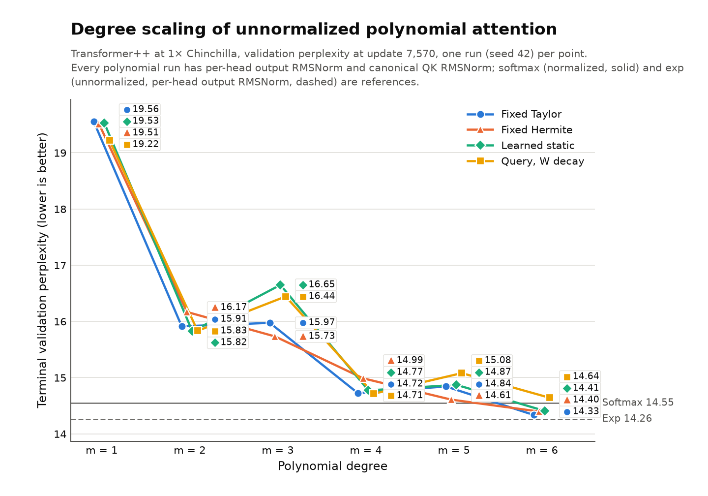

# Degree scaling at 1×

**Question.** How does held-out perplexity change with the polynomial degree
`m = 1, 2, 3, 4, 5, 6` for fixed Taylor, fixed Hermite, learned static, and query
coefficients with projection weight decay, under the Transformer++ recipe at 1×
Chinchilla?



## Runs

Every run uses the Transformer++ reference recipe at 1× (7,570 updates, warmup 455,
seed 42), the canonical QK setup (RMSNorm with a learned per-head score scale),
reference initialization, and unnormalized polynomial attention
`sum_(i<=t) sum_(r<=m) c_r s_ti^r v_i` followed by per-head output RMSNorm, on the
Mosaic kernels.

- **Fixed Taylor:** `c_r = 1/r!`.
- **Fixed Hermite:** the degree-`m` truncation of `exp(s) = exp(1/2) sum_r He_r(s)/r!`
  in monomial form, with the attention_scaling study's coefficients; for example
  `exp(1/2) (1/2 + s + s^2/2)` at `m = 2`.
- **Learned static:** one learned coefficient per order, layer and head, starting at
  Taylor.
- **Query, W decay:** `c_r(x_t) = [b_r + a_r tanh(w_r^T x_t)]/r!` per layer and head,
  starting at Taylor, with AdamW weight decay 0.1 on the projection `w_r`.

| Family | m = 1 | m = 2 | m = 3 | m = 4 | m = 5 | m = 6 |
| --- | --- | --- | --- | --- | --- | --- |
| Fixed Taylor | `ra7f2fda1c792` | `rdb1c706a5b85` | `r81fad1755b11` | `r816ab0fbe119` | `r8a526282ac43` | `r167091e2aeac` |
| Fixed Hermite | `rddf0b0173f42` | `rdf6363a4b83c` | `rf378c0e67607` | `rbd0cd771c676` | `rf1993c745e17` | `r3a332ae60437` |
| Learned static | `r5c691128699f` | `r99c3ab7d8a77` | `r1f880c4ee659` | `r4339a245820e` | `r3feaf71ff7af` | `r5e6f23bd0533` |
| Query, W decay | `rf9099d70ab3a` | `rd6b4d16d81bb` | `r00f1f91a7803` | `rca97cc9db8f2` | `r5de86f9f02da` | `r688344e6dcc6` |

Four cells reuse completed Kennel runs: Taylor at `m = 4` (B300) and static at `m = 4`
(H100 PCIe) trained with the earlier host-loop trainer, and query at `m = 2` (B300) and
`m = 4` (H100) with the current compiled loop. The twelve new runs differ from their family's `m = 4` recipe
only in degree and, for Hermite, the fixed coefficients. The `m = 1` column trained on
Kennel B300s and the other new cells on ORCD H100s; the
[study README](../../README.md#degree-scaling) gives the launch commands. Two reference
levels share the recipe: softmax (`r9040f12f3d80`, normalized) and unnormalized exp
with the same per-head output RMSNorm (`r6a76e7fbde45`, from `codex/qk-head-controls-4b`),
the kernel every polynomial here truncates.

The four `m = 5` runs copy their family's `m = 3` recipe and change only the degree and,
for Hermite, the fixed coefficients. They trained on ORCD H100 80GB HBM3s with the same
scaffold code as the other ORCD cells; static resumed once from update 4,500 after a
preemption.

The four `m = 6` runs copy their family's `m = 5` recipe with degree 6 (and, for Hermite,
the degree-6 coefficients) and trained on ORCD H100 80GB HBM3s with the same scaffold
code, from a branch started at `ba8494e7`.

Hermite at `m = 1` is `exp(1/2)` times Taylor at `m = 1`. The output RMSNorm removes
that factor, so the two runs train the same function up to the norm's epsilon and
floating point; their difference measures how far equivalent runs diverge numerically.
No cell has a second seed.

## Findings

<!-- BEGIN GENERATED RESULTS -->

**Terminal validation perplexity (update 7,570); lowest per degree in bold**

| Family | m = 1 | m = 2 | m = 3 | m = 4 | m = 5 | m = 6 |
| --- | ---: | ---: | ---: | ---: | ---: | ---: |
| Fixed Taylor | 19.556 | 15.912 | 15.974 | 14.724 | 14.843 | **14.334** |
| Fixed Hermite | 19.513 | 16.168 | **15.732** | 14.987 | **14.609** | 14.396 |
| Learned static | 19.531 | **15.822** | 16.649 | 14.773 | 14.871 | 14.408 |
| Query, W decay | **19.219** | 15.832 | 16.443 | **14.714** | 15.080 | 14.641 |

**Validation-best perplexity (update 7,500 in every run)**

| Family | m = 1 | m = 2 | m = 3 | m = 4 | m = 5 | m = 6 |
| --- | ---: | ---: | ---: | ---: | ---: | ---: |
| Fixed Taylor | 19.541 | 15.907 | 15.968 | 14.722 | 14.841 | 14.328 |
| Fixed Hermite | 19.495 | 16.164 | 15.722 | 14.984 | 14.602 | 14.393 |
| Learned static | 19.522 | 15.820 | 16.640 | 14.767 | 14.868 | 14.406 |
| Query, W decay | 19.205 | 15.827 | 16.436 | 14.709 | 15.074 | 14.637 |

**Change in terminal perplexity from the previous degree**

| Family | m = 1 | m = 2 | m = 3 | m = 4 | m = 5 | m = 6 |
| --- | ---: | ---: | ---: | ---: | ---: | ---: |
| Fixed Taylor | – | -18.6% | +0.4% | -7.8% | +0.8% | -3.4% |
| Fixed Hermite | – | -17.1% | -2.7% | -4.7% | -2.5% | -1.5% |
| Learned static | – | -19.0% | +5.2% | -11.3% | +0.7% | -3.1% |
| Query, W decay | – | -17.6% | +3.9% | -10.5% | +2.5% | -2.9% |

Softmax reference (`r9040f12f3d80`): terminal 14.546, validation-best 14.543 (update 7,500).

Exp reference (`r6a76e7fbde45`): terminal 14.262, validation-best 14.257 (update 7,500).

<!-- END GENERATED RESULTS -->

- **All twenty-four runs finished the 7,570 updates** with no numerical failure. Every run's
  validation-best checkpoint is update 7,500, and its terminal perplexity is at most 0.1%
  higher; both metrics order the cells the same way.
- **Going from `m = 1` to 2 is the largest step in every family**, 17–19% lower
  perplexity, and every family is best at `m = 6`.
- **At `m = 4`, query (14.714), Taylor (14.724) and static (14.773) lie within 0.4% of
  one another**, inside the resolution below; Hermite (14.987) is 1.5–1.9% higher. All
  four stay 1.2–3.0% above softmax (14.546) and 3.2–5.1% above exp (14.262).
- **`m = 3` breaks the trend for the learned families.** Static (+5.2% over `m = 2`) and
  query (+3.9%) end worse at `m = 3` than at `m = 2`; Taylor is flat (+0.4%: its `m = 3`
  run led `m = 2` until update 6,000), and Hermite keeps improving (−2.7%). Both learned
  `m = 3` runs fall behind fixed Taylor at `m = 3` early, static from update 400 and
  query from the first evaluation at update 100, and from update 2,000 on stay
  0.040–0.045 nats (static) and 0.027–0.033 nats (query) behind it. At `m = 2` and 4 the
  learned runs end within 0.6% of fixed Taylor. All four `m = 3` runs passed acceptance
  on H100 80GB HBM3s at the same commit: static and query ran the GPU kernel tests,
  degree 3 included, on their own nodes, and Taylor and Hermite reused Taylor `m = 2`'s.
  The rises are 18–24 times the twin difference below in validation NLL, so they are not
  rounding; whether they are systematic or one unlucky seed is untested.
- **`m = 5` is worse than `m = 4` for the three families that start from Taylor.** Taylor (+0.8%), static
  (+0.7%), and query (+2.5%) end higher at `m = 5` than at `m = 4`, while Hermite improves
  2.5% to 14.609, 0.4% above softmax and 2.4% above exp. Across `m = 2-6`, Taylor, static,
  and query improve at the even degrees and stall or worsen at the odd ones; Hermite
  improves at every degree, trailing Taylor at the even degrees and leading it at the odd
  ones.
- **At `m = 6` every family improves, and three end below softmax.** Taylor (14.334, −3.4%
  from `m = 5`), Hermite (14.396, −1.5%), and static (14.408, −3.1%) end 0.9–1.5% below
  softmax (14.546); query (14.641, −2.9%) stays 0.7% above it. Fixed Taylor at `m = 6` is
  0.5% above exp (14.262), the closest any polynomial here comes.
- **Equivalent runs diverge by about 0.2%.** Taylor and Hermite at `m = 1` end 0.042 apart
  (19.556 and 19.513). Learned static at `m = 1` adds nothing the per-head score scale
  cannot express while its constant coefficient stays positive, which it does in all 210
  heads, and it ends between them (19.531). Differences of a few tenths of a percent
  within a degree are not resolved.

## Limits

- One run (seed 42) per cell. The Taylor and Hermite `m = 1` twins measure numerical
  divergence between equivalent configurations, not variation across seeds or data
  orders, so the rises at `m = 3` and `m = 5` need a second seed, of fixed Taylor as well
  as the learned families, before they are read as an effect of degree.
- Recipes are identical within each family, but execution differs: the `m = 1` column,
  Taylor at `m = 4` and query at `m = 2` trained on Kennel B300s; the other ORCD cells on
  H100 80GB HBM3s; query at `m = 4` on a Kennel H100 80GB HBM3 and static at `m = 4` on a
  Kennel H100 PCIe. Taylor and static at `m = 4` accumulated gradients with the earlier
  host loop, which computes the same sums with different rounding. Query's step from
  `m = 2` to 3 therefore also changes GPU and source commit; static's does not. The steps
  from `m = 4` to 5 for Taylor, static, and query change GPU, trainer loop, or source commit,
  because their `m = 4` cells are the reused Kennel runs; Hermite's does not.
- The comparison is one 1× budget and schedule. Every `m = 1` run was still closing on
  its `m = 2` run when training ended, and fixed Taylor at `m = 2` overtook `m = 3` only
  after update 6,000, so the ranking may change with more tokens.
- The closest 10B-token analog in [attention_scaling](../../../../results/attention_scaling/README.md),
  learned coefficients with per-head output RMSNorm, improves at every degree (14.630 at
  `m = 2`, 13.988 at `m = 3`), so the penalty at `m = 3` is absent in that recipe.

## Regenerate

From the repository or worktree root:

```bash
PYTHONPATH=. scaffolds/transformer/.venv/bin/python -m scaffolds.records refresh experiments/transformer_pp/results/degree_scaling
PYTHONPATH=. scaffolds/transformer/.venv/bin/python -m experiments.transformer_pp.results.degree_scaling.plot
PYTHONPATH=. scaffolds/transformer/.venv/bin/python -m pytest -q experiments/transformer_pp/results/degree_scaling/tests
```
