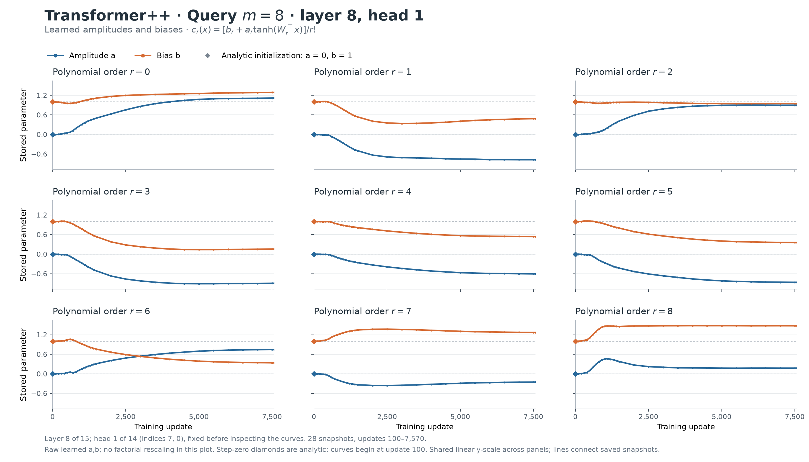
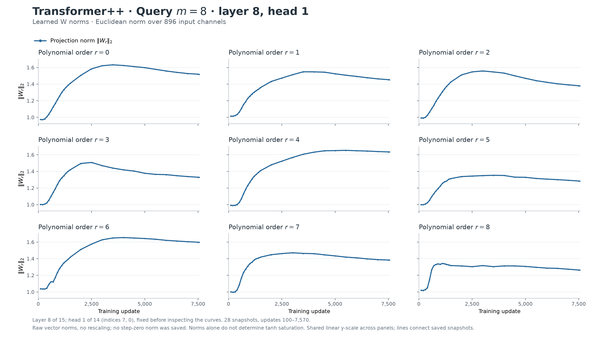

# Transformer++ regular-query parameter dynamics

Closed diagnostic, recorded 2026-11-13. How do one middle-layer head's learned
coefficient-generator parameters evolve in regular query polynomial attention,
and do its recorded coefficients vary across queries? This analysis uses saved
training measurements and a frozen-checkpoint activation probe. It introduces no
mechanism ranking.

## Sources and method

The [selection](selection.yaml) explicitly pins the completed regular-query runs
already selected by the [degree-scaling collection](../../../pretraining/polynomial/degree_scaling/README.md):

| Degree | Run | Executed source commit |
| --- | --- | --- |
| 8 | `r25fffc16c2f3` | `6ab34ab18bfdf208032a9d448e0324ec13764f1e` |
| 12 | `r0fceea0627c8` | `c656015584b2ad5802a41cb25f5eb25c18fe3ba6` |

Both use the 15-layer width-896 Transformer++ shape with 14 heads, RoPE,
canonical QK RMSNorm and learned positive head scales, query tanh coefficients,
and unnormalized attention followed by per-head output RMSNorm. Both completed
7,570 updates on Kennel. The frozen recipes and execution records remain under
the [study](../../../../README.md).

The fixed choice is **layer 8 of 15, head 1 of 14** (indices 7, 0), matching the
head used in the [SoS diagnostic](../sos_training_dynamics/README.md). Each run
saves 28 parameter snapshots at updates 100–1,500 in increments of 100, then
every 500 updates through 7,500, and at terminal update 7,570. Terminal values
here refer to 7,570, not the validation-best checkpoint at 7,500.

The regular-query parameterization is

\[
c_r(x_t)=\frac{b_r+a_r\tanh(W_r^\top x_t)}{r!},
\qquad p_t(s)=\sum_{r=0}^{m}c_r(x_t)s^r.
\]

Here x is the pre-attention RMSNorm activation, and W_r is a learned
896-dimensional vector. The generator has exactly a, b, and W: diagonal readout,
no inner tanh bias or coefficient gate. W receives weight decay 0.1; a and b do
not. Generator coordinates correspond to the actual polynomial orders 0 through
m. There are no square-factor coordinates in these direct-polynomial runs.

`modulation_amplitude` and `projection_bias` are the **raw learned a and b**.
Both start at a=0, b=1; both acquire their 1/r! factor when forming c_r. The
figures do not divide these raw parameters by r!. The saved
`effective_modulation_amplitude` and `effective_projection_bias` are separately
checked against a/r! and b/r!. `projection_kernel_l2` is the Euclidean norm over
the input-channel axis of each W vector, with no further scaling.

## Parameter histories

Each panel shows one polynomial order. The a/b figures use blue for a and
orange for b, with a shared linear y-axis across panels. Diamonds at update zero
and dashed references indicate analytic a=0, b=1 initialization; step zero was
not saved. The W figures contain only measured norms: each random initial
vector has its own norm, so no exact step-zero value is inserted.





[Degree-twelve a/b histories](head_parameters_m12.png) and
[degree-twelve W norms](head_w_norms_m12.png) provide the same views. PDFs
accompany every PNG. [parameter_summary.csv](parameter_summary.csv) contains
first/terminal values, recorded extrema, and the terminal coefficient statistics.

[Combined regular-query image](head_parameters_combined.png)
([PDF](head_parameters_combined.pdf)) shows the same histories in two sections,
for m=8 and m=12. Each has three rows (a, b, and W norm), with one column per
actual polynomial order r=0,...,m. It follows the combined SoS figure's layout;
these columns index direct polynomial coefficients. Blue denotes a and W norms,
orange denotes b. Raw values and initialization markers match the separate
figures, with a shared linear y-scale within each section's row. The standard
`plot.py` regeneration command below also produces this image.

| Range across saved snapshots and orders in this head | Degree 8 | Degree 12 |
| --- | ---: | ---: |
| a | −0.9070 to 1.1157 | −1.1125 to 0.8488 |
| b | 0.1400 to 1.4774 | 0.0977 to 1.8809 |
| W norm | 0.9721 to 1.6551 | 0.9548 to 1.6410 |

The W norms generally rise from around one, peak, and then decline. The saved
history shows no projection-norm explosion in this head. The a/b trajectories
adapt differently by order. These snapshots do not resolve brief changes
between evaluations, and a single head does not characterize the whole model.

## What this says about input dependence

Nonzero W alone is insufficient evidence: W is already random and nonzero at
initialization while a=0 makes every coefficient independent of x. Nonzero a
enables input dependence, but tanh may be nearly constant on a particular input
distribution. The norms also discard W's direction and its alignment with x.

The recorded `effective_summary` measures actual coefficients over the same
2,048 queries from the first held-out sequence at every evaluation. At terminal
update 7,570, r! std(c_r) is 0.6691 for degree-eight order 2 and 0.4752 for
degree-twelve order 12: these coefficients vary appreciably across those queries.
Other orders are almost constant despite nonzero a and W.

For nonzero a, the affine coefficient formula also gives the tanh moments on
that sample directly:

\[
\mathbb E[\tanh(W_r^\top x)]=\frac{r!\,\mathbb E[c_r]-b_r}{a_r},
\qquad
\operatorname{std}[\tanh(W_r^\top x)]
=\frac{r!\,\operatorname{std}(c_r)}{|a_r|}.
\]

For degree-eight order 3, the inferred mean is 0.999838 and standard deviation
0.000714; degree-twelve order 8 gives 0.999883 and 0.000856. These are consistent
with strong positive saturation on this held-out sample. They coexist with
orders that retain substantial variation; they do not establish uniform input
independence or the behavior on every training sequence. The inferred moments
are subject to rounding in the recorded coefficient summaries and are undefined
when a=0. They are preserved separately from the raw parameters in the summary.

## Regeneration

From the repository root, using its locked environment:

```bash
uv sync --project scaffolds/transformer --locked --link-mode hardlink
scaffolds/transformer/.venv/bin/python experiments/transformer_pp/results/diagnostics/learning_dynamics/query_parameter_dynamics/plot.py
```

The script verifies pinned scientific inputs, completed status, recipes, array
shapes, finite values, factorial conventions, and the fixed diagnostic sample.
All figures and summaries regenerate from committed run measurements without
a GPU, dataset, or checkpoint. To deliberately change the explicit inputs,
edit the selection and refresh before regenerating:

```bash
scaffolds/transformer/.venv/bin/python -m scaffolds.records refresh experiments/transformer_pp/results/diagnostics/learning_dynamics/query_parameter_dynamics
```
