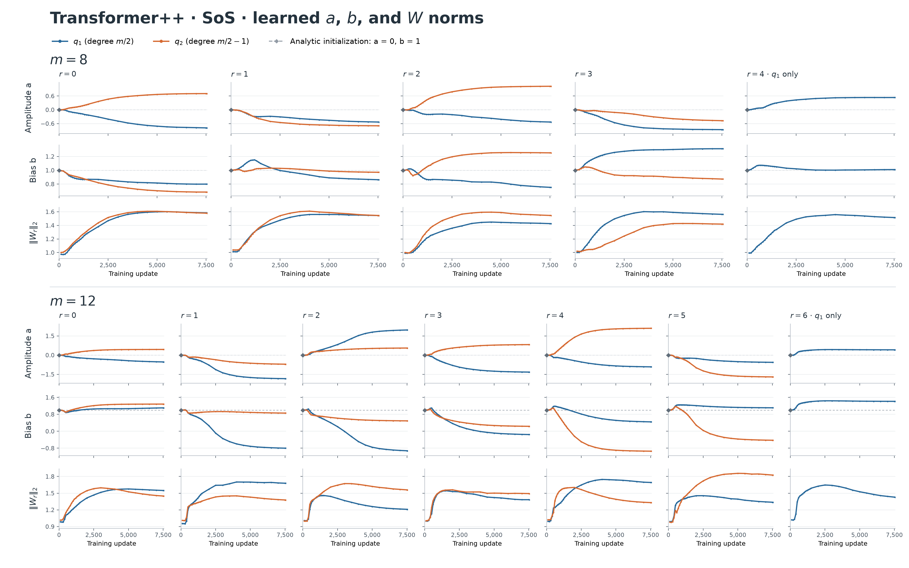

# Transformer++ sum-of-squares training dynamics

Closed diagnostic, recorded 2026-11-13. How do one middle-layer head's
coefficient-generator parameters (a, b, and W norms) evolve in the completed
query-conditioned sum-of-squares (SoS) polynomial runs? This analysis uses
existing training measurements; it performs no optimizer updates or checkpoint
replay and enters no mechanism comparison.

## Sources and method

The [selection](selection.yaml) pins two completed runs from the
[Transformer++ study](../../../../README.md):

| Role | Run | Executed source commit |
| --- | --- | --- |
| SoS degree 8 | `reeefbcc19abf` | `5880cf28e339153446d491eecf9fff8f3e843de8` |
| SoS degree 12 | `r3d52b7ab43d1` | `7cfdf8cc506e3ee8573101f5ec87e17fe04de7b3` |

Both use the 15-layer width-896 shape, 14 heads, 2,048-token training context,
RoPE, canonical QK RMSNorm with learned positive per-head score scales,
unnormalized attention followed by per-head output RMSNorm, and tanh query
conditioning with coefficient-projection weight decay. Both completed 7,570
updates on Kennel using Mosaic. Their frozen recipes and execution records remain
under the study's `runs/` directory. The source commits preserve the executed
query-SoS implementation.

## One middle-layer head's amplitudes and biases

The focused view uses **layer 8 of 15, head 1 of 14** (zero-based indices 7, 0)
for both runs. This is the middle layer and first head, fixed before inspecting
the histories, rather than selected for unusual behavior. The selection records
these indices and the exact fields: `modulation_amplitude` for a and
`projection_bias` for b. All 28 evaluations preserve the raw parameters for every
generator coordinate; no token averaging or factorial rescaling is applied.



The figure ([PDF](head_parameters_combined.pdf)) has one section per degree, m=8
then m=12, each with three rows (a, b, and W norm). Each column is a power in a
**square factor**, with blue for U and orange for V, on a shared linear scale
within each section's row. These are the parameters in
`F_j(x)=f_j[1+b_j+a_j tanh(W_j^T x)]/2`, not parameters of the expanded `c_r`.
Degree eight has factor coordinates `U_0,...,U_4,V_0,...,V_3`; degree twelve has
`U_0,...,U_6,V_0,...,V_5`. The highest factor power has U only. The generic
`effective_coefficient_names` stored beside the arrays refer to expanded
coefficients and must not be used to label the generator coordinates.

Step-zero diamonds and dashed references mark analytic initialization a=0, b=1;
there is no saved step-zero snapshot. Lines connect the 28 recorded evaluations
from updates 100 through 7,570. Parameter changes between evaluations are not
resolved, and this single head does not summarize the full model.

This head has larger parameter drift at degree twelve: recorded a ranges from
−1.8381 to 2.0958 and b from −0.9411 to 1.4389, versus −0.8638 to 1.0245 and
0.6836 to 1.3130 at degree eight. Several degree-twelve factors develop opposing
a and b trends; U_2 ends at a=1.9649, b=−0.9231, and V_4 at a=2.0958,
b=−0.9411. The curves look gradual at this cadence. They do not establish tanh
saturation or a causal explanation of training stability; that would require
the projected inputs and their activation distributions. Negative generator
parameters are compatible with the sum-of-squares constraint.

[head_parameter_summary.csv](head_parameter_summary.csv) gives each coordinate's
analytic a/b initialization, first recorded values, terminal values, and recorded
extrema for a, b, and the W norm.

### Projection-vector norms

For these diagonal tanh generators, **a, b, and W are the only learned
coefficient-generator parameters**. The Taylor square factors f are fixed;
there is no extra inner tanh bias, dense mixing matrix, or coefficient gate.

The figure's W rows read `projection_kernel_l2`. The executed diagnostic
computes `np.linalg.norm(kernel, axis=-2)` for the
`[layer, head, input_channel, factor_coordinate]` parameter array. Thus each
curve is the Euclidean norm of one 896-dimensional projection vector in
`tanh(W_j^T x)`, with the same U/V factor-power indexing as a and b. It is not a
matrix spectral norm, a norm of all the head's projections combined, or an
average over tokens. No factorial or Taylor-factor rescaling is applied.

All 28 norm snapshots are finite and nonnegative. Over the saved history, norms
range from 0.9707 to 1.6091 at degree eight and 0.9517 to 1.8566 at degree twelve.
Terminal ranges are 1.4190–1.5836 and 1.2096–1.8259, respectively. Degree-eight
norms generally grow from around one, then flatten or decline slightly;
degree twelve shows more variation among factors. For example, U_2 decreases
from 1.4590 at update 1,500 to 1.2096 at the end even while its amplitude grows.
There is no sampled projection-norm explosion in this head.

No step-zero W norm was saved. The recipe draws each entry with standard
deviation `1/sqrt(896)`, giving `sqrt(E[||W_j||_2^2])=1`; that is not the exact
initial norm of any particular draw and is not plotted as a measurement.
Norms alone cannot establish tanh saturation: that depends on the distribution
of `W_j^T x`, including the direction of W and the input correlations. Changes
in projection direction are also invisible to these norm histories.

## How the parameters form the polynomial

Suppressing layer/head indices, the generator produces

\[
g_j(x_t)=b_j+a_j\tanh(W_j^\top x_t),\qquad
F_j(x_t)=f_j\frac{1+g_j(x_t)}2,
\]

where the fixed factors `f` factorize the even-degree Taylor polynomial. For
degree `m=2d`, split the generated factors into `U_0,...,U_d` and
`V_0,...,V_{d-1}`. Then

\[
p_t(s)=\left(\sum_{j=0}^{d}U_j(x_t)s^j\right)^2
      +\left(\sum_{j=0}^{d-1}V_j(x_t)s^j\right)^2
      =\sum_{r=0}^{m}c_r(x_t)s^r,
\qquad
c_r=\sum_{i+j=r}U_iU_j+\sum_{i+j=r}V_iV_j.
\]

The initialization `b=1, a=0` reproduces `c_r=1/r!` up to rounding.

## Regeneration

From the repository root, using its locked environment:

```bash
uv sync --project scaffolds/transformer --locked --link-mode hardlink
scaffolds/transformer/.venv/bin/python experiments/transformer_pp/results/diagnostics/learning_dynamics/sos_training_dynamics/plot.py
```

The script checks scientific input hashes, complete status, model shape, and the
recorded parameter arrays. It regenerates the figure (PNG and PDF) and the summary
CSV from committed run measurements; no GPU, dataset, checkpoint, or training log
is needed. Repeated regeneration is byte-identical in the locked environment. To
deliberately change selected inputs, edit `selection.yaml`, refresh its pins, and
regenerate:

```bash
scaffolds/transformer/.venv/bin/python -m scaffolds.records refresh experiments/transformer_pp/results/diagnostics/learning_dynamics/sos_training_dynamics
```
