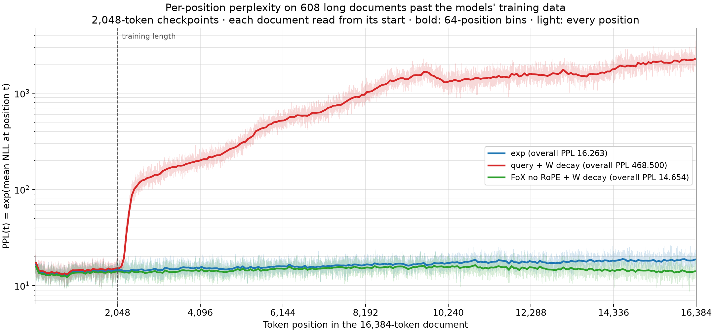
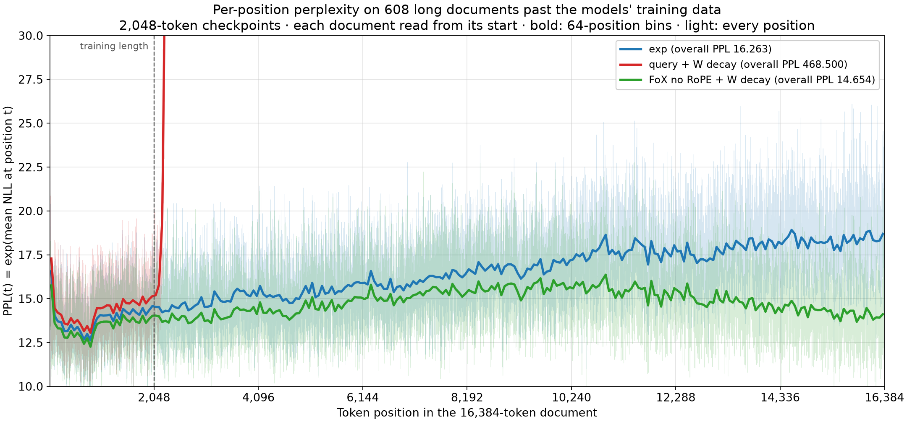
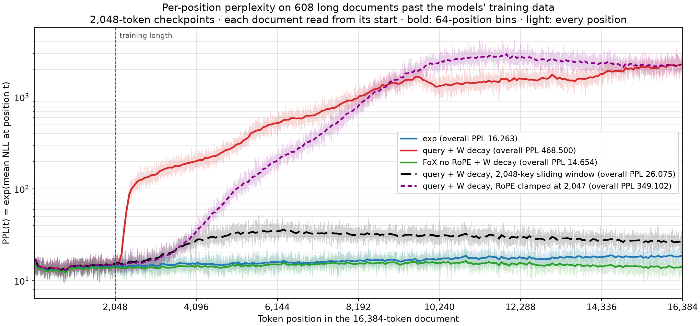

# Why query attention breaks past 2,048 tokens

Opened 2026-11-02.

**Question.** The 2,048-token query + W decay (m = 4) checkpoint fails past its training length
while exp and FoX without RoPE do not. Does the break come from keys beyond the training
distance at all, and if so, is the trigger their RoPE phases or how many of them there are?

## Runs and method

`r313eb59e1d5f` scores the validation-best (update 7,500) 2,048-token exp, query + W decay
(`rca97cc9db8f2`) and FoX no RoPE + W decay checkpoints per position at 16,384 tokens.
`ra9834409e40a` rescores the query checkpoint with only the attention call replaced:

| Pass | Keys each query attends to | RoPE |
| --- | --- | --- |
| `full` (control) | all earlier keys | true positions |
| `window` | the most recent 2,048 keys (distance < 2,048) | true positions |
| `clamp` | all earlier keys | true positions within 2,047 tokens; distance 2,047 beyond |

`window` removes every key beyond the training distance, so no query sees more keys or
farther ones than in training. `clamp` keeps every key but gives each one farther than
2,047 tokens the phase of distance 2,047 (the query rotated to position 2,047 and the key left
at position 0), so every relative phase was seen in training while the number of keys grows.
The replacement computes the model's own unnormalized polynomial with its query
coefficients in FP32, in 256-query blocks, before the unchanged per-head output RMSNorm.
[`evaluate_extrapolation_ablation.py`](../../../../evaluate_extrapolation_ablation.py) implements it; on CPU it matches the scaffold's blocked
reference kernel, and `window` and `clamp` match a brute-force pairwise computation.

`r6122f26085ec` measures, at the query at position 4,095, the weight on every key for the
2,048-token query checkpoint and its 4,096-token partner (`r738b35a8e314`). Nothing is
trained. Launch commands are in the [study README](../../../../README.md#extrapolation-ablation).

## Findings

In packed rows about three quarters of the predictions past position 2,048 have only other
documents more than 2,048 tokens back, so distant text helps little there. The evaluations
therefore use 608 single documents: rows 9,657–10,264 of `fineweb_12b_long_documents_seq16385/train`,
each an end-of-document token and the first 16,384 tokens of one document at least that long.
Every row is a document's first appearance in the stream (no earlier document begins with the
same 1,024 tokens), and all start after the 3.97B stream tokens of every compared run's full
training budget (the step-7,500 checkpoints saw 3.93B), so no model trained on them by
position and none repeats the opening of a document the models trained on; the evaluators
refuse earlier rows. Revised copies with a different opening remain: a scan of 64-token
windows against the first 3.97B stream tokens found 31 of the 608 documents (5%) sharing at
least half their windows with one trained document, 8 of them almost verbatim, and 9 of the
128 weight documents within their first 4,096 tokens. `r313eb59e1d5f` scores exp,
query + W decay and FoX no RoPE + W decay; `ra9834409e40a` runs the query model's window and
clamp passes; `r6122f26085ec` measures the per-key weights on the first 4,096 tokens of rows
9,657–9,784. Every 2,048-token replay reproduces its recorded validation NLL within 6e-6
nats, and `r313eb59e1d5f`'s three 16k passes pass the causal-prefix check. The ablation's full
pass matches `r313eb59e1d5f`'s query curve in mean NLL within 2e-5 nats over positions
1–2,048 (2e-6 overall; single positions within 5e-3), and its window and clamp passes equal
it over the first 2,048 positions.

| Perplexity at positions | 1,025–2,048 | 2,049–2,304 | 2,305–3,072 | 3,073–4,096 | 4,097–8,192 | 8,193–12,288 | 12,289–16,384 | 1–16,384 |
| --- | ---: | ---: | ---: | ---: | ---: | ---: | ---: | ---: |
| exp | 14.17 | 14.39 | 14.58 | 15.11 | 15.69 | 17.23 | 18.06 | 16.26 |
| query + W decay | 14.72 | 20.26 | 114.34 | 175.46 | 467.65 | 1,405.60 | 1,811.19 | 468.50 |
| FoX no RoPE + W decay | 13.74 | 13.86 | 13.87 | 14.14 | 14.85 | 15.56 | 14.54 | 14.65 |
| query, 2,048-key window | 14.72 | 15.46 | 16.45 | 21.95 | 32.50 | 31.03 | 27.86 | 26.07 |
| query, RoPE clamped at 2,047 | 14.72 | 15.04 | 15.93 | 22.58 | 188.73 | 2,026.93 | 2,361.49 | 349.10 |

([long_documents_summary.csv](long_documents_summary.csv) has these values and positions
1–1,024.)

- **Every model is worse late in a document than at positions 1,025–2,048**: exp by 27% at
  12,289–16,384 (14.17 to 18.06), FoX by 13% at 8,193–12,288 and 6% at 12,289–16,384 (13.74
  to 15.56 and 14.54). This does not show that the models fail to use distant text: these
  documents also get harder with position inside the training length (positions 1,025–2,048
  are 4–5% worse than 1–1,024 for all three models), and no same-position control without
  the distant text was run.
- **Query + W decay fails.** It reaches 114 by positions 2,305–3,072 and
  1,811 at 12,289–16,384. Clamping RoPE at 2,047 keeps it near the window until about
  position 3,700 (block means 15–23 through 4,096), then it collapses (189 at 4,097–8,192,
  2,361 at 12,289–16,384). The window never collapses: it falls from 32.5 at 4,097–8,192 to
  27.9 at 12,289–16,384.
- **The 2k model puts its weight far back.** Its per-key weights at position 4,095
  ([figure](position_weights_long_documents.png), [table](position_weights_long_documents.csv))
  put 55–73% of the weight 2,048 or more back in layers 6–12, with peaks of up to 7.6 times
  uniform (1.9–7.6 in layers 2–15) at two stretches of keys, against 23–32% in every layer of
  the 4k-trained model.

## Limits

- One checkpoint per training length (query + W decay, m = 4, seed 42), with exp and FoX no
  RoPE + W decay as references. The window and clamp are inference-time edits of the 2k
  checkpoint; neither was trained.
- The per-key weights fix the query at position 4,095, so distance and absolute key position
  cannot be told apart.
- Whether any model uses text more than 2,048 tokens back is not measured: no same-position
  control without the distant text was run for exp or FoX.
- The window's residual loss (about 28 late in the documents) is not explained; keeping the
  first tokens in every window, as in streaming attention, was not run.
- 5% of the long documents are revised copies of documents the models trained on.

`plot_long_documents.py` and `plot_positions.py` in this directory regenerate the figures and
tables from [selection.yaml](selection.yaml), run from the repository root.
