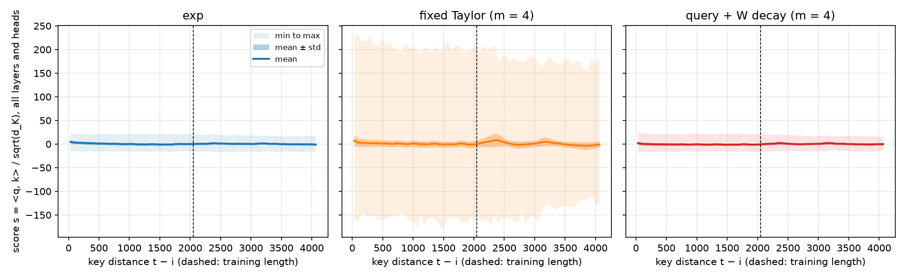
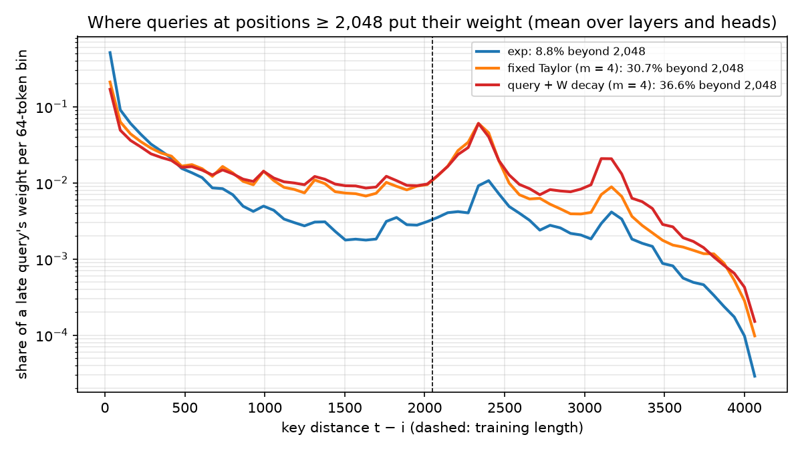

# Attention scores past the training length

Opened 2026-11-01.

**Question.** In the [context_length](../../../pretraining/scalings/context_length/README.md) topic, the
degree-four polynomial models trained at 2,048 tokens break past that length (PPL above 100)
while exp extrapolates. Are their attention scores at unseen key distances different, and
does their weight shift onto distant keys?

## Run and method

`r1d87cc903125` loads the validation-best checkpoints of fixed Taylor m = 4
(`r816ab0fbe119`), query + W decay m = 4 (`rca97cc9db8f2`) and, as a control, exp
(`r6a76e7fbde45`), with the length limit raised to 4,096,
and runs eight 4,097-token validation rows one at a time through each model's own backend.
It captures what every attention call receives and recomputes, per layer and head:

- the scores $s_{ti} = \langle q_t, k_i\rangle/\sqrt{d_K}$ after QK normalization, head
  scaling and RoPE, binned by key distance $t-i$ in 64-token bins;
- for queries at positions $t \ge 2{,}048$, the share of their weight magnitude
  $|w(s_{ti})|/\sum_i |w(s_{ti})|$ in each distance bin, with $w = e^{s}$ for exp,
  $\sum_{r \le 4} s^r/r!$ for fixed Taylor and $\sum_r c_r(x_t)\,s^r$ for query. With the
  per-head output RMSNorm these shares are what the unnormalized kernels apply.

Distances below 2,048 were seen in training; distances from 2,048 to 4,095 were not.

## Findings





| Model | Score std, seen / unseen | Max $\lvert s\rvert$, seen / unseen | Late-query weight beyond 2,048 (max head) |
| --- | ---: | ---: | ---: |
| exp | 3.04 / 2.41 | 23.6 / 21.4 | 8.8% (38%) |
| fixed Taylor, m = 4 | 7.35 / 9.50 | 231 / 210 | 30.7% (84%) |
| query + W decay, m = 4 | 2.68 / 2.60 | 26.6 / 21.8 | 36.6% (93%) |

([summary.csv](summary.csv) has these values; `metrics.jsonl` of the run has every layer.)

- The scores at unseen distances are not larger. Their spread and extremes match or fall
  below those at seen distances (median per-head ratio of unseen to seen spread: 0.77 exp,
  0.94 fixed Taylor, 0.91 query). The polynomial models' mean score rises by about one at
  unseen distances (fixed Taylor 0.99 to 2.23, query −0.59 to 0.56), with bumps near
  distances 2,300 and 3,100 that all three models share.
- The weights differ. Within the trained range the polynomial models already spread their
  weight more evenly over distance: about 1% of a late query's weight per 64-token bin
  from 500 to 2,000 tokens back, against 0.2–0.5% for exp, and 20% against 50% on the
  nearest bin. With twice as many keys, a late query puts a third of its weight on keys
  more than 2,048 tokens back (31% fixed Taylor, 37% query), against 9% for exp; single
  heads reach 84–93%.
- The break therefore comes from the polynomial weight's heavy tail, not from unusual
  scores. A degree-four weight grows like $s^4$ rather than $e^s$, so moderately scored
  distant keys keep substantial weight, and their total grows with the number of keys.
- Fixed Taylor's scores reach $\lvert s\rvert \approx 230$ at every distance, while exp and
  query stay below 27.

## Limits

Eight validation rows, pooled over layers and heads. The shared bumps near 2,300 and 3,100
are consistent with RoPE phases there resembling those of shorter distances; this is not
tested. One key width (64) and RoPE base (10,000).

## Regeneration

```bash
scaffolds/transformer/.venv/bin/python -m scaffolds.records refresh experiments/transformer_pp/results/diagnostics/length_extrapolation/extrapolation_scores
scaffolds/transformer/.venv/bin/python experiments/transformer_pp/results/diagnostics/length_extrapolation/extrapolation_scores/plot.py
```
