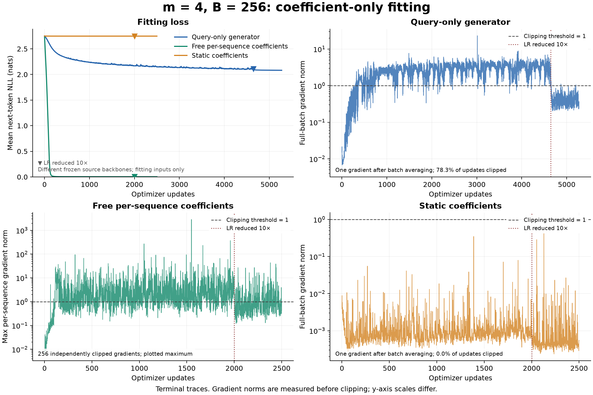
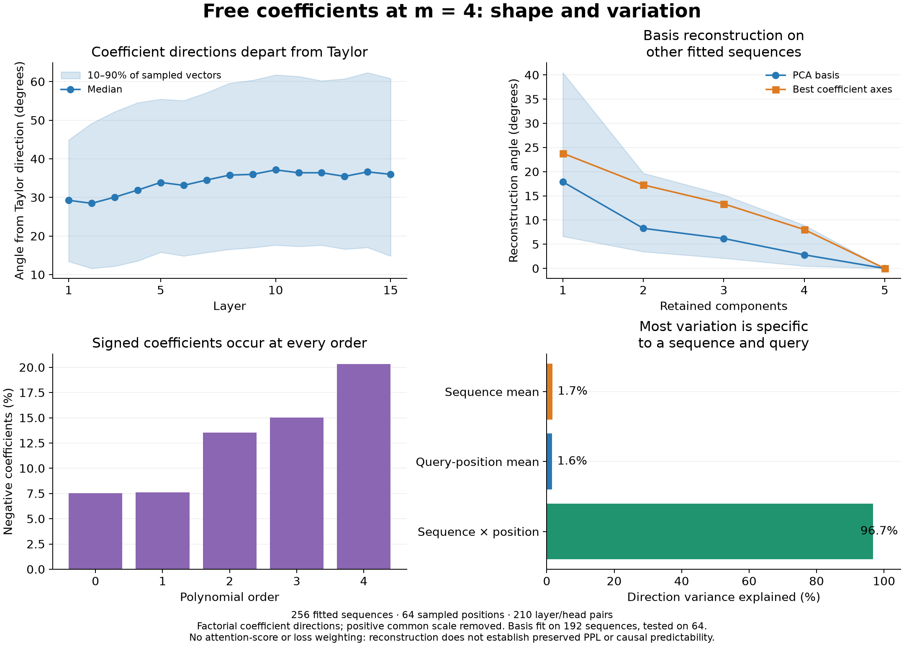
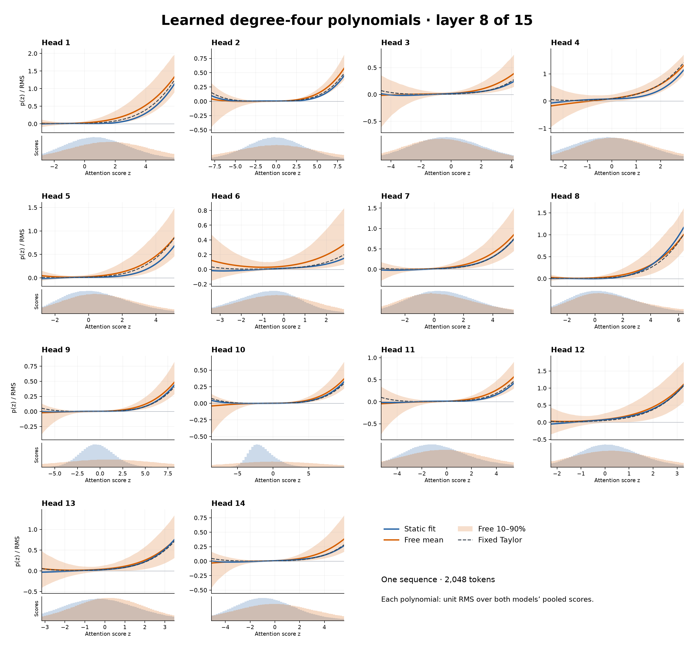
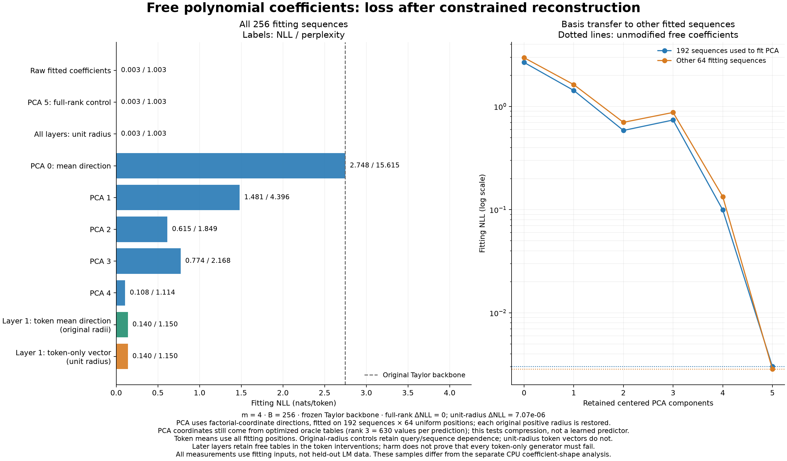
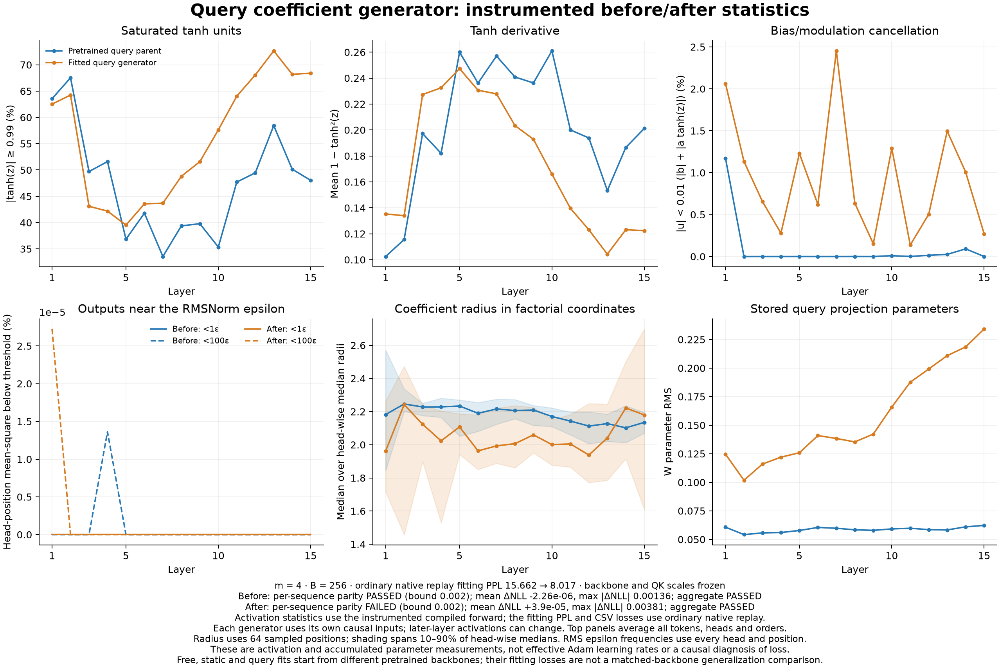

# Coefficient fitting with frozen Transformer++ backbones

Opened: **2026-10-23**. Home cluster: **Kennel**, except `r043b150cde03` (ORCD).

How much can polynomial coefficients fit a fixed batch of sequences, and how does
sharing coefficients constrain that capacity? These fits use the first
packed evaluation sequences and keep each source checkpoint's backbone frozen. They live in the
[Transformer++ study](../../../../README.md).

| Run | Trained parameters | Source checkpoint | Status |
| --- | --- | --- | --- |
| `rc95f2055e96d` | Original degree-four query generator on 256 sequences, with per-head QK scaling | Query-only `r2b22f2ff6461`, step 7,500 | Complete |
| `rda6029c3286f` | Free degree-four coefficients per sequence and query on 256 sequences, with per-head QK scaling | Fixed Taylor `r816ab0fbe119`, step 7,500 | Complete |
| `rc76733052ecb` | Free degree-four query coefficients times free key factors, c_r(t) g_r(i), per sequence on 256 sequences, with per-head QK scaling | Fixed Taylor `r816ab0fbe119`, step 7,500 | Complete |
| `r594b3706ecd7` | Query-key generator regressed onto the free query-key pair coefficients on teacher activations | Taylor `r816ab0fbe119`, step 7,500; teacher `rc76733052ecb`, step 200 | Complete |
| `rceea84f19f6b` | Static degree-four coefficients on 256 sequences, with per-head QK scaling | Static `r4339a245820e`, step 7,500 | Complete |
| `rec777591a61b` | Dense generator supervised by free coefficients on teacher activations | Taylor `r816ab0fbe119`, step 7,500; teacher `rda6029c3286f`, step 2,453 | Complete |
| `r84e37a39e2a0` | Original degree-four query generator on 1,024 sequences, with per-head QK scaling | Query-only `r2b22f2ff6461`, step 7,500 | Complete |
| `r043b150cde03` | Trained degree-four query and key generators on 256 sequences, with per-head QK scaling | Query-key `r501f5cca0d4c`, step 7,500 | Complete; stopped at the 10,000-update budget |

The source backbones differ. These are fitting-capacity diagnostics, not a
matched-backbone comparison of coefficient parameterizations. The
coefficient fits report fitting perplexity. The teacher-distillation experiment
below also scores its generator once on a fresh batch.

## Dense distillation from the free teacher

Opened **2026-10-26**. Run `rec777591a61b` tests whether the existing dense
generator can represent useful free-coefficient choices and transfer them to
new sequences. The teacher is the retained degree-four B256 free fit
`rda6029c3286f` at update 2,453. Its Taylor backbone `r816ab0fbe119` at update
7,500 remains bitwise frozen. Recorded inputs are the actual teacher attention
inputs after each block's attention RMSNorm, with all earlier layers using their
free coefficients; they are not activations from an unchanged Taylor forward.

The student uses nine tanh features per head, no inner tanh bias, a dense mixing
matrix, and the existing 1/3 readout scale. Both bias and mixing use factorial
coordinates. The stored bias begins at one, mixing at zero, and projections have
standard deviation `1/sqrt(896)`, reproducing Taylor at initialization. This is
the dense family used by `r04a5b2a3e8dd`, with no change to QK normalization or the
output RMSNorm. Only the generator's projections, biases, and mixing matrices train.

All 256 teacher sequences and all 2,048 query positions form the regression
dataset. The objective is raw factorial-coordinate MSE, `u_r = r! c_r`, averaged
over examples and orders independently for each layer/head. Each update samples
4,096 query tokens with replacement. Adam uses betas 0.9/0.95, epsilon 1e-8,
no decay, and independent per-layer/head clipping at one. A fixed 20,000-update
budget uses cosine LR 0.001 to 0.0001. Full reconstruction errors, per-layer/head
errors, and ordinary deployed fitting-batch PPL are measured every 1,000
updates. No teacher activations or coefficients enter a deployed forward.

The comparison uses two batches. The **fitting batch** is the teacher's: the
regression's inputs and targets, and the first score of the deployed generator.
The **fresh batch** is sequence indices `[5000000, 5000256)` of the packed
training manifest, beyond this backbone's training prefix; the original
evaluation manifest was almost entirely used for selecting the pretrained
checkpoint. The result is the snapshot with the lowest full coefficient MSE on the
fitting batch (snapshots every 1,000 updates, plus the Taylor initialization). It
and the frozen Taylor baseline are scored once on the fresh batch, which selects
nothing. Recipes pin both batches' manifest and token checksums. A strong fit plus
improved fresh-batch PPL would support a transferable coefficient rule; comparing
optimization routes additionally requires a matched direct-loss dense control.

This run also scored every snapshot on the fresh batch and a second fresh batch,
selecting by fresh-batch NLL, and kept only that selection's checkpoint: update 0,
the Taylor-equivalent initialization. The comparison below uses its pinned
measurements; the reported generator's update-20,000 weights are not retained.
First-layer repeated tokens have identical inputs but can have different free
targets, so exact raw regression may be impossible there; regression error alone
does not establish a functional limitation.

Startup qualification checks teacher replay and capture parity, exact backbone
preservation, Taylor initialization, native coefficient-projection parity, finite
feature updates after zero mixing moves, and exact optimizer resume. Numerical
discrepancies retain the established bounds and abort qualification. The run's
`distillation_acceptance.json`, `metrics.jsonl`, and final `completion.json` are
the compact evidence. Teacher activation caches use allocation-local temporary
storage and are regenerated from the pinned source checkpoint on a new allocation.

Run preparation and launch commands are in the [study README](../../../../README.md).

### Distillation outcome

The full 20,000-update budget completed on one B300. Actual fitting took about
two minutes after preparation; the successful allocation lasted 10 minutes 58
seconds. Teacher capture reproduced native logits and per-sequence losses exactly
on this allocation, with aggregate teacher PPL **1.002978**. Native coefficient
projection parity and optimizer checkpoint resume were exact; the backbone hash
remained unchanged. No logged regression update clipped its gradients.

| Model | Fitting batch PPL | Fresh batch PPL |
| --- | ---: | ---: |
| Frozen Taylor | 15.599915 | 15.071810 |
| Fitted free teacher | 1.002978 | Not applicable |
| Dense, regressed onto the teacher (update 20,000) | 15.624968 | 15.220033 |

The table and `distillation_summary.csv` regenerate from the explicitly selected
run's pinned measurements:

```bash
scaffolds/transformer/.venv/bin/python -m experiments.transformer_pp.results.diagnostics.overfitting.coefficient_oracle.summarize_distillation --print-markdown
```

Raw factorial-coordinate MSE fell from **0.549740 to 0.495616** (9.85%), while
mean angular error fell from **35.78 to 34.41 degrees**. The lowest-error snapshot
was the terminal one. It did not reproduce the teacher's language-model behavior:
it is slightly worse than frozen Taylor on the fitting batch (15.625 against 15.600,
where the teacher reaches 1.003) and worse on the fresh batch (15.220 against 15.072).

The optimal constant predictor for this coefficient objective has MSE **0.520781**.
Moving the mean away from Taylor explains **53.5%** of the dense fit's total MSE
improvement. Input dependence removes another **4.83%** of the remaining teacher
coefficient variance. Thus the generator learns some input-dependent signal on
teacher activations, but does not closely imitate the free table. This constant
reference is a coefficient-MSE baseline, not another trained language model.
Its compact [measurement](../../../../runs/rec777591a61b/distillation_reference.json)
regenerates on the teacher's home cluster with:

```bash
JAX_PLATFORMS=cpu scaffolds/transformer/.venv/bin/python -m experiments.transformer_pp.results.diagnostics.overfitting.coefficient_oracle.measure_distillation_reference \
  --run experiments/transformer_pp/runs/rec777591a61b
```

This experiment did not establish the proposed premise that dense can represent
the fitted free solution but language-model training cannot reach it. It also
does not prove that the dense family lacks useful solutions: the finite regression
optimization, nonunique free coefficients, raw-MSE objective, and conflicting
first-layer targets limit that inference. The open question is how much useful
coefficient variation is predictable by a shared causal generator and which
training objective can discover it. Exact measurements and per-layer/head errors
are in the run's [completion](../../../../runs/rec777591a61b/completion.json) and
[learning curves](../../../../runs/rec777591a61b/metrics.jsonl).

## Free query-key coefficients

Opened **2026-10-27**. Run `rc76733052ecb` is the free query-key analogue of
`rda6029c3286f`: on the same frozen fixed-Taylor backbone (`r816ab0fbe119`, step
7,500) and the same 256 fitting sequences, each sequence has free query coefficients
`c [layer, query, head, order]` and free key factors `g [layer, key, head, order]`,
and the weight of key i for query t uses the pair coefficient `c_r(t) g_r(i)`. They
start at the parent's `1/r!` and one, run on the fused query-key kernel, and use the
free fit's optimizer: Adam at LR 0.01 (c in factorial coordinates), each sequence's
(c, g) clipped jointly at one. The converted model reproduced the parent on all 256
sequences within 0.002 nats before training. The fit is the teacher for a query-key
regression; it was stopped at update 200, at the user's request, before the plateau rule.

| Fit | Initial PPL | Best PPL | Best update |
| --- | ---: | ---: | ---: |
| Free query coefficients (`rda6029c3286f`) | 15.600039 | 1.002979 | 2,453 |
| Free query coefficients times key factors (`rc76733052ecb`) | 15.600010 | 1.003380 | 200 |

### Query-key regression onto the free teacher

Run `r594b3706ecd7` regresses the native query-key generator,
`c_r(x_t) f_r(x_i)` with `c_r(x) = [b~_r + a_r tanh(w_r x)] / r!` and
`f_r(x) = 1 + a^k_r tanh(w^k_r x)`, onto the teacher's `r! c_r(t) g_r(i)`. Inputs are
the teacher's own attention inputs at the query and key tokens; each update samples
4,096 uniform causal pairs of the fitting batch, the same pairs for all 210
layer/head regressions. The generator starts at Taylor (stored bias one, both
amplitudes zero, projections N(0, 1/896)) and trains for 20,000 updates with Adam,
cosine LR 0.001 to 0.0001, and per-network clipping at one. Following the two-batch
protocol, the result is the snapshot with the lowest error on 262,144 fixed pairs of
the fitting batch, scored once on the fresh batch (training-manifest sequences
`[5000000, 5000256)`).

| Model | Fitting batch PPL | Fresh batch PPL |
| --- | ---: | ---: |
| Frozen Taylor | 15.599915 | 15.071810 |
| Free query-key teacher | 1.003380 | Not applicable |
| Query-key, regressed onto the teacher (update 20,000) | 17.464797 | 16.976661 |
| Dense, regressed onto the free query teacher (update 20,000) | 15.624968 | 15.220033 |

Pair MSE in factorial coordinates fell from **0.4148 to 0.3564** (14.1%), almost all
of it in the first 1,000 updates (0.3584), and mean angular error from 26.1 to 24.3
degrees. Lower pair error did not mean a better model: fitting-batch PPL rose from
17.00 at update 1,000 to 17.46 at update 20,000, and the regressed generator is about
12% worse than frozen Taylor on both batches, worse than the dense regression. Uniform
pair sampling weights the many low-weight distant pairs equally with the few that
dominate each attention output, and the teacher's coefficients carry next-token
information that causal inputs cannot predict; this run does not separate those causes.

## Degree-four batch fits with per-head QK scaling

Opened **2026-10-26**. These three fits use the new QK RMSNorm setup with learned
per-head scalar scaling. Each starts from its family's validation-best checkpoint
at step **7,500**, after 4B-token pretraining. They share the first **256** packed
evaluation sequences, each containing **2,048** next-token prediction positions;
their recipes pin the same batch and dataset-manifest SHA256. The input becomes
fitting data, with no independent generalization evaluation.

| Run | Trainable parameters | Count | Initialization |
| --- | --- | ---: | --- |
| `rc95f2055e96d` | Original query generator's stored kernel, bias, and amplitude | 942,900 | Restore query checkpoint `r2b22f2ff6461` |
| `rda6029c3286f` | Free coefficients `[sequence, layer, query, head, order]` | 550,502,400 | Fixed Taylor checkpoint `r816ab0fbe119`, exactly `1/r!` |
| `rceea84f19f6b` | Static coefficients `[layer, head, order]` | 1,050 | Restore exact effective coefficients from static checkpoint `r4339a245820e` |

The free table has shape `[256, 15, 2048, 14, 5]`; each polynomial is shared
across its query's causal keys. The static table has shape `[15, 14, 5]` and is
shared across every sequence and query position. Its initialization uses no
averaging or projection. Query fitting recomputes coefficients from the inputs
using the original trained generator. All other parameters stay frozen,
including QK channel gains, per-head QK scalars, and output RMSNorm gains.

Query fitting uses Adam on its native stored parameters at LR **0.001**; static
and free fitting use LR **0.01** in factorial coordinates `r! c_r`. All use
betas **0.9/0.95**, epsilon **1e-8**, no weight decay, and gradient clipping at
**1**. Query and static fitting average all 32 microbatches of eight before a
single clipping/Adam update. Free fitting clips and updates each sequence
independently. The shared stopping rule requires at least 2,000 updates,
reduces LR tenfold when improvement is below 0.001 nats over 200 updates, and
stops after 500 confirmation updates on a plateau, with a 10,000-update safety
budget. GPU qualification checks parent replay, finite updates with strict NLL
improvement within ten disposable Adam updates, frozen parameter hashes, and
exact checkpoint resume before training. Qualification does not advance the
production coefficients or optimizer; a transient first-step increase is allowed.

These fits compare capacity from different source backbones, rather than
isolating coefficient parameterization on a single backbone. The free-table
result provides a flexible fitting reference; it does not demonstrate that an
input-dependent generator can predict those coefficients on unseen inputs.
The open question is whether the original query generator closes the fitting
gap at degree four, and how much a static polynomial can fit from its own
trained checkpoint under the canonical QK normalization.

The frozen recipes and execution records contain the exact parent paths and
launch provenance. Allocate with
`python -m experiments.transformer_pp.launch_coefficient_fit prepare`, using
`--sequence-count 256`, the chosen `--parent`, and respectively
`--parameterization query_coefficient_generator`,
`--parameterization free_per_example_query_coefficients`, or
`--parameterization static_coefficients`.

From the committed experiment worktree, launch independently with one GPU each:

```bash
python -m experiments.transformer_pp.launch_coefficient_fit submit rc95f2055e96d --partition standard --time-limit 24:00:00
python -m experiments.transformer_pp.launch_coefficient_fit submit rda6029c3286f --partition debug --time-limit 02:00:00
python -m experiments.transformer_pp.launch_coefficient_fit submit rceea84f19f6b --partition debug --time-limit 02:00:00
```

The debug allocations checkpoint and requeue before the time limit. Runtime
environment selection follows the allocated GPU and the worktree's locked
CUDA environment.

### Fitting outcomes and optimization audit

Free and static fitting completed at update **2,500**, after reducing LR at
2,000 and completing the 500-update plateau confirmation. Query fitting completed
at **5,276**, after reducing LR at **4,648** and confirming the plateau. Every
backbone retains its original parameter checksum.

| Fit | Initial PPL | Best retained PPL | Best update | Terminal PPL |
| --- | ---: | ---: | ---: | ---: |
| Query | 15.662907 | 8.016347 | 5,273 | 8.016902 |
| Free | 15.600039 | 1.002979 | 2,453 | 1.002985 |
| Static | 15.648623 | 15.617530 | 2,394 | 15.618483 |

The implementation audit found no concrete bug in factorial-coordinate updates,
full-batch gradient averaging, clipping order, parameter freezing, or resumption.
Stored static/free coordinates are `u_r = r! c_r`; their gradients and effective
coefficient updates each divide by `r!` in the appropriate direction. The native
query generator already applies its factorial scaling inside the model. Fitting
metrics are contiguous, batch NLL equals the mean sequence NLL, and perplexity is
`exp(mean NLL)`. GPU qualification and final replay check the frozen parent and
retained coefficient checkpoint independently. These checks do not prove that
optimization finds the best solution in a parameterization.

The source pretraining runs do not show chronic clipping. Weighted compact
training windows cover all 7,570 updates exactly once:

| Parent | Updates clipped, all training | Updates clipped after 1,500 | Terminal validation PPL |
| --- | ---: | ---: | ---: |
| Query `r2b22f2ff6461` | 3.408% | 0.247% | 14.7792 |
| Static `r4339a245820e` | 3.633% | 0.198% | 14.7727 |
| Taylor `r816ab0fbe119` | 3.395% | 0.0165% | 14.7242 |

These are terminal validation values, not the fitting PPL or the validation-best
checkpoint values. Every recorded parent attention diagnostic is finite, with no
reported issues. Clipping during coefficient-only fitting must therefore be
examined separately from the original pretraining gap. A clipping multiplier is
not an effective Adam learning rate, and gradient-energy shares are not parameter
update shares.

The query fit improves every sequence in the fitting batch. During the last 200
measurements at LR 0.001, 99% of full-batch gradient norms exceed the clipping
threshold, with median norm **3.48**. During the last 200 at LR 0.0001, only **1%**
exceed it, with median **0.397**; the final 500-measurement clipping fraction is
**0.8%**. Best fitting PPL improves from **8.1713** before the reduction to **8.0163**.
The original LR produces much noisier optimization, but persistent clipping at the
final plateau does not explain the remaining large gap to the free table. Static
fitting has no clipping and improves only 0.00199 nats at its retained best.



### What the free coefficients encode

The retained free checkpoint has moderate factorial-coordinate magnitudes, with
99th percentiles around 2.0–2.4 across the five orders. The median direction differs
from Taylor by **33.93 degrees**, while each layer/head's mean direction is much
closer: median **4.93 degrees** from Taylor. This is substantial variation around
a largely Taylor-like average, rather than a single uniformly improved static
polynomial. Mixed coefficient signs occur in 41.14% of sampled vectors; coefficient
signs alone do not determine whether the polynomial is negative on observed scores.

Centered PCA of unit vectors `r!c / ||r!c||` captures a median **92.88%** of
coefficient-direction variance with three components and **97.58%** with four.
The first layer's original generator only sees its current token embedding after
normalization. Repeated occurrences of one token therefore share coefficients in
that layer, although the free oracle can distinguish them. An optimistic token
lookup leaves 80.46% of observed directional variation within repeated token IDs;
this does not establish that such variation is necessary for low loss.



### Learned polynomials at layer 8

Capture `r0daad8989288` replays the static (`rceea84f19f6b`) and free (`rda6029c3286f`)
fits on their frozen parents and keeps layer 8's queries, keys and coefficients on the first
fitting sequence. Each polynomial is divided by its RMS over both fits' pooled scores; the
free band spans the 10–90% range across query positions, and the histograms show each
model's scores.



`learned_polynomials.py measure --run experiments/transformer_pp/runs/r0daad8989288` derives
the plotted curves from the capture's archive on Kennel; `plot` draws them from that
committed measurement.

### Functional reconstruction of the free coefficients

The GPU probe replays every prediction position in all 256 fitting sequences.
Raw replay reproduces the retained best NLL within **0.000000662 nats**, and the
full-rank coefficient round trip produces identical losses. These controls pass
before interpreting the reconstruction ablations. The selected measurement is
`rda6029c3286f/batch_functional_probe.json`; compact source measurements stay in
the run and are pinned by the selection.

| Reconstruction, without refitting | Fitting NLL | Fitting PPL | Fitted NLL improvement lost |
| --- | ---: | ---: | ---: |
| Original free table | 0.002974 | 1.002978 | 0% |
| Unit factorial-coordinate radius, every layer | 0.002981 | 1.002985 | 0.00026% |
| PCA: mean direction only | 2.748248 | 15.615257 | 100.04% |
| PCA: one component | 1.480650 | 4.395803 | 53.85% |
| PCA: two components | 0.614885 | 1.849444 | 22.30% |
| PCA: three components | 0.773630 | 2.167620 | 28.08% |
| PCA: four components | 0.108155 | 1.114220 | 3.83% |
| PCA: five components, round-trip control | 0.002974 | 1.002978 | 0% |
| First layer: token mean direction, original radii | 0.140181 | 1.150482 | 5.00% |
| First layer: token-only vector, unit radius | 0.139925 | 1.150187 | 4.99% |

The fraction lost is `(NLL_reconstructed - NLL_free) / (NLL_parent - NLL_free)`.
Magnitude can be removed with negligible effect on this fitted solution. A fixed
coefficient direction removes almost all its benefit. Four PCA components retain
most of the fitting gain, but three are worse than two despite explaining more
coefficient variance. Coefficient reconstruction error is therefore not a reliable
proxy for attention or loss error. Degree-four coefficients already have only four
directional degrees of freedom; PCA4 is not evidence of a large intrinsic reduction.

The first-layer token-only substitution preserves about 95% of the total NLL gain
while leaving later oracle layers unchanged. Thus first-layer occurrence-dependent
coefficients are not the dominant source of this hybrid's fitting improvement.
The remaining loss increase does not prove that an optimized token-only generator
cannot fit: the token average minimizes a coefficient-direction surrogate, and
later layers are not refitted after the substitution.

PCA bases use the first 192 fitting sequences and 64 endpoint-inclusive positions;
they are then evaluated at every position in all 256 sequences. The other 64
sequences test basis transfer, not LM generalization. PCA latents still come from
their target-fitted oracle tables: even rank three retains 630 free latent values
per prediction position across all layers and heads. Token means use all fitting
positions. The separate CPU shape analysis uses mid-bin positions and excludes
positions below 64 for its repeated-token summaries; the two samplings are not
identical. Numeric PCA bases learned from evaluation targets must not initialize
a purported clean pretraining comparison.



### Query generator and numerical sensitivity

The generator changes substantially during fitting: median coefficient-direction
change is **29.45 degrees**, with a 90th percentile of **67.66 degrees**. It is not
stuck at its source checkpoint. The following activation statistics come from an
instrumented forward; the qualification below records its numerical limits.

| Measurement | Pretrained query parent | Fitted query generator |
| --- | ---: | ---: |
| Tanh activations with absolute value at least 0.99 | 47.52% | 55.88% |
| Tanh derivatives below 0.01 | 41.50% | 51.05% |
| Mean tanh derivative | 0.20155 | 0.17397 |
| Projection-weight RMS | 0.05871 | 0.16270 |
| Stored amplitude RMS | 0.24930 | 0.68050 |
| Median factorial-coordinate radius | 2.18788 | 2.06308 |
| First-percentile factorial-coordinate radius | 1.83996 | 0.69552 |
| Severe bias/modulation cancellation | 0.0876% | 0.9283% |

Here severe cancellation means `|b + a tanh(z)| < 0.01 (|b| + |a tanh(z)|)`.
Increased saturation can suppress some projection-feature derivatives, but it
does not demonstrate globally vanishing generator gradients: amplitude growth and
small coefficient radii increase the measured projection-to-direction Jacobian
mean square from **0.717 to 9.784**. The current parameterization therefore has
uneven sensitivities, rather than simply failing to learn.

No observed head/query output has mean-square below the RMS epsilon. Only **one**
observation before fitting and **two** afterward fall below 100 times epsilon,
out of **110,100,480** observations per snapshot. The epsilon floor is not a
widespread explanation for this fitting gap.



Ordinary native replay reproduces the retained fitting-best checkpoint. The
instrumented BF16 forward's batch-average NLL differs by only **0.0000390 nats**
after fitting, but **22/256 sequences** exceed the established **0.002-nat**
per-sequence cross-compilation bound; the maximum is **0.00380683**. Before
fitting none exceed it. This bound remains recorded as **failed**, not widened.
The explicit `--record-parity-discrepancies` analysis option retains the
measurement while requiring native checkpoint replay and aggregate agreement.

On the worst microbatch (sequences 200–207), each separately compiled program
repeats exactly. The native coefficient-return API matches ordinary native NLL
and logits exactly. The instrumented statistics program differs deterministically;
its independent logits have relative RMS difference **2.23%**. Within a joint
compilation the native and hooked forwards agree exactly. These controls establish
graph-dependent numerical sensitivity, not stochastic execution corruption.

A separate sequence-zero gradient probe compares the original checkpoint with the
retained fitted checkpoint using its full causal keys. It measures the actual
Mosaic coefficient derivative against an independent FP64 formula, keeping the
recorded raw-output cotangent fixed. Median relative errors are about **2.6e-7**
in both snapshots. Excluding query position zero, pooled relative L2 error is
**2.56e-7 before** and **3.66e-7 after**. The full RMS-composed gradient error
against the smooth FP64 reference is **0.199% before** and **0.133% after**. There
is no clear coefficient-backward implementation bug in this sample. Relative errors near a mathematically vanishing gradient, especially
at the first causal position, require their absolute errors and pooled norms;
they must not be interpreted as large task-gradient errors from ratios alone.
The median nonradial condition number is about **39.7 before** and **36.7 after**
when excluding position zero: anisotropy exists, but did not broadly worsen in
this sample. Full samples, rank counts, and pooled versus per-row summaries are
retained in `precision_summary.json` and `precision_vjp_summary.csv`.

The zero-probe instrumented fitted BF16 graph differs from its native sequence
NLL by **0.00201344**, while the same checkpoint arrays under FP32 blocked
attention differ by **0.0000002384** between native and instrumented execution.
The logit relative RMS discrepancy falls from **0.01875** to **0.00000330**.
Because both arithmetic and backend change, this control supports numerical
sensitivity without attributing it to one precise compiler or kernel cause.
Derivative measurements from the discrepant BF16 capture are explicitly labeled
as belonging to that instrumented compiled execution. The canonical fitting PPL
always comes from ordinary native evaluation, not from these diagnostic variants.

### Parameterization decision

The evidence motivates improving the coefficient generator, but does not identify
a single cause of the gap or establish that a causal generator can reproduce
label-fitted free tables. A useful next controlled diagnostic would preserve all
five polynomial orders, use several nonlinear features mixed across orders, and
control their preactivation scale. The current diagonal generator gives each
order only one tanh feature; a dense readout removes that restriction, while an
inner bias removes its odd-function restriction. Dense mixing already exists in
the scaffold and is not itself a newly established optimization fix. A comparison
should use the same frozen backbone, fitting inputs, and initialization for all
variants; the present three fits have different source backbones.

A separate coordinate change suggested by the successful unit-radius control is
to predict the **four true directional degrees of freedom** of a degree-four
polynomial. Simply normalizing an unconstrained five-output vector does not remove
that vector's radial redundancy: ignoring epsilon, downstream head RMS already
makes `F(v / ||v||) = F(v)`, including its derivative with respect to `v`.

One concrete candidate uses a fixed Taylor-centered sphere chart. Let
`u0 = (1,1,1,1,1)/sqrt(5)` and choose a fixed orthonormal basis `E` perpendicular
to `u0`, independently of data. A causal generator outputs four coordinates `z`:

```text
u(z) = ((1 - ||z||^2) u0 + 2 E z) / (1 + ||z||^2)
c_r(z) = sqrt(5) u_r(z) / r!
```

At `z=0` this is exactly Taylor. It retains every coefficient direction except
the antipode, and removes the continuous coefficient-radius degree. Its tangent
Jacobian has equal singular values `2 / (1 + ||z||^2)`, but large coordinates
near the excluded antipode can themselves cause weak gradients. It does not
prevent cancellation in attention outputs or eliminate neural-network parameter
symmetries. Four directional outputs do not imply only four hidden features.
This is an open candidate, not an implemented or demonstrated improvement; the
lower-rank PCA ablations do not justify discarding another directional degree.

Regenerate compact-data analyses from the repository root:

```bash
PYTHONPATH=. scaffolds/transformer/.venv/bin/python experiments/transformer_pp/results/diagnostics/overfitting/coefficient_oracle/audit_optimization.py
PYTHONPATH=. scaffolds/transformer/.venv/bin/python experiments/transformer_pp/results/diagnostics/overfitting/coefficient_oracle/plot_optimization.py
PYTHONPATH=. scaffolds/transformer/.venv/bin/python experiments/transformer_pp/results/diagnostics/overfitting/coefficient_oracle/free_coefficient_shape.py plot
PYTHONPATH=. scaffolds/transformer/.venv/bin/python experiments/transformer_pp/results/diagnostics/overfitting/coefficient_oracle/learned_polynomials.py plot
PYTHONPATH=. scaffolds/transformer/.venv/bin/python experiments/transformer_pp/results/diagnostics/overfitting/coefficient_oracle/plot_batch_functional.py
PYTHONPATH=. scaffolds/transformer/.venv/bin/python experiments/transformer_pp/results/diagnostics/overfitting/coefficient_oracle/summarize_precision.py
```

The analyses use completed, pinned measurements, and the figures and summaries require
only those committed compact measurements. The checkpoint-probe measurements
(`batch_functional_probe.json` and `coefficient_vjp_probe.json` beside their runs) record
the source commit and script hashes that produced them.

## Degree-four query-key generator from its own checkpoint

Opened **2026-10-28**. Home cluster: **ORCD**. How far can the trained query-key
coefficient generators alone fit a fixed batch? Run `r043b150cde03`
(selection role `query_key_generator_full_batch_m4_head_scale`) starts from the
degree-four query-key pretraining run `r501f5cca0d4c` at its validation-best step
**7,500** (3,932,160,000 training tokens; the full run trained 7,570 updates,
3,968,860,160 prediction tokens). That parent uses
the canonical QK RMSNorm with learned per-head score scales; its retained checkpoint
in ORCD's artifact root has directory SHA256 `8e7eafad…efc1a`. The fit runs the
parent's model unchanged, on the fused query-key kernel.

Both pretrained generators are restored unchanged, and only they train:
`query_polynomial_bias`, `query_polynomial_amplitude`, `query_polynomial_kernel`,
`key_polynomial_kernel`, and `key_polynomial_amplitude` (1,884,750 parameters).
Everything else is frozen, including Q/K/V, all normalization gains, and the
per-head QK scales. Coefficients remain functions of the inputs; this is neither
free per-token coefficient fitting nor coefficient distillation. The objective is
ordinary next-token NLL on the first **256** packed evaluation sequences (2,048
predictions each, batch SHA256 `f2b3cfea…f170a`). Adam starts from fresh moments at
LR **0.001** in the model's stored coordinates, keeping its factorial scaling, with
betas **0.9/0.95**, epsilon **1e-8**, no weight decay, and one global clip at **1**
on the gradient averaged over all 32 microbatches of eight. The shared stopping
rule above applies, with its 10,000-update safety budget; the lowest-fitting-NLL
checkpoint is retained.

Before fitting, GPU qualification compares the restored fused forward with the
blocked reference backend on the first microbatch, and checks finite, nonzero
gradients for all five groups before and after one update, unchanged frozen
parameters, and exact checkpoint resume. Fitting perplexity measures capacity on
the fitting batch, not generalization. Its parent backbone and training budget
differ from the other fits' parents, so comparisons with them are not
matched-backbone comparisons.

Allocated on ORCD with
`python -m experiments.transformer_pp.launch_coefficient_fit prepare --parent experiments/transformer_pp/runs/r501f5cca0d4c --sequence-count 256 --home-cluster orcd`;
from the committed experiment worktree, submitted on one H100 with:

```bash
python -m experiments.transformer_pp.launch_coefficient_fit submit r043b150cde03 --cluster orcd
```

### Findings

Qualification passed on both H100 allocations with identical measurements: the
restored fused forward matched the blocked reference within **0.00097** nats per
sequence, and checkpoint resume was exact. Training ran at 3.35 s/update and
resumed exactly at update 6,156 after one time-limit requeue.

| Update | Best fitting PPL |
| ---: | ---: |
| 0 | 15.622 |
| 500 | 7.889 |
| 2,000 | 5.821 |
| 4,543 (LR cut to 0.0001) | 4.893 |
| 9,959 (retained) | **4.470** |

Fitting NLL fell from **2.7487** to **1.4973**; per-sequence fitting perplexity
narrowed from 5.54–34.23 to 2.57–6.58. The plateau rule cut the learning rate at
update 4,543, but the best NLL kept improving by 0.0012–0.0020 nats per 200 updates
and never met the 0.001 stopping threshold, so the run paused at the safety budget.
Its best update, **9,959**, is sealed as the result (`--finalize-stopped`); a longer
budget would likely lower fitting perplexity only slightly further. Gradient norms
exceeded the clip in most updates at both learning rates (median about 2 after the
cut). Frozen parameters were unchanged throughout.

For context only, the query-only generator fit `rc95f2055e96d` reached a best
fitting PPL of **8.016** (converged at 5,273) from a different parent backbone,
with 942,900 trainable parameters to this fit's 1,884,750. The query-key generators
passed that value by update 500. This is a capacity comparison across backbones
and parameter counts, not a matched ablation, and fitting perplexity is not
held-out performance.

## Degree-four query generator on 1,024 sequences

Opened **2026-10-27**. `r84e37a39e2a0` repeats the `rc95f2055e96d` query fit on the
first **1,024** packed evaluation sequences, from the same per-head QK-scale query
checkpoint `r2b22f2ff6461` (step 7,500), with the same optimizer and stopping rule.
LR dropped at update **3,977**; fitting stopped at **4,477** after the plateau
confirmation, retaining update **4,452**.

| Model | Fitting batch (1,024) |
| --- | ---: |
| Parent query `r2b22f2ff6461` | 14.737 |
| 1,024-sequence fit, update 4,452 | 11.256 |

### Findings

- Fitting 4× more sequences keeps much less of the gain: the fit reaches **11.256** on its
  1,024 sequences, against **8.016** for the 256-sequence fit `rc95f2055e96d`.

## Open question and regeneration

Decide whether these fitting results motivate changes to the shared coefficient
generator or its training. [selection.yaml](selection.yaml) names the exact runs
and their source parents. Measurements and retained fitted parameters live only
under each run. Launch commands are in the [study README](../../../../README.md).

```bash
scaffolds/transformer/.venv/bin/python -m scaffolds.records refresh experiments/transformer_pp/results/diagnostics/overfitting/coefficient_oracle
```
