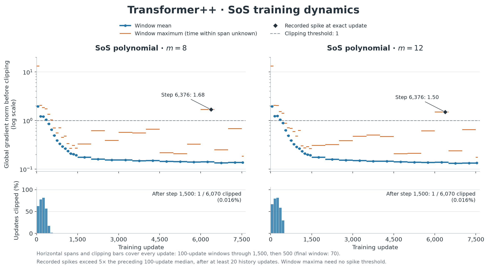
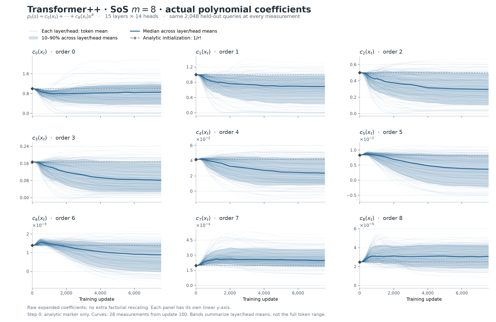
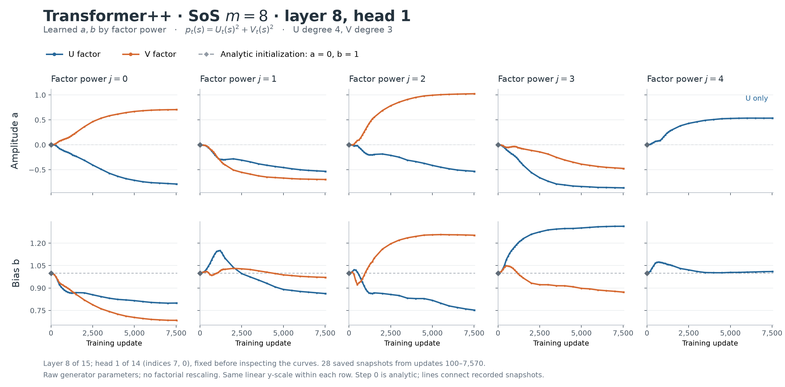
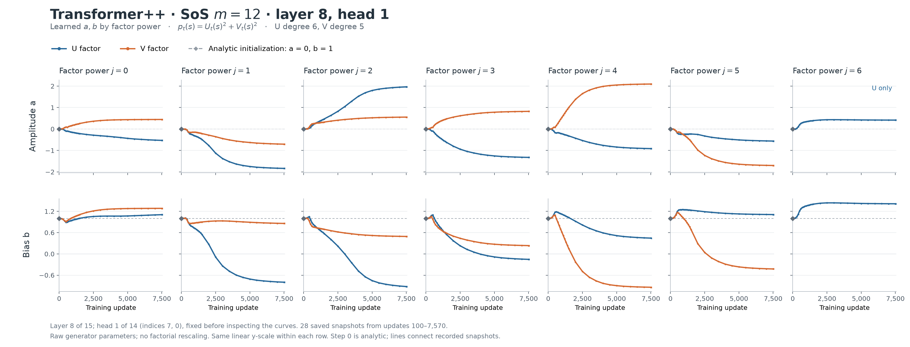

# Transformer++ sum-of-squares training dynamics

Closed diagnostic, recorded 2026-11-13. Are the completed query-conditioned
sum-of-squares (SoS) polynomial runs stable during training, and how do their
actual polynomial coefficients evolve? This isolated analysis uses existing
training measurements; it performs no optimizer updates or checkpoint replay and
enters no mechanism comparison or canonical result selection.

## Sources and method

The [selection](selection.yaml) pins two completed runs from the
[Transformer++ study](../../../README.md):

| Role | Run | Executed source commit |
| --- | --- | --- |
| SoS degree 8 | `reeefbcc19abf` | `5880cf28e339153446d491eecf9fff8f3e843de8` |
| SoS degree 12 | `r3d52b7ab43d1` | `7cfdf8cc506e3ee8573101f5ec87e17fe04de7b3` |

Both use the 15-layer width-896 shape, 14 heads, 2,048-token training context,
RoPE, canonical QK RMSNorm with learned positive per-head score scales,
unnormalized attention followed by per-head output RMSNorm, and tanh query
conditioning with coefficient-projection weight decay. Both completed 7,570
updates on Kennel using Mosaic. Their frozen recipes and execution records remain
under the study's `runs/` directory. The source commits preserve the executed
query-SoS implementation.

The 28 gradient reporting windows cover **every training update**, with 100-update
windows through 1,500, then 500-update windows and a final 70-update window. The
gradient norm is measured before global clipping at 1. Window maxima are plotted
as spans: their exact update is unknown unless a separate spike record supplies
it. These are not every-10-update sampled logs. Recorded spikes exceed five times
the preceding 100-update median after at least 20 history updates.

Actual expanded coefficients are recorded at the same 28 evaluation steps on the
same first held-out sequence (2,048 query tokens). Each order has token mean,
standard deviation, minimum, and maximum for every layer/head. The sequence hash
is `26d5803c7dc95fe7f5dd7015ae4195205246bda089792b2e0f478a29398df8a6`.

## Findings

| Recorded gradient statistic | Degree 8 | Degree 12 |
| --- | ---: | ---: |
| Clipped updates, entire run | 301 / 7,570 (3.976%) | 319 / 7,570 (4.214%) |
| Clipped updates after update 1,500 | 1 / 6,070 (0.0165%) | 1 / 6,070 (0.0165%) |
| Largest norm after update 1,500 | 1.6847 | 1.5031 |
| Update of that spike | 6,376 | 6,376 |
| Final-window mean norm | 0.1369 | 0.1349 |
| Final-window maximum norm | 0.1853 | 0.1766 |

These runs have an initial period of frequent clipping, followed by low, steady
gradient norms and one isolated late clipped update. The coincidence at update
6,376 is consistent with a shared minibatch effect, but does not establish its
cause. Held-out perplexity continues improving at the subsequent scheduled
evaluations (6,500, 7,000, and 7,500); the terminal evaluation is slightly worse
than validation best. The figures use the full training history, and the final
coefficient heatmaps explicitly use terminal update 7,570, not the retained
validation-best checkpoint at 7,500.



The coefficient histories show gradual adaptation and substantial differences
among heads. Many lower-order token-mean coefficients decrease from their Taylor
initialization. The highest-order coefficients remain nonzero: the terminal
pooled means of `8! c_8` and `12! c_12` are approximately 1.248 and 1.252,
respectively, relative to initialization 1. Thus the observed stability does not
come from uniformly removing the highest-order term. This does not measure its
contribution to attention, which also depends on the score distribution and
output normalization.

Some expanded coefficients become negative. That is compatible with the SoS
constraint: it constrains the complete polynomial, not each coefficient. All
recorded coefficient diagnostics are finite and valid. Smooth histories at the
evaluation cadence do not exclude changes between measurements.



[Degree-twelve coefficient histories](coefficients_m12.png) and final heatmaps
for [degree eight](coefficients_m8_final_taylor_relative.png) and
[degree twelve](coefficients_m12_final_taylor_relative.png) provide the companion
views. PDFs are saved alongside every PNG.

## One middle-layer head's amplitudes and biases

The focused view uses **layer 8 of 15, head 1 of 14** (zero-based indices 7, 0)
for both runs. This is the middle layer and first head, fixed before inspecting
the histories, rather than selected for unusual behavior. The selection records
these indices and the exact fields: `modulation_amplitude` for a and
`projection_bias` for b. All 28 evaluations preserve the raw parameters for every
generator coordinate; no token averaging or factorial rescaling is applied.





Each column is a power in a **square factor**, with blue for U and orange for V;
the top row shows a and the bottom row b, on a shared linear scale within each
row. These are the parameters in `F_j(x)=f_j[1+b_j+a_j tanh(W_j^T x)]/2`, not
parameters of the expanded `c_r`. Degree eight has factor coordinates
`U_0,...,U_4,V_0,...,V_3`; degree twelve has
`U_0,...,U_6,V_0,...,V_5`. The highest factor power has U only. The generic
`effective_coefficient_names` stored beside the arrays refer to expanded
coefficients and must not be used to label the generator coordinates.

Step-zero diamonds and dashed references mark analytic initialization a=0, b=1;
there is no saved step-zero snapshot. Lines connect the 28 recorded evaluations
from updates 100 through 7,570. Parameter changes between evaluations are not
resolved, and this single head does not summarize the full model.

This head has larger parameter drift at degree twelve: recorded a ranges from
−1.8381 to 2.0958 and b from −0.9411 to 1.4389, versus −0.8638 to 1.0245 and
0.6836 to 1.3130 at degree eight. Several degree-twelve factors develop opposing
a and b trends; U_2 ends at a=1.9649, b=−0.9231, and V_4 at a=2.0958,
b=−0.9411. The curves look gradual at this cadence. They do not establish tanh
saturation or a causal explanation of training stability; that would require
the projected inputs and their activation distributions. Negative generator
parameters are compatible with the sum-of-squares constraint.

[head_parameter_summary.csv](head_parameter_summary.csv) gives each coordinate's
initialization, first recorded value, terminal value, and recorded extrema.
PDFs accompany both figures.

## What the coefficients mean

Suppressing layer/head indices, the generator produces

\[
g_j(x_t)=b_j+a_j\tanh(W_j^\top x_t),\qquad
F_j(x_t)=f_j\frac{1+g_j(x_t)}2,
\]

where the fixed factors `f` factorize the even-degree Taylor polynomial. For
degree `m=2d`, split the generated factors into `U_0,...,U_d` and
`V_0,...,V_{d-1}`. Then

\[
p_t(s)=\left(\sum_{j=0}^{d}U_j(x_t)s^j\right)^2
      +\left(\sum_{j=0}^{d-1}V_j(x_t)s^j\right)^2
      =\sum_{r=0}^{m}c_r(x_t)s^r,
\qquad
c_r=\sum_{i+j=r}U_iU_j+\sum_{i+j=r}V_iV_j.
\]

The initialization `b=1, a=0` reproduces `c_r=1/r!` up to rounding. The plotted
`effective_summary` values are these expanded **actual `c_r`**, already including
factorial order scaling. They are neither the generator parameters `a,b,W` nor
the square factors. No further factorial division is applied.

History panels show all 210 layer/head token means, their median, and their
10th–90th percentiles across layer/head means. The bands are **not token
quantiles or confidence intervals**. Each panel uses its own linear vertical
axis. Final heatmaps separately display `r! mean_x c_r`, explicitly scaled
relative to Taylor initialization, to make different orders comparable.
[coefficient_summary.csv](coefficient_summary.csv) also preserves pooled token
mean/std, observed extrema, and counts of heads with negative means or any
negative token coefficient. Pooled variance includes both within-head token
variance and between-head mean variation.

The executed query implementation expands the squares in FP32 and evaluates the
expanded polynomial with Mosaic. It does not evaluate two squares directly.
Finite-precision cancellation can therefore yield small negative weights near
zeros despite algebraic nonnegativity. These measurements establish stable
training behavior for the two selected runs; they do not prove that SoS removes
all cancellation, guarantees stability at larger degree, or explains the
performance improvement. Token-level coefficient samples and inter-coefficient
covariances were not saved, so polynomial uncertainty bands cannot be recovered
from these marginal summaries.

## Regeneration

From the repository root, using its locked environment:

```bash
uv sync --project scaffolds/transformer --locked --link-mode hardlink
scaffolds/transformer/.venv/bin/python experiments/transformer_pp/results/diagnostics/sos_training_dynamics/plot.py
```

The script checks scientific input hashes, complete status, model shape, gradient
window coverage, and the coefficient sample/array invariants. It regenerates all
PNG/PDF figures and the three summary CSVs from committed run measurements; no GPU,
dataset, checkpoint, or training log is needed. Repeated regeneration is
byte-identical in the locked environment. To deliberately change selected inputs,
edit `selection.yaml`, refresh its pins, and regenerate:

```bash
scaffolds/transformer/.venv/bin/python -m scaffolds.records refresh experiments/transformer_pp/results/diagnostics/sos_training_dynamics
```
