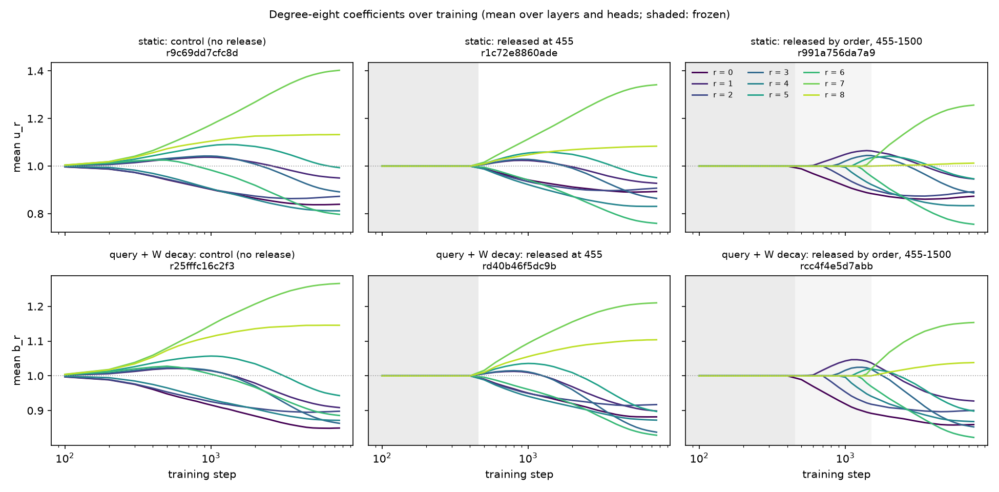

# Coefficient release

Opened 2026-11-08.

**Question.** At degree eight, learned coefficients finish behind fixed Taylor
(validation-best 14.294 static and 14.323 query + W decay, against 14.218). Do they reach
fixed Taylor if they stay at their Taylor initialization through warmup and then train,
all at once or one order at a time?

**Schedule.** Order r of the learned coefficients (static c_r; for the query generator
b_r, a_r and column r of W) is frozen for optimizer updates with count k < s_r and trains
for k ≥ s_r. Update count k is logged as step k + 1.

| Schedule | Release counts s_0, …, s_8 |
| --- | --- |
| `all` | 455 for every order (the first update after warmup) |
| `by_order` | 455 + ⌊r · 1,045 / 8⌋ = 455, 585, 716, 846, 977, 1,108, 1,238, 1,369, 1,500 |

- A frozen entry's gradient is zeroed before global-norm clipping and AdamW, and its update
  after AdamW, so neither the gradient nor weight decay moves it.
- A released entry's Adam moments start at zero, and bias correction keeps the global count,
  so its first update is about 0.45 of the full size.
- Every parameter follows the one shared learning-rate schedule.
- The scaffold README describes the implementation.

**Runs.** Each copies its control's recipe and adds only `optim.coefficient_release_*`.

| Run | Label | Control |
| --- | --- | --- |
| `rd40b46f5dc9b` | query-m8-w-decay-release-all | `r25fffc16c2f3` |
| `rcc4f4e5d7abb` | query-m8-w-decay-release-by-order | `r25fffc16c2f3` |
| `r1c72e8860ade` | static-m8-release-all | `r9c69dd7cfc8d` |
| `r991a756da7a9` | static-m8-release-by-order | `r9c69dd7cfc8d` |

**Controls.** Validation perplexity, best and terminal (update 7,570):

| Run | Model | Best | Terminal |
| --- | --- | ---: | ---: |
| `ra7ee8a4b2544` | fixed Taylor m = 8 | 14.218 | 14.223 |
| `ra040de24096c` | Hermite m = 8 | 14.225 | 14.231 |
| `r6a76e7fbde45` | exp | 14.257 | 14.262 |
| `r9c69dd7cfc8d` | static m = 8 | 14.294 | 14.299 |
| `r25fffc16c2f3` | query m = 8 + W decay | 14.323 | 14.328 |

**Success criterion.** A released run at or below fixed Taylor: 14.223 terminal, or 14.218
validation-best.

**Measurements.** Best and terminal perplexity, reported separately. Also the unscaled
coefficients u_r = r! c_r over training, from the evaluation coefficient reports: raw values
for static runs; b, a and the effective-coefficient summary for query runs.

**Findings.** All four runs completed 7,570 updates on 2026-11-08 (three B300, one H100).

| Run | Model and schedule | Best | Terminal | Best vs control | Best vs fixed Taylor |
| --- | --- | ---: | ---: | ---: | ---: |
| `rd40b46f5dc9b` | query + W decay, released at 455 | 14.229 | 14.237 | −0.094 | +0.011 |
| `rcc4f4e5d7abb` | query + W decay, by order | 14.242 | 14.243 | −0.081 | +0.024 |
| `r1c72e8860ade` | static, released at 455 | 14.343 | 14.346 | +0.049 | +0.125 |
| `r991a756da7a9` | static, by order | 14.243 | 14.246 | −0.051 | +0.025 |

- **No run reaches fixed Taylor (14.218 / 14.223); the success criterion is not met.** The
  closest, query released at 455, ends 0.011 above Taylor's best and level with Hermite
  (14.225).
- **Query + W decay gains from both schedules:** 0.09 and 0.08 below its control, and below
  exp (14.257). The gain exceeds most same-recipe rerun differences recorded elsewhere
  (median 0.006, at most 0.074), but rests on one seed.
- **Static is mixed:** by-order release helps (−0.05), releasing all orders at once hurts
  (+0.05). Both are within the rerun spread, so their ordering is unresolved.
- **The freeze held exactly:** before its release every coefficient, and the query runs'
  W, was bitwise at its initial value at every evaluation (the controls had moved by up to
  0.16 by update 400). Each release fired at its scheduled update.
- **Coefficients end near the controls':** once released they follow the controls' pattern
  ([coefficients.png](coefficients.png)): u_7 and u_8 grow (static means 1.34 / 1.08 with
  release at 455, against 1.40 / 1.13 for the control), the low orders fall to 0.8-0.9.

**Open decision.** Discard, or confirm the query result with a second seed before any
further schedule variant.

Regenerate `summary.csv` and `coefficients.png` with
`scaffolds/transformer/.venv/bin/python -m experiments.transformer_pp.results.exploratory.coefficient_release.plot`.

Launch commands are in the [study README](../../../README.md#coefficient-release); the runs
are listed in [selection.yaml](selection.yaml).
