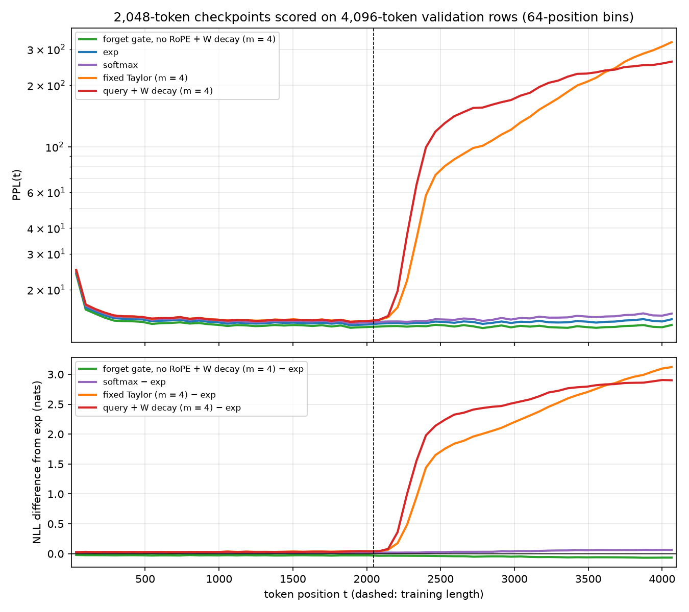

# Context length (2,048 and 4,096 tokens)

Opened 2026-11-01.

**Question.** How do the Transformer++ attention variants use context beyond the 2,048
tokens they were trained on, and how do they compare when trained at 4,096 tokens?

## Length extrapolation of 2,048-token checkpoints

`r8e4d56dfc830` scores five validation-best checkpoints (update 7,500, 7,570-update runs)
per position, with no training:

| Role | Run | Best validation PPL (2,048) |
| --- | --- | ---: |
| exp | `r6a76e7fbde45` (on `codex/qk-head-controls-4b`) | 14.257 |
| softmax | `r9040f12f3d80` | 14.543 |
| query + W decay, m = 4 | `rca97cc9db8f2` | 14.709 |
| fixed Taylor, m = 4 | `r816ab0fbe119` | 14.722 |
| forget gate, no RoPE + W decay, m = 4 | `r4a80e28ce0a7` (on `codex/fox-query-key-wdecay-4b`) | 13.873 |

For each model the evaluation first replays its own validation set (4,864 sequences of
2,048 positions) and must reproduce its recorded validation NLL within 0.002 nats. It then
raises the model's length limit to 4,096, which changes no parameter, and scores 2,432
validation rows of 4,097 tokens cut from the same token stream
(`/data/cl/u/rafah/home/datasets/fineweb_12b_seq4097/eval`). Its recipe pins every
checkpoint's files, recipe and recorded NLL; `metrics.jsonl` holds the per-position NLL of
both passes.



| Model | Replay error (nats) | PPL, positions 1–2,048 | PPL, positions 2,049–4,096 |
| --- | ---: | ---: | ---: |
| forget gate, no RoPE + W decay | 3.7e-6 | **13.92** | **13.24** |
| exp | 5.5e-6 | 14.30 | 13.92 |
| softmax | 1.1e-5 | 14.60 | 14.54 |
| fixed Taylor, m = 4 | 4.4e-6 | 14.77 | 112.94 |
| query + W decay, m = 4 | 1.2e-6 | 14.76 | 138.91 |

([extrapolation_summary.csv](extrapolation_summary.csv) has the exact values.)

- Every replay reproduces its model's recorded validation NLL within 1.1e-5 nats.
- Within the training length the ordering is the validation ordering.
- Beyond it, the forget gate without RoPE keeps improving (13.92 to 13.24, −4.9%), as does
  exp (−2.7%); softmax is flat (−0.4%).
- Both degree-four polynomial models break: perplexity rises within about 150 positions
  past 2,048 and reaches about 300 (fixed Taylor) and 260 (query) by position 4,096.
- RoPE alone does not explain the failure, since exp and softmax use RoPE and extrapolate.
  The [extrapolation_scores diagnostic](../../diagnostics/extrapolation_scores/README.md)
  finds the polynomial models' scores at unseen distances no larger than at seen ones;
  their weights decay too slowly with distance instead, so a late query puts 31–37% of its
  weight on keys more than 2,048 tokens back, against 9% for exp. The gated model has no
  RoPE and decays distant keys.

## Training at 4,096 tokens

Five runs repeat the models above at 4,096 tokens with the same tokens per update and
budget; the [study README](../../../README.md#context-length) gives the recipe and launch
commands. Findings: pending.

## Open decision

Add context length as a dimension of the Transformer++ comparison, or discard the topic.

## Regeneration

```bash
scaffolds/transformer/.venv/bin/python -m scaffolds.records refresh experiments/transformer_pp/results/exploratory/context_length
scaffolds/transformer/.venv/bin/python experiments/transformer_pp/results/exploratory/context_length/plot.py
```
