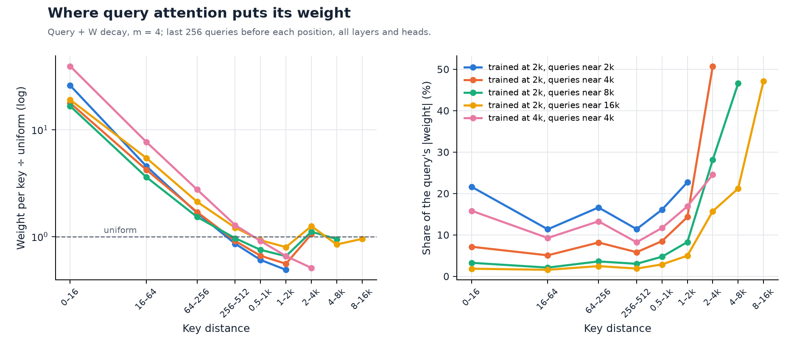
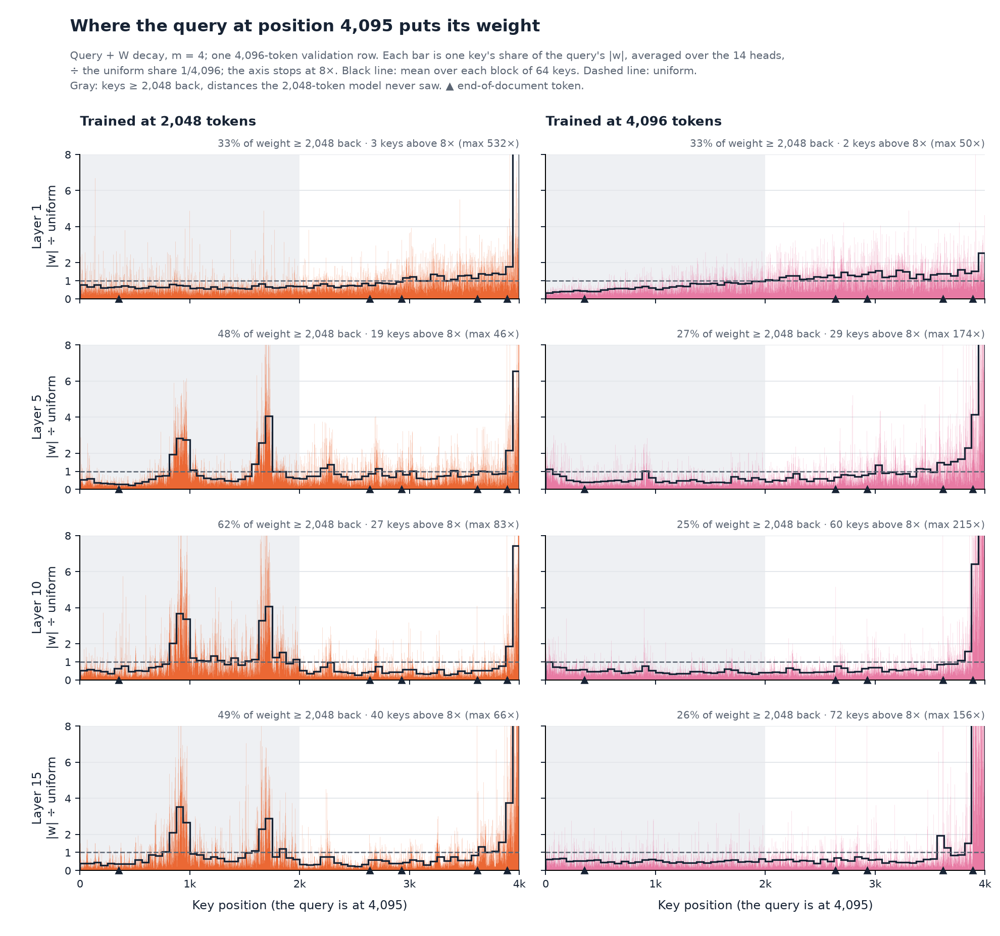
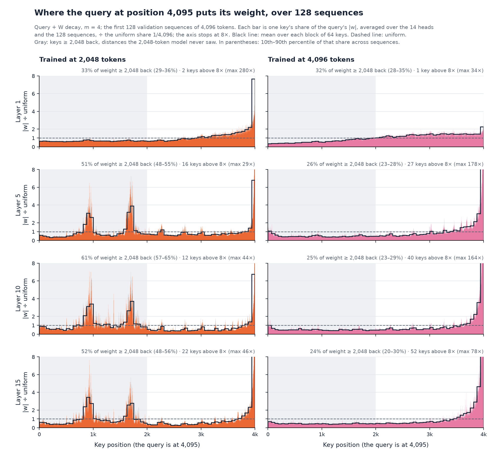

# Why query attention breaks past 2,048 tokens

Opened 2026-11-02.

**Question.** In [context_length](../context_length/README.md), the 2,048-token query + W decay
(m = 4) checkpoint reaches perplexity 3,081 by 16,384 tokens while FoX without RoPE stays near
13. Its scores at unseen distances are not larger
([extrapolation_scores](../../diagnostics/extrapolation_scores/README.md)). Does the break come
from keys beyond the training distance at all, and if so, is the trigger their RoPE phases or
how many of them there are?

## Run and method

`rb786bd19c6b1` evaluates the validation-best checkpoint of `rca97cc9db8f2` (update 7,500) per position
on the 608 held-out rows of 16,384 tokens that the original 16k evaluation
(`r2a45c518f703`) scored, with only the attention call replaced:

| Pass | Keys each query attends to | RoPE |
| --- | --- | --- |
| `full` (control) | all earlier keys | true positions |
| `window` | the most recent 2,048 keys (distance < 2,048) | true positions |
| `clamp` | all earlier keys | true positions within 2,047 tokens; distance 2,047 beyond |

`window` removes every key beyond the training distance, so no query sees more keys or
farther ones than in training. `clamp` keeps every key but gives each one farther than
2,047 tokens the phase of distance 2,047 (the query rotated to position 2,047 and the key left
at position 0), so every relative phase was seen in training while the number of keys grows.
The replacement computes the model's own unnormalized polynomial with its query
coefficients in FP32, in 256-query blocks, before the unchanged per-head output RMSNorm.
[`evaluate.py`](evaluate.py) implements it; on CPU it matches the scaffold's blocked
reference kernel, and `window` and `clamp` match a brute-force pairwise computation.

Qualification: `full` and `clamp` replay the model's 4,864-row validation set at 2,048
tokens (where all three passes are the same function) within 0.002 nats of its recorded NLL,
and `full` at 16,384 tokens must match the original Mosaic evaluation's first 2,048
positions within 0.002 nats. Nothing is trained. Launch commands are in the
[study README](../../../README.md#extrapolation-ablation).

## Findings and open decision

The evaluation ran on one H100 in about 40 minutes. Both 2,048-token replays reproduce the
recorded validation NLL within 3.6e-6 nats, and the 16k control reproduces the original Mosaic
evaluation to within 1.5e-5 nats over the first 2,048 positions and 3e-6 nats overall.

| Perplexity at positions | 1–2,048 | 2,049–2,304 | 2,305–3,072 | 3,073–4,096 | 4,097–8,192 | 8,193–12,288 | 12,289–16,384 |
| --- | ---: | ---: | ---: | ---: | ---: | ---: | ---: |
| query, original attention | 14.80 | 19.68 | 137.13 | 230.91 | 680.23 | 2,245.5 | 2,727.1 |
| query, 2,048-key window | 14.80 | 14.32 | 15.17 | 19.60 | 29.21 | 29.06 | 28.78 |
| query, RoPE clamped at 2,047 | 14.80 | 14.21 | 15.26 | 21.69 | 240.86 | 3,656.4 | 3,388.7 |
| exp (reference) | 14.36 | 13.62 | 13.96 | 14.01 | 14.68 | 16.76 | 19.26 |
| FoX no RoPE + W decay (reference) | 13.98 | 13.23 | 13.38 | 13.22 | 13.29 | 13.45 | 13.43 |

([summary.csv](summary.csv) has these values; the reference rows come from `r2a45c518f703`.)

- **The collapse comes from keys beyond 2,048 tokens.** Restricting each query to its most
  recent 2,048 keys removes it: overall perplexity at 16k falls from 659.7 to 25.0.
- **Two mechanisms act at different lengths.** Clamping RoPE phases at distance 2,047
  removes the break between 2,048 and 4,096 tokens (137 to 15 at positions 2,305–3,072, the
  same as the window), so unseen RoPE phases trigger the first failure. Beyond about 4,000
  tokens the clamped model collapses anyway (241 at 4k–8k, 3,656 at 8k–12k): once distant
  keys outnumber the window, their accumulated weight breaks it whatever their phase. This
  is the heavy tail the [score diagnostic](../../diagnostics/extrapolation_scores/README.md)
  measured, now shown to be sufficient on its own.
- **The window does not fully restore the model.** Its perplexity rises from 14.3 to about 29
  between positions 2,048 and 4,096 and then stays flat. Every query still sees 2,048 keys at
  trained distances, so the loss is something else the model had in training: plausibly the
  first tokens of the row, which carry 14 times their uniform share of weight within 2,048
  tokens and which late windows no longer include, with the damage spreading through layers
  until every key in the window was itself computed without them. Keeping the first few
  tokens in every window (as in streaming attention) would test this; it was not run.
- FoX without RoPE avoids both mechanisms: it has no positional phases and its gate decays
  distant keys exponentially.

## Weight profile by key distance

`r9155f2214b4b` measures how the same checkpoint, and the query + W decay model trained at
4,096 tokens (`r738b35a8e314`), spread late queries' weight over key distance: for queries in
the last 256 positions before 2,048, 4,096, 8,192 and 16,384 tokens, the share of |w| in
distance bins beside the share of keys each bin holds, and the effective number of keys, per
layer ([`weight_profile.py`](weight_profile.py)); 8 rows at 2,048 and 4,096 tokens, 4 at 16,384.

| Weight per key ÷ uniform, key distance | 0–16 | 16–64 | 64–256 | 256–512 | 0.5–1k | 1–2k | 2–4k | 4–8k | 8–16k |
| --- | ---: | ---: | ---: | ---: | ---: | ---: | ---: | ---: | ---: |
| trained at 2k, queries near 2k | 26.0 | 4.6 | 1.7 | 0.86 | 0.60 | 0.49 | | | |
| trained at 2k, queries near 4k | 17.8 | 4.2 | 1.7 | 0.91 | 0.66 | 0.56 | 1.05 | | |
| trained at 2k, queries near 16k | 19.1 | 5.4 | 2.1 | 1.21 | 0.92 | 0.80 | 1.25 | 0.84 | 0.95 |
| trained at 4k, queries near 4k | 39.3 | 7.7 | 2.8 | 1.28 | 0.91 | 0.66 | 0.51 | | |

([weight_profile.csv](weight_profile.csv) has every series with the weight and key shares.)

- **Past its training length the 2k model spreads its weight almost evenly.** Beyond about
  256 tokens every distance bin gets 0.8–1.25 times the uniform weight per key, out to 16k:
  queries near 16k put 84% of their weight on keys more than 2,048 tokens back and 6% on
  their nearest 256 keys (50% within training). Keys at unseen distances get no less per key
  than keys at trained distances.
- **Within training it already decays only slowly.** Near 2k, a key 1–2k back still gets half
  the uniform weight; with 24 times uniform on the nearest 16 keys and about a quarter of all
  weight on the farther half of the context. The effective number of keys is about a fifth
  of all keys at every length (0.19–0.27), so it grows linearly with context.
- **Training at 4k does not produce a window.** Near 4k, the 4k model still puts 25% of its
  weight on keys 2–4k back (0.51 times uniform per key), the same fraction the 2k model gives
  its own farther half at 2k; the broken 2k model gives them 51% (1.05 times uniform). The 4k
  model sharpens the nearest keys (39 times uniform against 18) and gives distant keys half
  the weight, in every layer (21–31% beyond 2k, against 32–72% for the 2k model, worst in
  the middle layers). It learned how much weight distant keys should get at 4k, not to
  remove them.

## Weights of one query over every key

`rece89382b690` runs the first 4,096-token validation row through both models (the 2k
checkpoint with only its forward-length limit raised; RoPE uses the true positions) and
records, for the query at position 4,095, each
key's share of |w| per layer, averaged over the 14 heads
([`position_weights.py`](position_weights.py)). It keeps the per-key structure the weight
profile averages away. The figure shows layers 1, 5, 10 and 15 on a linear axis.

| Weight per key ÷ uniform, key distance | 0–15 | 16–63 | 64–255 | 256–1,023 | 1,024–2,047 | 2,048–4,095 | Weight ≥ 2,048 back |
| --- | ---: | ---: | ---: | ---: | ---: | ---: | ---: |
| trained at 2k, layer 1 | 36.0 | 2.49 | 1.53 | 1.21 | 0.80 | 0.67 | 33% |
| trained at 2k, layer 5 | 16.7 | 3.20 | 1.30 | 0.80 | 0.84 | 0.95 | 48% |
| trained at 2k, layer 10 | 18.3 | 3.82 | 1.09 | 0.44 | 0.50 | 1.25 | 62% |
| trained at 2k, layer 15 | 24.3 | 6.38 | 2.13 | 0.70 | 0.44 | 0.98 | 49% |
| trained at 4k, layer 1 | 4.8 | 1.79 | 1.52 | 1.34 | 1.24 | 0.65 | 33% |
| trained at 4k, layer 5 | 41.8 | 6.06 | 2.71 | 1.11 | 0.64 | 0.54 | 27% |
| trained at 4k, layer 10 | 53.0 | 12.50 | 3.04 | 0.66 | 0.52 | 0.50 | 25% |
| trained at 4k, layer 15 | 29.1 | 11.59 | 4.43 | 0.73 | 0.58 | 0.52 | 26% |

([position_weights.csv](position_weights.csv) has all 15 layers, the weight on the row's
first key and on each end-of-document token, and the highest 64-key block ≥ 2,048 back.)

- **Past 2,048 tokens the 2k model's weight per key rises again.** In layers 6–12, keys
  2,048–4,095 back get 1.13–1.45 times the uniform weight each, more than keys 256–1,023
  and 1,024–2,047 back (0.34–0.74), and hold 57–73% of the query's weight. Layers 1–4 keep
  them below uniform (0.53–0.79). Averaged over layers they get 1.03 times uniform, against
  0.54 in the 4k model, close to the weight profile's 1.05 and 0.51.
- **Much of it lands on two stretches of one earlier document.** Keys 896–1,023 and
  1,664–1,791 (3,072–3,199 and 2,304–2,431 tokens back) hold the far region's highest 64-key
  block in every layer but 13: 1.8–7.5 times uniform in layers 2–12, 14 and 15, and 0.83 in
  layer 1, whose far weight is flat. The 4k model gives the same keys about uniform weight
  or less: its far blocks peak at 0.67–2.12 times uniform, and every peak above 1.4 is the
  row's first 64 keys (layers 11–14).
- **The 4k model decays with distance in every layer and keeps no window.** Keys
  2,048–4,095 back get 0.44–0.65 times uniform (22–33% of the weight), and its nearest 16
  keys get 20–53 times uniform in layers 3–15 against 9–24 in the 2k model.
- **Sinks.** The row's first token draws 30–60 times uniform in the 4k model's layers
  11–14 against 4–12 in the 2k model. End-of-document tokens (▲) are sinks in late layers of
  both models: in layers 11–14 the four within 2,048 keys of the query draw 9–101 times
  uniform in the 2k model and 11–254 in the 4k model, most on the nearest (3,981), and the
  one at 362 draws 1–12 and 2–14.
- The average over 128 sequences below shows that the two stretches are positional.

### Averaged over 128 sequences

`ra0ad3d431842` repeats the measurement on the first 128 validation sequences of 4,096 tokens
(one 4k training batch) and averages each key's share over the 14 heads and the 128
sequences. The query is at position 4,095 in every sequence, so each key position is the same
distance back in all of them: the average cancels content and keeps what depends on
distance. Its first sequence reproduces `rece89382b690`'s share beyond 2,048 to within 0.0005 in
every layer (H100 here, B300 there).

| Weight per key ÷ uniform, key distance | 0–15 | 16–63 | 64–255 | 256–1,023 | 1,024–2,047 | 2,048–4,095 | Weight ≥ 2,048 back (10th–90th percentile) |
| --- | ---: | ---: | ---: | ---: | ---: | ---: | ---: |
| trained at 2k, layer 1 | 21.8 | 2.95 | 1.97 | 1.35 | 0.81 | 0.66 | 33% (29–36%) |
| trained at 2k, layer 5 | 16.4 | 3.62 | 1.14 | 0.75 | 0.75 | 1.02 | 51% (48–55%) |
| trained at 2k, layer 10 | 18.5 | 2.84 | 1.18 | 0.58 | 0.49 | 1.22 | 61% (57–65%) |
| trained at 2k, layer 15 | 22.7 | 5.71 | 1.78 | 0.71 | 0.43 | 1.04 | 52% (48–56%) |
| trained at 4k, layer 1 | 4.1 | 1.64 | 1.45 | 1.44 | 1.25 | 0.63 | 32% (28–35%) |
| trained at 4k, layer 5 | 51.1 | 6.25 | 2.27 | 1.13 | 0.62 | 0.51 | 26% (23–28%) |
| trained at 4k, layer 10 | 56.8 | 9.01 | 2.51 | 0.85 | 0.57 | 0.51 | 25% (23–29%) |
| trained at 4k, layer 15 | 38.0 | 10.72 | 3.27 | 1.03 | 0.55 | 0.48 | 24% (20–30%) |

([position_weights_batch.csv](position_weights_batch.csv) has all 15 layers and the highest 64-key
block in the two stretches.)

- **The two stretches are positional, not content.** In all 15 layers the 2k model's highest
  far 64-key block lies in them (keys 896–959 or 1,728–1,791; 3,136–3,199 and 2,304–2,367
  tokens back), at 1.9–7.6 times uniform in layers 2–15 and 2.0–5.2 times the layer's own far
  average. Content differs from sequence to sequence; positions do not. The 4k model, trained
  at these distances, has a weak bump at the same keys: in every layer their highest block is
  1.1–1.5 times its far average and below uniform (at most 0.95). Both models favor these
  positions, and training at them keeps the bump small. RoPE at these distances is the likely
  source, consistent with clamping RoPE at 2,047 removing the break between 2,048 and 4,096
  tokens. With the query at one position, distance cannot be told apart from absolute key
  position; moving the query would separate them.
- **The single sequence was typical.** In layers 6–12 the 2k model gives keys 2,048–4,095 back
  1.09–1.46 times uniform each and 55–73% of the weight, more than half in at least 90% of
  sequences; the 4k model gives them 0.44–0.56 times uniform and 22–28%, and under 35% in at
  least 90% of sequences in every layer. Averaged over layers, 1.04 against 0.53, as in the
  weight profile (1.05 and 0.51).
- **Recent keys and the first token.** The 4k model's nearest 16 keys get 31–60 times uniform
  in layers 3–15, against 13–26 in the 2k model, and the row's first token 15–49 times in its
  layers 11–14, against 2–8. End-of-document sinks fall at different positions in each
  sequence and average out.

`plot.py`, `plot_profile.py` and `plot_positions.py` in this directory regenerate the
figures and tables from [selection.yaml](selection.yaml), run from the repository root.

**Open decision:** keep the result in the context-length discussion, or delete this topic
with its runs.
