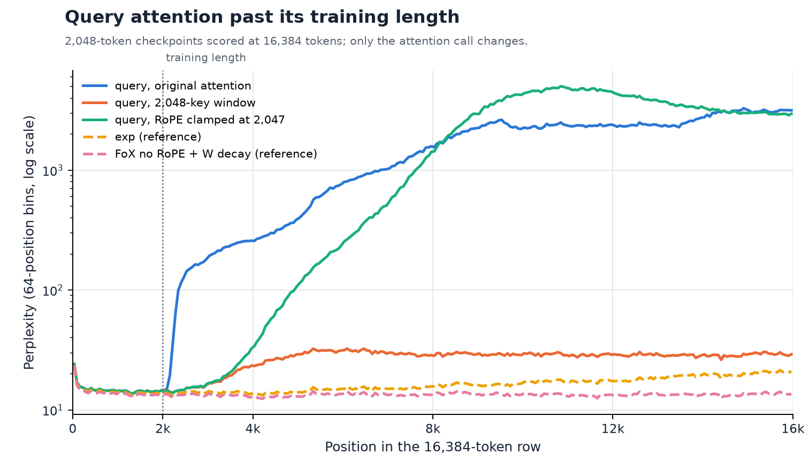

# Why query attention breaks past 2,048 tokens

Opened 2026-11-02.

**Question.** In [context_length](../context_length/README.md), the 2,048-token query + W decay
(m = 4) checkpoint reaches perplexity 3,081 by 16,384 tokens while FoX without RoPE stays near
13. Its scores at unseen distances are not larger
([extrapolation_scores](../../diagnostics/extrapolation_scores/README.md)). Does the break come
from keys beyond the training distance at all, and if so, is the trigger their RoPE phases or
how many of them there are?

## Run and method

`rb786bd19c6b1` evaluates the validation-best checkpoint of `rca97cc9db8f2` (update 7,500) per position
on the 608 held-out rows of 16,384 tokens that the original 16k evaluation
(`r2a45c518f703`) scored, with only the attention call replaced:

| Pass | Keys each query attends to | RoPE |
| --- | --- | --- |
| `full` (control) | all earlier keys | true positions |
| `window` | the most recent 2,048 keys (distance < 2,048) | true positions |
| `clamp` | all earlier keys | true positions within 2,047 tokens; distance 2,047 beyond |

`window` removes every key beyond the training distance, so no query sees more keys or
farther ones than in training. `clamp` keeps every key but gives each one farther than
2,047 tokens the phase of distance 2,047 (the query rotated to position 2,047 and the key left
at position 0), so every relative phase was seen in training while the number of keys grows.
The replacement computes the model's own unnormalized polynomial with its query
coefficients in FP32, in 256-query blocks, before the unchanged per-head output RMSNorm.
[`evaluate.py`](evaluate.py) implements it; on CPU it matches the scaffold's blocked
reference kernel, and `window` and `clamp` match a brute-force pairwise computation.

Qualification: `full` and `clamp` replay the model's 4,864-row validation set at 2,048
tokens (where all three passes are the same function) within 0.002 nats of its recorded NLL,
and `full` at 16,384 tokens must match the original Mosaic evaluation's first 2,048
positions within 0.002 nats. Nothing is trained. Launch commands are in the
[study README](../../../README.md#extrapolation-ablation).

## Findings and open decision

The evaluation ran on one H100 in about 40 minutes. Both 2,048-token replays reproduce the
recorded validation NLL within 3.6e-6 nats, and the 16k control reproduces the original Mosaic
evaluation to within 1.5e-5 nats over the first 2,048 positions and 3e-6 nats overall.

| Perplexity at positions | 1–2,048 | 2,049–2,304 | 2,305–3,072 | 3,073–4,096 | 4,097–8,192 | 8,193–12,288 | 12,289–16,384 |
| --- | ---: | ---: | ---: | ---: | ---: | ---: | ---: |
| query, original attention | 14.80 | 19.68 | 137.13 | 230.91 | 680.23 | 2,245.5 | 2,727.1 |
| query, 2,048-key window | 14.80 | 14.32 | 15.17 | 19.60 | 29.21 | 29.06 | 28.78 |
| query, RoPE clamped at 2,047 | 14.80 | 14.21 | 15.26 | 21.69 | 240.86 | 3,656.4 | 3,388.7 |
| exp (reference) | 14.36 | 13.62 | 13.96 | 14.01 | 14.68 | 16.76 | 19.26 |
| FoX no RoPE + W decay (reference) | 13.98 | 13.23 | 13.38 | 13.22 | 13.29 | 13.45 | 13.43 |

([summary.csv](summary.csv) has these values; the reference rows come from `r2a45c518f703`.)

- **The collapse comes from keys beyond 2,048 tokens.** Restricting each query to its most
  recent 2,048 keys removes it: overall perplexity at 16k falls from 659.7 to 25.0.
- **Two mechanisms act at different lengths.** Clamping RoPE phases at distance 2,047
  removes the break between 2,048 and 4,096 tokens (137 to 15 at positions 2,305–3,072, the
  same as the window), so unseen RoPE phases trigger the first failure. Beyond about 4,000
  tokens the clamped model collapses anyway (241 at 4k–8k, 3,656 at 8k–12k): once distant
  keys outnumber the window, their accumulated weight breaks it whatever their phase. This
  is the heavy tail the [score diagnostic](../../diagnostics/extrapolation_scores/README.md)
  measured, now shown to be sufficient on its own.
- **The window does not fully restore the model.** Its perplexity rises from 14.3 to about 29
  between positions 2,048 and 4,096 and then stays flat. Every query still sees 2,048 keys at
  trained distances, so the loss is something else the model had in training: plausibly the
  first tokens of the row, which carry 14 times their uniform share of weight within 2,048
  tokens and which late windows no longer include, with the damage spreading through layers
  until every key in the window was itself computed without them. Keeping the first few
  tokens in every window (as in streaming attention) would test this; it was not run.
- FoX without RoPE avoids both mechanisms: it has no positional phases and its gate decays
  distant keys exponentially.

**Open decision:** keep the result in the context-length discussion, or delete this topic
with its run.
