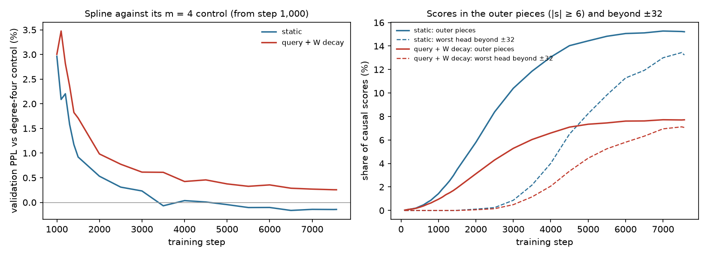

# Spline attention

Opened 2026-11-08.

**Question.** Can static or query-dependent polynomial splines replace the global
polynomial attention function? The proposed comparison has no FoX gate. Both
variants would use the same fixed knots and continue their boundary polynomial
pieces outside the knot interval. Input-dependent knots are deferred.

## Score calibration

Run `rb1a3a991da6c` reads the regular degree-four static model `r4339a245820e`
and query + W decay model `rca97cc9db8f2`, each at its seed-42 initialization and
retained validation-best checkpoint (step 7,500). Both use the 15-layer width-896
Transformer++ recipe, 2,048-token contexts, RoPE, QK RMSNorm with learned head
scaling, and unnormalized attention followed by head RMSNorm. There is no FoX gate.
Checkpoints and configurations remain unchanged; the diagnostic performs no
optimizer updates and creates no checkpoints.
Initialization is reconstructed from each source recipe under the diagnostic's
recorded scaffold; it is not an archived step-zero checkpoint or a proven
bitwise replay of historical initialization.

All snapshots use the same 16 training rows, starting at row zero with stride
100,003. These rows lie within the sources' consumed training stream. The run
captures the actual operands supplied to attention after QK normalization, head
scaling, and RoPE, and recomputes their dot products in FP32 with highest matmul
precision. It retains per-layer/head histograms, sampled score quantiles, per-query
extrema, and score-count and absolute-polynomial-weight coverage for candidate
symmetric ranges. It samples 128 query positions uniformly without replacement per sequence,
using every causal key for those positions, plus 4,096 uniformly sampled causal
pairs per sequence for quantiles. The immutable diagnostic recipe pins the source
recipes, checkpoint files, dataset manifest, sample settings, and candidate ranges.

**Open decision.** Whether quartic splines on this fixed grid match or beat the
degree-four polynomial, static and query-dependent (see
[Quartic spline pretraining](#quartic-spline-pretraining)). The calibration supports the
grid; it is not a bound on the spline models' scores or an optimized knot choice.

## Execution

Home cluster: Kennel. Execute from the isolated diagnostic worktree after syncing
its environment and committing the execution files:

```bash
uv sync --project scaffolds/transformer --locked --extra cuda --link-mode hardlink
JAX_PLATFORMS=cpu scaffolds/transformer/.venv/bin/python -m pytest -q experiments/transformer_pp/tests/test_calibrate_spline_scores.py
sbatch --parsable --job-name=spline-score-calibration \
  --output="$PWD/experiments/transformer_pp/runs/rb1a3a991da6c/training.log" \
  experiments/transformer_pp/calibrate_spline_scores.sbatch \
  "$PWD" "$(git rev-parse HEAD)" rb1a3a991da6c
```

The launcher requests one H100 in `standard`, freezes the execution set, and uses
the worktree's CUDA 12 environment. Runtime qualification checks the diagnostic
statistics against an explicit reference before processing model snapshots.

## Findings and regeneration

Completed on one H100 in Kennel `standard`, job 239571, in 6 minutes 52 seconds.
Five CPU checks passed; the allocated-device statistics matched the independent
NumPy FP64 reference with maximum absolute discrepancy 1.58e-6. All four snapshots
have finite outputs/statistics and zero zero-weight query rows. Measurements remain
under the run directory. No model parameters were updated.

| Snapshot | Pooled score std | Observed score range | Mean absolute-weight share outside ±12 | Outside ±24 |
| --- | ---: | --- | ---: | ---: |
| Static, reconstructed initialization | 1.005 | −5.09 to 5.24 | 0% | 0% |
| Query + W decay, reconstructed initialization | 1.005 | −5.09 to 5.24 | 0% | 0% |
| Static, checkpoint 7,500 | 3.032 | −25.19 to 30.93 | 14.11% | 0.543% |
| Query + W decay, checkpoint 7,500 | 2.720 | −19.10 to 25.10 | 7.09% | 0.00215% |

Each snapshot includes 441,346,920 causal scores from sampled query rows, with
65,536 independent causal-pair samples and 2,048 query extrema per layer/head.
Only 0.123% of static scores and 0.0403% of query scores lie outside ±12, so score
frequency alone understates the importance of the tails. Head pooling also matters:
at ±24, the largest head-level mean absolute-weight tail share is 28.12% for
static and 0.405% for query. No sampled query-row score lies outside ±32.

These are descriptive measurements on 16 training sequences, not bounds on the
training corpus or a future spline model. The same reconstructed initialization
produces identical measured score distributions in both controls. The trained
checkpoints are selected validation-best states, not terminal states. Absolute-weight
shares do not account for signed cancellation or value-vector directions.

### Provisional knot choice

Use endpoints −32 and 32, with three simple interior knots at **−6, 0, 6**.
Use the same grid for static and query coefficients, clamped endpoint multiplicity
`degree + 1`, and polynomial continuation. A degree-`m` spline then has `m + 4`
basis coefficients. This is a design recommendation, not a launched recipe.

The central range [−6,6] contains 94.83% of static and 96.71% of query score pairs.
The outer pieces nevertheless govern 55.24% and 44.98% of mean absolute-weight
share. This splits flexibility between the dense center and influential tails.
For comparison, using interior knots at ±4 would put about 76%/68% of absolute
weight outside the central pieces; ±8 would put 37%/27% there. These measurements
support ±6 as a reasonable starting compromise, not a validated optimum.

The endpoints cover the sampled extrema. With polynomial continuation, **only
interior knots are functional breakpoints**: the first and last pieces continue
past the endpoints. Endpoint placement affects B-spline coefficients and
conditioning, not additional tail flexibility. Thus uniform spacing across ±32
(interior knots −16,0,16) would place most ordinary scores in just the two central
pieces. The provisional grid instead gives those pieces boundaries near the
observed score distribution. Initialization and query-readout scaling must be
qualified with this nonuniform basis before training.

```bash
scaffolds/transformer/.venv/bin/python -m scaffolds.records refresh experiments/transformer_pp/results/exploratory/spline_attention
scaffolds/transformer/.venv/bin/python -m experiments.transformer_pp.results.exploratory.spline_attention.summarize
```

`summary.csv` distinguishes pooled score moments from the median and maximum of
per-layer/head sample quantiles. `coverage.csv` includes mean, 95th-percentile,
and maximum head-level tail-weight shares, so pooling cannot hide a head with
much broader scores. `score_coverage.png` shows the central score density and
mean absolute-weight share outside each candidate range. Weight shares are based
on absolute polynomial weights; signed cancellation and value vectors can change
their contribution to the final attention output.

## Quartic spline pretraining

**Recipe.** Degree-four B-splines on the clamped knot vector
[-32 ×5, -6, 0, 6, 32 ×5], eight basis functions shared by every layer, head and token;
outside [-32, 32] the end pieces continue. The weight f(s) of each causal score multiplies V
directly (unnormalized, signed), followed by the head RMSNorm.

- Static: f(s) = Σ_j θ_j B_j(s), eight coefficients per layer and head, no weight decay.
- Query: θ_j(t) = b_j + a_j tanh(w_j · x_t), the diagonal generator with eight outputs and
  weight decay 0.1 on W only.
- Both start exactly at T4(s) = 1 + s + s²/2 + s³/6 + s⁴/24, the controls' initial
  function: θ = b = [116131/3, 38029/6, -931/6, 38, -42, 2351/6, 63935/6, 49697] by
  blossoming, a = 0, W ~ N(0, 1/896). Spline parameters are FP32 with no factorial scaling.
- Each recipe differs from its control only in the basis, the unscaled coefficients and
  the blocked strips backend (the controls ran on Mosaic).

| Run | Label | Control |
| --- | --- | --- |
| `r7e4193fcafbd` | spline-static-m4 | `r4339a245820e` (static m = 4) |
| `rf303a5f94487` | spline-query-m4-w-decay | `rca97cc9db8f2` (query m = 4 + W decay) |

**Qualification** (scaffold validation record, "Blocked causal strips"; jobs 239705 B300 and
239706 H100 SXM): the spline GPU precision tests passed on both GPUs; BF16 output and
gradients are at the rounding floor (1.008×). One full-model update on the strips takes
4.53 s (static) and 5.16 s (query) on a B300 and 8.56 and 9.86 s on an H100 SXM, 1.5-1.65×
the degree-four polynomial on the same strips, with peak memory 30.5 and 32.5 GB (compile
2-3 minutes). The initial loss matches the controls' to five digits.

**Coefficient scale under Adam.** The outer stored coefficients are about 4e4 to 5e4, with FP32
spacing 2^-8, larger than twice the peak learning rate. The static θ_0 and θ_7 and
query offsets b_0 and b_7 stayed unchanged in the recorded evaluations. This is an
observed optimization limitation, not a hard bound on every Adam update. Query
amplitudes remain trainable, so unchanged offsets do not imply fixed effective
query coefficients or exactly fixed tails.

**Monitoring.** Evaluation diagnostics record, per layer and head, the fraction of causal
scores in each piece and beyond ±32 (polynomial continuation), with score extrema.

**Findings.** Both runs completed 7,570 updates on 2026-11-08 (one B300 each, jobs 239722
and 239723).

| Run | Best | Terminal | Control best / terminal | Best vs control |
| --- | ---: | ---: | ---: | ---: |
| `r7e4193fcafbd` static spline | 14.745 | 14.752 | 14.767 / 14.773 | −0.021 (−0.14%) |
| `rf303a5f94487` query spline + W decay | 14.746 | 14.751 | 14.709 / 14.714 | +0.038 (+0.26%) |

- **The splines tie the degree-four polynomials.** Both end at 14.75. The static spline
  starts behind (+2.6 PPL at update 500), crosses its control at update 3,500 and ends
  0.02 ahead; the query spline closes to +0.04. Both differences are within the
  same-recipe rerun spread recorded elsewhere (up to 0.074).
- **Large initial coordinates limit learning.** The outer static coefficients and
  query offsets did not move in the recorded evaluations. Query amplitudes did learn;
  the effective query coefficients must be assessed separately from their offsets.
  This motivates the affine initialization below before drawing broader conclusions
  about spline attention.
- **Scores leave the calibrated range.** At update 100 every score lies within ±8 (the
  trained m = 4 controls reach about ±30). By the end the static model's scores span
  −117 to +157 and the query model's −92 to +149: 15% and 8% of causal scores fall in the
  outer pieces (|s| ≥ 6), 0.16% and 0.06% beyond ±32, and in the most extreme head 13% and
  7% are evaluated by the polynomial continuation. 11 and 6 of the 210 heads have most of
  their scores in the outer pieces.



**Open decision.** Whether changing the initial function to an affine function lets
these splines learn useful departures from it and match the degree-four polynomial
controls. The fixed grid and polynomial continuation remain unchanged.

Regenerate `training_summary.csv` and `training.png` with
`scaffolds/transformer/.venv/bin/python -m experiments.transformer_pp.results.exploratory.spline_attention.plot_training`.


## Affine initialization comparison

`r325f7d64b940` (static) and `r2de7f1f4c9ce` (query + W decay) start from
**f(s) = 1 + s/4**, with exact B-spline coefficients
**[-7, -5.375, -3.375, -1, 3, 5.375, 7.375, 9]**. All eight remain trainable.
The query generator starts with b equal to this vector, a = 0, and the same random
W initialization as `rf303a5f94487`. W receives decay 0.1; a and b do not. Static
coefficients receive no decay. The coefficients have no factorial scaling.

Their paired source recipes are `r7e4193fcafbd` and `rf303a5f94487`, respectively.
Only the initial spline function changes: the quartic basis, knots, polynomial
continuation, RoPE, absence of FoX gates, QK RMSNorm and learned head scale, output
head RMSNorm, seed 42, backbone initialization, data, 2,048-token context, global
batch 256, 7,570 updates and learning-rate schedule all match those sources. Signed
weights are allowed; the initial affine function is negative below score -4.
This is an initialization comparison, not a claim that the affine function matches
Taylor at initialization.

Execution uses the optimized blocked JAX causal strips, with no fused spline kernel.
The source B300 jobs took 10 h 50 min (static) and 12 h 13 min (query), including
acceptance and evaluation; these are estimates for the new runs, excluding queue
wait. Each new run requests one B300 in `standard` independently.

The adapter `experiments.transformer_pp.spline_affine_acceptance` pins the source
recipes and checks actual initial coefficient arrays, unchanged backbone and query
projection draws, parameter counts and the optimizer decay mask. Shared acceptance
also checks the spline computation and gradients, a full-recipe pilot, validation,
and exact fresh-process checkpoint resumption before training starts. Run records
hold acceptance outcomes, exact submission commands and scheduler IDs. Monitoring
checks scheduler state and run outputs for failures, inactivity and completion;
completed results will distinguish validation-best and terminal PPL against both
the same-family Taylor-initialized spline and the global-polynomial control.
