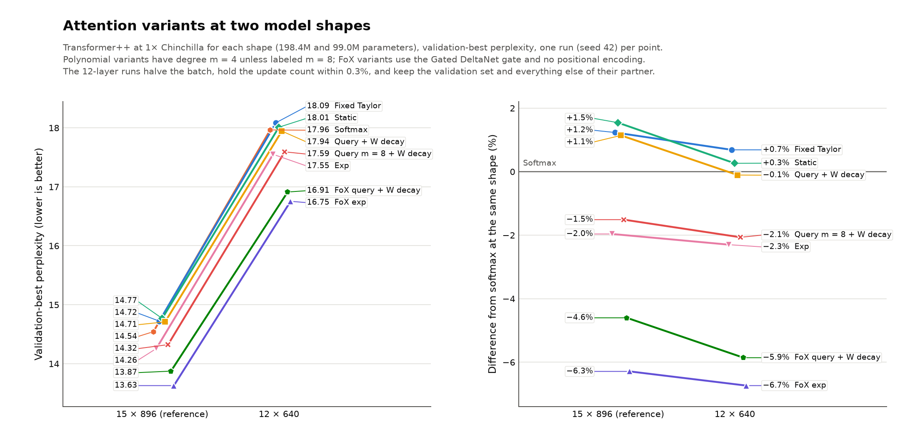

# Shape pairs

**Question.** Do the attention-variant comparisons of the Transformer++ recipe hold at a
smaller model shape? Eight variants train at the 12-layer width-640 shape, each against its
partner at the 15-layer width-896 reference shape, both at 1× Chinchilla.

## Method

Each 12-layer run is its partner's recipe derived by the study's
[recipe rules](../../../README.md#model-shapes-and-token-budgets) with
`derive_recipe.py --layers 12 --width 640`: 10 heads of width 64 for queries, keys and
values, SwiGLU width 1,664, batch 128, 7,551 updates (1.98B prediction tokens), warmup 454,
and the reference's 4,864 validation sequences (38 batches of 128) at the same cadence.
The 1× budget comes from the normalized-softmax model at the shape (98,977,016 parameters)
and holds for every variant. A query-coefficient projection draws its initial entries with
standard deviation $1/\sqrt{640}$ (the reference's $1/\sqrt{896}$, rescaled with the width).
"FoX" here is the forget gate in Gated DeltaNet's form (`attention_forget_gate_form: input`),
not the Forgetting Transformer's original sigmoid gate.
Everything else is the partner's: data and its order, tokenizer, context 2,048, positional
encoding, QK RMSNorm with the learned head scale, output normalization (per-head RMSNorm for
the unnormalized variants), peak learning rate 0.001 with floor 0.0001, AdamW settings,
seed 42, attention backend, and the initialization rules, whose depth- and width-dependent
values follow the shape: residual projections 0.02/sqrt(24) instead of 0.02/sqrt(30), and the
forget gate's projection Uniform(±1/sqrt(640)).

| Variant | 12-layer width-640 run | Reference-shape partner | Partner best |
| --- | --- | --- | ---: |
| Softmax | `rf81c96f76a1d` | `r9040f12f3d80` | 14.543 |
| Exp | `r3e2fa2532c23` | `r6a76e7fbde45` | 14.257 |
| Fixed Taylor m = 4 | `r2c432bd3a2a4` | `r816ab0fbe119` | 14.722 |
| Static m = 4 | `r94e0f2b8cff9` | `r4339a245820e` | 14.767 |
| Query m = 4 + W decay | `r4cce9a985a70` | `rca97cc9db8f2` | 14.709 |
| Query m = 8 + W decay | `r95a5691d293f` | `r25fffc16c2f3` | 14.323 |
| FoX query m = 4 + W decay, no positional encoding | `r3d14b598d88f` | `r4a80e28ce0a7` | 13.873 |
| FoX exp, no positional encoding | `ra5dfd978d3bd` | `r183f08346ddc` | 13.628 |

The [selection](selection.yaml) pins each pair. Launch commands are in the
[study README](../../../README.md#model-scale).

## Results



<!-- BEGIN GENERATED RESULTS -->

**Validation-best perplexity**

| Variant | 15 × 896 | 12 × 640 | 12 × 640 / 15 × 896 | vs softmax, 15 × 896 | vs softmax, 12 × 640 |
| --- | ---: | ---: | ---: | ---: | ---: |
| FoX exp | 13.628 | 16.753 | 1.229 | -6.29% | -6.74% |
| FoX query m = 4 + W decay | 13.873 | 16.911 | 1.219 | -4.60% | -5.86% |
| Exp | 14.257 | 17.550 | 1.231 | -1.96% | -2.30% |
| Query m = 8 + W decay | 14.323 | 17.592 | 1.228 | -1.51% | -2.07% |
| Query m = 4 + W decay | 14.709 | 17.944 | 1.220 | +1.14% | -0.11% |
| Softmax | 14.543 | 17.964 | 1.235 | – | – |
| Static m = 4 | 14.767 | 18.010 | 1.220 | +1.54% | +0.26% |
| Fixed Taylor m = 4 | 14.722 | 18.087 | 1.229 | +1.23% | +0.68% |

Validation-best updates: 15 × 896 (reference) 7,500; 12 × 640 7,551.

**Terminal perplexity and parameters**

| Variant | 15 × 896 run | Terminal | Parameters | 12 × 640 run | Terminal | Parameters |
| --- | --- | ---: | ---: | --- | ---: | ---: |
| FoX exp | `r183f08346ddc` | 13.630 | 198,642,166 | `ra5dfd978d3bd` | 16.753 | 99,061,736 |
| FoX query m = 4 + W decay | `r4a80e28ce0a7` | 13.875 | 199,585,066 | `r3d14b598d88f` | 16.911 | 99,446,936 |
| Exp | `r6a76e7fbde45` | 14.262 | 198,453,586 | `r3e2fa2532c23` | 17.550 | 98,984,696 |
| Query m = 8 + W decay | `r25fffc16c2f3` | 14.328 | 200,150,806 | `r95a5691d293f` | 17.592 | 99,678,056 |
| Query m = 4 + W decay | `rca97cc9db8f2` | 14.714 | 199,396,486 | `r4cce9a985a70` | 17.944 | 99,369,896 |
| Softmax | `r9040f12f3d80` | 14.546 | 198,440,146 | `rf81c96f76a1d` | 17.964 | 98,977,016 |
| Static m = 4 | `r4339a245820e` | 14.773 | 198,454,636 | `r94e0f2b8cff9` | 18.010 | 98,985,296 |
| Fixed Taylor m = 4 | `r816ab0fbe119` | 14.724 | 198,453,586 | `r2c432bd3a2a4` | 18.087 | 98,984,696 |

<!-- END GENERATED RESULTS -->

## Findings

- Every variant's validation-best perplexity rises by 22–24% at the 12-layer shape
  (×1.219–1.235). Each variant's difference from softmax changes by at most 1.3 percentage
  points between the shapes.
- The leading order holds at both shapes: FoX exp, FoX query m = 4 + W decay, exp, then
  query m = 8 + W decay, all below softmax. Their gains over softmax grow at the smaller shape:
  FoX exp −6.3% to −6.7% and exp −2.0% to −2.3% (0.3–0.4 points), query m = 8 −1.5% to −2.1%
  (0.6 points), FoX query −4.6% to −5.9% (1.3 points).
- Query m = 8 + W decay trails exp by 0.46% at the reference shape and by 0.24% at 12 × 640:
  it does not overtake exp at the smaller shape, and one seed per run does not resolve the
  0.2-point change. Its lead over query m = 4 + W decay shrinks from 2.6% to 2.0%.
- The three m = 4 polynomials with RoPE and no forget gate move toward softmax at the smaller
  shape: query + W decay from +1.1% to −0.1% (a tie), static from +1.5% to +0.3%, fixed Taylor
  from +1.2% to +0.7%.
  Softmax pays the most for the smaller shape (×1.235); FoX query, query m = 4 and static the
  least (×1.219–1.220).
- At the reference shape softmax leads that cluster by 1.1–1.5%; at 12 × 640 it sits inside
  the cluster's 0.8% spread, whose order changes (query m = 4, softmax, static, fixed Taylor;
  0.1–0.4 points between neighbors). With one seed per run and no gap in this comparison replicated,
  that order is not resolved.

## Limits

- The step is 0.50× in total parameters but 0.41× without the input and output embeddings,
  because the 32,000-token vocabulary is fixed: they are 41% of the smaller model and 29% of
  the reference. With half the tokens as well, training compute is about 0.25× (6ND).
- Shape and batch change together, by rule, so the update count stays within 0.3% of the
  reference's (7,551 against 7,570).
- The peak learning rate is 0.001 at both shapes. It was chosen at the reference shape by
  1,500-update normalized-softmax pilots (peaks 0.0005, 0.001 and 0.002, with the earlier QK
  setup) and is not re-tuned for the 12-layer shape or for any variant.
- One seed per run.
- Six 12-layer runs trained on one B300 and FoX query on one H100 SXM. Fixed Taylor trained
  updates 1–1,892 on a B300, was preempted, and resumed from its update-1,500 checkpoint on an
  H100 SXM, which trained the rest and its validation-best checkpoint. The partners trained on
  a B300 (softmax, exp, fixed Taylor, query m = 8, FoX query), an H100 PCIe (static) and an
  H100 SXM (query m = 4; FoX exp, resumed from update 6,500), so the GPU type differs within five pairs, and each
  pair's runs executed different source commits.
- Each 12-layer run's validation-best checkpoint is its final update, 7,551; the reference
  runs' is update 7,500 of 7,570.

## Regeneration

From the worktree root, re-pin the selection after its runs change, then regenerate
`summary.csv`, `shape_pairs.png`/`.pdf` and the tables above:

```bash
scaffolds/transformer/.venv/bin/python -m scaffolds.records refresh experiments/transformer_pp/results/l12_d640/shape_pairs
PYTHONPATH=. scaffolds/transformer/.venv/bin/python -m experiments.transformer_pp.results.l12_d640.shape_pairs.plot
```

`tests/` checks the pins; that each pair differs only by the shape rules and matches a fresh
derivation; that every variant is its declared mechanism and otherwise softmax's recipe at the
same shape; each shape's 1× budget; the quoted values; and byte-identical regeneration.
