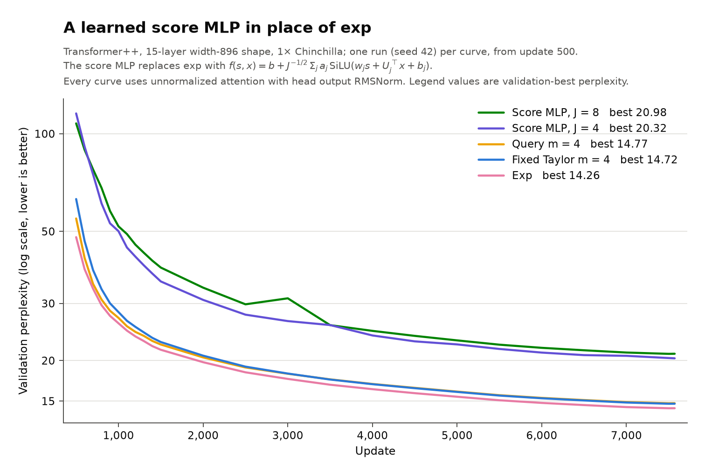

# Score MLP

Can a learned MLP of the score and the query token replace exp in unnormalized attention?
The conventional score MLP replaces the attention kernel with

$$f(s, x_t) = b_{\mathrm{out}} + \frac{1}{\sqrt{J}}\sum_{j=1}^{J} a_j\,\mathrm{SiLU}\big(w_j s + U_j^\top x_t + b_j\big),$$

where $s$ is the query–key score and $x_t$ the query token's pre-attention RMSNorm activation.
Its weights are learned per layer and head and do not depend on the token; they start random
and its biases at zero. Each MLP run copies the query control `r2b22f2ff6461` except for this
kernel, so every run here is unnormalized attention with head output RMSNorm, canonical QK
RMSNorm and RoPE, at the 15-layer width-896 shape and 1× Chinchilla, with one seed. Method and
launch commands: [study README](../../../../../README.md#score-mlp). Runs and roles:
[`selection.yaml`](selection.yaml).



## Results

<!-- BEGIN GENERATED RESULTS -->

| Variant | Run | Best | Terminal | Best vs exp | Late updates clipped | Parameters |
| --- | --- | ---: | ---: | ---: | ---: | ---: |
| Exp | `r6a76e7fbde45` | 14.257 | 14.262 | – | 0.0% | 198,453,586 |
| Fixed Taylor m = 4 | `r816ab0fbe119` | 14.722 | 14.724 | +3.3% | 0.0% | 198,453,586 |
| Query m = 4 | `r2b22f2ff6461` | 14.774 | 14.779 | +3.6% | 0.2% | 199,396,486 |
| Score MLP, J = 4 | `rea8b942672f4` | 20.321 | 20.321 | +42.5% | 82.7% | 199,208,956 |
| Score MLP, J = 8 | `rfc68c6d26f40` | 20.976 | 20.992 | +47.1% | 39.0% | 199,964,116 |

Validation-best updates: Exp 7,500; Fixed Taylor m = 4 7,500; Query m = 4 7,500; Score MLP, J = 4 7,570; Score MLP, J = 8 7,500.

Late updates clipped: the fraction of updates 4,000–7,570 whose gradient norm exceeded the clipping threshold of 1.

<!-- END GENERATED RESULTS -->

## Findings

- The score MLP does not replace exp: `J = 4` ends 42.5% above it, and 37.5% above the
  query control whose recipe it copies.
- Width does not help: `J = 8` ends 3.2% above `J = 4`.
- The MLP trains less stably. Gradient clipping still rescales 83% (`J = 4`) and 39%
  (`J = 8`) of late updates, against at most 0.2% for the controls, and the `J = 8`
  validation perplexity rose from 29.81 to 31.11 between updates 2,500 and 3,000.

## Limitations

- One seed, at one shape and token budget.
- The MLP changes the kernel's form and its initialization together, so this tests the
  conventional MLP as a whole, not one ingredient.
- On the fused score-MLP kernel, `J = 4` takes about 10.5 hours on one B300 and `J = 8`
  about 21.

## Regeneration

From the repository root, re-pin the selection after its runs change, then regenerate
`summary.csv`, `score_mlp.png`/`.pdf` and the table above:

```bash
scaffolds/transformer/.venv/bin/python -m scaffolds.records refresh experiments/transformer_pp/results/pretraining/alternative_attention/mlp/score_mlp
PYTHONPATH=. scaffolds/transformer/.venv/bin/python -m experiments.transformer_pp.results.pretraining.alternative_attention.mlp.score_mlp.plot
```

`tests/` checks the pins; that every run trains its declared variant on the query control's
recipe and that the two MLP runs differ only in `J`; the quoted values; and byte-identical
regeneration.
