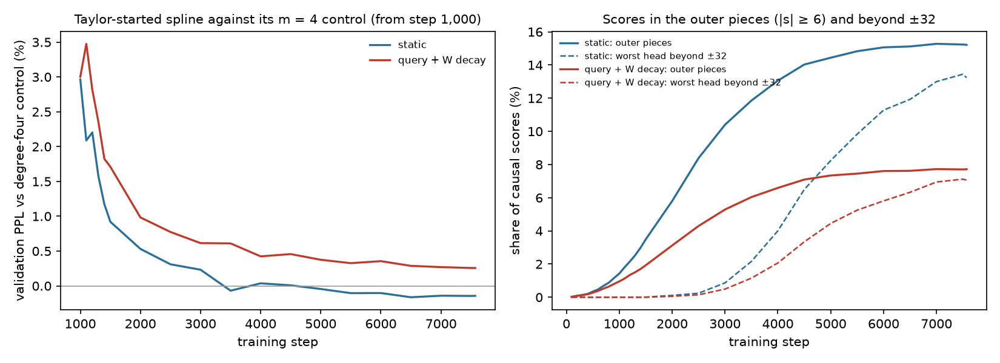
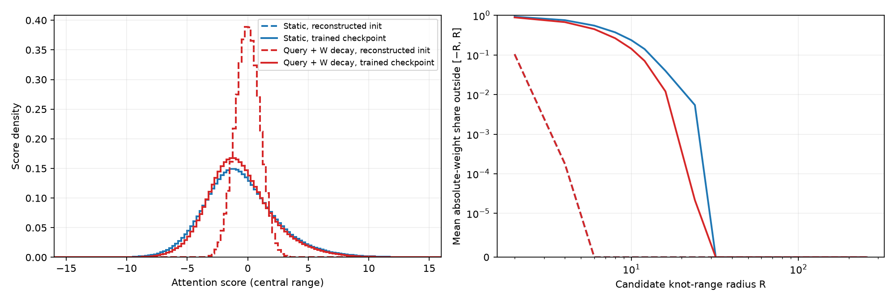

# Spline attention

Can a learned quartic B-spline of the score replace the global polynomial kernel, with static or
query-dependent coefficients, and how much does its initial function matter?



## Method

- **Kernel.** Each causal score $s$ gets the weight $f(s) = \sum_{j=1}^{8} \theta_j B_j(s)$: degree-four
  B-splines on the clamped knots $[-32^{\times 5}, -6, 0, 6, 32^{\times 5}]$, shared by every layer, head
  and token. Outside $[-32, 32]$ the end pieces continue as polynomials. The weights multiply $V$ directly
  (unnormalized and signed), followed by head RMSNorm.
- **Coefficients.** Static: eight per layer and head, no weight decay. Query:
  $\theta_j(t) = b_j + a_j \tanh(w_j^\top x_t)$, the diagonal generator with eight outputs, weight decay
  0.1 on $W$ only. Coefficients are FP32, with no factorial scaling.
- **Initial functions.** The static coefficients and the query offsets start at the exact B-spline
  coefficients of each function; query amplitudes start at zero and $W$ at its control's draw.

  | Start | $f(s)$ at initialization | B-spline coefficients |
  | --- | --- | --- |
  | Taylor | $T_4(s) = \sum_{r \le 4} s^r / r!$, the controls' start | [116131/3, 38029/6, −931/6, 38, −42, 2351/6, 63935/6, 49697] |
  | Affine | $1 + s/4$ | [−7, −5.375, −3.375, −1, 3, 5.375, 7.375, 9] |
  | Quadratic | $1 + s + s^2/2$ | [481, 559/2, 605/6, −10, 6, 815/6, 661/2, 545] |
  | Scaled binomial | $(1 + s/4)^4 / 16$ | [2401/16, 343/32, −49/32, 35/64, −45/64, 405/32, 3645/32, 6561/16] |

- **Controls.** The Taylor-started splines copy the degree-four polynomials static `r4339a245820e` and
  query + W decay `rca97cc9db8f2` except for the basis, the unscaled coefficients and the backend: the
  splines train on the blocked causal strips, the controls on Mosaic. Every other start changes only its
  initial function from its Taylor-started partner. All are Transformer++ at the 15-layer width-896
  shape and 1× (7,570 updates), seed 42, RoPE, without a forget gate. Recipes and launch commands are in
  the [study README](../../../../../README.md#spline-attention); the scaffold's
  [validation record](../../../../../../../scaffolds/transformer/validation/README.md) qualifies each start.

## Results

<!-- BEGIN GENERATED INITIALIZATIONS -->

| Initial function | Static | Query + W decay |
| --- | ---: | ---: |
| Taylor, $T_4(s)$ | 14.745 | 14.746 |
| Affine, $1 + s/4$ | 17.933 (+21.6%) | 16.968 (+15.1%) |
| Quadratic, $1 + s + s^2/2$ | 15.769 (+6.9%) | 15.675 (+6.3%) |
| Scaled binomial, $(1 + s/4)^4/16$ | 16.290 (+10.5%) | 16.360 (+10.9%) |
| Degree-four polynomial control | 14.767 | 14.709 |

Validation-best perplexity; in parentheses, the difference from the Taylor-started spline with the same generator. Terminal values are in `initialization_summary.csv`.

<!-- END GENERATED INITIALIZATIONS -->

## Findings

- **Started at Taylor, the splines tie the degree-four polynomials:** 14.745 against 14.767 static and
  14.746 against 14.709 query, within the same-recipe rerun spread recorded elsewhere (up to 0.074). The
  static spline starts behind (+2.6 PPL at update 500) and passes its control at update 3,500.
- **Every other start is clearly worse,** 6–22% behind Taylor: quadratic by 6.3–6.9%, scaled binomial by
  10.5–10.9%, affine by 15.1–21.6%. The query generator narrows only the affine gap (15.1% against 21.6%
  static).
- **The Taylor-started functions stay near $T_4$.** Its outer coefficients are about $4 \times 10^4$ to
  $5 \times 10^4$, whose FP32 spacing ($2^{-8}$) exceeds twice the peak learning rate: the static
  $\theta_0, \theta_7$ and query offsets $b_0, b_7$ never moved in the recorded evaluations, while the
  central coefficients and the query amplitudes did. The other starts have far smaller coefficients
  (largest spacing 64 times finer for the quadratic), so their tails can move.
- **Scores leave the calibrated range.** At update 100 every score lies within ±8. At the end the
  Taylor-started static model's scores span −117 to +157 and the query model's −92 to +149: 15% and 8%
  of causal scores fall in the outer pieces ($|s| \ge 6$) and 0.16% and 0.06% beyond ±32.

## Knot calibration

Run `rb1a3a991da6c` measured the two controls' attention scores at their reconstructed initialization
and at their validation-best checkpoint (update 7,500), on 16 training sequences. Scores are recomputed
in FP32 from the operands after QK normalization, head scaling and RoPE.

| Snapshot | Pooled score std | Observed score range | Mean absolute-weight share outside ±12 | Outside ±24 |
| --- | ---: | --- | ---: | ---: |
| Static, reconstructed initialization | 1.005 | −5.09 to 5.24 | 0% | 0% |
| Query + W decay, reconstructed initialization | 1.005 | −5.09 to 5.24 | 0% | 0% |
| Static, checkpoint 7,500 | 3.032 | −25.19 to 30.93 | 14.11% | 0.543% |
| Query + W decay, checkpoint 7,500 | 2.720 | −19.10 to 25.10 | 7.09% | 0.00215% |

- The central range [−6, 6] holds 94.8% (static) and 96.7% (query) of the trained score pairs, but the
  outer pieces carry 55.2% and 45.0% of the mean absolute weight, so interior knots at −6, 0 and 6 split
  flexibility between the dense centre and the influential tails. Knots at ±4 would put about 76% and 68%
  of the absolute weight outside the central pieces, and ±8 37% and 27%.
- No sampled score lies outside ±32, so the endpoints cover the observed extrema. With polynomial
  continuation only the interior knots are breakpoints.
- `summary.csv` and `coverage.csv` hold the per-head quantiles and tail shares behind these figures.



## Limitations

- One seed per run.
- The splines train on the blocked causal strips and their controls on Mosaic: the same mathematics in
  another implementation. One full-model update on the strips takes 1.5–1.65 times the degree-four
  polynomial's.
- Each start also changes the coefficients' scale, and with it how far Adam moves them, so the comparison
  does not separate the initial function from its coefficient scale.
- The knot calibration is descriptive, from 16 sequences of two trained models: not a bound on the
  spline models' scores, and absolute-weight shares ignore signed cancellation and value directions.

## Regeneration

From the repository root, re-pin the selection after its runs change, then regenerate the calibration
(`summary.csv`, `coverage.csv`, `score_coverage.png`) and the pretraining results (`training_summary.csv`,
`training.png`, `initialization_summary.csv` and the table above):

```bash
scaffolds/transformer/.venv/bin/python -m scaffolds.records refresh experiments/transformer_pp/results/pretraining/alternative_attention/splines/spline_attention
PYTHONPATH=. scaffolds/transformer/.venv/bin/python -m experiments.transformer_pp.results.pretraining.alternative_attention.splines.spline_attention.summarize
PYTHONPATH=. scaffolds/transformer/.venv/bin/python -m experiments.transformer_pp.results.pretraining.alternative_attention.splines.spline_attention.plot_training
```

`tests/` checks the pins; that each start's recipe is its Taylor-started partner's apart from the
initial function; the quoted values; and byte-identical regeneration.
