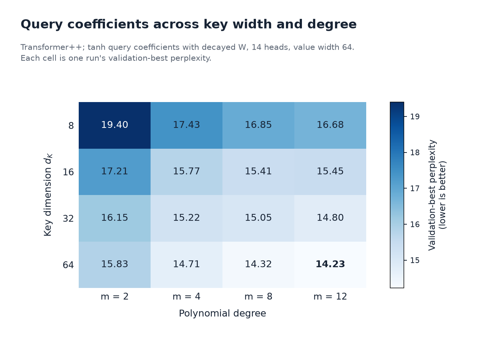

# Query coefficients across key width and degree (Transformer++)

Opened: **2026-10-31**. Home cluster: **Kennel**.

How do the key width `d_K` and the polynomial degree `m` shape validation perplexity for
tanh query-conditioned coefficients with a decayed projection `W`, the best query
parameterization at `d_K = 64`, `m = 4` (`query-m4-w-decay`, `rca97cc9db8f2`, 14.71)? This is
the Transformer++ counterpart of the key-width-by-degree heatmap in
[attention_scaling](../../../../../../results/attention_scaling/README.md), restricted to this one
mechanism. The runs live in the [Transformer++ study](../../../../README.md).

## Runs

| `d_K` \ `m` | 2 | 4 | 8 | 12 |
| --- | --- | --- | --- | --- |
| 8 | `r7bede0f75198` | `r1c80ab3a466b` | `r16b23893884d` | `r1b1123bf96e0` |
| 16 | `rc90fb11d4772` | `rb5fe0aef572a` | `rd10c2ebe1181` | `rcdfee1e67fd4` |
| 32 | `r18d67098c780` | `rcb1f56f31981` | `rf5b51bd384bc` | `r4f3aa6be7108` |
| 64 | `rd6b4d16d81bb` | `rca97cc9db8f2` | `r25fffc16c2f3` | `r0fceea0627c8` |

Every run is `query-m4-w-decay`'s recipe with `qk_head_dim` and `attention_degree` changed:
degree-`m` unnormalized polynomial attention with tanh query coefficients
`c_r(x) = (b_r + a_r tanh(W_r x)) / r!` (zero amplitude at initialization, so the kernel starts
as Taylor; `W` drawn `N(0, 1/896)` and decayed with `optim.weight_decay` 0.1; `b` and `a` in
factorial coordinates, undecayed), 14 heads with value width 64 (only the query and key width
changes, so narrower keys shrink the Q/K projections), canonical QK RMSNorm with per-head
scaling, head RMSNorm output scaling, Mosaic kernels, reference initialization, and the study's
recipe: 7,570 updates of 256 sequences, learning rate 0.001 with cosine decay to 0.0001,
warmup 455, weight decay 0.1. The `d_K = 64`, `m = 4` cell reuses `rca97cc9db8f2`, whose recipe
is identical up to run names. The `m = 12` column uses the largest degree the Mosaic query
kernels are qualified for.

Launch commands are in the [study README](../../../../README.md#query-coefficients-across-key-width-and-degree).

## Findings and open question

All fifteen new runs completed their 7,570 updates on one GPU each (B300 or H100; 2.4–4.7 h
at `m <= 8`, 3.9–5.4 h at `m = 12`). Validation-best perplexity; the best checkpoint is update
7,500 except at `m = 2`, `d_K = 8` and `16` (terminal, 7,570); terminal values are in
`summary.csv`.



| `d_K` \ `m` | 2 | 4 | 8 | 12 |
| --- | ---: | ---: | ---: | ---: |
| 8 | 19.396 | 17.430 | 16.854 | 16.681 |
| 16 | 17.205 | 15.768 | **15.413** | 15.450 |
| 32 | 16.146 | 15.225 | 15.046 | 14.803 |
| 64 | 15.827 | 14.709 | 14.323 | **14.226** |

- **Wider keys always help.** Every column falls monotonically from `d_K = 8` to 64.
- **Degree helps with diminishing returns.** Going from `m = 2` to 4 lowers perplexity by
  10.1% at `d_K = 8` and 7.1% at `d_K = 64`; from 4 to 8, by 3.3% and 2.6%; from 8 to 12, by
  1.0% (`d_K = 8`), 1.6% (32) and 0.7% (64), while `d_K = 16` is the one cell that gets worse
  (+0.2%).
- **Width keeps paying at high degree.** At `m = 8` and 12, doubling `d_K` from 32 to 64 still
  gains 4.8% and 3.9%; at `m = 2` the same step gains 2.0%.
- **The best cell, `d_K = 64`, `m = 12` (14.226), is 3.4% below fixed Taylor at `m = 4`**
  (`r816ab0fbe119`, 14.722) and slightly below unnormalized exp (`r6a76e7fbde45`, 14.257), the
  forget gate at `m = 4` with RoPE (`r111843b4c7cc`, 14.318), and query-key coefficients at
  `m = 12` (`r2459b843ca81`, 14.232, on ORCD). Without fixed-Taylor or static runs at the other
  cells, the grid does not separate the contribution of query dependence from that of degree
  and width.

**Open question:** whether to add matched fixed-Taylor (or static) cells to isolate query dependence,
or delete the topic.

Regenerate the heatmap and `summary.csv` from the pinned selection:

```bash
scaffolds/transformer/.venv/bin/python -m experiments.transformer_pp.results.pretraining.polynomial.query_width_degree.plot
```

## Narrow keys for exp, softmax, softplus–SoS and a degree-eight ladder

Planned; no results. Added 2026-11-20. Does the key-width penalty above hold for the exponential, for softmax and
for the best sum-of-squares kernel, and which ingredient lets polynomial attention keep its quality at narrow keys
while exp collapses: the polynomial form, learned coefficients or their input dependence? Every run changes only
`qk_head_dim` (value width 64) of a partner: exp `r6a76e7fbde45`, unshifted and shifted by its row maximum; softmax
`r9040f12f3d80`; `r841f35a24241`, `z h_t(z)` with `z = softplus(s)` and a query sum-of-squares core of degree eight
(total degree nine); and a degree-eight ladder on the raw score that adds one ingredient per step:

- fixed Taylor `T_8(s) = sum_(r<=8) s^r / r!`, exp's truncation with nothing learned (`ra7ee8a4b2544`);
- static learned `p(s)`, from that start (`r9c69dd7cfc8d`);
- tanh query coefficients `p_t(s)` with W decay, the grid's degree-eight column, which gains `d_K` 4 (from
  `r16b23893884d` at `d_K` 8).

Validation-best perplexity of the existing runs:

| `d_K` | `z h_t(z)` | exp | exp, row-maximum shift | softmax | `T_8(s)` | static `p(s)` | query `p_t(s)` |
| ---: | --- | --- | --- | --- | --- | --- | --- |
| 4 | `r5a25f500bfa8` | `ra28b295d81e6`, numerical failure | `r2739c80cc032` | `reaca8ac9420c` | `re3515eed3576` | `r0f5e38b0d934` | `rd5e3ec5a4f02` |
| 8 | `r8d6683db38a8` | `r535bc84a7772` | `r2a45c9e3d452` | `r6f65dc73550a` | `r858c094cb85f` | `r161f07127f20` | `r16b23893884d`, 16.854 |
| 16 | `r79abb4d7292c` | `r6f84b1db6de6` | `rfdc104924c7c` | `r328466965c2b` | `rcc9e0b03e692` | `r576bb8758634` | `rd10c2ebe1181`, 15.413 |
| 64 | `r841f35a24241`, 14.095 | `r6a76e7fbde45`, 14.257 | – | `r9040f12f3d80`, 14.543 | `ra7ee8a4b2544`, 14.218 | `r9c69dd7cfc8d`, 14.294 | `r25fffc16c2f3`, 14.323 |

- Read along a row, the ladder separates the ingredients: `T_8(s)` against the shifted exp is the polynomial form
  alone (a truncation of the same function, nothing learned), static `p(s)` against `T_8(s)` adds learned
  coefficients, and `p_t(s)` against `p(s)` makes them input-dependent. Margins near 0.5–1% are within one seed's
  noise.
- `ra28b295d81e6`, exp at `d_K` 4 on the unshifted fused kernel, ended in a numerical failure at update 3,954: its
  scores reached 74 by update 3,500 and `e^s` overflowed FP32. `r2739c80cc032` is its recipe with
  `attention_exp_shift: row_max`: the same function under head RMSNorm, finite at any score. `r535bc84a7772` and
  `r6f84b1db6de6` reached scores of 67 and 54, past the row maxima (about 34) beyond which FP32 head RMSNorm's
  backward departs from FP64 in the Q/K gradients; `r2a45c9e3d452` and `rfdc104924c7c` rerun them with the shift,
  so the shifted column is the exp control at every narrow width.
- Narrower keys remove 18–23 M Q/K parameters and run QK RMSNorm over 4–16 channels; every other initial array is
  the partner's. `z h_t(z)` trains on the Mosaic transformed kernels (B200 or H100), the ladder on the Mosaic
  query-coefficient kernel (`d_K` 4 on B200 or H100, 8 and 16 on B300 or H100), exp on the fused kernel and softmax
  on cuDNN, which zero-pads Q and K to width 64 (both B300 or H100); the exp runs add gradient-event capture to their
  October control (methods and launch:
  [B1-B6](../../../../README.md#score-prefactors-swish-and-narrow-keys),
  [shifted exp and softmax](../../../../README.md#shifted-exp-and-softmax-at-narrow-keys),
  [the ladder and shifted exp at `d_K` 8 and 16](../../../../README.md#degree-eight-ladder-and-shifted-exp-at-narrow-keys)).
- When these runs join the selection (`rd5e3ec5a4f02` among them), `plot.py` keeps to the `query_decay_*` roles, so
  the heatmap and `summary.csv` stay as they are.
