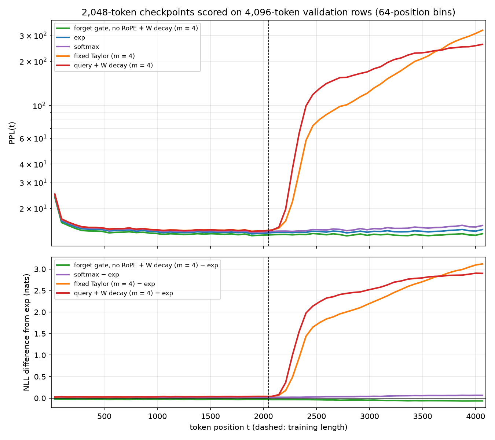
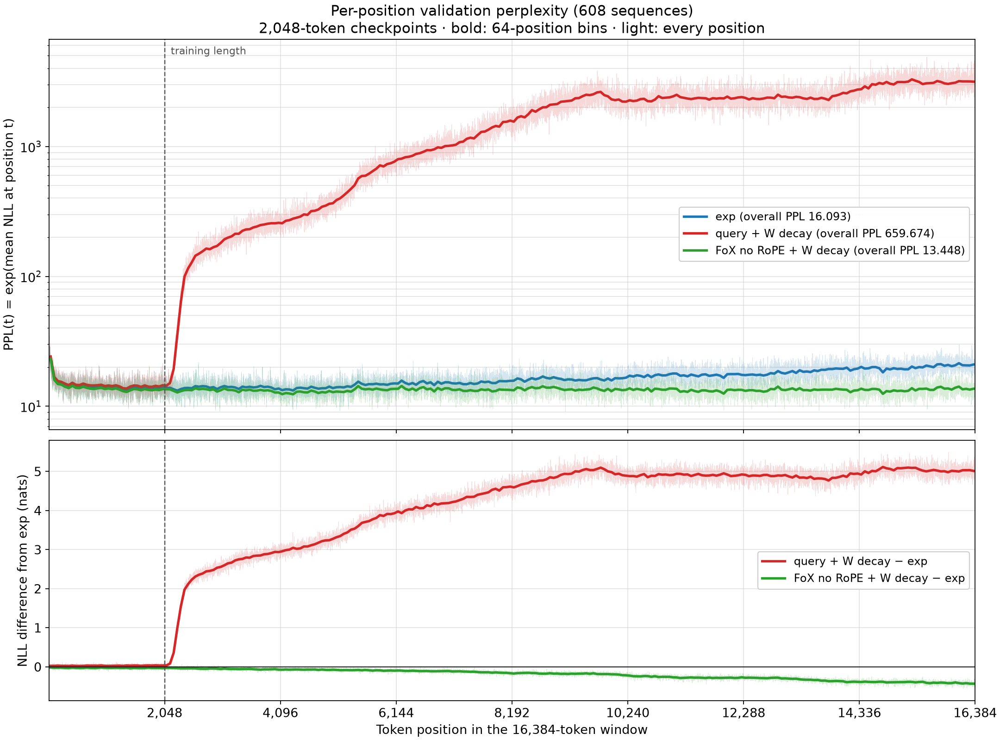

# Context length

Opened 2026-11-01.

**Question.** How do the Transformer++ attention variants use context beyond the 2,048
tokens they were trained on, up to 16,384 tokens, and how do they compare when trained at 4,096 tokens?

## Length extrapolation of 2,048-token checkpoints

`r8e4d56dfc830` scores five validation-best checkpoints (update 7,500, 7,570-update runs)
per position, with no training:

| Role | Run | Best validation PPL (2,048) |
| --- | --- | ---: |
| exp | `r6a76e7fbde45` | 14.257 |
| softmax | `r9040f12f3d80` | 14.543 |
| query + W decay, m = 4 | `rca97cc9db8f2` | 14.709 |
| fixed Taylor, m = 4 | `r816ab0fbe119` | 14.722 |
| forget gate, no RoPE + W decay, m = 4 | `r4a80e28ce0a7` | 13.873 |

For each model the evaluation first replays its own validation set (4,864 sequences of
2,048 positions) and must reproduce its recorded validation NLL within 0.002 nats. It then
raises the model's length limit to 4,096, which changes no parameter, and scores 2,432
validation rows of 4,097 tokens cut from the same token stream
(`/data/cl/u/rafah/home/datasets/fineweb_12b_seq4097/eval`). Its recipe pins every
checkpoint's files, recipe and recorded NLL; `metrics.jsonl` holds the per-position NLL of
both passes.



| Model | Replay error (nats) | PPL, positions 1–2,048 | PPL, positions 2,049–4,096 |
| --- | ---: | ---: | ---: |
| forget gate, no RoPE + W decay | 3.7e-6 | **13.92** | **13.24** |
| exp | 5.5e-6 | 14.30 | 13.92 |
| softmax | 1.1e-5 | 14.60 | 14.54 |
| fixed Taylor, m = 4 | 4.4e-6 | 14.77 | 112.94 |
| query + W decay, m = 4 | 1.2e-6 | 14.76 | 138.91 |

([extrapolation_summary.csv](extrapolation_summary.csv) has the exact values.)

- Every replay reproduces its model's recorded validation NLL within 1.1e-5 nats.
- Within the training length the ordering is the validation ordering.
- Beyond it, the forget gate without RoPE keeps improving (13.92 to 13.24, −4.9%), as does
  exp (−2.7%); softmax is flat (−0.4%).
- Both degree-four polynomial models break: perplexity rises within about 150 positions
  past 2,048 and reaches about 300 (fixed Taylor) and 260 (query) by position 4,096.
- RoPE alone does not explain the failure, since exp and softmax use RoPE and extrapolate.
  The [extrapolation_scores diagnostic](../../../diagnostics/length_extrapolation/extrapolation_scores/README.md)
  finds the polynomial models' scores at unseen distances no larger than at seen ones;
  their weights decay too slowly with distance instead, so a late query puts 31–37% of its
  weight on keys more than 2,048 tokens back, against 9% for exp. The gated model has no
  RoPE and decays distant keys.

## Extrapolation to 16,384 tokens

`r2a45c518f703` evaluates the same 2,048-token exp, query + W decay (m = 4),
and FoX no RoPE + W decay (m = 4) checkpoints at 16,384 tokens. It scores 608
sequences, or 9,961,472 prediction tokens per model, from the same held-out packed
stream as the earlier evaluation. It first replays the original validation set
and checks that its identical 2,048-token prefix agrees within the declared NLL
tolerances when evaluated in the longer window. Checkpoint parameters, RoPE settings, and attention backends are unchanged;
only the forward length guard is raised. No gradients or optimizer updates occur.

Home cluster: Kennel. The run's recipe pins the checkpoint files and both dataset
manifests. Repacking preserves stream order and EOS separators;
row boundaries differ between lengths, so aggregate PPL alone does not establish
that a model uses distant context.



| Model | PPL, positions 1–2,048 | PPL, positions 2,049–4,096 | PPL, positions 14,337–16,384 | Overall PPL, 16,384 |
| --- | ---: | ---: | ---: | ---: |
| exp | 14.36 | 13.94 | 20.07 | 16.09 |
| query + W decay | 14.80 | 139.60 | 3080.62 | 659.67 |
| FoX no RoPE + W decay | 13.98 | 13.28 | 13.47 | 13.45 |

[extrapolation_16k_summary.csv](extrapolation_16k_summary.csv) includes all eight
successive 2,048-position blocks. Each reported PPL is the exponential of mean NLL.

- Exp improves slightly through 4,096 positions, then degrades gradually, reaching
  PPL 20.07 in the final 2,048-position block. The earlier 4k improvement does not
  extend throughout this longer range.
- Query + W decay deteriorates sharply past the 2,048-token training boundary and
  reaches PPL 3,080.62 in the final block; its polynomial degree remains four.
- FoX without RoPE + W decay stays near PPL 13 throughout the extrapolated range.
  This shows stable loss at 16k, but does not establish effective use of 16k of history.
- All three original validation replays agree within 8.0e-6 nats. The same-input
  causal-prefix check agrees in mean NLL within 1.95e-4 nats (maximum per-token
  difference 0.157 nats), within the frozen 0.002/0.2 tolerances. All losses are finite.
- These profiles average 608 sequences rather than the original 4,864. With fewer
  examples per position, raw curves are noisier; bold curves aggregate 64 positions.

## Training at 4,096 tokens

Five runs repeat the models above at 4,096 tokens with the same tokens per update and
budget; the [study README](../../../../README.md#training-at-4096-tokens) gives the recipe and
launch commands. Their validation set is the 2,432 rows of 4,097 tokens that the
extrapolation pass scores (rows 0–2,431 of the same manifest), so a 4,096-token run's
validation-best perplexity compares directly with its 2,048-token partner's perplexity over
positions 1–4,096 of those rows. Every run's best is at update 7,500 of 7,570.

| Model | Trained at 4,096 tokens: best PPL | 2,048-token checkpoint, same rows | Change |
| --- | ---: | ---: | ---: |
| forget gate, no RoPE + W decay, m = 4 | **13.484** (`r58efc973ff28`) | 13.574 | −0.7% |
| exp | 14.098 (`r2047d29a0d9f`) | 14.111 | −0.1% |
| softmax | 14.498 (`r636f433be44f`) | 14.566 | −0.5% |
| query + W decay, m = 4 | 14.556 (`r738b35a8e314`) | 45.283 | −67.9% |
| fixed Taylor, m = 4 | 14.581 (`r339a31ad8d4b`) | 40.850 | −64.3% |

- The ranking is unchanged: forget gate, exp, softmax, then query and fixed Taylor. The
  forget gate's lead over exp grows from 2.7% at 2,048 tokens to 4.4%.
- Exp and softmax gain little (0.1%, 0.5%): their 2,048-token checkpoints already
  extrapolate to 4,096 tokens.
- The polynomial models need the longer training: they reach 14.556 and 14.581 instead of
  45.3 and 40.8. They still trail softmax (+0.4%, +0.6%; +1.1%, +1.2% at 2,048 tokens) and
  exp (+3.3%, +3.4%).
- Validation records only the mean loss; per-position curves of these checkpoints are not
  measured.

## Open question

Add context length as a dimension of the Transformer++ comparison, or delete the topic.

## Regeneration

```bash
scaffolds/transformer/.venv/bin/python -m scaffolds.records refresh experiments/transformer_pp/results/pretraining/scalings/context_length
scaffolds/transformer/.venv/bin/python experiments/transformer_pp/results/pretraining/scalings/context_length/plot.py
scaffolds/transformer/.venv/bin/python -m experiments.transformer_pp.results.pretraining.scalings.context_length.plot_16k
```
