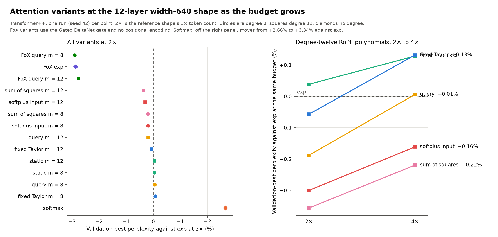

# Budgets

How do the attention variants compare at the 12-layer width-640 shape as its token budget grows? Trained
on the reference shape's token count, twice its own 1x budget, how do they compare at degrees eight and
twelve, and how close does each come to its reference-shape counterpart at the same tokens? At four times
the 1x budget, how do the five degree-twelve RoPE polynomials and softmax compare with exp there and with
their 2x runs? Each run's status is in its record and the study's `runs.csv`.



## Runs

Each run is a 12-layer width-640 1x run derived with `derive_recipe.py --budget 2`: 15,103 updates of
128 × 2,048 tokens (3.96B prediction tokens, against the reference shape's 3.97B), warmup 908, validation
every 200 updates through 3,000 and every 1,000 after, seed 42. Where the 1x partner has another degree, only
`attention_degree` changes. One GPU each; home cluster Kennel.

| Run | Label | Variant | `m` | Recipe source | Attention |
| --- | --- | --- | ---: | --- | --- |
| `r3759b2a57a54` | `query-m8-w-decay-l12-d640-2x` | tanh query, RoPE, W decay | 8 | `r95a5691d293f` | Mosaic |
| `r0f6d929e5992` | `query-m12-w-decay-l12-d640-2x` | tanh query, RoPE, W decay | 12 | `r95a5691d293f`, degree 12 | Mosaic |
| `r3cca4c13edab` | `static-m8-l12-d640-2x` | learned static | 8 | `r94e0f2b8cff9`, degree 8 | Mosaic |
| `r84f325593209` | `static-m12-l12-d640-2x` | learned static | 12 | `r94e0f2b8cff9`, degree 12 | Mosaic |
| `rd77db79142e6` | `fixed-m8-l12-d640-2x` | fixed Taylor | 8 | `r2c432bd3a2a4`, degree 8 | Mosaic |
| `rffab7c4eeac5` | `fixed-m12-l12-d640-2x` | fixed Taylor | 12 | `r2c432bd3a2a4`, degree 12 | Mosaic |
| `rc6a7e50d27e1` | `query-m8-w-decay-l12-d640-softplus-input-2x` | softplus input, `c_0` from 0 | 8 | `r3759b2a57a54` with the transform | Mosaic transformed, H100 |
| `r53d5bbcac16f` | `query-m12-w-decay-l12-d640-softplus-input-2x` | softplus input, `c_0` from 0 | 12 | `r0f6d929e5992` with the transform | Mosaic transformed, H100 |
| `rccd2cb5e8bab` | `query-m8-sum-of-squares-w-decay-l12-d640-2x` | sum-of-squares query | 8 | `r3759b2a57a54` with sum of squares | Mosaic |
| `r08be7093202a` | `query-m12-sum-of-squares-w-decay-l12-d640-2x` | sum-of-squares query | 12 | `r0f6d929e5992` with sum of squares | Mosaic |
| `r656e8e652b72` | `query-m8-forget-gate-no-rope-w-decay-l12-d640-2x` | FoX query: cumulative gate, no RoPE, W decay | 8 | `r3d14b598d88f`, degree 8 | causal strips |
| `rbf05f7baab5e` | `query-m12-forget-gate-no-rope-w-decay-l12-d640-2x` | FoX query | 12 | `r3d14b598d88f`, degree 12 | causal strips |
| `rd920368a922e` | `exp-l12-d640-2x` | exp | – | `r3e2fa2532c23` | fused Triton |
| `r3bb5b8bd5c6a` | `softmax-l12-d640-2x` | softmax | – | `rf81c96f76a1d` | cuDNN |
| `re634d82ee479` | `exp-forget-gate-no-rope-l12-d640-2x` | FoX exp | – | `ra5dfd978d3bd` | causal strips |

- The softplus runs are the 2x query runs with the reference-shape softplus run's changes: the transform, `c_0`
  started at 0 and gradient-event capture. Their 1x counterpart `r1d342ca6e58c` trained on the causal strips.
- The sum-of-squares runs are the 2x query runs with the reference-shape sum-of-squares runs' changes.
- The forget-gate runs train on the causal strips, where their 1x partners used the blocked scan: the same
  arithmetic in another summation order.

Recipes, acceptance and launch commands:
[study README](../../../../../README.md#the-12-layer-width-640-shape-at-the-reference-token-count).

## Comparisons

Each 2x run is compared with:

- exp at 2x, `rd920368a922e`;
- its 1x run at the 12-layer width-640 shape, where one exists at its degree: query 17.592, softplus 17.488,
  exp 17.550, softmax 17.964 and FoX exp 16.753, all at degree eight or without a degree;
- the reference shape's 1x run of the same variant and degree, at almost the same tokens: query 14.323 (`m = 8`)
  and 14.226 (`m = 12`), fixed Taylor 14.218 and 14.309, static 14.294 (`m = 8`), softplus input 14.262 and
  14.222, sum of squares 14.196 and 14.165, exp 14.257, softmax 14.543, and FoX query 13.907 (`m = 8`) and FoX
  exp 13.628.

Perplexities are validation-best; the results tables give terminal values beside them. Every 2x run is
validation-best at update 15,000 (3,932,160,000 tokens), every reference-shape run at update 7,500 (the same
tokens), and every 1x run at this shape at its last update, 7,551 (1,979,449,344 tokens), so its terminal value
is the same. The [selection](selection.yaml) names each run's role and pins its scientific files.

## Results

At 2x, against exp at 2x, in order of validation-best perplexity (`metrics.jsonl`; `best_validation.json` and
`completion.json` agree):

<!-- BEGIN GENERATED 2X RESULTS -->

| Run | Variant | `m` | Validation-best PPL (update) | vs exp | Terminal PPL (update 15,103) | vs exp |
| --- | --- | ---: | ---: | ---: | ---: | ---: |
| `r656e8e652b72` | FoX query | 8 | 15.314 (15,000) | −2.90% | 15.325 | −2.87% |
| `re634d82ee479` | FoX exp | – | 15.320 (15,000) | −2.87% | 15.330 | −2.84% |
| `rbf05f7baab5e` | FoX query | 12 | 15.335 (15,000) | −2.77% | 15.341 | −2.76% |
| `r08be7093202a` | sum of squares | 12 | 15.715 (15,000) | −0.36% | 15.721 | −0.36% |
| `r53d5bbcac16f` | softplus input | 12 | 15.724 (15,000) | −0.30% | 15.731 | −0.29% |
| `rccd2cb5e8bab` | sum of squares | 8 | 15.740 (15,000) | −0.20% | 15.748 | −0.19% |
| `rc6a7e50d27e1` | softplus input | 8 | 15.740 (15,000) | −0.20% | 15.748 | −0.19% |
| `r0f6d929e5992` | query | 12 | 15.742 (15,000) | −0.19% | 15.750 | −0.17% |
| `rffab7c4eeac5` | fixed Taylor | 12 | 15.763 (15,000) | −0.06% | 15.769 | −0.05% |
| `rd920368a922e` | exp | – | 15.772 (15,000) | – | 15.777 | – |
| `r84f325593209` | static | 12 | 15.778 (15,000) | +0.04% | 15.783 | +0.04% |
| `r3cca4c13edab` | static | 8 | 15.778 (15,000) | +0.04% | 15.787 | +0.06% |
| `r3759b2a57a54` | query | 8 | 15.780 (15,000) | +0.05% | 15.787 | +0.06% |
| `rd77db79142e6` | fixed Taylor | 8 | 15.783 (15,000) | +0.07% | 15.788 | +0.07% |
| `r3bb5b8bd5c6a` | softmax | – | 16.192 (15,000) | +2.66% | 16.203 | +2.70% |

<!-- END GENERATED 2X RESULTS -->

Against the 1x runs, validation-best perplexity with terminal in parentheses (the 1x runs at this shape end at
their validation best); percentages compare validation-best values:

<!-- BEGIN GENERATED 2X PARTNERS -->

| Run | Variant | `m` | 2x | 1x at 12-layer width-640 | 2x vs 1x | Reference shape, 1x | 2x vs reference shape |
| --- | --- | ---: | ---: | --- | ---: | --- | ---: |
| `r3759b2a57a54` | query | 8 | 15.780 (15.787) | `r95a5691d293f` 17.592 | −10.30% | `r25fffc16c2f3` 14.323 (14.328) | +10.17% |
| `r0f6d929e5992` | query | 12 | 15.742 (15.750) | – | – | `r0fceea0627c8` 14.226 (14.230) | +10.66% |
| `r3cca4c13edab` | static | 8 | 15.778 (15.787) | – | – | `r9c69dd7cfc8d` 14.294 (14.299) | +10.38% |
| `r84f325593209` | static | 12 | 15.778 (15.783) | – | – | – | – |
| `rd77db79142e6` | fixed Taylor | 8 | 15.783 (15.788) | – | – | `ra7ee8a4b2544` 14.218 (14.223) | +11.00% |
| `rffab7c4eeac5` | fixed Taylor | 12 | 15.763 (15.769) | – | – | `rb2b70dae4d21` 14.309 (14.311) | +10.16% |
| `rc6a7e50d27e1` | softplus input | 8 | 15.740 (15.748) | `r1d342ca6e58c` 17.488 | −9.99% | `ra3b54e2489f8` 14.262 (14.265) | +10.36% |
| `r53d5bbcac16f` | softplus input | 12 | 15.724 (15.731) | – | – | `r9eb845aae5bb` 14.222 (14.226) | +10.56% |
| `rccd2cb5e8bab` | sum of squares | 8 | 15.740 (15.748) | – | – | `reeefbcc19abf` 14.196 (14.200) | +10.88% |
| `r08be7093202a` | sum of squares | 12 | 15.715 (15.721) | – | – | `r3d52b7ab43d1` 14.165 (14.168) | +10.95% |
| `r656e8e652b72` | FoX query | 8 | 15.314 (15.325) | – | – | `r9353f554b917` 13.907 (13.910) | +10.12% |
| `rbf05f7baab5e` | FoX query | 12 | 15.335 (15.341) | – | – | – | – |
| `rd920368a922e` | exp | – | 15.772 (15.777) | `r3e2fa2532c23` 17.550 | −10.14% | `r6a76e7fbde45` 14.257 (14.262) | +10.62% |
| `r3bb5b8bd5c6a` | softmax | – | 16.192 (16.203) | `rf81c96f76a1d` 17.964 | −9.86% | `r9040f12f3d80` 14.543 (14.546) | +11.34% |
| `re634d82ee479` | FoX exp | – | 15.320 (15.330) | `ra5dfd978d3bd` 16.753 | −8.56% | `r183f08346ddc` 13.628 (13.630) | +12.41% |

<!-- END GENERATED 2X PARTNERS -->

–: no run at that shape and degree. At the 12-layer width-640 shape static, fixed Taylor and FoX query have 1x
runs only at `m = 4`, query at `m = 4` and `m = 8`, softplus only at `m = 8`, sum of squares none; the reference
shape has no static run at `m = 12` and no FoX query run with the shared cumulative gate at `m = 12`.

## Findings

At 2x:

- **The forget gate leads, and FoX query catches FoX exp.** FoX query at `m = 8` (15.314) and `m = 12` (15.335)
  and FoX exp (15.320) are 2.77–2.90% below exp. FoX query at `m = 8` is 0.03% below FoX exp, which it trails by
  2.05% at the reference shape; at `m = 12` it is 0.10% above.
- **The ten RoPE polynomials lie within 0.43% of one another, around exp**: from 15.715 (sum of squares,
  `m = 12`) to 15.783 (fixed Taylor, `m = 8`), −0.36% to +0.07% against exp. The nine of them with
  reference-shape runs span 1.11% there (−0.65% to +0.46% against exp).
- **Softplus input and sum of squares lead query by 0.11–0.25%.** Softplus input leads it by 0.25% at `m = 8` and
  0.11% at `m = 12`, short of the score_transforms topic's 0.5% bar; sum of squares by 0.25% and 0.17%. At the
  reference shape softplus leads it by 0.42% and 0.02%, sum of squares by 0.89% and 0.43%.
- **Degree twelve moves the RoPE polynomials by at most 0.24%**: query −0.24%, sum of squares −0.15%, fixed
  Taylor −0.13%, softplus −0.10%, static 0.00%; FoX query +0.14%. At the reference shape query gains 0.68% and
  fixed Taylor loses 0.63%.
- **Softmax trails exp by 2.66%** (2.35% at 1x, 2.00% at the reference shape).
- **Twice the tokens lowers validation-best perplexity by 8.6–10.3%**: query −10.30%, exp −10.14%, softplus
  −9.99% (against its 1x run on the causal strips), softmax −9.86%, FoX exp −8.56%. Against exp, query moves
  from +0.24% to +0.05%, softplus from −0.36% to −0.20%, FoX exp from −4.54% to −2.87% and softmax from
  +2.35% to +2.66%.
- **At the same tokens the 12-layer width-640 shape stays 10.1–12.4% above the reference shape.** FoX query at
  `m = 8` (+10.12%) and fixed Taylor at `m = 12` (+10.16%) come closest, softmax (+11.34%) and FoX exp
  (+12.41%) least close. For the five with a 1x run at their degree at this shape, the gap at 1x, with half the
  tokens, is 22.6–23.5%.

## Limits

- One seed (42) and data order per run. In the study's [noise check](../../../../../README.md#noise) a second seed and
  data order moved single runs by 0.6–0.7% and a gap between two variants by about 0.1 percentage point.
- GPUs of the 2x runs, from each record's attempts; no 2x update ran on a B300:
  - one H100 PCIe (`mastiff`) throughout: query at `m = 8` and `m = 12`, exp, softmax and FoX exp;
  - one H100 SXM (`dogo`) throughout: static and fixed Taylor at `m = 8` and `m = 12`, whose first attempts,
    on `akita`'s B300, were preempted during acceptance, before any update, and requeued;
  - an H100 PCIe (`mastiff`) until Kennel's Slurm reset on 2026-11-13, then an H100 SXM (`dogo`) from the last
    checkpoint, after acceptance there: softplus input from update 13,500 (`m = 8`) and 8,500 (`m = 12`), sum of
    squares from 6,500 and 5,500, FoX query from 13,500 and 12,500. The sum-of-squares and FoX query jobs were
    first preempted on `akita` during acceptance. These six runs' validation-best checkpoints were trained on
    `dogo`.
- The comparisons with 1x runs also cross GPUs and implementations: the 1x query, exp, softmax and FoX exp runs
  at this shape trained on B300, the 1x softplus run on an H100 PCIe on the causal strips (the 2x softplus runs
  use the Mosaic transformed kernels), and the reference-shape runs on B300, H100 PCIe or H100 SXM (FoX query on
  ORCD).

## Four times the budget

The five degree-twelve RoPE polynomials above, exp and softmax at four
times the shape's 1x budget, each its 2x run derived with `derive_recipe.py --budget 4`: 30,205 updates of
128 × 2,048 tokens (7.92B prediction tokens, twice the 2x runs' 3.96B), warmup 1,815, validation every 400 updates
through 6,000 and every 2,000 after, seed 42. One GPU each; home cluster Kennel. Sum of squares and fixed Taylor
also evaluate head RMSNorm with its max-abs prescale (`attention_head_rms_prescale: max_abs`), the same function:
their attention outputs grow past an RMS of about 2e14, beyond which the plain FP32 backward is inexact.

| Run | Label | Variant | `m` | 2x run | Attention |
| --- | --- | --- | ---: | --- | --- |
| `r2f41d054e944` | `query-m12-w-decay-l12-d640-4x` | tanh query, RoPE, W decay | 12 | `r0f6d929e5992` | Mosaic |
| `r0f8122dd8439` | `static-m12-l12-d640-4x` | learned static | 12 | `r84f325593209` | Mosaic |
| `rf1fad040d27d` | `fixed-m12-l12-d640-4x-max-abs-head-rms` | fixed Taylor | 12 | `rffab7c4eeac5` | Mosaic |
| `rb74e8b994b74` | `query-m12-w-decay-l12-d640-softplus-input-4x` | softplus input, `c_0` from 0 | 12 | `r53d5bbcac16f` | Mosaic transformed, H100 |
| `r775f6499974f` | `query-m12-sum-of-squares-w-decay-l12-d640-4x-max-abs-head-rms` | sum-of-squares query | 12 | `r08be7093202a` | Mosaic |
| `r333444bd4304` | `exp-l12-d640-4x` | exp | – | `rd920368a922e` | fused Triton |
| `r93df1e48c8fd` | `softmax-l12-d640-4x` | softmax | – | `r3bb5b8bd5c6a` | cuDNN |

The softplus run's control and the sum-of-squares run's partner is the 4x query run `r2f41d054e944`. Each run is
compared with exp at 4x, `r333444bd4304`, and with its 2x run; the [selection](selection.yaml) names the roles.
Recipes, acceptance, time limits and launch commands:
[study README](../../../../../README.md#the-12-layer-width-640-shape-at-four-times-its-1x-budget), and for sum of
squares and fixed Taylor its [max-abs runs](../../../../../README.md#max-abs-alibi-exp-and-12-layer-width-640-4x-runs).

### 4x results

Against exp at 4x, in order of validation-best perplexity (`metrics.jsonl`; `best_validation.json` and
`completion.json` agree). Every 4x run is validation-best at its last update, 30,205 (7,918,059,520 tokens), so
its terminal value is the same; every 2x run is validation-best at update 15,000. The last column compares
validation-best values, 4x against 2x:

<!-- BEGIN GENERATED 4X RESULTS -->

| Run | Variant | `m` | Validation-best PPL (update) | Terminal PPL (update 30,205) | vs exp | 2x validation-best | 2x vs exp | 2x to 4x |
| --- | --- | ---: | ---: | ---: | ---: | ---: | ---: | ---: |
| `r775f6499974f` | sum of squares | 12 | 14.573 (30,205) | 14.573 | −0.22% | 15.715 | −0.36% | −7.27% |
| `rb74e8b994b74` | softplus input | 12 | 14.581 (30,205) | 14.581 | −0.16% | 15.724 | −0.30% | −7.27% |
| `r333444bd4304` | exp | – | 14.605 (30,205) | 14.605 | – | 15.772 | – | −7.40% |
| `r2f41d054e944` | query | 12 | 14.606 (30,205) | 14.606 | +0.01% | 15.742 | −0.19% | −7.22% |
| `r0f8122dd8439` | static | 12 | 14.624 (30,205) | 14.624 | +0.13% | 15.778 | +0.04% | −7.31% |
| `rf1fad040d27d` | fixed Taylor | 12 | 14.624 (30,205) | 14.624 | +0.13% | 15.763 | −0.06% | −7.22% |
| `r93df1e48c8fd` | softmax | – | 15.092 (30,205) | 15.092 | +3.34% | 16.192 | +2.66% | −6.79% |

<!-- END GENERATED 4X RESULTS -->

Gap to exp in percent at the same fraction of training, as 2x / 4x: the 2x run at update `s` against exp at 2x,
the 4x run at update `2s` against exp at 4x, and in the last column the last updates. Every evaluation uses the
same 38 validation batches (`metrics.jsonl`):

<!-- BEGIN GENERATED 4X MATCHED POINTS -->

| Variant | `m` | 3,000 / 6,000 | 6,000 / 12,000 | 9,000 / 18,000 | 12,000 / 24,000 | 15,000 / 30,000 | 15,103 / 30,205 |
| --- | ---: | ---: | ---: | ---: | ---: | ---: | ---: |
| sum of squares | 12 | −0.23 / −0.20 | −0.32 / −0.17 | −0.37 / −0.22 | −0.35 / −0.21 | −0.36 / −0.23 | −0.36 / −0.22 |
| softplus input | 12 | −0.32 / 0.00 | −0.30 / −0.10 | −0.36 / −0.13 | −0.31 / −0.16 | −0.30 / −0.19 | −0.29 / −0.16 |
| query | 12 | −0.18 / +0.05 | −0.26 / +0.02 | −0.29 / −0.02 | −0.18 / −0.01 | −0.19 / −0.01 | −0.17 / +0.01 |
| static | 12 | +0.13 / +0.12 | −0.01 / +0.16 | 0.00 / +0.14 | +0.09 / +0.10 | +0.04 / +0.11 | +0.04 / +0.13 |
| fixed Taylor | 12 | −0.06 / −0.01 | −0.10 / +0.08 | −0.06 / +0.10 | −0.07 / +0.09 | −0.06 / +0.11 | −0.05 / +0.13 |
| softmax | – | +1.26 / +2.90 | +2.04 / +3.25 | +2.47 / +3.32 | +2.57 / +3.30 | +2.66 / +3.34 | +2.70 / +3.34 |

<!-- END GENERATED 4X MATCHED POINTS -->

### 4x findings

- **Exp gains the most from 2x to 4x.** Twice the tokens lowers its validation-best perplexity by 7.40%, the five
  polynomials' by 7.22–7.31% and softmax's by 6.79%. From 1x to 2x exp gained 10.14% and softmax 9.86%.
- **Every degree-twelve polynomial loses ground against exp**, by 0.09 (static) to 0.19 percentage points
  (query). Sum of squares (−0.22%) and softplus input (−0.16%) stay below it; query (+0.01%), static (+0.13%) and
  fixed Taylor (+0.13%) lie within 0.13% above it. The shift is not confined to the end: at every matched point
  from 6,000 / 12,000 updates on, each polynomial's gap is 0.01–0.28 points higher at 4x than at 2x (at 3,000 /
  6,000 static's is not).
- **Softmax falls further behind**: 3.34% above exp, against 2.66% at 2x and 2.35% at 1x; its gap is 0.64–1.63
  points larger at 4x at every matched point.
- **The five polynomials keep their 2x order, except that static and fixed Taylor tie** (14.6238 and 14.6243):
  sum of squares, softplus input, query, then static and fixed Taylor, spanning 0.35% (0.40% at 2x). Exp moves
  from between fixed Taylor and static to between softplus input and query, which ties it (+0.01%; −0.01% at
  update 30,000).
- **Every 4x run is validation-best at its last evaluation, update 30,205**, 0.19–0.23% below update 30,000 on the
  same validation batches; every 2x run is validation-best at 15,000 and 0.03–0.07% higher at 15,103. The shift is
  common to all runs, which train on the same batches in the same order, and moves each gap to exp by at most
  0.03 points, so it does not change comparisons within a budget.

### 4x limits

- One seed (42) and data order, shared with the 2x runs. The 2x-to-4x shifts against exp, 0.08–0.19 points, are
  of the order of the 0.1-point change in one gap that a second seed and data order made in the study's
  [noise check](../../../../../README.md#noise).
- GPUs, from each record's attempts:
  - `dogo`'s H100 SXM throughout: softplus input, exp and softmax; exp's two attempts on `akita`'s B300 were
    preempted during acceptance, before any update;
  - `akita`'s B300 throughout: sum of squares and fixed Taylor;
  - `akita`'s B300 from the start, then `dogo`'s H100 SXM from the last checkpoint, after acceptance there: query
    from update 4,000 and static from 17,000.
- Preemptions: each run resumed from its latest checkpoint, at the matching position in the data, three times
  (query), once (fixed Taylor, static, softplus input, exp, softmax) or never (sum of squares), counting
  resumptions that reached a later checkpoint. The other attempts were preempted before reaching a new
  checkpoint, or ended before any update: preempted during acceptance, or failed at JAX initialization on `dogo`
  (`CUDA_ERROR_UNKNOWN`) and were resubmitted under a new job ID.
- Within 4x the comparisons also cross GPUs: sum of squares and fixed Taylor trained on a B300 throughout and
  query and static their first 4,000 and 17,000 updates (CUDA 13 environment), exp, softmax and softplus input only
  on the H100 SXM (CUDA 12).
- The 2x runs trained on H100 PCIe and H100 SXM GPUs ([Limits](#limits)), so the 2x-to-4x comparisons cross GPUs
  as well as budgets.

## Regeneration

From the repository root, re-pin the selection after its runs change, then regenerate `summary.csv`,
`budgets.png`/`.pdf` and the tables above:

```bash
scaffolds/transformer/.venv/bin/python -m scaffolds.records refresh experiments/transformer_pp/results/pretraining/scalings/l12_d640/budgets
PYTHONPATH=. scaffolds/transformer/.venv/bin/python -m experiments.transformer_pp.results.pretraining.scalings.l12_d640.budgets.plot
```

`tests/` checks the pins; that every run trains its role's variant, degree, shape and schedule; that each 4x
recipe is its 2x run derived with `derive_recipe.py --budget 4`, and each 2x run with a 1x partner at its
degree that partner derived with `--budget 2` (apart from the softplus run's attention backend); the quoted
values; and byte-identical regeneration.
