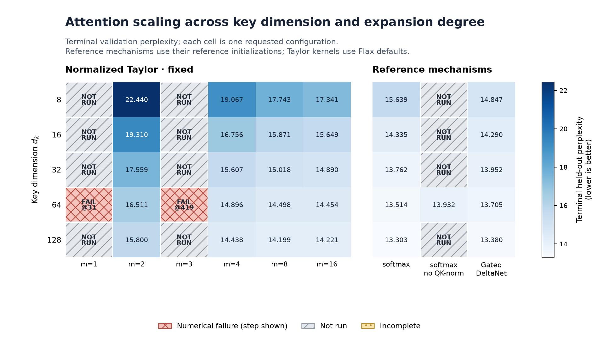

# Attention mechanisms across key width and degree

Terminal held-out perplexity of the 200M attention runs: 19,074 updates (10.0B
tokens), seed 0, same data order and evaluation set. No training happens here; the
figures are built from existing runs named in [`selection.yaml`](selection.yaml)
(heatmap) and [`degree_chart.yaml`](degree_chart.yaml). Provenance:
[`manifest.json`](manifest.json). Home cluster: Kennel.

The two maintained attention figures are the combined heatmap and the degree plot.
Their selections are subsets of the [complete run inventory](../../experiments/attention_scaling/runs.csv).
Each run retains its recipe, measurements (including training curves and recorded
coefficient diagnostics), and execution metadata under
[`experiments/attention_scaling/runs/`](../../experiments/attention_scaling/runs/).

Every plotted run uses selective weight decay and QK-norm, except "softmax no QK-norm"
and Gated DeltaNet, which have no QK-norm. The reference mechanisms use their reference
initializations: GPT-2/Megatron (`transformer_reference`) for softmax and unnormalized
exp, the paper's (`gated_deltanet_reference`) for Gated DeltaNet. The polynomial kernels
still use the scaffold's Flax defaults (see [Limits](#limits)).

<!-- BEGIN GENERATED RESULTS -->
### Heatmap

45 cells: 31 complete, 2 failed, 12 not run, 0 incomplete.



[PDF](combined_terminal_ppl.pdf)

### Degree chart (d_K = 64)

30 runs: 20 complete, 10 failed. Failures sit below the axis at their update.


[PDF](degree_chart.pdf) · [Cell data and checksums](summary.csv) · [Provenance](manifest.json)
<!-- END GENERATED RESULTS -->

## Figure key

- **Heatmap:** normalized fixed Taylor (`1/r!`) at `m = 1, 2, 3, 4, 8, 16` and
  `d_K = 8–128`, plus softmax with and without QK-norm and Gated DeltaNet. FAIL = numerical
  failure at the shown update; NOT RUN = not trained.
- **Degree chart:** families at `d_K = 64`; failures sit in the strip below the axis.
  Learned coefficients start from `1/r!` and are learned per layer and head.
  "Nonnegative" writes the kernel as `q1^2 + q2^2`, so it exists only at even degrees.
  Fixed Hermite uses the standard-normal projection
  `p_m(s) = exp(1/2) sum_(r<=m) He_r(s)/r!` (normalized `m = 2` evaluated as
  `exp(1/2) (s+1)^2 / 2`). Normalized Hermite `m = 1` failed in its 20-update
  qualification pilot (production model, data, and optimizer).

## Results at d_K = 64

References, each on its reference initialization: softmax **13.514**, Gated DeltaNet
**13.705**, softmax no QK-norm **13.932**, unnormalized exp with QK-norm **15.885**.
With Flax defaults, as the polynomial kernels use, they were 14.457, 14.665, and 18.304
([reference_init](../exploratory/reference_init/README.md)).

Normalized kernels (failures show the update):

| m | Fixed Taylor | Fixed Hermite | Learned | Learned nonnegative |
| ---: | ---: | ---: | ---: | ---: |
| 1 | fail @31 | fail @5 | fail @27 | — |
| 2 | 16.511 | fail @3,829 | fail @1,857 | 16.176 |
| 3 | fail @419 | fail @802 | fail @318 | — |
| 4 | 14.896 | fail @1,390 | fail @1,456 | 14.742 |
| 8 | 14.498 | | | |
| 16 | 14.454 | | | |

Unnormalized kernels:

| m | Fixed Taylor | Fixed Hermite | Learned Taylor |
| ---: | ---: | ---: | ---: |
| 1 | 20.316 | 20.870 | 20.279 |
| 2 | 21.748 | 17.468 | 17.599 |
| 3 | 17.631 | 17.894 | 16.330 |
| 4 | 18.181 | 17.246 | 16.384 |

- **Normalized kernels need a nonnegative kernel.** Signed kernels fail when a row sum
  crosses zero: every odd degree, the signed learned kernels, and Hermite `m = 4`
  (negative for `s` in about (−2.8, −1.6)). Even-degree Taylor is strictly positive and
  finishes. Hermite `m = 2` is nonnegative but zero at `s = -1` and failed late; the
  learned sum-of-squares kernels also learned a zero and finished.
- **Normalized Taylor `m = 16` ties softmax at equal initialization** (14.454 vs
  14.457 with Flax defaults); `m = 8` is 0.04 above.
- **Hermite vs Taylor, unnormalized:** Hermite is better at even degrees (−4.28 at
  `m = 2`, −0.94 at `m = 4`) and worse at odd degrees (+0.55, +0.26). Runs without
  QK-norm show the same signs.
- **Normalized Hermite `m = 2` led Taylor until it failed** (33.85 vs 38.86 at update
  3,000). The cause is unconfirmed; its step-3,500 checkpoint is kept for a replay.
  Hermite `m = 4` was far behind before failing (551 vs 105 at update 1,000).
- **Learned beats fixed Taylor, unnormalized,** at every degree (by 0.04 at `m = 1` to
  4.15 at `m = 2`).

## Effect of QK-norm

Change in PPL when the same kernel is rerun with QK-norm (negative is better). Except
for softmax, the runs without QK-norm also used the old decay rule, which moved
softmax by 0.03.

| Kernel | m = 1 | m = 2 | m = 3 | m = 4 | m = 8 | m = 16 |
| --- | ---: | ---: | ---: | ---: | ---: | ---: |
| Unnormalized fixed Taylor | −0.45 | −1.76 | −2.61 | −3.28 | | |
| Unnormalized learned Taylor | −0.43 | −2.46 | −2.20 | −3.76 | | |
| Normalized fixed Taylor | fails (@9 → @31) | +0.23 | fails (@17 → @419) | −0.09 | −0.18 | −0.25 |
| Softmax | −0.21 | | | | | |
| Unnormalized exp | +0.85 | | | | | |

QK-norm helps unnormalized polynomial kernels at `m >= 2` by 1.8–3.8 PPL but hurts the
unnormalized exponential by 0.85 (18.304 vs 17.458). These rows compare Flax-default
runs; with the reference initialization QK-norm improves softmax by 0.42 at `d_K = 64`
(13.514 vs 13.932).

For normalized fixed Taylor the effect depends on `d_K` and `m`: QK-norm hurts most at
small `d_K` and low degree (+1.86 at `d_K = 8`, `m = 2`). At `m >= 4` and
`d_K >= 32` it changes perplexity by at most 0.25.

| m | d_K = 8 | 16 | 32 | 64 | 128 |
| ---: | ---: | ---: | ---: | ---: | ---: |
| 2 | +1.86 | +0.81 | +0.39 | +0.23 | +0.08 |
| 4 | +0.89 | +0.24 | +0.04 | −0.09 | −0.09 |
| 8 | +0.56 | +0.07 | −0.05 | −0.18 | −0.16 |
| 16 | +0.49 | +0.02 | −0.13 | −0.25 | −0.16 |
| softmax | +0.52 | +0.01 | −0.12 | −0.21 | −0.15 |

Softmax (Flax defaults) follows the same pattern. Its runs without QK-norm used the old
decay rule except at `d_K = 64`.

## Other widths

- **Normalized fixed Taylor:** higher degree closes the gap to softmax at equal (Flax
  default) initialization. `d_K = 8`: `m = 2` 22.44, `m = 16` 17.34, softmax 17.22.
  `d_K = 128`: `m = 8` 14.20 and `m = 16` 14.22 match softmax (14.22).
- **Softmax vs Gated DeltaNet** (both on reference initializations): Gated DeltaNet is
  lower at `d_K = 8` (14.85 vs 15.64) and level at 16 (14.29 vs 14.34); softmax is lower
  at 32, 64, and 128 (by 0.19, 0.19, 0.08). Both improve with every doubling of `d_K`.
  At `d_K = 64` Gated DeltaNet beats GLA by 1.67 (13.705 vs 15.376), both on reference
  initializations.

## Limits

- One seed per cell; differences of a few tenths are not established.
- Initializations differ between the panels: the references use their reference
  initializations and the polynomial kernels Flax defaults, which cost softmax 0.9–1.6
  and unnormalized exp 2.4 ([reference_init](../exploratory/reference_init/README.md)).
  Compare polynomial kernels with references only at equal initialization until the
  polynomial runs are rerun.
- Parameter count changes with `d_K`. Gated DeltaNet also changes the architecture and
  has 10.9–11.0M (5–6%) more parameters than softmax at the same `d_K`.
- Four runs resumed on another GPU type after preemption: unnormalized Hermite `m = 2`
  (B300, then H100 from update 14,500), unnormalized Taylor `m = 4` (B300, then
  H100 from update 500), normalized Taylor `d_K = 128`, `m = 8` (H100, then B300
  from update 500), and Gated DeltaNet `d_K = 128` (H100, then B300 from update
  13,500).

## Reproduce

```bash
uv sync --project scaffolds/transformer --locked --extra cuda --link-mode hardlink
PYTHONPATH=. scaffolds/transformer/.venv/bin/python -m results.attention_scaling.plot
```

Checks every pinned input, then writes the figures, [`summary.csv`](summary.csv) (its
`figure` column names the figure), and `manifest.json`. No GPU or dataset needed.
