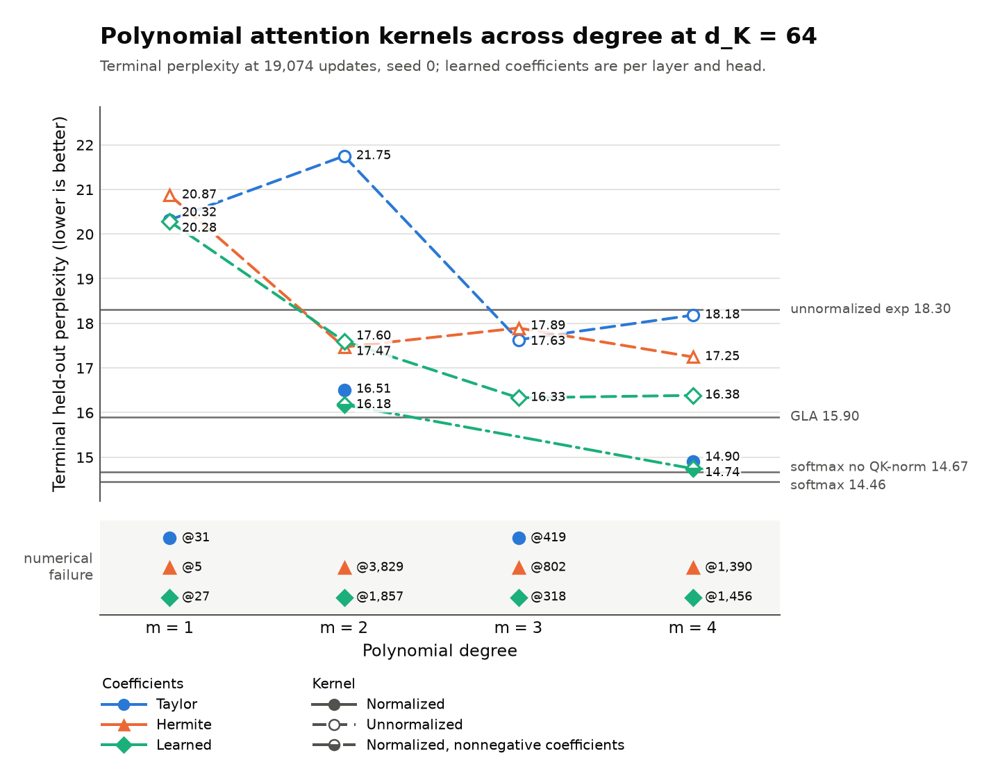
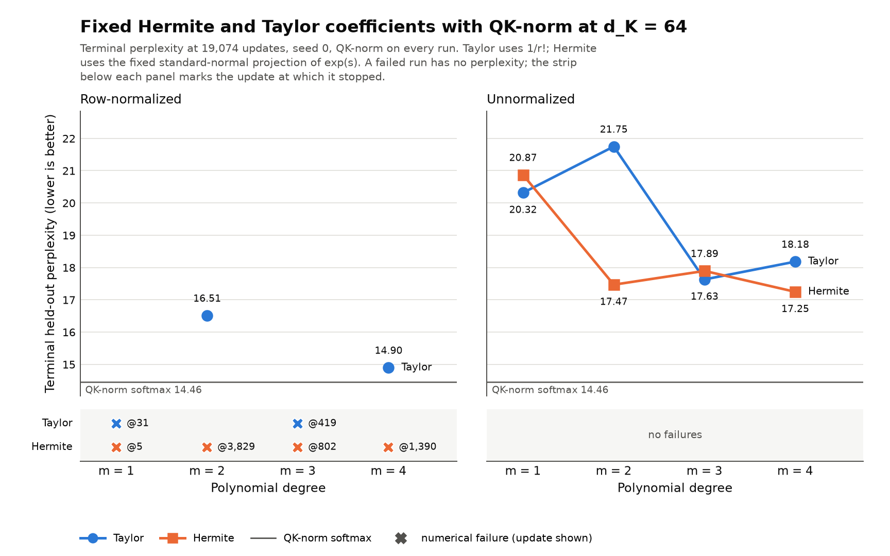

# Attention mechanisms across key width and degree

Terminal held-out perplexity of the 200M attention runs: 19,074 updates (10.0B
tokens), seed 0, same data order and evaluation set. No training happens here; the
figures are built from existing runs named in [`selection.yaml`](selection.yaml)
(heatmap), [`degree_chart.yaml`](degree_chart.yaml), and
[`hermite_chart.yaml`](hermite_chart.yaml). Provenance: [`manifest.json`](manifest.json).
Home cluster: Kennel.

Current defaults are selective weight decay and QK-norm. **Legacy** runs predate
them: outlined in the heatmap, hollow and dashed in the degree chart.

<!-- BEGIN GENERATED RESULTS -->
### Heatmap

45 cells: 31 complete, 2 failed, 12 not run, 0 incomplete. 25 of 33 trained cells are legacy (outlined).


[PDF](combined_terminal_ppl.pdf)

### Degree chart (d_K = 64)

17 runs: 13 complete, 4 failed, 1 legacy (hollow, dashed). Failures sit below the axis at their update.



[PDF](degree_chart.pdf)

### Hermite vs Taylor (d_K = 64, QK-norm)

17 runs: 11 complete, 6 failed.



[PDF](hermite_taylor.pdf) · [Cell data and checksums](summary.csv) · [Provenance](manifest.json)
<!-- END GENERATED RESULTS -->

## Figure key

- **Heatmap:** normalized fixed Taylor (`1/r!`, row-normalized) at `m = 1, 2, 3, 4, 8, 16`
  and `d_K = 8–128`, plus softmax with and without QK-norm and GLA. FAIL = numerical
  failure at the shown update; NOT RUN = not trained.
- **Degree chart:** families at `d_K = 64`. Learned coefficients start from `1/r!` and
  are learned per layer and head. "Nonnegative" writes the kernel as `q1^2 + q2^2`,
  so it exists only at even degrees.
- **Hermite vs Taylor:** Taylor uses `1/r!`; Hermite uses the fixed standard-normal
  projection `p_m(s) = exp(1/2) sum_(r<=m) He_r(s)/r!` (normalized `m = 2` evaluated as
  `exp(1/2) (s+1)^2 / 2`). Lines join only adjacent completed degrees. Normalized
  Hermite `m = 1` failed in its 20-update qualification pilot (production model, data,
  and optimizer).

## Results at d_K = 64

References: QK-norm softmax **14.457**, softmax without QK-norm **14.665** (both with
selective decay), unnormalized exp 17.458 (legacy).

Normalized kernels (failures show the update):

| m | Fixed Taylor | Fixed Hermite | Learned | Learned nonnegative |
| ---: | ---: | ---: | ---: | ---: |
| 1 | fail @31 | fail @5 | fail @27 | — |
| 2 | 16.511 | fail @3,829 | fail @1,857 | 16.176 |
| 3 | fail @419 | fail @802 | fail @318 | — |
| 4 | 14.896 | fail @1,390 | fail @1,456 | 14.742 |
| 8 | 14.498 | | | |
| 16 | 14.454 | | | |

Unnormalized kernels:

| m | Fixed Taylor | Fixed Hermite | Learned Taylor |
| ---: | ---: | ---: | ---: |
| 1 | 20.316 | 20.870 | 20.279 |
| 2 | 21.748 | 17.468 | 17.599 |
| 3 | 17.631 | 17.894 | 16.330 |
| 4 | 18.181 | 17.246 | 16.384 |

- **Normalized kernels need a nonnegative kernel.** Signed kernels fail when a row sum
  crosses zero: every odd degree, the signed learned kernels, and Hermite `m = 4`
  (negative for `s` in about (−2.8, −1.6)). Even-degree Taylor is strictly positive and
  finishes. Hermite `m = 2` is nonnegative but zero at `s = -1` and failed late; the
  learned sum-of-squares kernels also learned a zero and finished.
- **Normalized Taylor `m = 16` ties QK-norm softmax** (0.0035 lower); `m = 8` is 0.04 above.
- **Hermite vs Taylor, unnormalized:** Hermite is better at even degrees (−4.28 at
  `m = 2`, −0.94 at `m = 4`) and worse at odd degrees (+0.55, +0.26). Runs without
  QK-norm show the same signs.
- **Normalized Hermite `m = 2` led Taylor until it failed** (33.85 vs 38.86 at update
  3,000). The cause is unconfirmed; its step-3,500 checkpoint is kept for a replay.
  Hermite `m = 4` was far behind before failing (551 vs 105 at update 1,000).
- **Learned beats fixed Taylor, unnormalized,** at every degree (by 0.04 at `m = 1` to
  4.15 at `m = 2`).

## Effect of QK-norm

Change in PPL when the same kernel is rerun with QK-norm (negative is better). Except
for softmax, the runs without QK-norm also used the old decay rule, which moved
softmax by 0.03.

| Kernel | m = 1 | m = 2 | m = 3 | m = 4 | m = 8 | m = 16 |
| --- | ---: | ---: | ---: | ---: | ---: | ---: |
| Unnormalized fixed Taylor | −0.45 | −1.76 | −2.61 | −3.28 | | |
| Unnormalized learned Taylor | −0.43 | −2.46 | −2.20 | −3.76 | | |
| Normalized fixed Taylor | fails (@9 → @31) | +0.23 | fails (@17 → @419) | −0.09 | −0.18 | −0.25 |
| Softmax | −0.21 | | | | | |

QK-norm helps unnormalized kernels at `m >= 2` by 1.8–3.8 PPL. For normalized Taylor it
changes perplexity by at most 0.25, about as much as for softmax, so the legacy
normalized Taylor cells at other widths are fair proxies; legacy unnormalized ones
are not.

## Other widths (legacy runs)

- **Normalized fixed Taylor:** higher degree closes the gap to softmax. `d_K = 8`:
  `m = 2` 20.58, `m = 16` 16.85, softmax 16.71. `d_K = 128`: `m = 8` 14.36 vs softmax 14.38.
- **GLA:** 17.22 at `d_K = 8` to 15.44 at `d_K = 128`; better than normalized `m = 2` and
  worse than softmax at every width.

Not plotted (in their study records): normalized `m = 0` (47.07), softmax at
`d_K = 2, 4, 256`, and the learned quadratics (per-head positive 16.21, global
positive 16.19, global unrestricted failed @2,324).

[`combined_terminal_ppl-original-decay.png`](combined_terminal_ppl-original-decay.png)
([PDF](combined_terminal_ppl-original-decay.pdf), [data](summary-original-decay.csv))
is the frozen 2026-09-25 heatmap under the old decay rule; it is not regenerated.

## Limits

- One seed per cell; differences of a few tenths are not established.
- Parameter count changes with `d_K`; GLA also changes the architecture.
- Two runs resumed on another GPU type after preemption: unnormalized Hermite `m = 2`
  (B300, then H100 from update 14,500) and unnormalized Taylor `m = 4` (B300, then
  H100 from update 500).

## Reproduce

```bash
uv sync --project scaffolds/transformer --locked --extra cuda --link-mode hardlink
PYTHONPATH=. scaffolds/transformer/.venv/bin/python -m results.attention_scaling.plot
```

Checks every pinned input, then writes the figures, [`summary.csv`](summary.csv) (its
`figure` column names the figure), and `manifest.json`. No GPU or dataset needed.
