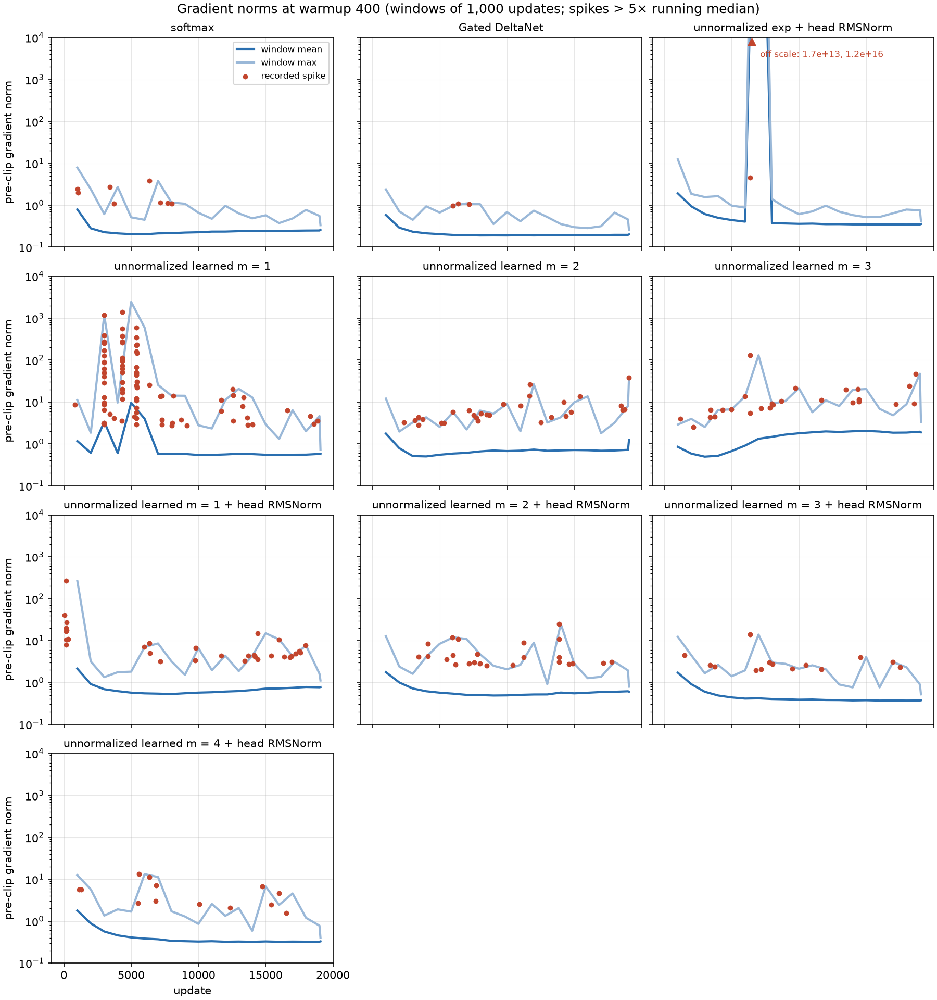

# Gradient spikes

A diagnostic record of gradient behavior; no comparison depends on it.

Where do gradient spikes occur in unnormalized learned-coefficient attention, with and
without head RMSNorm, and how do they compare with softmax, Gated DeltaNet, and
unnormalized exp with head RMSNorm? A **spike** is an update whose pre-clip gradient
norm exceeds 5× the median of the preceding 100 updates. All runs: `d_K = 64`, warmup
400, reference initialization, same data order, per-update gradient telemetry. Runs:
[`selection.yaml`](selection.yaml).

| Run | Spikes | Largest (× median) | Where |
| --- | ---: | ---: | --- |
| softmax | 8 | 19 | MLP, attention output projection |
| Gated DeltaNet | 3 | 6 | MLP |
| unnormalized exp + head RMSNorm | 3 | 12 | attention output projection, MLP |
| unnormalized learned m = 1 | 125 | 2,384 | Q/K/V |
| unnormalized learned m = 2 | 29 | 58 | coefficients |
| unnormalized learned m = 3 | 26 | 120 | coefficients |
| unnormalized learned m = 1 + head RMSNorm | 32 | 176 | Q/K/V, attention output projection |
| unnormalized learned m = 2 + head RMSNorm | 24 | 47 | coefficients, attention output projection |
| unnormalized learned m = 3 + head RMSNorm | 14 | 37 | attention output projection, coefficients |
| unnormalized learned m = 4 + head RMSNorm | 13 | 38 | attention output projection, coefficients |

- **The references spike rarely and mildly**, in the MLP and the attention output
  projection.
- **Learned coefficients without RMSNorm spike most, in the coefficient gradients, until
  the end of training.** m = 1 is the worst: its spikes sit in Q/K/V, clustered between
  updates 2,000 and 6,000.
- **Head RMSNorm shrinks these spikes and moves about half of them to the attention
  output projection.** The coefficients' share of the gradient norm falls from 0.89 to
  0.64 (m = 2) and from 0.99 to 0.52 (m = 3). These runs still spike more than softmax
  and Gated DeltaNet.
- **Some batches spike every run.** Update 6,376 spikes all runs from softmax to the
  learned kernels; all runs see the same batches in the same order.
- **Exp + head RMSNorm had two MLP-only gradient norms of 1.7e13 and 1.2e16 on B300**,
  with every other parameter group normal, so they look like numerical corruption rather
  than optimization. Clipping neutralized them.

Limits: one seed; spikes are relative to each run's running median; each window of 1,000
updates keeps the statistics of at most 20 spikes.

Regenerate: `scaffolds/transformer/.venv/bin/python results/diagnostics/gradient_spikes/plot.py`
