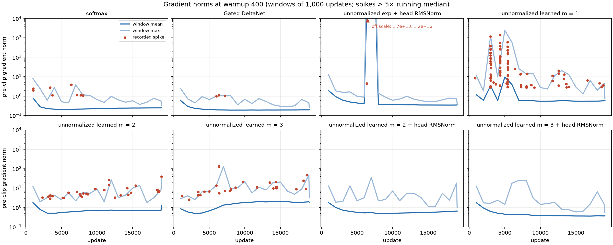

# Gradient spikes

Opened 2026-10-09. Unnormalized learned-coefficient attention with head RMSNorm showed
gradient spikes (window maxima 25–36 against medians near 0.5). Are such spikes also in
the references (softmax, Gated DeltaNet), in unnormalized exp with head RMSNorm, and in
unnormalized learned coefficients without RMSNorm? Does a small attention output before
head RMSNorm predict them?

All runs are `d_K = 64` at warmup 400 with their reference initialization, the same
data order, and the training telemetry of the shared trainer. Every update records the
pre-clip gradient norm and its norm per parameter group. A **spike** is an update whose
norm exceeds 5× the median of the preceding 100 updates; each validation record keeps
the complete statistics of up to 20 spikes in its window of 1,000 updates.
The two head RMSNorm runs predate telemetry and have only window means and maxima.

Runs, roles, and pinned inputs: [`selection.yaml`](selection.yaml).

| Run | Run ID | Terminal PPL | Spikes | Largest (× median) | Groups of recorded spikes |
| --- | --- | ---: | ---: | ---: | --- |
| softmax | `rc2fa883c75c0` | 13.737 | 8 | 19.1 | MLP 5, attention output projection 3 |
| Gated DeltaNet | `rf640fc13f3a8` | 13.583 | 3 | 5.9 | MLP 3 |
| unnormalized exp + head RMSNorm | `r8cfaa9398718` | 13.409 | 3 | 12, then 4.6e13 and 3.1e16 | attention output projection 1, MLP 2 |
| unnormalized learned m = 1 | `r3bb3e706c834` | 17.879 | 125 | 2,384 | Q/K/V 87, attention output projection 1 (88 recorded) |
| unnormalized learned m = 2 | `r8b936520deda` | 15.419 | 29 | 58 | coefficients 24, Q/K/V 4, embedding 1 |
| unnormalized learned m = 3 | `r6b480b3c9510` | 14.704 | 26 | 120 | coefficients 23, attention output projection 3 |
| unnormalized learned m = 2 + head RMSNorm | `rfb43d69f60dc` | 14.630 | — | window max 35.6 | — |
| unnormalized learned m = 3 + head RMSNorm | `r5ae483d40d62` | 13.988 | — | window max 25.2 | — |

- **The references spike rarely and mildly.** Softmax has 8 spikes, at most 19× its
  median, and none after update 8,021; Gated DeltaNet has 3, at most 6×. Their spikes
  sit in the MLP and the attention output projection.
- **Some spikes come from specific batches.** Update 6,376 spikes softmax (19×), Gated
  DeltaNet (6×), exp + head RMSNorm (12×), and learned m = 3 (120×); updates 3,412,
  5,987, and 7,176 recur across runs too. All runs see the same batches in the same
  order.
- **Learned coefficients without RMSNorm spike far more, in the coefficient gradients.**
  m = 2 and m = 3 have 29 and 26 spikes, up to 58× and 120×, almost all in the attention
  coefficients, and they continue to the end of training (m = 2: 58× at update 19,046).
  m = 1 is the most unstable: 125 spikes up to 2,384×, in the Q/K/V projections,
  clustered between updates 2,000 and 6,000.
- **Exp + head RMSNorm behaves like the references**, apart from two MLP-only gradient
  norms of 1.7e13 and 1.2e16 at updates 6,474 and 6,491 on B300. At both, every other
  parameter group had a normal gradient norm (0.1–0.4), the loss was finite, and the
  residual stream and attention outputs were unremarkable. A real gradient that large
  would also reach the residual stream and attention parameters, so these look like
  numerical corruption of the MLP backward pass rather than optimization, like the
  infinite gradient norm of the warmup-400 softmax run on B300
  ([`warmup_length`](../warmup_length/README.md)). Clipping neutralized them; the run's
  terminal perplexity matches its earlier identical run (13.411).
- **Learned coefficients spike with or without head RMSNorm.** After the first 1,000
  updates, learned m = 2 and m = 3 reach window maxima of 35.6 and 25.2 with head
  RMSNorm and 38.7 and 129.8 without it, against 3.8 for softmax and 1.1 for Gated
  DeltaNet. Whether the head RMSNorm runs' spikes are in the coefficients was not
  recorded.
- **Small attention outputs before head RMSNorm do not predict spikes.** In exp + head
  RMSNorm the largest RMSNorm gain `1/sqrt(mean(y^2) + eps)` grew to 935 at quiet updates
  but was 125–258 at its spikes.

Limits: one seed; spikes are relative to each run's running median; at most 20 spikes
per window keep their statistics (learned m = 1 recorded 88 of 125). Terminal
perplexities differ from the earlier identical runs by 0.002–0.011 for softmax, Gated
DeltaNet (against its ORCD run), exp + head RMSNorm, and learned m = 1, by 0.04 for
learned m = 2, and by 0.07 for learned m = 3 (14.704 against 14.630). Hardware: exp + head RMSNorm and learned m = 2 on four B300s; softmax on
four H100 PCIe; Gated DeltaNet on two B300s; learned m = 1 on two H100 PCIe to update
5,000, then four; learned m = 3 on two H100 PCIe to update 500, then two B300s.

## Open decision

Keep this as a diagnostic topic or discard it. Follow-ups not run: rerun learned
coefficients with head RMSNorm under telemetry to locate their spikes; inspect the
batches at updates 6,376 and 7,176; test whether the MLP-only norms recur on H100.

Regenerate: `scaffolds/transformer/.venv/bin/python results/exploratory/gradient_spikes/plot.py`
