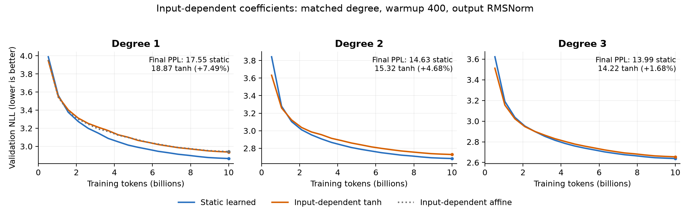

# Input-dependent polynomial coefficients

Opened 2026-10-07. Updated 2026-10-08. Home cluster: **Kennel**.

Does letting the current token choose polynomial coefficients improve
unnormalized attention with per-head output RMSNorm and 400 warmup steps?
This comparison includes an affine degree-one predictor, tanh predictors at
degrees one, two, and three, and a static learned control at each degree.

## Runs and method

| Role | Run ID | Coefficients | Status |
| --- | --- | --- | --- |
| Affine reference, m = 1 | `r9cf9589b9855` | Query-dependent affine projection | Complete, 19,074 updates |
| Static reference, m = 1 | `r03bfa6fd7b2e` | Input-independent, learned per layer and head | Complete, 19,074 updates |
| Primary, m = 1 | `r80300a4cd5fa` | `b_r + a_r tanh(w_r^T x_t)` | Complete, 19,074 updates |
| Primary, m = 2 | `rbfe1750cc24c` | `b_r + a_r tanh(w_r^T x_t)` | Complete, 19,074 updates |
| Primary, m = 3 | `r0bc57959ef6c` | `b_r + a_r tanh(w_r^T x_t)` | Complete, 19,074 updates |
| Static reference, m = 2 | `rfb43d69f60dc` | Input-independent, learned per layer and head | Complete, 19,074 updates |
| Static reference, m = 3 | `r5ae483d40d62` | Input-independent, learned per layer and head | Complete, 19,074 updates |

W&B: [tanh m = 1](https://wandb.ai/rafah-massachusetts-institute-of-technology/functional-memory/runs/e431fdc66cea454fa0a0297b2a33435b),
[tanh m = 2](https://wandb.ai/rafah-massachusetts-institute-of-technology/functional-memory/runs/344eba83b1e043c284e14d8b0a753526),
and [tanh m = 3](https://wandb.ai/rafah-massachusetts-institute-of-technology/functional-memory/runs/a3b484f37f624f908ed272388d4fe555).

Explicit runs, roles, and scientific input checksums are in [selection.yaml](selection.yaml).
Measurements live under [the attention study](../../../experiments/attention_scaling/README.md).
All runs use the canonical `transformer_reference` initialization, QK normalization,
unnormalized attention, per-head output RMSNorm, `d_K = d_V = 64`, 10 layers,
width 1024, 16 heads, seed 0, BF16 training, effective batch 256, global microbatch
64, the same FineWeb data order, 19,074 updates (10.0B tokens), and learning rates
3e-4 to 3e-5 with 400 warmup updates. The train and evaluation manifest hashes
match for all seven runs. Coefficient parameters are FP32 and excluded from
weight decay. Each degree-matched pair has the same optimizer, data, and training
settings; execution source, hardware, and attention implementation differ.

The predictors use the incoming attention activation after the block input
RMSNorm, independently per layer and head. The affine predictor starts at zero
projection weights and bias `(1, 1)`. The tanh runs learn
`c_r(x_t) = b_r + a_r tanh(w_r^T x_t)` for every order `r = 0, ..., m`.
There is no bias inside tanh. Initial values `b_r = 1/r!`, `a_r = 1`, and
`w_r = 0` reproduce the degree-`m` Taylor kernel exactly. The static controls
start with the same Taylor coefficients. The amplitude bounds the modulation
for fixed parameters, but this bound changes as the amplitude learns.

The tanh runs used four GPUs each at nice 0: B300 on `standard` for degree one,
H100 on `long` for degree two, and B300 on `long` for degree three. They used
source `254cab946e637cd6cd5c004b6976351b1dee3651` and direct fused polynomial
attention. All passed CPU and GPU checks, canonical initialization checks,
full-recipe pilots with validation, and exact fresh-process checkpoint resumption.
The direct fused kernel also passed all 12 standalone H100 GPU checks across
the three degrees; [qualification evidence](../../../scaffolds/transformer/validation/runs/query-tanh-h100/tests.json)
is separate from production acceptance.

The [shared scaffold](../../../scaffolds/transformer/README.md#input-dependent-polynomial-coefficients)
defines the mechanism. Exact launch commands are in the
[study README](../../../experiments/attention_scaling/README.md#input-dependent-coefficient-comparison).

## Findings and limitations

All three tanh models finish worse than their degree-matched static controls.
The deficit shrinks with degree: **7.49%**, **4.68%**, and **1.68%** higher
validation perplexity for degrees one, two, and three. Tanh degree one improves
only 0.44% over the earlier affine predictor. Increasing degree helps both
families; the improvement across tanh degrees does not establish a benefit from
input dependence.

<!-- BEGIN GENERATED RESULTS -->

| Degree | Coefficients | Terminal validation NLL | Terminal PPL | Best validation PPL | Best step |
| --- | --- | ---: | ---: | ---: | ---: |
| 1 | static | 2.865257 | 17.553569 | 17.553569 | 19,074 |
| 1 | affine | 2.941899 | 18.951802 | 18.951802 | 19,074 |
| 1 | tanh | 2.937520 | 18.869000 | 18.869000 | 19,074 |
| 2 | static | 2.683093 | 14.630271 | 14.630271 | 19,074 |
| 2 | tanh | 2.728845 | 15.315193 | 15.315193 | 19,074 |
| 3 | static | 2.638175 | 13.987648 | 13.987648 | 19,074 |
| 3 | tanh | 2.654816 | 14.222367 | 14.222367 | 19,074 |

<!-- END GENERATED RESULTS -->

All seven runs completed 10.0B tokens. Terminal and validation-best metrics
coincide at update 19,074. Each validation NLL curve decreases at all 20 recorded
points, and all recorded attention diagnostics are valid and finite. The tanh
runs initially lead their static controls, but the static curves overtake them
by update 3,000 for degrees one and two, and update 5,000 for degree three.
There is no recorded validation-loss spike or numerical failure explaining the
final difference.



[PDF](learning_curves.pdf) · [Derived measurements and input checksums](summary.csv)

Final sampled training NLL is also worse with tanh: **2.971880 vs 2.898437**,
**2.758711 vs 2.710249**, and **2.681989 vs 2.664114** for degrees one, two, and
three. These are means of seven logged training batches over updates
19,001–19,074, not evaluations of the whole training dataset. Their gaps to
validation NLL are similar within each pair, so the observed deficit is not
primarily a larger training–validation gap. A more expressive parameterization
can contain the static model without the optimizer finding an equally good
solution within this training budget.

The learned input-dependent branches are active. On the final pinned diagnostic
sequence, mean coefficient standard deviation across tokens is about 0.22 for
each degree. Some branches are also strongly saturated: the fractions of
layer/head/order branches with `|mean_tanh| > 0.99` are 33.75%, 20.42%, and 10.47%.
These are fractions of branches, not fractions of tokens. The approximate mean
local tanh derivatives inferred from coefficient moments are 0.154, 0.228, and
0.208. These statistics cover one fixed held-out sequence of 2,048 prediction
tokens. They show substantial saturation alongside input variation, but do not
establish saturation as the cause of the performance deficit. They regenerate
from recorded coefficient means, standard deviations, biases, and amplitudes;
no checkpoint is required.

This is one seed and one bounded nonlinear parameterization under a shared
optimizer recipe. It does not establish that input dependence cannot help.
Neither predictor adds GDN's write gates, forgetting, or delta correction.
These runs remain outside the canonical plot selections.

## Regeneration

From a checkout containing the committed run measurements:

```bash
scaffolds/transformer/.venv/bin/python -m scaffolds.records refresh results/exploratory/input_dependent_coefficients
scaffolds/transformer/.venv/bin/python -m results.exploratory.input_dependent_coefficients.plot
```

The plot verifies pinned scientific inputs before producing the three-panel
figure, CSV, and generated table. `summary.csv` contains terminal and
validation-best metrics separately, matched-control differences, and diagnostic
statistics. Learning curves use every recorded validation, without smoothing.
Metrics and full coefficient diagnostics stay in each run's `metrics.jsonl`.

## Open decision

The affine and tanh comparisons are complete and show no benefit over matched
static coefficients with this recipe. Decide whether to promote this negative
comparison into the maintained attention results, investigate the optimization
and saturation behavior within this topic, or discard the topic and its runs.
