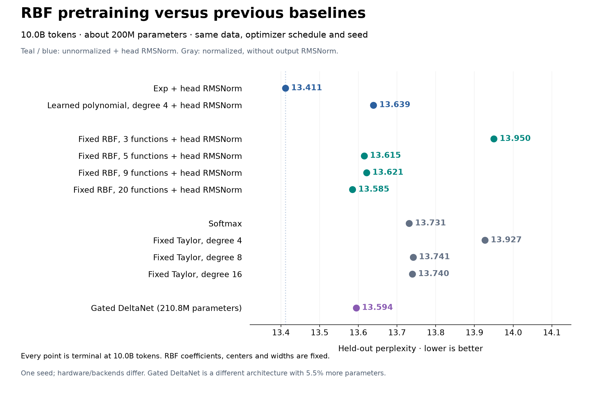

# RBF basis counts and coefficient learning

Opened: **2026-10-21**. Home cluster: **Kennel**.

## Question and method

How do the number of scalar Gaussian RBFs and learning their coefficients affect
unnormalized-attention language-model quality and computational cost with
per-head output RMSNorm? The [study](../../../experiments/attention_scaling/README.md#fixed-rbf-basis-counts)
owns the frozen recipes, methods, and exact launch commands. All 13 production
runs below completed. They remain exploratory and enter no canonical selection.

The scalar functions approximate `exp(score)` under a Gaussian fitting measure.
Centers and widths stay fixed. Fixed coefficients retain their fitted values;
learned coefficients are either static per layer/head or conditioned on the query
activation. Fit quality alone is not a language-model result.

## Fixed coefficients at 10B tokens

All four fixed-RBF runs completed 10,000,269,312 training tokens. Their terminal
validation perplexities are **13.950, 13.615, 13.621, and 13.585** for 3, 5, 9,
and 20 RBFs, respectively. Twenty RBFs is best among these single-seed RBF runs,
but exp with matching head RMSNorm remains stronger at **13.411**.

The exact baseline IDs are pinned in `selection.yaml`. The dot-product models
match shape, reference initialization, QK normalization, optimizer schedule,
global batch, seed, and training/evaluation data hashes. Normalized references
omit output RMSNorm; the exp and learned degree-four controls use it. RBF
coefficients are fixed, while the polynomial control learns its coefficients.
Gated DeltaNet is an architecture reference with its own initialization and
210.8M parameters, 5.5% more than RBF. Historical backends, microbatches,
rematerialization, GPU counts, and GPU models differ: this compares quality,
not measured runtime. A single seed does not establish a robust advantage.



[PDF](comparison.pdf) · [Exact values](summary.csv)

<!-- BEGIN RBF COMPARISON -->
| Mechanism | Run ID | Tokens (B) | Validation PPL | Metric |
| --- | --- | ---: | ---: | --- |
| Exp + head RMSNorm | `r8ad66f3912c2` | 10.000 | 13.411 | terminal |
| Learned polynomial, degree 4 + head RMSNorm | `rc2b555b905dd` | 10.000 | 13.639 | terminal |
| Fixed RBF, 3 functions + head RMSNorm | `re530e0627233` | 10.000 | 13.950 | terminal |
| Fixed RBF, 5 functions + head RMSNorm | `r1b62a76f9b55` | 10.000 | 13.615 | terminal |
| Fixed RBF, 9 functions + head RMSNorm | `r46c3479f9681` | 10.000 | 13.621 | terminal |
| Fixed RBF, 20 functions + head RMSNorm | `rc28d7b48dc72` | 10.000 | 13.585 | terminal |
| Softmax | `rdf00da0866a8` | 10.000 | 13.731 | terminal |
| Fixed Taylor, degree 4 | `r67e1c33d19fa` | 10.000 | 13.927 | terminal |
| Fixed Taylor, degree 8 | `r10baef5d8428` | 10.000 | 13.741 | terminal |
| Fixed Taylor, degree 16 | `r697221e420ad` | 10.000 | 13.740 | terminal |
| Gated DeltaNet (210.8M parameters) | `rdf74e4289926` | 10.000 | 13.594 | terminal |
<!-- END RBF COMPARISON -->

## Shorter-budget cohorts

### Original 1× recipe

Four fixed-basis runs use 3,998,744,576 tokens, 7,627 cosine-schedule updates and
160 warmup updates. Two learned 9-RBF runs use the same model and optimization
recipe, with raw learned coefficients. The query-dependent model has additional
parameters and receives 4,028,104,704 tokens under the same 20-tokens-per-parameter
budget convention. It also has a slightly longer learning-rate schedule.

Static learning lowers perplexity from **16.058 to 15.864** relative to fixed
9-RBF. Query dependence reaches **15.762**. The latter difference is a modest
single-seed gain with a small token-budget difference. An intermediate checkpoint
from a 10B-token schedule is not a matched 1× control.

### Matched recipe

Three 9-RBF runs share Rafael's executed 15-layer, width-896 recipe, seed 42,
reference initialization, QK RMSNorm, optimizer, evaluation, and exactly
**3,968,860,160 tokens**. Learning uses relative fitted coefficients:
`c_j = s_j theta_j` for static weights and
`c_j(x) = s_j [b_j + a_j tanh(w_j^T x)]` for query-dependent weights.
The initial query projections match the audited polynomial reference's random draw.

Final perplexities are **14.635 fixed, 14.366 learned static, and 14.440
query-dependent**. Both learned variants improve on the fixed control; static
learning is better than query dependence in this matched, single-seed comparison.
These results cannot be directly compared with the original 1× cohort, which has
a different backbone, initialization, learning rate, seed, and evaluation recipe.
The table distinguishes terminal metrics from validation-best checkpoints.

<!-- BEGIN RBF COHORTS -->
| Recipe | Coefficients | Run ID | Tokens (B) | Terminal PPL | Best PPL (step) |
| --- | --- | --- | ---: | ---: | ---: |
| Original 1× | Fixed 3-RBF | `r4614f6fff21f` | 3.999 | 16.614 | 16.614 (7,627) |
| Original 1× | Fixed 5-RBF | `r0fbe4040cc36` | 3.999 | 16.064 | 16.064 (7,627) |
| Original 1× | Fixed 9-RBF | `r6e1b71e49350` | 3.999 | 16.058 | 16.058 (7,627) |
| Original 1× | Fixed 20-RBF | `r8f7f83e9b6ee` | 3.999 | 16.011 | 16.011 (7,627) |
| Original 1× | 9-RBF, learned static | `r55b028eb88a6` | 3.999 | 15.864 | 15.864 (7,627) |
| Original 1× | 9-RBF, learned query | `r564c8c864d15` | 4.028 | 15.762 | 15.762 (7,683) |
| Matched recipe | 9-RBF, fixed | `r4ef941dde7b9` | 3.969 | 14.635 | 14.630 (7,500) |
| Matched recipe | 9-RBF, static | `rd3711311e629` | 3.969 | 14.366 | 14.363 (7,500) |
| Matched recipe | 9-RBF, query | `r77e00510b1b0` | 3.969 | 14.440 | 14.437 (7,500) |
<!-- END RBF COHORTS -->

[Exact shorter-budget values](cohorts.csv)

## Implementation and limitations

The [scaffold qualification](../../../scaffolds/transformer/validation/README.md#native-triton-scalar-attention)
records the compiled-accumulation and native Triton speed measurements, independent
forward/gradient checks, and H100 pilots. The kernel uses an inlined scalar-function
callback, streaming rescaling, and fused per-head RMSNorm with the corresponding
epsilon adjustment. Synthetic compute benchmarks exclude data loading, evaluation,
checkpointing, and compilation; they are separate from scientific quality results.

Canonical measurements and execution records live under each run. Checkpoints and
logs remain on Kennel at their recorded locations. W&B histories are retained
locally where online project permissions prevented upload; W&B is not the source
of these tables. The completed runs retain their original recipes and source commits.

## Open decision

Whether to promote fixed-basis attention, coefficient learning, or input dependence
into maintained comparisons remains open. Larger basis counts improve the completed
10B results modestly; learning helps both shorter-budget cohorts, while the benefit
of query dependence changes with the recipe. More seeds and matched compute/quality
comparisons are needed before selecting a preferred mechanism.

## Regeneration

`selection.yaml` names and pins every reported run. Measurements remain under their
runs. From the repository root:

```bash
PYTHONPATH=. scaffolds/transformer/.venv/bin/python results/exploratory/rbf_basis/compare.py
```

The script verifies source hashes and comparison settings, then regenerates the
CSV tables, PNG/PDF figure, and README tables byte-identically. After a deliberate
selection or measurement update, refresh pins with
`python -m scaffolds.records refresh results/exploratory/rbf_basis` first.
