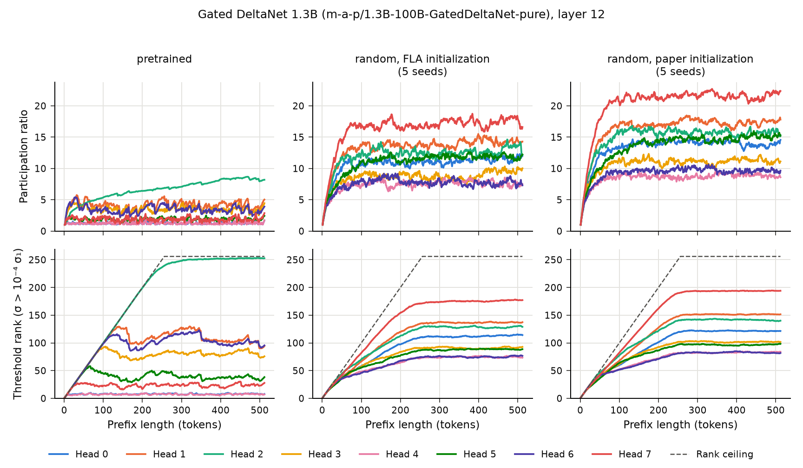

# Random Gated DeltaNet initialization and state rank

Opened 2026-10-01. Open decision: promote into
[`results/state_rank/`](../../state_rank/README.md) (replacing or adding to its
random DeltaNet controls) or discard.

The canonical random DeltaNet controls use FLA's reference initialization. Do the
state ranks change under the Gated DeltaNet paper's own initialization?

- **FLA** (canonical): Linear, short-convolution, and embedding weights N(0, 0.02);
  no residual rescaling.
- **Paper** ([NVlabs/GatedDeltaNet](https://github.com/NVlabs/GatedDeltaNet)
  `lit_gpt`, `mamba_init`): Linear and short-convolution weights at PyTorch's
  default `U(±1/√fan_in)`, MLP down projection also divided by `√(2·24)`, embeddings
  N(0, 0.02). Its name-matched rescaling does not reach the recurrent `o_proj`.
- Both: norm scales 1; the same `A_log` and `dt_bias` distributions, and, for a given
  seed, the same draws.

Same pinned `m-a-p/1.3B-100B-GatedDeltaNet-pure` architecture, inputs, and analysis as
the canonical figure; five seeds per initialization. Runs and roles:
[`selection.yaml`](selection.yaml). `r3793d9db5bf8` repeated the pretrained
condition as the launch preflight and matched the retained baseline.



[PDF](state_rank_init.pdf) · [Per-layer summary](summary.csv)

## Results

Final token, averaged over heads and inputs (and seeds for random), layer 12:

| Condition | Participation ratio | Threshold rank |
| --- | ---: | ---: |
| Pretrained | 3.78 | 74.9 / 256 |
| Random, FLA initialization | 11.51 | 111.1 / 256 |
| Random, paper initialization | 14.33 | 121.6 / 256 |

- **The paper initialization raises random ranks at every layer:** participation
  ratio by 17–28% (median 23%), threshold rank by 8–14% (median 11%). Seed ranges
  overlap at 23 of 24 layers for participation ratio and all 24 for threshold rank.
- **The pretrained comparison is unchanged.** Pretrained participation ratio is below
  both random means at all 24 layers; threshold rank is below both at 15 of 24.
- **Head ordering is the same under both initializations,** which share their decay
  gate draws per seed, consistent with the gates setting each head's rank.

## Limits

- The checkpoint is M-A-P's, whose own training initialization is undocumented; the
  paper's rule is applied to its architecture, not to the paper's 1.3B model.
- Five seeds per initialization; Llama's random controls are unchanged (its
  checkpoint was pruned from a larger model, so it has no random initialization).

## Regenerate

```bash
PYTHONPATH=. scaffolds/state_rank/.venv/bin/python -m results.exploratory.state_rank_init.plot
```

Run in the Kennel primary checkout, which holds the pinned archives.
