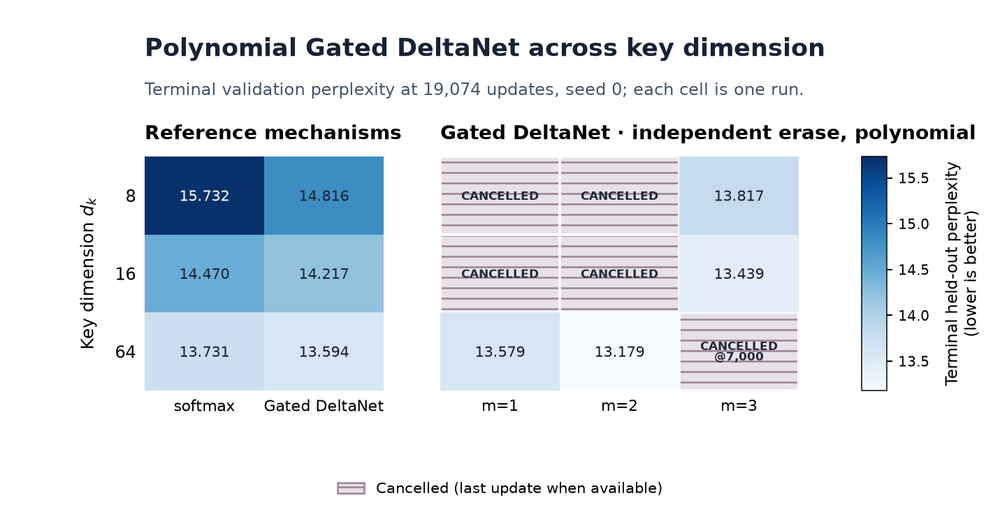
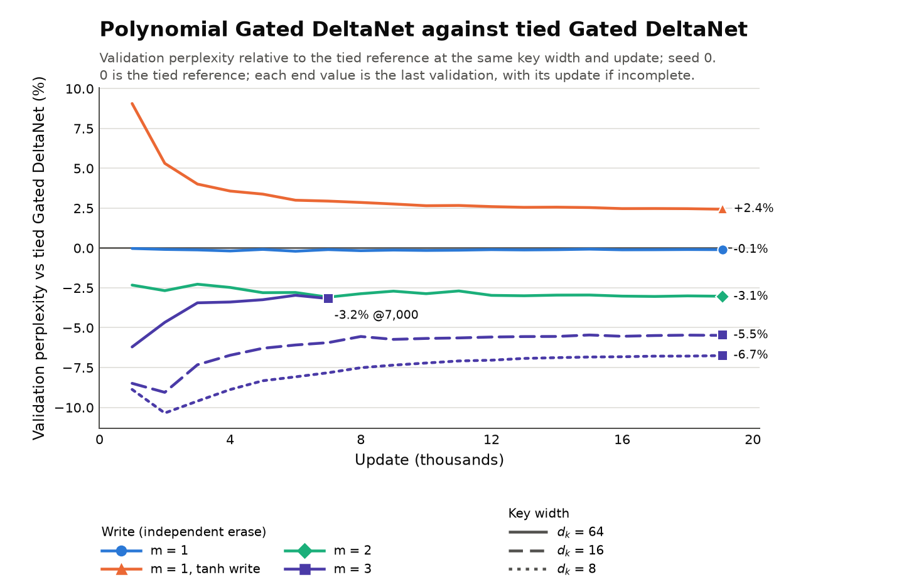

# Polynomial Gated DeltaNet

Do independent erasure and higher-degree memory improve Gated DeltaNet (GDN), and do
they let narrow keys match wide ones? Terminal held-out perplexity of 200M models after
19,074 updates (10.0B tokens), seed 0. No training happens here; the figures and
tables are built from the runs named in [`selection.yaml`](selection.yaml). Home
cluster: Kennel. Cancelled runs retain their cells and any recorded measurements.

## Model

The GDN block keeps width-four causal convolutions and SiLU on Q/K/V, L2-normalized
queries and keys, Mamba-2 scalar decay `alpha_t`, gated output RMSNorm, and no RoPE.
Every gate is a scalar per token, layer, and head.

- **Tied GDN (reference):** `S_t = alpha_t (I - beta_t k_t k_t^T) S_{t-1} + beta_t k_t v_t^T`,
  `beta_t = sigmoid(W_beta x_t)`; the read is `S_t^T q_t / sqrt(d_K)`.
- **Independent erase (`m = 1`):** the erase gate `lambda_t = sigmoid(W_lambda x_t)`
  replaces `beta_t` in `I - lambda_t k_t k_t^T`. `W_lambda` starts as a copy of
  `W_beta`, so the model starts identical to tied GDN.
- **Polynomial memory (`m >= 2`):**

  ```text
  F_t(q) = alpha_t F_{t-1}(P_t q) + v_t sum_(r=0..m) beta_{t,r} <q, k_t>^r,   P_t = I - lambda_t k_t k_t^T
  read_t = F_t(q_t) / sqrt(d_K)
  ```

  `beta_{t,1}` is the sigmoid write above; each added order `r = 0, 2, ..., m` has
  `beta_{t,r} = tanh(W_r x_t)` with `W_r` zero at the start, so every polynomial model
  starts as its `m = 1` control. Unrolled, token `i` contributes
  `(prod_(j=i+1..t) alpha_j) sum_r beta_{i,r} s_ti^r v_i` with
  `s_ti = q_t^T P_t ... P_{i+1} k_i`: with `lambda = 0` and `alpha = 1` this is
  unnormalized polynomial attention whose coefficients depend on the key (writing)
  token.
- **Tanh write:** degree one with `beta_t = tanh(W_beta x_t)` (signed writes from the
  first update) and the sigmoid independent erase gate.

## Explicit configurations

This collection uses GDN inside the shared JAX Transformer backbone. The native
FLA GDN baselines in the Transformer++ study use a different full model and recipe;
they are not a PyTorch translation of this collection's model. The table below
specifies the tied, `d_K = 64` reference selected here and the native baselines.
The other widths and polynomial variants retain their frozen per-run settings.
Softmax references in this collection use QK-norm; GDN has its own Q/K normalization.

| Setting | Shared-scaffold GDN reference | Native FLA GDN in Transformer++ |
| --- | --- | --- |
| Implementation | Shared JAX/Flax Transformer with FLA's fused GDN recurrence | Upstream PyTorch `GatedDeltaNetForCausalLM` |
| Parameters | 210,843,584 | 200,205,878 |
| Layers / hidden width | 10 / 1,024 | 9 / 1,024 |
| Heads / key width / value width | 16 / 64 / 64 | 3 / 256 / 512 |
| SwiGLU intermediate width | 3,008 | 2,816 |
| Vocabulary / embeddings | 32,000 / untied input and output | 32,000 / untied input and output |
| Q/K processing | Width-4 causal convolution, SiLU, then per-head L2 normalization | Same operations; native FLA implementation |
| GDN gates and readout | Sigmoid write/erase gate, Mamba-2 decay, gated output RMSNorm | Same gate families; native FLA implementation |
| Position encoding | None; no RoPE | None; no RoPE |
| Normalization epsilon | `1e-6` | `1e-6` |
| Initialization | `gated_deltanet_reference`; detailed below | Native FLA constructor; detailed below |
| Data / tokenizer | EOS-packed FineWeb-Edu / Llama-2 | Same packed train and evaluation manifests / tokenizer |
| Context / global batch | 2,048 prediction tokens / 256 sequences | 2,048 prediction tokens / 256 sequences |
| Tokens per optimizer update | 524,288 | 524,288 |
| Training updates | 19,074 | 7,570 (1×) or 18,925 (2.5×) |
| Training tokens | 10,000,269,312 | 3,968,860,160 or 9,922,150,400 |
| Optimizer / peak and minimum LR | AdamW / `3e-4`, `3e-5` | AdamW / `3e-4`, `3e-5` |
| Adam betas / epsilon | `(0.9, 0.95)` / `1e-8` | `(0.9, 0.95)` / `1e-15` |
| Schedule / warmup | Linear warmup then cosine / 400 updates | Linear warmup then cosine / 379 or 946 updates (5%, rounded) |
| Weight decay / clipping | Selective `0.1` / global gradient norm 1 | Selective `0.1` / global gradient norm 1 |
| Precision | BF16 computation, FP32 parameters and optimizer state | BF16 autocast, FP32 parameters and optimizer state |
| Model seed / data shuffle seed | 0 / 0 | 42 / 0 |
| Validation sample | 7 batches: 1,792 sequences, 3,670,016 tokens | 19 batches: 4,864 sequences, 9,961,472 tokens |
| Validation cadence | Every 1,000 updates and at the end | 1×: every 100 through 1,500, then 500; 2.5×: every 250 through 3,750, then 1,250; both evaluate at the end |

Sources: the selected [shared-scaffold recipe](../../experiments/attention_scaling/runs/rdf74e4289926/config.yaml)
and [initialization implementation](../../scaffolds/transformer/models/initialization.py),
and the frozen native [1× recipe](../../experiments/transformer_pp/runs/r6b38709ed8d3/config.yaml),
[2.5× recipe](../../experiments/transformer_pp/runs/r2ebc05346f44/config.yaml),
and [native study documentation](https://github.com/rafaelhanashiro/functional-memory/blob/e1f3e9615771119abdef80294dc45dcc1e2bcf1f/experiments/transformer_pp/README.md#native-gated-deltanet-baseline).
These native recipes are separate from Transformer++'s default dot-product recipe:
they do not inherit its truncated initialization, QK RMSNorm, tuned LR, or 6% warmup.

**Initialization.** The shared-scaffold GDN reference initializes embeddings and the
LM head with untruncated normal standard deviation 0.02, linear weights with
`Uniform(-1/sqrt(fan_in), 1/sqrt(fan_in))`, and divides the FFN down projection by
`sqrt(2 * layers)`. Its GDN output projection is not residual-scaled; short convolutions
keep PyTorch's default initialization. Native FLA initializes linear, embedding and
convolution weights with untruncated normal standard deviation 0.02, without residual
projection rescaling. Both use unit normalization gains and Mamba-2 initialization
for the decay/time-step parameters.

**Weight decay.** In both current recipes, projection matrices (including gate
projections), FFN matrices, the untied LM head and convolution kernels receive
decay 0.1. Token embeddings, normalization gains, biases, `A_log` and `dt_bias` do
not. In the native runtime this also honors upstream `_no_weight_decay` markers;
the instantiated optimizer groups are checked during acceptance.

### Adaptations of the native reference

The upstream sources are FLA `516143e`, Flame `24dea91` and TorchTitan `0b44d4c`,
pinned in each native recipe. Flame's `flame/models/fla.toml` is a **generic FLA
training example**, not a GDN-specific recipe tuned for this model size.

- **Model size and data:** scale the native architecture to 200.2M parameters while
  retaining its per-head dimensions, value expansion, FFN sizing rule, convolutions,
  gates and initialization. Use the project's packed corpus, tokenizer and validation
  split. The global batch stays 256; one GPU accumulates 32 microbatches of eight.
- **Token budget:** use the study's explicit 7,570/18,925-update horizons instead
  of carrying over the generic 20,480-update horizon. At this batch size, 20,480
  updates would consume 10,737,418,240 tokens (about 2.705×, not 2.5×). The cosine
  schedule follows the chosen horizon; warmup remains 5%, giving 379/946 updates
  instead of the generic horizon's 1,024.
- **Decay exclusions:** replace the initial native run's all-parameter AdamW decay
  with the explicit selective policy above. The decay strength remains 0.1.
- **Evaluation:** use the project's early/regular validation cadence, the same
  fixed 19-batch held-out sample, and a final evaluation. Validation does not consume
  training tokens or advance the training data cursor.
- **Preserved optimizer choices:** keep peak/minimum LR `3e-4`/`3e-5`, betas
  `(0.9, 0.95)`, epsilon `1e-15`, clipping at 1, and the reference's scheduler indexing.
  No native GDN LR sweep established these values as optimal.

The budget and decay changes were made together, so their effects are not isolated
by comparing native runs. Comparisons with this collection additionally change
architecture, parameter count, initialization, warmup, Adam epsilon, seed and the
number of validation batches. Even with the same dataset, these are comparisons
of complete recipes, not controlled tests of the scaffold or decay policy.

<!-- BEGIN GENERATED RESULTS -->
### Terminal perplexity

15 cells: 10 complete, 0 incomplete, 0 pending, 4 cancelled, 1 not run, 0 failed.



[PDF](terminal_ppl.pdf)

| d_K | softmax | Gated DeltaNet | GDN m = 1 | GDN m = 2 | GDN m = 3 |
| ---: | ---: | ---: | ---: | ---: | ---: |
| 8 | 15.732 | 14.816 | cancelled | cancelled | 13.817 |
| 16 | 14.470 | 14.217 | cancelled | cancelled | 13.439 |
| 64 | 13.731 | 13.594 | 13.579 | 13.179 | — |

### Against tied Gated DeltaNet



[PDF](validation_gap.pdf) · [Per-run measurements](summary.csv)

### Degree-one variants (d_K = 64)

| Erase gate | Linear write | Run | Terminal PPL | vs tied reference |
| --- | --- | --- | ---: | ---: |
| Tied to the write gate | sigmoid | `rdf74e4289926` | 13.594 |  |
| Tied to the write gate | sigmoid | `rf640fc13f3a8` | 13.583 | -0.08% |
| Independent | sigmoid | `rf7341031e3d5` | 13.579 | -0.11% |
| Independent | tanh | `rf65d38ec0552` | 13.927 | +2.44% |
<!-- END GENERATED RESULTS -->

## Findings

- **Quadratic memory gives the lowest canonical `d_K = 64` perplexity:** 13.179, 2.95%
  below its independent-erase control (13.579) and 3.06% below tied GDN (13.594). The
  best `d_K = 64` attention run in [attention scaling](../attention_scaling/README.md) is
  exp with head RMSNorm (13.411); softmax is 13.731.
- **Cubic memory makes narrow keys competitive:** at `d_K = 16` it reaches 13.439,
  5.5% below tied GDN at the same width (14.217) and below tied GDN at `d_K = 64`. At
  `d_K = 8` it reaches 13.817, 6.7% below tied GDN (14.816) and 12.2% below softmax
  (15.732). The width-matched independent-erase controls were cancelled before training; at `d_K = 64`
  independent and tied erase differ by 0.1%.
- **The polynomial gain holds through training.** Against tied GDN, quadratic
  `d_K = 64` stays between -2.3% and -3.1% from update 1,000 onward.
- **Independent erase is a near-tie with tied erase:** 13.579 against 13.594 and
  13.583, two tied runs of one recipe on H200 and B300.
- **A tanh linear write hurts:** 13.927, 2.6% above the sigmoid control. Against tied
  GDN it starts 9% behind at update 1,000 and ends 2.4% behind.
- **The order-0 write dominates the gradient.** Polynomial runs clip far more often
  than linear ones (at most 0.5% of updates): quadratic `d_K = 64` 95.6% of updates,
  cubic `d_K = 16` 27.4%, and cubic
  `d_K = 8` 1.8%. In every polynomial run the order-0 write projection carries almost
  all of the gradient norm (1.76 of 1.77 in quadratic's final window). With clipping
  at norm 1, this scales every other parameter's update down by the same factor.

## Cancelled runs

No polynomial GDN runs remain queued. The width-matched controls at `d_K = 8`
and 16 (independent erase `m = 1`, quadratic `m = 2`) were cancelled before training.
All four remain selected with their recipes.

## Limits

- One seed. Two tied GDN runs of one recipe differ by 0.08%, so smaller differences
  are not established.
- Arithmetic differs by mechanism: tied GDN uses FLA's `chunk_gated_delta_rule`,
  independent erase and tanh writes use FLA chunks with local independent-gate WY
  kernels, and polynomial runs use local transported-score Triton kernels. Hardware
  differs too (H200, B300, and H100); each record lists
  its attempts.
- Each added order adds 163,840 parameters: quadratic `d_K = 64` has 211.3M against
  210.8M for tied GDN (+0.2%). At `d_K = 8` and 16 the models have 192.4–195.7M.
- The `d_K = 8` and 16 comparisons use tied GDN; their independent-erase
  controls were cancelled before training.
- The order-0 gradient also inflates clipping, so polynomial and linear runs train
  with different effective step sizes. Whether limiting it helps is untested.

## Reproduce

```bash
uv sync --project scaffolds/transformer --locked --extra cuda --link-mode hardlink
PYTHONPATH=. scaffolds/transformer/.venv/bin/python -m scaffolds.records refresh results/gdn_polynomial
PYTHONPATH=. scaffolds/transformer/.venv/bin/python -m results.gdn_polynomial.plot
```

The plot checks every pinned input and each recipe's mechanism, width, erase gate,
write, and degree, then writes both figures, [`summary.csv`](summary.csv) (terminal,
validation-best, and last-validation metrics, differences from tied GDN and from each
run's control, parameter counts, and gradient clipping), and the generated tables. No
GPU or dataset needed. Recipes, records, and launch commands are in the
[attention study](../../experiments/attention_scaling/README.md#polynomial-gated-deltanet).
