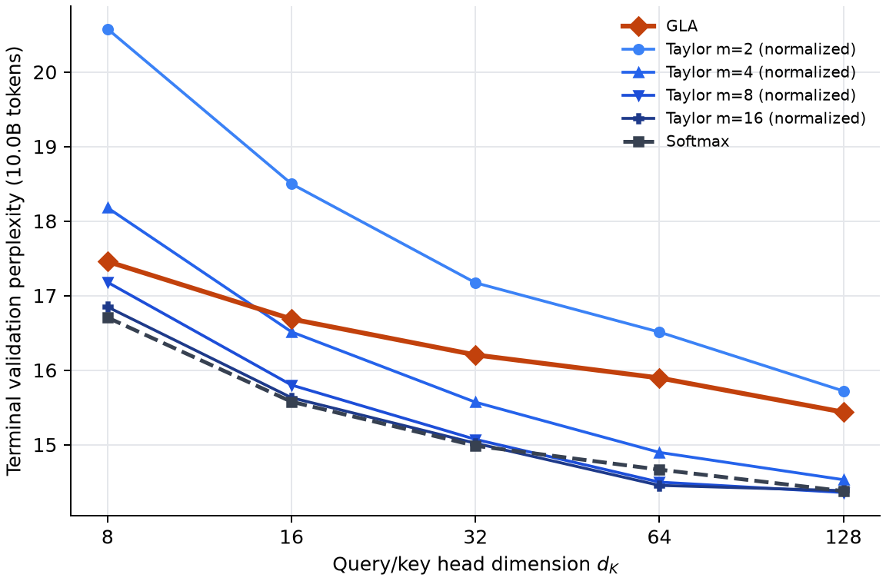

# Gated linear attention across key width

[Selected runs and source hashes](selection.yaml) · [Run index](../../experiments/attention_scaling/runs.csv) · [Execution guide](../../experiments/attention_scaling/README.md)

How does gated linear attention (GLA) scale with key width `d_K`, against softmax
and normalized Taylor attention on the same 200M backbone? Terminal held-out
perplexity after 19,074 updates (10.0B tokens), seed 0.

## Results

| d_K | Parameters | GLA | Softmax | GLA − softmax | Taylor m=2 | m=4 | m=8 | m=16 |
| ---: | ---: | ---: | ---: | ---: | ---: | ---: | ---: | ---: |
| 8 | 192.2M | 17.46 | 16.71 | +0.75 | 20.58 | 18.18 | 17.18 | 16.85 |
| 16 | 194.9M | 16.69 | 15.58 | +1.11 | 18.50 | 16.51 | 15.80 | 15.63 |
| 32 | 200.2M | 16.20* | 14.99 | +1.22 | 17.17 | 15.57 | 15.07 | 15.02 |
| 64 | 210.7M | 15.90 | 14.67 | +1.23 | 16.51 | 14.90 | 14.50 | 14.45 |
| 128 | 231.9M | 15.44* | 14.38 | +1.06 | 15.72 | 14.53 | 14.36 | 14.38 |

\* Old run (weight decay on all parameters); its selective-decay rerun has not run
yet. All other GLA values use selective decay.



[PDF](perplexity_vs_key_dimension.pdf) · [summary.csv](summary.csv)

- **GLA improves with width** (17.46 → 15.44), less than softmax (16.71 → 14.38).
- **GLA trails softmax at every width:** by 0.75 at `d_K = 8` and 1.06–1.23 above it,
  despite having more parameters.
- **Against Taylor:** GLA beats `m = 2` at every width. From `d_K = 16` up it sits
  between `m = 2` and `m = 4`; at `d_K = 8` it beats `m = 4` and trails `m = 8` by 0.28.
- **Selective decay** moved GLA by +0.23 at `d_K = 8`, −0.03 at 16, and −0.00 at 64.

## Setup

- **GLA:** per head `S_t = diag(alpha_t) S_(t-1) + k_t v_t^T`, `o_t = q_t^T S_t`, with a
  rank-16 decay gate, RoPE on Q/K, per-head RMSNorm on the readout, and a SiLU output
  gate. No QK-norm. Fused Triton kernels adapted from OFM.
- **Backbone and data:** as in the [d_K × Taylor record](../key_dimension_taylor/README.md):
  10 layers, width 1024, 16 heads, `d_V = 64`, packed FineWeb-Edu, global batch 256,
  AdamW `3e-4` → `3e-5`, 2,000 warmup updates.
- **Comparisons:** width-matched softmax and normalized Taylor runs from that record.
  At `d_K = 64` they are the current-default runs (Taylor with QK-norm; softmax
  without QK-norm, selective decay); at other widths they are old runs.
- **Runs:** selective-decay runs trained on ORCD (2×H200); the two old runs on Kennel.
  Hardware, jobs, and checkpoints are in each run's `record.json`.

## Limits

- One seed per width.
- Not parameter-matched: wider keys add state and projections, and GLA adds gates
  and head normalization.
- On B300, the fused kernel's BF16-operand products run at TF32-level precision
  (4e-4 relative error, against 1e-7 on H100); see the
  [scaffold validation](../../scaffolds/transformer/validation/README.md).

## Reproduce

```bash
PYTHONPATH=. scaffolds/transformer/.venv/bin/python -m results.gla_key_dimension.plot
```
