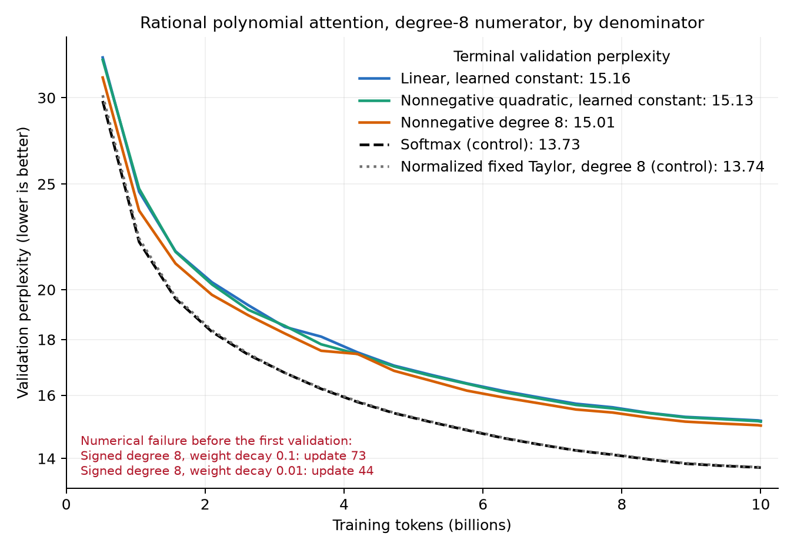

# Rational polynomial attention

Every normalized learned polynomial with one signed polynomial failed when a row sum
crossed zero ([degree chart](../attention_scaling/README.md), learned column). Does a
separate denominator polynomial let it train? The kernel is

```text
attn_ij = p_a(s_ij) / sum_(k<=i) p_b(s_ik),   p_a(s) = sum_(r<=8) a_r s^r
```

with cosine (QK-norm) scores and coefficients per layer and head. The denominator `p_b`
is one of:

| Denominator | `p_b(s)` | Sign |
| --- | --- | --- |
| signed degree 8 | `1 + sum_(1<=r<=8) b_r s^r` | signed |
| linear, learned constant | `b_0 + b_1 s` | signed |
| nonnegative quadratic, learned constant | `(c_0 + c_1 s)^2 + d_0^2`, every nonnegative quadratic | `>= 0` |
| nonnegative degree 8 | `(1 + sum_(r<=4) u_r s^r)^2 + (sum_(r<=4) w_r s^r)^2`, every nonnegative degree-8 polynomial with constant 1 | `>= 0` |

With a learned constant, numerator and denominator can scale together without changing
the attention weights. The training loss is

```text
NLL + lambda * sum over layers and heads [ a_0^2 + sum_(r>=2) r^2 a_r^2 (+ sum_(r>=1) r^2 b_r^2) ]
```

with `a_1` unpenalized. The `b_r` term, on the expanded denominator for the nonnegative
form, applies only where the runs table says so. An exactly zero row sum is a numerical
failure, recorded as such. The validation loss and the recorded training NLL exclude the
penalty; `metrics.jsonl` records the penalty term separately
([scaffold](../../scaffolds/transformer/README.md#attention-and-parameter-ownership)).

Settings shared by these runs, each a candidate for tuning later:

| Setting | Value | Recipe field |
| --- | --- | --- |
| Initialization | linear attention: `a_1 = 1`, other numerator coefficients 0, denominator 1, so attention starts at `sum_(j<=i) s_ij v_j / (i + 1)` | `model.attention_coefficient_initialization: linear` |
| Nonnegative denominator start, constant 1 | `u_r = 0`, `w_1 = 10^-3`, other `w_r = 0` (all-zero `w` gets no gradient), so `p_b = 1 + 10^-6 s^2` | fixed in `attention/rational_polynomial.py` |
| Nonnegative denominator start, learned constant | `c_0 = d_0 = 1/sqrt(2)`, `c_1 = 0`, so `p_b = 1` exactly | fixed in `attention/rational_polynomial.py` |
| Penalty weight `lambda` | 0.01 | `optim.coefficient_penalty` |
| AdamW weight decay (other parameters) | 0.1, the study's canonical value, or 0.01 as in the original specification; polynomial coefficients are never decayed | `optim.weight_decay` |

All runs: 200M, `d_K = 64`, QK-norm, transformer reference initialization, seed 0,
19,074 updates (10.0B tokens) with 400 warmup updates. Runs and roles:
[`selection.yaml`](selection.yaml); recipes and records:
[attention scaling study](../../experiments/attention_scaling/README.md).



## Results

The runs table gives terminal validation perplexity, which is also the validation best
for every completed run. The coefficient table uses each completed run's terminal
coefficients, per layer and head, over scores `abs(s) <= 3`. Variation is the
denominator's range there divided by its constant. The last two columns compare the
numerator's terms of order 2 and above with `a_1 s`, as the ratio of their largest
magnitudes, and give the penalty term at the end of training.

<!-- BEGIN GENERATED RESULTS -->

| Run | Denominator | Penalized denominator | Weight decay | Outcome |
| --- | --- | --- | ---: | ---: |
| `r90f6452bba82` | signed degree 8 | yes | 0.1 | fail @73 |
| `rc8aeb26cf795` | signed degree 8 | yes | 0.01 | fail @44 |
| `rd5ac0e3013e3` | linear, learned constant | no | 0.1 | 15.159 |
| `r05cd33157d94` | nonnegative quadratic, learned constant | no | 0.1 | 15.132 |
| `rbafa372b4e8b` | nonnegative degree 8 | yes | 0.01 | **15.006** |
| `rdf00da0866a8` | softmax (control) |  | 0.1 | 13.731 |
| `r10baef5d8428` | normalized fixed Taylor, degree 8 (control) |  | 0.1 | 13.741 |

| Validation PPL at update | 1,000 | 2,000 | 5,000 | 10,000 | 19,074 |
| --- | ---: | ---: | ---: | ---: | ---: |
| Linear, learned constant | 32.66 | 24.60 | 19.35 | 16.71 | 15.159 |
| Nonnegative quadratic, learned constant | 32.50 | 24.75 | 19.16 | 16.68 | 15.132 |
| Nonnegative degree 8 | 31.31 | 23.63 | 18.94 | 16.50 | 15.006 |
| Softmax | 29.79 | 22.12 | 17.43 | 15.12 | 13.731 |
| Normalized fixed Taylor, degree 8 | 30.16 | 22.28 | 17.47 | 15.14 | 13.741 |

| Denominator | Constant, median (min) | Variation over `abs(s) <= 3`, median (max) | Largest `abs(b_r)`, `r >= 1` | Numerator orders `>= 2` over `a_1 s`, median | Penalty term (nats) |
| --- | ---: | ---: | ---: | ---: | ---: |
| linear, learned constant | 1.19 (0.86) | 0.72 (3.4) | 0.62 | 5.8 | 5.0e-04 |
| nonnegative quadratic, learned constant | 1.48 (0.65) | 1.12 (3.9) | 1.1 | 4.8 | 5.0e-04 |
| nonnegative degree 8 | 1 (fixed) | 3.41 (13.2) | 0.0031 | 11.2 | 6.6e-04 |

<!-- END GENERATED RESULTS -->

## Findings

- **Signed degree-8 denominators fail; every other denominator trains to the end,** 1.3
  to 1.4 perplexity above softmax.
- **The nonnegative degree-8 denominator leads the rational runs throughout.** It
  finishes 0.13 and 0.15 below the quadratic and linear ones, which end within 0.03 of
  each other. All three trail softmax at every update, by 1.5 to 2.9 at update 1,000.
- **Learned constants grew rather than shrinking the common scale.**
- **Low-degree denominators vary moderately.** On the diagnostic sequence the linear
  denominator is negative for some keys, down to −2.1, but its row sums stayed at least
  0.74. The quadratic one stays at least 0.33, with row sums at least 0.56.
- **The degree-8 denominator's coefficients are small but still matter.** It varies most
  across the score range. On the diagnostic sequence its values come within 0.001 of
  zero, and row sums stayed at least 0.97.
- **No numerator is linear.** Within `abs(s) <= 3` the terms beyond `a_1 s` outweigh it
  severalfold in every run.

The diagnostic-sequence values (per-key denominators and row sums on the first held-out
sequence) were measured separately; `plot.py` does not regenerate them.

### Signed degree-8 denominator

Both signed degree-8 runs fail within the first 75 updates, with the forward loss,
gradient norm, and updated parameters all NaN in the same update. The training NLL fell
from 10.58 to 9.00 by update 30 in both (within 0.002 of each other), then rose to
9.4–9.5 at update 40 and to 9.70 at update 70 in the run that got that far, while
softmax fell to 8.20 and 7.02.

- **A zero denominator sum, inferred.** QK-norm bounds the scores and Adam bounds how far
  each coefficient moves, so the denominator cannot overflow. With bounded scores and
  coefficients, the only forward NaN the kernel produces is an exactly zero row sum. The
  failure state is NaN throughout, so the sum itself was not measured.
- **High-order terms can set the sign.** At `abs(s) = 5`, `s^8 = 3.9e5`: a degree-8
  coefficient of 1e-5 already adds ±3.9 to a denominator whose constant is 1.
- **`lambda = 0.01` does not prevent it,** at either weight decay.

## Limits

- One seed, one numerator degree, one penalty weight, one coefficient initialization.
- `rbafa372b4e8b` changes both the denominator penalty and the weight decay against the
  other completed runs, so neither effect is isolated.
- The signed and degree-8 runs ran on 4 H100s. The linear run moved from 4 to 2 H100s,
  and the quadratic run from 4 H100s to 2 B300s and then 2 H100s, after preemptions,
  with the same global batch.
- No checkpoint precedes either signed degree-8 failure, so the failing updates cannot be
  replayed.

## Regenerate

```bash
PYTHONPATH=. scaffolds/transformer/.venv/bin/python -m scaffolds.records refresh results/rational_polynomial
PYTHONPATH=. scaffolds/transformer/.venv/bin/python -m results.rational_polynomial.plot
PYTHONPATH=. scaffolds/transformer/.venv/bin/python -m pytest -q results/rational_polynomial/tests
```
