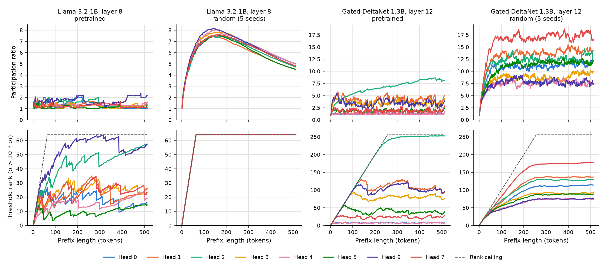

# State rank

How concentrated is the spectrum of an attention state in a pretrained model,
compared with randomly initialized copies of the same architecture?



[PDF](state_rank.pdf) · [Per-layer summary](summary.csv) · [Selected runs](selection.yaml) ·
[Study and execution](../../experiments/state_rank/README.md)

## Setup

- **Models and states.** Llama-3.2-1B's implicit softmax numerator state (post-RoPE
  keys, width 64) and Gated DeltaNet 1.3B's native 256 × 256 recurrent state, before
  output processing. Each has one pinned pretrained checkpoint and five random
  reference initializations (seeds 0–4).
- **Inputs.** Four fixed 512-token texts from the same source articles, tokenized
  natively; pretrained and random models of one architecture see identical tokens.
- **Measures.** For each state at every prefix length: participation ratio
  `(Σσ²)² / Σσ⁴`, and threshold rank, the number of singular values above
  `10⁻⁴ σ₁`. Ranks are computed per state and only then averaged.
- **Figure.** One layer per model (Llama 8 of 16, DeltaNet 12 of 24, zero-based);
  each line is one head, averaged over the four inputs. Random lines also average
  the five seeds at the same head index. The dashed line is the rank ceiling,
  `min(prefix, width)`.

At the final token, averaged over heads and inputs (and seeds for random):

<!-- state-rank:summary:start -->
| Setting | Layer | Participation ratio | Threshold rank |
|---|---:|---:|---:|
| Llama-3.2-1B, pretrained | 8 | 1.39 | 29.8 / 64 |
| Llama-3.2-1B, random | 8 | 4.76 | 64.0 / 64 |
| Gated DeltaNet 1.3B, pretrained | 12 | 3.78 | 74.9 / 256 |
| Gated DeltaNet 1.3B, random | 12 | 11.51 | 111.1 / 256 |
<!-- state-rank:summary:end -->

## Observations

- **Pretrained Llama is far more concentrated.** Participation ratio stays between
  about 1 and 2.4 throughout the input, and threshold rank ends around 30 of 64. Random models reach
  the full 64 modes by token 64 and hold them. The pretrained ranks are lower for both
  measures at every one of the 16 layers ([summary](summary.csv)).
- **Pretrained Llama heads specialize.** At layer 8, final threshold ranks range from
  about 15 to 57 across heads, while every random head saturates at 64 with nearly the
  same participation ratio. DeltaNet's pretrained heads span even more, from about 7
  to 253 of 256 at layer 12, but its random heads also differ (about 73–177 after
  averaging five seeds, since each draws its own decay parameters), so head spread
  alone is not evidence of learned specialization there.
- **In DeltaNet, the answer depends on the measure.** Participation ratio is lower
  than random at all 24 layers, but threshold rank is higher in 9 of them. At layer 20,
  participation ratio is 8.9 against 16.6 while threshold rank is 228 against 127:
  a few strong modes coexist with a long weak tail. Pretraining concentrates the
  dominant modes; it does not reduce every notion of rank.
- **Random networks are not a flat-spectrum baseline.** Their ranks vary with depth
  without any training, and random Llama's participation ratio peaks around token
  150 and then declines.

## Caveats

- Four fixed texts and one checkpoint per model; seed ranges describe the random
  initializations, not uncertainty about the pretrained model.
- Random models are fresh reference initializations, not the checkpoints' actual
  starting weights or a training trajectory.
- Random head curves average the same head index across independent seeds; head
  indices are not matched features. Compare absolute ranks only within an
  architecture, since the two states differ in kind and width.

## Regenerate

The numerical archives are ignored by Git and live on Kennel, so run this in the
primary checkout there:

```bash
uv sync --project scaffolds/state_rank --locked --link-mode hardlink
PYTHONPATH=. scaffolds/state_rank/.venv/bin/python -m results.state_rank.plot
```

It checks every pinned recipe and archive hash in `selection.yaml`, then rewrites
the figure, `summary.csv`, and the table above.
