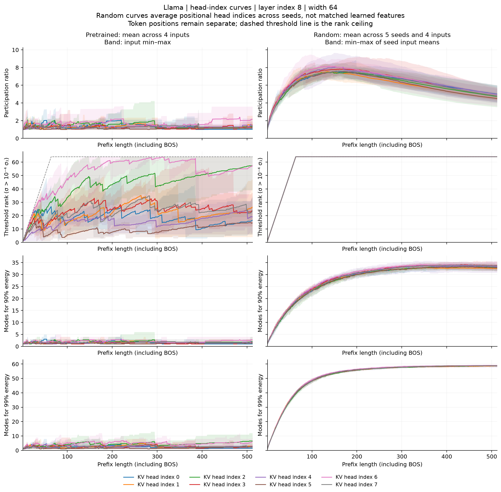
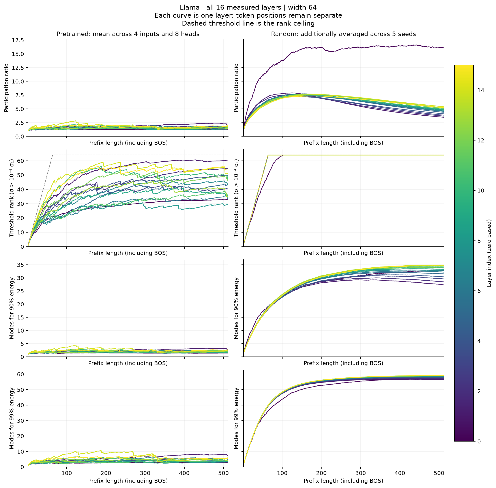

# Llama: pretrained and random weights

Both figures place pretrained and random models side by side. All curves average over sequences; random curves additionally average over initialization seeds. No separate input or seed figures are retained.

## Per-head rank at layer 8

Each color preserves a head index. Random head-index means describe independent initializations, not semantically matched heads. Shading is the input range for pretrained weights and the range of sequence-averaged seed curves for random weights.

[PDF](heads.pdf)

## Per-layer rank across tokens

Each color identifies one layer. Curves average over inputs and heads, plus seeds for random models.

[PDF](layers.pdf)

[Terminal rank versus depth](../depth_counts.png) · [Full comparison and provenance](../REPORT.md)
